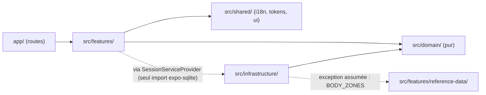
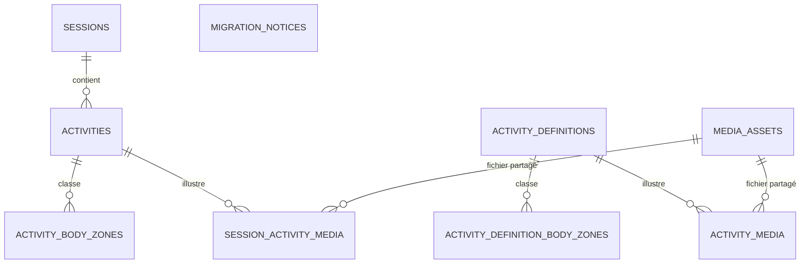
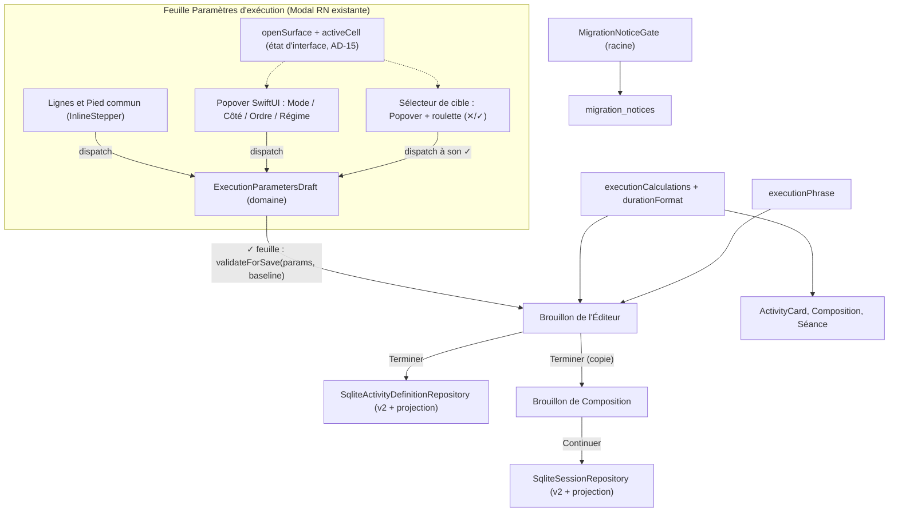

# Architecture Spine — PRE-4

Les identifiants `FR-xx-yy`, `NFR-xx`, Q, P et H renvoient au PRD et à `docs/preparation/PRE-4/bmad/questions-ouvertes.md`. Les chemins de code renvoient au code de départ. `QA-n` renvoie à la section « Questions ouvertes » ci-dessous. Une Rule qui décrit un état visé le dit ; sinon elle ratifie l'existant.

*Révision du 2026-10-17 (recette iPhone) : Q36 — une Cible Durée n'est pas obligatoirement un multiple de 5 s ; bornes 5..3535 inchangées, à la seconde. AD-1, AD-7, AD-13 et AD-16 corrigés (`nearestGridValue` devient un bornage, nom conservé ; politique « pas de base 5 » levée). Q35 — Cible à renseigner signalée par un fond `#FFF1F0` au lieu du contour (AD-1). Identifiants AD inchangés.*

*Révision du 2026-10-17 (recette iPhone, écarts E-10 et E-11) : Q37 — la roue d'un Sélecteur de la Feuille (Cible commune, Cible d'une ligne, Durée totale) s'affiche sans flèche, centrée horizontalement sur la page, sur voile, dans `WheelPickerOverlay`, composant PRE-3 accepté ; elle se ferme par ✕ ou ✓ seulement (voile non pressable). Les popovers de choix (Mode, Côté, Ordre, Régime) restent des `Popover` SwiftUI ancrés. AD-7 (décision, critères de S0, voie consignée) et AD-15 (familles de surfaces, T7, T8, T10, T19, T27 et ligne des Sélecteurs communs) annotés « Rendu remplacé par Q37 », historique conservé.*

*Révision du 2026-10-17 (recette iPhone, écart E-15) : Q41 — sur iOS, le Changement de côté, l'Ordre des côtés, la roue de « Durée d’une série » et la roue de Durée totale s'ouvrent dans un panneau sans flèche (`AnchoredPanel`), juste sous le champ, aligné à droite, au-dessus du contenu ; un toucher hors du panneau le ferme sans appliquer ; le Mode garde son `Popover` SwiftUI. AD-7 (décision, tests) et AD-15 (familles de surfaces, ligne des Sélecteurs communs) annotés « Présentation remplacée par Q41 », historique conservé. Les animations de la Feuille (fondu supprimé, révélation par le bas) ne relèvent d'aucune règle de la spine. Identifiants AD inchangés.*

*Révision du 2026-10-17 (décision de Hermann Q44, story 3.6) : la Cellule active et le Pied commun ne sont pas réalisés ; les cellules du tableau gardent leurs ± permanents. Dans AD-15, `activeCell` est sans objet (toujours `none`) ainsi que T4, T9, T11, T12 et le contrôle R-3.6-08 ; `selector(rowTarget(l))` existe sans `activeCell`, s'ouvre en touchant la valeur d'une cellule de Cible, et se ferme par ✓ (Cible de la ligne appliquée), ✕ ou appui extérieur sans application. AD-16 (`stepTarget`, `steppedValue`) s'applique aux ± des cellules. Identifiants AD inchangés.*

## Design Paradigm

**Architecture en couches à domaine pur**, ratifiée depuis le code existant `[ADOPTED]`.

| Couche | Répertoire | Contient | Peut dépendre de |
|---|---|---|---|
| Coquilles de routes | `app/` | Routes expo-router de quelques lignes | `src/features/` |
| Fonctionnalités | `src/features/` | Écrans, composants, contextes (`*Context.tsx` séparé de `*Provider.tsx`) | `src/domain/`, `src/shared/`, ports de `src/infrastructure/` exposés par les providers |
| Domaine | `src/domain/` | Types, validation, calculs, phrase, formateurs, machines de brouillon : fonctions pures | rien hors de lui-même |
| Infrastructure | `src/infrastructure/` | SQLite, migrations, repositories, médias locaux | `src/domain/` (et l'exception assumée `BODY_ZONES` de `src/features/reference-data/`) |
| Partagé | `src/shared/` | Lexique i18n, jetons, composants UI génériques (`InlineStepper`, `SegmentedControl`) | rien de métier |



## Invariants & Rules

### AD-1 — Cible typée, définie par le seul domaine

- **Binds:** ED-05, ED-06, ED-09, ED-11 à ED-19 ; FR-05-*, FR-06-*, FR-09-05, FR-18-01 à FR-18-08, FR-18-14 ; H7, H25.
- **Prevents:** deux encodages concurrents de « à l'échec » ; un `null` ou un 0 qui confond échec, vide et valeur (ch. 09 l. 1246) ; une donnée historique sans Cible supprimée ou convertie en échec faute de type pour la porter.
- **Rule:**
  - Un seul type `SeriesTarget` : `{ kind: "NUMBER", value }` | `{ kind: "FAILURE" }` | `{ kind: "UNSET" }`.
  - Écriture applicative d'une valeur saisie : `NUMBER` (entier ≥ 1, dans les bornes du Mode : 5..3535 à la seconde en Durée depuis Q36, 1..100 en Répétitions) ou `FAILURE` seulement. `UNSET` = Cible à renseigner (brouillon, ou héritée). Une Cible `NUMBER` héritée **positive** hors de ces bornes (hors plage : 5999 s, 150 ; une Cible de 7 s est valide depuis Q36) est écrite par `migration010` telle quelle (H7, Q15, Q21) et réenregistrée telle quelle tant qu'elle n'est pas modifiée (AD-13, H25). Une Cible héritée négative ou non entière n'existe jamais en v2 : l'Exercice est écarté par `migration010` (Q28, AD-4).
  - **Cible à renseigner héritée** : `UNSET` persisté en v2, écrit **uniquement** par `migration010` (AD-4). C'est la seule écriture d'`UNSET` autorisée. Toute écriture applicative la refuse (AD-13). L'Éditeur l'affiche `—` avec le signal de FR-10-06 (fond `#FFF1F0`, sans liseré, depuis Q35) ; ✓ de la Feuille et `Terminer` restent indisponibles jusqu'à saisie (H25, FR-09-05).
  - Mode : `"DURATION" | "REPETITIONS"`. Régime : `series.kind` (`UNIFORM` | `VARIABLE`).
  - **État visé** : `src/domain/activities/ExecutionParameters.ts` est le seul module qui définit ces types, leurs bornes, leur validation, leur sérialisation et leur lecture. Aujourd'hui `ExerciseExecutionMode` est défini dans `Session.ts:64` avec `TO_FAILURE`, et des listes de modes existent dans `ActivityDefinition.ts:194`, `validation.ts:69`, `DatabaseRows.ts:51`, `ExecutionParameters.ts:27`. Le socle (AD-14) les ramène au domaine ; `Session.ts` réexporte le type.
  - `LegacyExecutionMode` (`DURATION | REPETITIONS | TO_FAILURE`) n'existe que dans `readV1` (AD-3), les types de ligne SQL et `migration010`.
  - Aucun module ne teste une Cible par `=== null` ni par une valeur numérique sentinelle.

### AD-2 — Une seule machine de brouillon pour la Feuille

- **Binds:** ED-04, ED-07, ED-08, ED-10, ED-11, ED-12 ; FR-04-*, FR-07-* à FR-12-* ; H4, H5 (confirmée par Q29), Q29, H26, H27.
- **Prevents:** des composants d'interface qui gèrent eux-mêmes réserves, mémoire par Mode, retrait ou annulation, et qui divergent de la règle.
- **Rule:**
  - `src/domain/activities/ExecutionParametersDraft.ts` reste l'unique machine d'état du Brouillon de la Feuille. Toute transition y est une fonction pure : Régime, Cible d'une ligne (typée), retrait et annulation, N, Mode, réordonnancement, Inversion du total. L'interface dispatche et affiche.
  - L'état d'ouverture des surfaces et la Cellule active n'y figurent jamais (AD-15).
  - Mémoire des Cibles indexée par Mode et par identité de ligne (H4). Au changement de Mode, N, Pauses, Bip, Changement de côté, Ordre des côtés, Pause au changement de côté, Compte à rebours et Fin sont conservés (H26).
  - **Précédence au retour dans un Mode (H27)** : le dernier choix explicite l'emporte. Une ligne actuellement `FAILURE` reste `FAILURE` ; le nombre mémorisé pour ce Mode n'est pas restauré sur cette ligne. Une ligne `NUMBER` ou `UNSET` prend la mémoire du Mode cible pour son identité, sinon `UNSET` (P37). La valeur courante est mémorisée pour le Mode quitté.
  - Retrait : le domaine tient l'instantané d'annulation (`pendingRemoval`). L'ensemble des transitions qui l'invalident est défini une seule fois, dans le domaine (QA-3, Q29) : toute modification du Brouillon de la Feuille ; l'ouverture et la fermeture d'une surface sans application n'en sont pas, car l'état des surfaces n'est pas dans le brouillon. L'affichage du message suit sa présence.
  - Le ✓ de la Feuille appelle `validateForSave` (AD-13) puis commit ; le ✕ abandonne le Brouillon sans écriture.

### AD-3 — Format canonique v2, lecteurs, projection scalaire unique

- **Binds:** ED-15 (transport), ED-18, ED-19 ; FR-18-*, FR-19-* ; P22, P28, H11.
- **Prevents:** un module qui lit le sens d'une Cible dans les colonnes scalaires pendant qu'un autre lit le JSON ; une forme v2 de la migration différente de celle du domaine ; une projection calculée en plusieurs endroits.
- **Rule:**
  - `execution_parameters` en **version 2** est la seule autorité, pour `activity_definitions` comme pour `activities`. Toute écriture produit du v2.
  - **Forme v2, figée dès `migration010`**, dérivée du sérialiseur v1 (`ExecutionParameters.ts:267-291`) : mêmes clés, même ordre, `JSON.stringify` sans espace ; seuls changent `version` et l'encodage de la Cible. Toute modification ultérieure de cette forme exige une nouvelle migration.

    ```text
    {"version":2,"mode":"DURATION"|"REPETITIONS","series":S,"sideMode":…,"sideOrder":…,
     "sideRecoverySeconds":n,"cadenceBeepIntervalSeconds":n,"countdownSeconds":n,"endSeconds":n}
    S = {"kind":"UNIFORM","count":n,"target":T,"pauseSeconds":n}
      | {"kind":"VARIABLE","rows":[{"target":T,"pauseSeconds":n},…]}
    T = {"kind":"NUMBER","value":n} | {"kind":"FAILURE"} | {"kind":"UNSET"}
    ```

    Bip unique au niveau de l'Exercice, aucun champ par ligne (P22). Aucune identité de ligne, Réserve, mémoire de Mode, phrase ni total sérialisés.
  - Lecteurs du domaine : `readV2` (seul lecteur des repositories) et `readV1(json | scalaires)`. `readV1` est le seul porteur du littéral `TO_FAILURE` hors `migration010` ; il n'est importé que par les tests de parité et le lecteur d'Instantané v1. Un test de garde (recherche de `TO_FAILURE` et `readV1` hors de ces fichiers) l'impose.
  - Après `migration010`, aucune ligne Exercice n'a `execution_parameters` NULL ni v1. Le lecteur des repositories traite NULL, v1 ou version inconnue comme erreur de donnée (`ExecutionParametersDataError`). `legacyExecutionParameters` et `resolveExecutionParameters` n'ont plus d'appelant de production.
  - Les repositories renvoient des paramètres analysés (type du domaine), jamais la chaîne JSON.
  - **Projection scalaire unique**, dans le mapping d'écriture des repositories, juste avant `INSERT`/`UPDATE` : `execution_mode` = Mode ; `duration_seconds` = `value` de la première ligne effective si elle est `NUMBER` en Durée, sinon NULL ; `repetition_count` idem en Répétitions ; `series_count` = N effectif ; `pause_seconds` = Pause de la première ligne ; `side_mode`, `side_recovery_seconds` comme aujourd'hui. Première Cible `FAILURE` ou `UNSET` → cible scalaire NULL ; on ne cherche jamais la première Cible numérique suivante.
  - **État visé** : les types du domaine des Exercices (`SessionDraftExercise`, `Activity`, `CreateSessionActivityInput`, `ActivityDefinitionInput`, `ActivityDurationFacts`) portent `executionParameters` obligatoire et ne portent plus mode, cible, N ni Pause scalaires. Aujourd'hui ils les portent et plusieurs modules les lisent : voir « Inventaire des lecteurs de scalaires ». Affichages, calculs et faits de durée par lot passent par le JSON lu par le domaine : **changement à faire**, pas une ratification.
  - Instantanés : `EXERCISE_SNAPSHOT_VERSION` (`exerciseSnapshot.ts:22`) passe à 2 si et seulement si ses paramètres sont v2. Une enveloppe v1 est lue par `readV1` (Bip absent → 0), sans réécriture, sans performance inventée (FR-19-10 à FR-19-12).

### AD-4 — Migration 010, transactionnelle, avec convertisseur figé

- **Binds:** ED-18, ED-21 ; FR-18-09 à FR-18-20, FR-21-57 ; Q19, Q28, P44 (amendée par Q28), P45, H6, H7, H21, H25.
- **Prevents:** une migration dont le résultat change quand le domaine évolue ; une écriture partielle ; une donnée lisible supprimée ou convertie en échec ; la perte silencieuse des liens Médias de Séance par cascade.
- **Rule:**
  - Nouvelle `migration010`, après `migration009`. `DATABASE_VERSION` 9 → 10. `migration001` intacte. Exécutée dans la transaction exclusive unique de `migrateDatabase.ts`, avec une étape JavaScript comme 008.
  - Convertisseur v1 → v2 **embarqué dans le fichier de migration** : il n'importe ni le sérialiseur ni le lecteur évolutifs du domaine.
  - **Prédicat d'illisibilité fermé (Q19, Q28, P44, P45)**. Une ligne Exercice est illisible si et seulement si :
    - (a) `execution_parameters` non NULL et JSON non analysable ;
    - (b) JSON analysable de version inconnue (≠ 1) ;
    - (c) types impossibles : racine non objet, clé requise absente, type JSON incompatible (chaîne, booléen, objet ou tableau à la place d'un nombre) ;
    - (d) Mode inconnu (hors `DURATION | REPETITIONS | TO_FAILURE`), ou `sideMode`, `sideOrder`, `series.kind` inconnus ;
    - (e) nombre de lignes incohérent avec N : `count` < 1, `rows` absent, vide ou non tableau ;
    - (f) valeur non représentable par le modèle (P45) : N non entier, qu'il vienne du `count` d'un JSON v1 ou de `series_count` d'une ligne sans JSON (ex. 2,5), dans les deux tables ;
    - (g) valeur non représentable par la base (P45), dans `activities` seulement : Copie en Séance lisible au sens de (a) à (f) et (h) dont la projection scalaire d'AD-3 violerait le nouveau CHECK de l'étape 5 (ex. Cible ou Pause de première ligne **positive** au-dessus des bornes de 004, 6 000 s, portée par le seul JSON v1). Le test de (g) est fait en JavaScript à l'étape 1, sur les bornes du CHECK reproduites dans le convertisseur figé, avant toute écriture ;
    - (h) valeur numérique **négative ou non entière** (Q28) de la Cible, d'une Pause, de la Pause au changement de côté, du Bip, du Compte à rebours ou de la Fin, dans une Définition ou une Copie en Séance, quelle que soit la ligne (première ou non), portée par un JSON v1 ou par les scalaires d'une ligne sans JSON (`duration_seconds`, `repetition_count`, `pause_seconds`, `side_recovery_seconds`). Testé en JavaScript à l'étape 1, avant toute écriture.
    - Tout autre cas est lisible. En particulier, une valeur numérique **positive** hors grille ou hors bornes (7 s, 5999 s, 150 répétitions, Bip 11, Pause 400 s) est lisible et conservée, dans un JSON v1 comme dans les scalaires (Q15, Q21, H7, H25), sauf (g) ; une Cible absente, `null` ou 0 est lisible et devient `UNSET` (H7). Dans `activity_definitions`, qui n'a pas de CHECK composite, (g) ne s'applique jamais. Les scalaires d'une ligne à JSON sont ignorés. Les cas (f), (g) et (h) ne sont pas productibles par le code PRE-3 (P45, Q28). Aucun calcul n'utilise une valeur négative (Q28).
  - **Conversion d'une ligne lisible** (sans bornage, sans grille, valeurs exactes) :
    - JSON v1 en `TO_FAILURE` → Répétitions, toutes les Cibles `FAILURE` (FR-18-10, FR-18-13).
    - JSON v1 en Durée ou Répétitions : cible `null` ou 0 (absence historique) → `UNSET` ; toute autre valeur numérique, entière et positive → `NUMBER` de cette valeur exacte, hors grille ou hors plage comprise. Jamais `FAILURE`, jamais supprimée (H7, FR-18-14). Une valeur négative ou non entière a classé la ligne illisible (h) avant toute conversion (Q28).
    - Sans JSON : **toujours** convertie par l'adaptateur historique, copie figée de `legacyExecutionParameters` (`ExecutionParameters.ts:395-415`) : uniforme, `BY_SIDE`, Bip 0, Compte à rebours et Fin 0, N = max(`series_count`, 1). `TO_FAILURE` → Répétitions et `FAILURE`. Cible NULL ou 0 hors ancien mode échec → `UNSET` ; toute autre valeur entière positive → `NUMBER` conservé (négative ou non entière : (h)).
    - Bip, Pauses, côtés et autres champs copiés tels quels (Bip 11, Pause 400 s compris : valeurs positives hors bornes).
  - **Portée d'`UNSET` hérité** : surtout `activity_definitions` (aucun CHECK composite, `migration006.ts:17-31`) ; c'est là que vivent « Répétitions sans nombre » et « Durée sans valeur ». Dans `activities`, le CHECK de 004 garantit une cible scalaire valide (Durée 1..5999, Répétitions ≥ 1) : `UNSET` n'y vient que d'un JSON v1 dont une ligne non première porte 0 ou `null`.
  - Lignes `type = 'RECOVERY'` d'`activities` : aucun JSON, inchangées.
  - **Étapes ordonnées**, dans la transaction :
    1. Lire toutes les lignes Exercice des deux tables ; classer et convertir en JavaScript (v2 et projection d'AD-3).
    2. Supprimer les illisibles avec leurs liens : Définition → `activity_definition_body_zones`, `activity_media` ; Copie → `activity_body_zones`, `session_activity_media`. Catégorie et Récupération de l'occurrence sont des colonnes de la ligne. Aucun `media_assets`, aucune Séance, aucun fichier supprimés.
    3. Renuméroter de façon contiguë les positions des occurrences restantes par (`session_id`, `structural_position`), ordre relatif conservé, via la plage haute de 004.
    4. `activity_definitions` : `UPDATE` de `execution_parameters` v2 et de tous les scalaires projetés ; `execution_mode` `TO_FAILURE` → `REPETITIONS`.
    5. `activities` : reconstruction (motif 003/004, `defer_foreign_keys`). Les valeurs converties (v2, scalaires, `REPETITIONS`) sont écrites **par la recopie** depuis une table de conversion temporaire, et non par un `UPDATE` préalable, que le CHECK de 004 rejetterait (`REPETITIONS` sans nombre).
       - Sauvegarde puis restauration de **toutes** les tables filles : `activity_body_zones` (002, 008) et `session_activity_media` (009). Un contrôle par `PRAGMA foreign_key_list` sur toutes les tables lève une erreur structurelle si une autre FK vers `activities` existe.
       - Index recréés : `activities_session_position_idx`, `session_activity_media_activity_idx`, `session_activity_media_asset_idx`.
       - Schéma reconstruit égal au schéma v9 (colonnes de 005, 007, 009, FK `category_id`, unicité, FK composites), hors CHECK composite.
       - Nouveau CHECK : bornes de 004 **à l'identique** (Durée 1..5999, Répétitions ≥ 1, Pauses et Récupération 0..5999, N ≥ 1). Deux changements seulement : `TO_FAILURE` retiré de l'énumération ; cible scalaire NULL admise en Durée et en Répétitions. Jamais les deux cibles non nulles. Branche `RECOVERY` inchangée.
       - Une Copie dont la projection violerait ce CHECK a déjà été classée illisible par (g) à l'étape 1 et écartée à l'étape 2 (Q19, P45) : la recopie n'en reçoit aucune. Ce n'est pas une erreur structurelle. Une violation du CHECK pendant la recopie, malgré (g), reste une erreur structurelle.
       - Comptes de chaque table fille égaux avant et après (hors liens des illisibles) ; `PRAGMA foreign_key_check` vide. Sinon erreur structurelle.
    6. Créer `migration_notices` et y écrire l'avis (AD-12).
    7. `user_version = 10` en fin de transaction (existant).
  - `activity_definitions` n'est pas reconstruite ; son CHECK d'énumération reste permissif, aucune ligne n'y garde `TO_FAILURE`.
  - Dans la même story que le CHECK : `assertSessionAggregateRow` (`SqliteSessionRepository.ts:1205-1250`) et les revalidations TypeScript (`ActivityDefinition.ts:290-333`, `validation.ts:579-617`) suivent le nouveau CHECK. Un test de parité soumet les mêmes lignes au CHECK réel (`node:sqlite`) et à l'assertion.
  - **Erreur structurelle** (schéma inattendu, contrainte violée, échec SQL, contrôle ci-dessus) : exception, annulation complète, `user_version` inchangé, comportement d'erreur de démarrage existant (H6).

### AD-5 — Un seul calcul de durée, un seul formateur

- **Binds:** ED-13, ED-14, ED-15, ED-16 ; FR-13-*, FR-14-*, FR-15-* ; Q17, Q20, Q30, P31, P41, P42, H8, H10, H28.
- **Prevents:** une carte Catalogue, une ligne de Composition et la Feuille qui affichent trois totaux ou trois natures différents pour le même Exercice ; une Séance en `≈` alors qu'une contribution est partielle.
- **Rule:**
  - `src/domain/activities/executionCalculations.ts` est le seul propriétaire du résultat d'Exercice `exact | estimated | lowerBound | omitted | incomplete`. `lowerBound` porte le montant connu et prime sur `estimated` (FR-13). Il fixe aussi la disponibilité de l'Inversion du total (Durée, Régime identiques, Cible numérique, N non hérité). Le N hérité est un indicateur d'entrée du calcul, non persisté ; PRE-4 n'en produit pas, et la règle n'est vérifiée que par un test du domaine (P42).
  - **Cible `UNSET` (H10, Q30)** : issue `incomplete`, distincte d'`omitted` (FR-13-05). Aucun montant de Durée totale d'Exercice, donc aucune ligne ni aucun total affiché pour cet Exercice (H10, H28). Elle porte des contributions connues (`knownSeconds`) calculées comme le montant d'un mélange avec échec (`lowerBound`, FR-13-03) : travail connu ou estimable des Séries `NUMBER` et toutes les Pauses et PC ; le travail des Séries `UNSET` est inconnu et n'ajoute rien. Exemple (Q30) : 30 s / `UNSET` / 45 s, Pauses 10 s × 3, unilatéral → (30 + 45) + 30 = 105 s. Dans l'agrégation, la Séance est `lowerBound`. Ce n'est pas une omission. Aujourd'hui une cible absente est classée `omitted` (`executionCalculations.ts:119-125`) : changement à faire.
  - **Pli d'agrégation (Séance, Circuit)** : nature `lowerBound` si une contribution est `lowerBound`, `omitted` ou `incomplete` ; sinon `estimated` si une contribution est `estimated` ; sinon `exact`. Montant = Σ des montants `exact`, `estimated` et `lowerBound` + Σ des `knownSeconds` des `omitted` et des `incomplete`. `computeOccurrenceDuration` substitue PN par R avant de qualifier la nature, pour toutes les issues (FR-15-02). Aujourd'hui `aggregateSessionDuration` (`executionCalculations.ts:253-267`) ne connaît que `omitted` : changement à faire.
  - **Formateurs** : `src/domain/activities/durationFormat.ts`, fonctions pures. Le formateur de durée adopté est `formatPhraseDuration` (`executionPhrase.ts:31`) `[ADOPTED]` (ch. 08 l. 609-618, H8). Même exception au lexique que la phrase (texte grammatical francophone du MVP) ; les symboles `≈`, `≥` et les annonces d'accessibilité restent dans le lexique.
  - **Rendu des cartes (P41, Q20)** : chaque carte garde son rendu PRE-3 des totaux `exact` et `estimated` (non-régression, NFR-03) ; aucun arrondi RM-159 n'est introduit là où il n'existait pas.
    - Carte Catalogue (`catalogueDuration`, `ActivityCard.tsx:114-121`) : formateur de durée pour toutes les natures, `≈` si `estimated`, `≥` si `lowerBound` (165 s → `2 min 45 s` ; partiel 105 s → `≥ 1 min 45 s`).
    - Résumé de Composition : `exact` et `estimated` par son formateur actuel (`formatEstimatedDuration`, `compositionPresentation.ts:134`) ; `lowerBound` en `≥` minutes et secondes, sans arrondi, par le formateur de durée (Q20).
    - Cartes de Séance : `formatEstimatedDuration` (`formatSessionSummary.ts:54-63`) inchangé, pour toutes les natures ; Q20 ne s'y applique pas (P41). L'attendu P31 (150 s, `lowerBound`) porte sur le montant ; son affichage suit ce formateur.
  - Feuille, carte de l'Éditeur, `ActivityCard` et Composition n'appellent que ces fonctions, plus `formatEstimatedDuration` pour les seuls totaux exacts et estimés du résumé de Composition (P41). `formatCompactDuration` et `formatDurationRowValue` (`compositionPresentation.ts:200`, `:149`) cessent de formater une durée d'Exercice.

### AD-6 — Un seul générateur de phrase ; résumés typés

- **Binds:** ED-15 (affichage), ED-16, ED-17 ; FR-15-06, FR-16-*, FR-17-* ; Q16, Q17, H16 à H18, H20.
- **Prevents:** une Phrase des paramètres et des résumés compacts qui divergent sur une Cible à l'échec (« 0 rép. », « 0 s »).
- **Rule:**
  - `src/domain/activities/executionPhrase.ts` est le seul générateur de la Phrase des paramètres : segments `{ texte, gras }`, jamais enregistrés. Une Cible `UNSET` donne une phrase nulle, comme une cible absente aujourd'hui (`executionPhrase.ts:105`).
  - `formatExerciseRowSummary` (`compositionPresentation.ts:245-295`) lit les Cibles typées par le domaine (AD-3), jamais les scalaires ni `?? 0`. Mélange : branche existante « N séries variables » (`variableSeries`) ; tout échec : « N séries à l'échec » (H20). Texte pour `UNSET` : QA-2.
  - `formatExerciseRecap` et `formatExerciseDurationLine` (`compositionPresentation.ts:354`, `:441`), sans appelant de production, sont supprimés avec leurs tests dans le socle (AD-14).
  - Les gabarits mixtes suivent Q16. Le corpus 276 reste l'oracle (AD-10).

### AD-7 — Primitives natives pour les choix et les roulettes

- **Binds:** ED-03, ED-07, ED-08, ED-10, ED-14, ED-22 ; FR-03-*, FR-07-*, FR-08-*, FR-09-06 ; NFR-02, NFR-03 ; P9, P33, Q5, Q12, Q14, Q37, Q41.
- **Prevents:** un popover réimplémenté en `Modal` React Native ; une roulette réécrite en `ScrollView` sur iOS ; une sentinelle numérique d'échec qui sort d'une roulette ; un échec de faisabilité découvert en fin d'epic.
- **Rule:**
  - La Feuille reste la `Modal` React Native existante (`ExecutionParametersSheet.tsx:362`) `[ADOPTED]`, non remplacée.
  - **Décision sous condition `[ASSUMPTION]`** : Mode, Changement de côté, Ordre des côtés, Régime, Sélecteur de cible et roulette de Durée totale s'ouvrent dans un `Popover` SwiftUI de `@expo/ui`, ancré à leur ligne, contenu suivant Figma, ✕/✓ propres pour les roulettes (Q12).
    - *Rendu remplacé par Q37 (2026-10-17) pour les roues :* le Sélecteur de cible (commun ou de ligne, Durée ou Répétitions) et la roulette de Durée totale s'ouvrent dans `WheelPickerOverlay` (`src/features/sessions/`), composant PRE-3 accepté `[ADOPTED]` : couche centrée horizontalement, voile atténué, position indépendante du déclencheur, sans flèche ; fermeture par ✕ ou ✓ seulement, le voile n'étant pas pressable. `DurationWheelPicker` / `NumberWheelPicker` et `PickerToolbar` y gardent leur mécanisme natif, inchangé. Seuls Mode, Changement de côté, Ordre des côtés et Régime restent des `Popover` ancrés.
    - *Présentation remplacée par Q41 (2026-10-17, écart E-15) :* sur iOS, le Changement de côté et l'Ordre des côtés (`SegmentedControl` accepté, inchangé), le Sélecteur de la Cible commune en Durée et la roulette de Durée totale (`DurationWheelPicker` inchangé) s'ouvrent dans un **panneau sans flèche**, `AnchoredPanel` (`src/features/activities/`) : conteneur de positionnement en position absolue dans le contenu défilant de la Feuille, juste sous le champ sélectionné, aligné à droite sur lui, au-dessus des lignes (aucune ligne ne se décale) ; une zone de toucher extérieur, transparente et non accessible, le ferme sans appliquer ; panneau modal pour VoiceOver ; ni `Modal`, ni `Popover`. Motif : iOS ne fournit pas de popover natif sans flèche, et le `Popover` SwiftUI dessine toujours la sienne ; le panneau ne réimplémente aucune primitive (NFR-02, NFR-03). Seul le Mode reste un `Popover` SwiftUI ancré (validé) ; le Régime (story 3.3) reste prévu en `Popover`. Par cohérence (décision consignée le 2026-10-17), les Sélecteurs de Cible Répétitions et de ligne (Cellule active) s'ouvrent dans le même panneau, sous leur champ ou leur cellule ; Q37 ne s'applique plus à aucune roue de la Feuille. `WheelPickerOverlay` reste inchangé pour Composition.
  - **Story de faisabilité S0**, en tête de l'epic interface, sur iPhone, bloquante pour les autres stories d'interface. Critères de succès :
    - `node_modules/@expo/ui` = 57.0.13 vérifié après `npm ci` ; exécution dans le dev client « Routine Dev » déjà installé, jamais Expo Go (Q22, QA-5) ;
    - **en ouverture de S0**, compatibilité du dev client vérifiée : version native de `@expo/ui` embarquée comparée à 57.0.13, présence des correctifs de 57.0.12. Si un nouveau build est nécessaire, S0 s'arrête et le signale à Hermann (EAS exclu de la préparation actuelle, pas définitivement) ;
    - `Popover` dans `Host` dans le `ScrollView` de la `Modal` en fondu : bulle ancrée, aussi après défilement ; appui extérieur → `onIsPresentedChange(false)` ; la `Modal` reste tactile après fermeture ;
    - Sélecteur : `Picker` roue, ou `RNHostView` → roulette existante, dans `Popover.Content`, dimensionné sans repli de la roue, ✕/✓ actifs. *Constaté sur iPhone (voie i, écart E-05 validé le 2026-10-17), puis rendu remplacé par Q37 : roue dans `WheelPickerOverlay`, centrée, sans flèche, ✕/✓ actifs.*
    - **Voie consignée** : S0 se clôt en consignant, dans son fichier de story, la voie retenue — (i) `RNHostView` enveloppant `DurationWheelPicker` / `NumberWheelPicker`, ou (ii) `Picker` SwiftUI rendu directement dans `Popover.Content` — avec la preuve sur iPhone. Les stories du Sélecteur et de la roulette de Durée totale appliquent cette voie, sans en ouvrir une autre. Dans les deux voies, le contrat des roulettes ci-dessous reste porté par `DurationWheelPicker` et `NumberWheelPicker` (aucune troisième roulette) : en voie (ii), leur branche iOS existante (`SwiftUIPicker`, `PickerToolbar`) est rendue dans `Popover.Content` au lieu de son propre `Host`, sans dupliquer la roue. *Rendu remplacé par Q37 : la voie imposée aux stories du Sélecteur et de la roulette de Durée totale est `WheelPickerOverlay` ; aucune roue n'est placée dans `Popover.Content`.*
  - **Repli si S0 échoue** : (a) `Popover` ancré au niveau d'un `Host` hors de la `Modal`, si possible ; sinon (b) écart signalé à Hermann (P33). Aucune réimplémentation silencieuse.
  - Un test iOS par nouveau popover garantit qu'aucune `Modal` ni aucun `Pressable` de substitution n'est rendu. Pour une roue (Q37), le test vérifie qu'elle est rendue dans `WheelPickerOverlay` (composant accepté, qui n'est pas une substitution), sans `Popover`, et que son voile n'est pas pressable. Pour un panneau sans flèche (Q41), le test vérifie qu'il est rendu sous le champ, aligné à droite, sans `Popover` ni `Modal` supplémentaire, que son contenu est le contrôle accepté tel quel et qu'un toucher extérieur ferme sans appliquer (tests `PRE4-Q41`).
  - **Android et web** : aucun repli de popover n'existe dans le code. Repli défini : `SegmentedControl` en place (existant) pour Mode, Côté, Ordre et Régime ; roulettes `Legacy*` existantes pour les Cibles. Parité fonctionnelle testée sous Jest ; rendu non recetté (recette iPhone seule, Q5).
  - **Contrat des roulettes** (`DurationWheelPicker`, `NumberWheelPicker`) :
    - étendues par des props optionnelles : pas, bornes, option échec ; leur absence reproduit le comportement actuel (Composition, roulette des tours inchangées) ;
    - option échec par une prop `failureOption` dont le rappel reçoit une `SeriesTarget` ; quand elle est présente, le rappel numérique n'est jamais appelé ; aucune sentinelle numérique ne sort du composant ;
    - elles reçoivent une valeur déjà dans les bornes (AD-16) et ne recalent jamais ; la roulette de Cible Durée garde ses secondes au pas de 1 (Q36) ;
    - mécanisme `Picker` roue inchangé ; garde-fous zéro `ScrollView` iOS inchangés ;
    - `PickerToolbar` réutilisé dans ses deux copies (duplication volontaire) ; libellés ou icônes passent à ✕/✓ ; **une seule prop ajoutée**, optionnelle, `validateDisabled` (défaut `false`, comportement actuel inchangé), dans les deux copies à l'identique : le `Pressable` du ✓ reçoit `disabled`, `accessibilityState={{ disabled: true }}` et l'opacité `UNSELECTED_OPACITY` (AD-11) ; l'appui n'appelle pas `onValidate`. Le composant n'est pas remplacé ; le `disabled` porte sur le bouton ✓ seul, jamais sur la roue (grisé manipulable). Les roulettes exposent la prop correspondante (`validateDisabled`, calculée par l'appelant : roue Durée sur `00:00` en sélection numérique, FR-08-04). Rendu du ✓ indisponible : NON VÉRIFIABLE sur Figma, contrôlé à la recette ;
    - haptique : celle du `Picker` natif, aucune haptique ajoutée (FR-07-06, vérifiée en recette) ;
    - bornes de la roulette de Durée totale inchangées (FR-09-06).
  - Le grisé manipulable est une opacité appliquée autour de la primitive, jamais un `disabled`.

### AD-8 — Tableau des séries variables : glisser PRE-3 conservé, pied commun

- **Binds:** ED-10, ED-12, ED-22 ; FR-10-*, FR-12-* ; Q13, Q15, Q21, NFR-03.
- **Prevents:** le remplacement du glisser accepté par une `List` native, ou deux mécanismes de réglage concurrents dans une ligne.
- **Rule:**
  - Les lignes gardent leur glisser par responder React Native et leurs actions accessibles monter et descendre.
  - Les steppers permanents des cellules sont retirés. Une seule Cellule active (AD-15) ; le Pied commun n'agit que sur elle, par le mécanisme ± d'AD-16. Toucher une cellule de Cible ouvre le Sélecteur de cible (AD-7).
  - « Série supprimée — Annuler » réutilise le message d'ajustement existant (`ExecutionParametersSheet.tsx:741-768`) `[ADOPTED]`.

### AD-9 — Copies et duplications par clonage profond du domaine

- **Binds:** ED-01, ED-19, ED-21 ; FR-01-*, FR-19-*, FR-21-5x ; P27, P36.
- **Prevents:** une copie qui partage une collection mutable avec sa source, ou qui perd le type d'une Cible.
- **Rule:** une copie de Définition vers Séance (`activityDefinitionToDraftExercise`), la duplication d'une occurrence (`duplicateActivity`) et la réouverture passent par le clonage profond des paramètres du domaine. Elles conservent les Cibles typées (`UNSET` compris), le Régime, le Bip, les côtés, la Catégorie et l'ordre des Médias. Les fichiers de Médias sont référencés, jamais copiés ni supprimés. Aucun nouveau parcours de duplication (P36).

### AD-10 — Preuves : SQLite réelle, corpus inchangé sur disque

- **Binds:** ED-17, ED-18 ; FR-17-*, FR-18-19, NFR-04, NFR-11 ; P43.
- **Prevents:** une migration « prouvée » sur un mock ; un corpus réécrit pour faire passer les tests ; un oracle produit par le générateur qu'il vérifie.
- **Rule:**
  - Migration et aller-retour sur `node:sqlite` réel (`NodeSqliteDatabase`). Base v9 construite par 001 à 009, alimentée en données anciennes (`TO_FAILURE` uniforme et variable, scalaires sans JSON, Médias partagés, Zones, Séances), puis 010.
  - Cas obligatoires : chaque cas du prédicat d'illisibilité (AD-4), un par un, dont (h) pour chaque champ numérique négatif ou non entier (Q28) ; valeurs positives hors bornes conservées ; Définition Répétitions sans nombre et sans JSON → conservée, relue `UNSET`, jamais `FAILURE` ; JSON v1 à cible 0 → `UNSET` ; comptes des tables filles avant/après ; `foreign_key_check` vide ; schéma reconstruit égal au v9 hors CHECK ; Séance vidée, Circuit vidé, écart au milieu d'une zone (positions contiguës).
  - Parité v2 : pour chaque fixture, `readV2(sortie 010)` = `readV1(entrée)`, et `serializeV2(readV2(sortie 010))` = sortie 010 octet pour octet.
  - Parité CHECK réel / `assertSessionAggregateRow` (AD-4).
  - H25 : Cible 5999 s, 150 répétitions, Bip 11 non modifiés → ✓ et `Terminer` disponibles, relus identiques ; valeur modifiée → bornes de saisie exigées (Durée à la seconde, Q36).
  - Annulation par injection d'échec (motif `FailingDatabase`).
  - Corpus (P43) : `docs/archives/evolutions-v15-2026-10-07/phrases-276.json` est l'oracle source ; `docs/preparation/PRE-3/planification/attendus-phrases-276.json` en est l'encodage de test (276 phrases identiques, vérifié le 2026-10-16). Aucun des deux n'est modifié ; un test vérifie leur identité. Dans le socle (AD-14), le test du corpus reçoit l'adaptation minimale qui le garde vert (cas `TO_FAILURE` lus en Répétitions, toutes Cibles `FAILURE`) ; la story de la Phrase la rend explicite et nommée, et ajoute le rejeu en Durée, toutes Cibles `FAILURE`, même attendu (FR-16-07), Bip conservé sans clause (P26). Variantes nouvelles dans `src/domain/activities/__tests__/fixtures/`.
  - Attendus en chaînes littérales ; totaux attendus recalculés par formule dans le test, jamais par `executionCalculations` (FR-17-04).
  - Une suite verte ne vaut pas recette visuelle (NFR-04).

### AD-11 — Lexique et jetons

- **Binds:** tous les textes d'interface ; NFR-08 ; Q11, Q18, H22 à H24.
- **Prevents:** des textes en dur, ou un jeton modifié qui casse `tokensSpecification.test.ts`.
- **Rule:** tout texte nouveau passe par une clé de `src/shared/i18n/` (exception : phrase et formateurs du domaine, AD-5). Aucun jeton de `src/shared/ui/tokens.ts` n'est modifié ; un écart avec Figma est signalé, pas corrigé dans les jetons. L'opacité 0,45 devient `UNSELECTED_OPACITY` dans `src/shared/ui/opacity.ts`, hors jetons, utilisée à N = 1 (*rendu remplacé par Q38 pour l'Ordre des côtés : masqué à N = 1 ; l'Ordre choisi est conservé et réaffiché dès N ≥ 2 — source : Q38*) et pour le grisé de la Cible à l'échec ; la constante locale de la Feuille (`ExecutionParametersSheet.tsx:1160`) la remplace.

### AD-12 — Avis de migration lu une fois

- **Binds:** FR-18-20 ; Q19, H24.
- **Prevents:** un message perdu si l'application est fermée, répété à chaque lancement, affiché deux fois, ou une trace de l'Exercice écarté.
- **Rule:** `[ASSUMPTION: H24]`
  - `migration010` crée `migration_notices` dans tous les cas, avec exactement ce schéma : `id INTEGER PRIMARY KEY`, `kind TEXT NOT NULL`, `count INTEGER NOT NULL CHECK (count >= 1)`, `created_at TEXT NOT NULL`, `acknowledged_at TEXT` (nullable). Les dates sont au format ISO 8601 UTC de `Date.prototype.toISOString()`, comme les `created_at` existants (repositories, `now()`). Elle insère **au plus une** ligne : `kind = 'UNREADABLE_EXERCISES_DROPPED'`, `count` = Définitions + Copies écartées. Aucune ligne si `count` = 0. Aucun identifiant, nom ni contenu d'Exercice écarté n'est stocké.
  - Le repository est exposé par le contexte de services de `SessionServiceProvider` (seul import `expo-sqlite`).
  - Un composant unique, `MigrationNoticeGate`, monté une fois à la racine sous le provider, lit l'avis non acquitté et affiche une `Alert` native à un bouton, texte du lexique. L'acquittement est écrit par le repository **à l'appui sur ce bouton**, et seulement alors : si l'application est quittée avant cet appui, l'avis réapparaît au lancement suivant ; une fois fermé par le bouton, il ne réapparaît plus (H24 précisée). Aucun autre écran ne lit la table.
  - Si H24 est infirmée, seul `MigrationNoticeGate` change.

### AD-13 — Validation d'enregistrement unique, tolérante à la ligne de base

- **Binds:** ED-09, ED-18 ; FR-09-05, FR-09-06, FR-18-03, FR-18-06, FR-18-07, FR-18-14 ; Q15, Q21, Q28, P44, H7, H25.
- **Prevents:** un ✓ de Feuille qui accepte ce que `Terminer` refuse ; un Exercice historique impossible à réenregistrer ; une saisie nouvelle hors grille acceptée ; un CHECK SQL resserré qui rejette une donnée historique.
- **Rule:**
  - Une seule fonction du domaine, `validateForSave(params, baseline)`, dans `ExecutionParameters.ts`. Violations retournées en union, jamais levées.
  - **Niveau structurel**, toujours appliqué : **forme et types, pas les bornes** (P44 amendée par Q28). Nombres entiers non négatifs là où un nombre est attendu (Cible `NUMBER` ≥ 1), Mode à deux valeurs, `kind` de Cible et de Régime connus, `sideMode` et `sideOrder` connus, lignes cohérentes avec N (au moins une Série), aucune Cible `UNSET` (héritée comprise : bloque ✓ et `Terminer`, H25). Une valeur négative ou non entière est une violation structurelle : aucune donnée migrée n'en porte (Q28, AD-4 (h)). Une valeur héritée **positive** hors grille ou hors bornes, non modifiée, reste enregistrable (H25), dans la limite des contraintes de la base : le CHECK d'`activities` (bornes de 004 : Durée 1..5999, Répétitions ≥ 1, Pauses et Récupération 0..5999, N ≥ 1), reflété par `assertSessionAggregateRow`, reste appliqué par le repository.
  - **Niveau saisie** (bornes : Durée 5..3535, à la seconde, sans pas imposé — Q36 lève le multiple de 5 —, Répétitions 1..100, Bip 0..10, bornes de Pause, Compte à rebours, Fin et Pause au changement de côté d'`EXECUTION_BOUNDS`) : appliqué seulement aux valeurs **différentes de la ligne de base**. Une valeur héritée non modifiée est tolérée (H25).
  - Ligne de base : paramètres relus à l'ouverture de l'Éditeur, alignés par le brouillon sur les lignes courantes (identité de ligne suivie à travers réordonnancement et retrait ; ligne nouvelle sans base) ; champs communs comparés champ par champ ; une Cible n'est tolérée que si le Mode est celui de la ligne de base. Création : aucune base, la grille s'applique partout.
  - Appelants : ✓ de la Feuille et `Terminer` (Catalogue, Séance) avec la ligne de base ; validation de Séance au `Continuer` et repositories (défense) au niveau structurel seul (`baseline = "STORAGE"`). Aucun autre chemin de validation des paramètres.
  - Projection scalaire et CHECK SQL tolèrent les bornes historiques : 1..5999 de 004, jamais 5..3535.

### AD-14 — Ordre de livraison : socle de données atomique

- **Binds:** ED-05, ED-06, ED-18, ED-19 ; FR-18-*, FR-19-* ; NFR-11.
- **Prevents:** une écriture v2 ou une première Cible `FAILURE` sur une base v9, que le CHECK de 004 rejette ; une story intermédiaire rouge ; un type supprimé par une story et importé par une autre.
- **Rule:**
  - **Story 1, « socle de données »**, atomique, livrée avec les trois contrôles verts : types d'AD-1 (`SeriesTarget`, Mode à deux valeurs, `LegacyExecutionMode`) ; `readV1`, `readV2`, `serializeV2` ; niveau structurel de `validateForSave` ; projection unique (AD-3) ; `migration010`, `DATABASE_VERSION = 10`, `migration_notices` et son repository ; `assertSessionAggregateRow` et revalidations ; adaptation mécanique de tous les consommateurs de l'inventaire et des tests `TO_FAILURE`, et adaptation minimale du test du corpus qui le garde vert sans modifier ses fichiers (AD-10, P43). Aucune fonctionnalité d'interface nouvelle ; l'option `TO_FAILURE` du segmenté Mode est retirée. Entre le socle et le Sélecteur de cible, aucune Cible à l'échec ne peut être créée ni rendue numérique : perte transitoire assumée, aucune livraison avant la fin de PRE-4.
  - Aucune story n'écrit du v2 avant ce socle.
  - Ordre ensuite : (2) brouillon (AD-2), niveau saisie d'AD-13, réglage numérique (AD-16) ; (3) calculs et phrase (AD-5, AD-6, corpus) ; (4) interface : S0 (AD-7) puis Feuille, Sélecteur, tableau ; (5) cartes consommatrices (Catalogue, Composition, Séance). L'affichage de l'avis (AD-12) suit le socle, à tout rang.
  - **Contrainte obligatoire et ordre indicatif.** Seuls sont obligatoires : le socle en premier ; S0 avant toute autre story d'interface de la Feuille ; aucune story ne dépend d'une story placée après elle. L'ordre (2) à (5) ci-dessus est indicatif. Le découpage en epics (`epics.md`) le modifie ainsi, ce qui est conforme : calculs, Phrase et cartes consommatrices (Epic 2) avant le brouillon et l'interface (Epic 3), car ils ne dépendent que du socle (Cibles typées lues par le domaine) et non du brouillon étendu ; S0 en tête de l'Epic 3, avant le brouillon (3.2), car S0 ne dépend d'aucun état du brouillon. Le brouillon (AD-2) et le réglage numérique (AD-16) précèdent toujours la Feuille, le Sélecteur et le tableau qui les consomment.

### AD-15 — Une seule surface ouverte dans la Feuille ; Cellule active distincte

*Q44 (2026-10-17) : `activeCell` est sans objet (toujours `none`) ; T4, T9, T11, T12 et le contrôle R-3.6-08 sont sans objet ; la partie `activeCell` de T5, T6, T7, T13, T21 et T27 ne s'applique pas. `selector(rowTarget(l))` existe sans `activeCell`. La croix de retrait est active si et seulement si aucune surface ni stepper n'est ouvert ; sinon l'appui range l'outil. Historique conservé ci-dessous.*

*Révisé après la revue ChatGPT du 2026-10-16 (R2) : l'ancienne union unique `activeSurface`, qui comprenait `cell(ligne, colonne)`, perdait la Cellule active à la fermeture du Sélecteur. Conception retenue : la Cellule active et la surface ouverte sont deux états distincts.*

*Complété le 2026-10-16 après la porte post-revue (M1, F1 à F3) : transitions d'un `stepper(champ)` ouvert (T20 à T23), Sélecteurs de la Cible commune et de la Durée totale (T24 à T26), `Annuler` du retrait (T27) ; T10 restreinte aux surfaces natives ; « N diminué » sorti de T18 vers T22 ; condition de T19 précisée.*

- **Binds:** ED-03, ED-07, ED-10, ED-12, ED-14, ED-22 ; FR-03-05, FR-03-10, FR-03-11, FR-07-01, FR-07-05, FR-10-02, FR-10-03, FR-10-04, FR-10-05, FR-12-02, FR-12-05, FR-14-03, FR-22-11 ; P9, Q12, Q13, Q25, Q26, Q29, Q37.
- **Prevents:** deux popovers ouverts ; une valeur de roue appliquée avant son ✓ ; la croix de retrait déclenchée par l'appui qui range un outil ; une ouverture gérée par chaque composant ; la Cellule active perdue à la fermeture du Sélecteur par ✓ ou ✕ ; un rappel natif tardif qui efface un état plus récent.
- **Rule:**
  - `ExecutionParametersSheet` détient deux états d'interface, jamais dans le brouillon du domaine, modifiés par un seul réducteur d'interface (fonction pure, testable sans rendu) :
    - `openSurface` : `none` | `popover(mode | side | order | regime)` | `selector(rowTarget(ligne) | commonTarget | total)` | `stepper(champ)`, où `champ` désigne une valeur hors tableau (N, Pause commune, Pause au changement de côté, Bip, Compte à rebours, Fin, FR-10-05). Chaque ouverture reçoit une clé `surfaceKey` = (genre, cible, génération), la génération étant un compteur strictement croissant de la Feuille ;
    - `activeCell` : `none` | `{ ligne, colonne }`, `ligne` étant l'identité de ligne du brouillon (AD-2), et `colonne` = `target` ou `pause`.
  - **Au plus une surface ouverte.** Ouvrir une surface ferme la précédente sans appliquer sa valeur en cours. **Un seul champ actif dans la Feuille (FR-10-05)** : `stepper(champ)` et `activeCell` ≠ `none` ne coexistent jamais. `selector(rowTarget(l))` n'existe qu'avec `activeCell = { l, target }`.
  - Tous les `isPresented` dérivent d'`openSurface`. La valeur d'un Sélecteur est locale ; elle n'est dispatchée au brouillon qu'à son ✓.
  - **Pied commun** : ses ± agissent sur `activeCell` si et seulement si `openSurface = none` et `activeCell ≠ none`, et que `stepTarget` (AD-16) ne renvoie pas `unavailable` (Q26) ; sinon ils sont indisponibles. Ils dispatchent à chaque pas (FR-10-04). Les ± d'un `stepper(champ)` agissent sur ce champ.
  - **Croix de retrait** : active seulement si `openSurface = none` et `activeCell = none` et aucun `stepper` n'est ouvert. Sinon l'appui sur la croix est un appui extérieur qui range l'outil sans retirer la ligne (FR-10-04, FR-12-05).
  - **Deux familles de surfaces.** Les surfaces **natives** (`popover(…)`, `selector(…)`) sont des `Popover` : un appui hors de la bulle est absorbé par la primitive, qui se ferme sans application et émet son rappel `onIsPresentedChange(false)` ; le contrôle situé dessous n'est jamais activé par ce geste (T7, T10 ; FR-03-10, FR-22-11). Le **`stepper(champ)`** est un état React Native (`InlineStepper`, AD-16), sans bulle ni rappel natif : un appui ailleurs atteint réellement sa cible ; il range le stepper et, si la cible est inoffensive, l'active **dans le même geste** (T20, T21, T23 ; FR-03-05 « un seul geste »).
  - *Rendu remplacé par Q37 (2026-10-17) pour `selector(…)` :* un Sélecteur n'est plus un `Popover` mais une roue dans `WheelPickerOverlay`. Son voile couvre la Feuille et n'est pas pressable : un appui hors de la roue est absorbé **sans fermer** la roue ; aucun contrôle de la Feuille n'est activé (T10 pour `selector(…)` : `openSurface` et `activeCell` inchangés). La roue ne se ferme que par ✕ ou ✓ (T5, T6, T25, T26) ; elle n'émet pas `onIsPresentedChange`, et T7 et T8 ne s'appliquent plus qu'aux `popover(…)`. Le traitement d'un geste d'échappement VoiceOver suit le composant PRE-3 tel quel ; il est constaté en recette (R-3.1-03, R-3.8-01), sans être présupposé. T19 et T27 : avec un `selector(…)` ouvert, ✓, ✕ de la Feuille et `Annuler` restent inatteignables sous le voile.
  - *Présentation remplacée par Q41 (2026-10-17) pour tous les `selector(…)` (commun Durée ou Répétitions, de ligne, total), `popover(côté)` et `popover(ordre)` sur iOS :* troisième famille, les **panneaux sans flèche** (`AnchoredPanel`), vues React Native. Un appui hors du panneau, dans le corps de la Feuille, atteint la zone de toucher extérieur : le panneau se ferme **sans appliquer**, et le contrôle touché n'est pas activé (T7 et T10 s'appliquent de nouveau, sans rappel natif ; T8 est sans objet). La clé de surface est le contrôle ouvert ; une seule surface ouverte. Le geste d'échappement VoiceOver ferme le panneau sans appliquer. L'en-tête de la Feuille reste hors de la zone de toucher extérieur ; *corrigé par la story 3.8 (2026-10-18, FR-22-11, T10, T19) :* avec un panneau ou une roue ouvert, ✓ et ✕ de la Feuille (et le retour Android) ne font que fermer la surface sans appliquer sa valeur ; un second appui valide ou abandonne la Feuille. Un champ ± ouvert n'absorbe rien (T19). *Historique : « ✓ de la Feuille applique le Brouillon sans la valeur en cours dans le panneau, ✕ de la Feuille annule tout ».*
  - **Ligne disparue.** Après toute transition du Brouillon, si la ligne de `activeCell` n'existe plus, `activeCell` devient `none` ; si la ligne de `selector(rowTarget(l))` n'existe plus, `openSurface` devient `none` (règle défensive du réducteur : par les invariants ci-dessus, aucun geste nominal n'y conduit, car N ne diminue que par son `stepper`, qui exclut toute Cellule active).
  - **Règle anti-rappel tardif.** Chaque `Popover` reçoit sa `surfaceKey` ; son `onIsPresentedChange(false)` est traité par le réducteur avec cette clé. Il n'agit que si `openSurface` porte **la même clé** : c'est alors une fermeture extérieure (ligne T7). Si `openSurface` vaut `none` (surface déjà fermée par ✓ ou ✕) ou porte une autre clé (surface plus récente), le rappel est ignoré : il n'efface jamais un état plus récent, ni `openSurface` ni `activeCell`. Les ✓ et ✕ d'un Sélecteur ferment par une transition explicite (T5, T6), avant tout rappel natif. Un rappel reçu après la fermeture de la Feuille est ignoré (Feuille démontée ou génération périmée).
  - Le ✓ et le ✕ de la Feuille agissent sur le brouillon seul ; une valeur de Sélecteur non validée n'y est jamais.
  - **Table de transitions** (l = ligne, `target` = cellule de Cible, `pause` = cellule de Pause ; « inchangé » = valeur précédente conservée) :

    | # | Événement | Condition | `openSurface` après | `activeCell` après | Brouillon | Source |
    |---|---|---|---|---|---|---|
    | T1 | Ouverture de la Feuille | — | `none` | `none` | Brouillon créé | FR-10-04, Q26 |
    | T2 | Toucher une cellule de Cible `NUMBER` ou `FAILURE` de la ligne l | `openSurface = none` | `selector(rowTarget(l))`, nouvelle clé | `{ l, target }` | inchangé ; roue ouverte sur la Cible (`selectorOpeningPosition`) | Q13, Q21, FR-10-03 |
    | T3 | Toucher une cellule de Cible `UNSET` de la ligne l | `openSurface = none` | `selector(rowTarget(l))`, nouvelle clé | `{ l, target }` | inchangé ; roue ouverte sur la valeur minimale, 00:05 ou 1 | Q13, Q25 |
    | T4 | Toucher une cellule de Pause de la ligne l | `openSurface = none` | `none` | `{ l, pause }` | inchangé | FR-10-02 |
    | T5 | ✓ du Sélecteur de ligne | `openSurface = selector(rowTarget(l))` | `none` | inchangé (`{ l, target }`) | Cible de l remplacée par la valeur choisie (`NUMBER` ou `FAILURE`) | Q12, Q13 |
    | T6 | ✕ du Sélecteur de ligne | `openSurface = selector(rowTarget(l))` | `none` | inchangé (`{ l, target }`) | inchangé (une Cible `UNSET` reste `UNSET`) | Q12, Q25 |
    | T7 | Fermeture extérieure d'une surface (`onIsPresentedChange(false)` de même clé : appui hors de la bulle, geste d'échappement d'accessibilité) | clé égale à celle d'`openSurface` | `none` | `none` : l'appui extérieur range l'outil | inchangé (rien n'est appliqué) | FR-10-04, FR-03-10, P9 |
    | T8 | Rappel `onIsPresentedChange(false)` tardif | `openSurface = none` ou clé différente | inchangé | inchangé | inchangé | règle anti-rappel |
    | T9 | Toucher une autre cellule m (changement de cellule) | `openSurface = none`, `activeCell ≠ none` | selon m : T2, T3 ou T4 | `{ m, … }` : la précédente est désactivée dans le même geste | inchangé | FR-10-02 |
    | T10 | Toucher une cellule, une autre valeur, une ligne ou tout contrôle de la Feuille (✓ et ✕ de la Feuille compris) pendant qu'une surface **native** est ouverte | `openSurface` = `popover(…)` ou `selector(…)` (jamais `stepper`, voir T20, T21, T23) | traité comme T7 : la primitive absorbe l'appui et se ferme sans application ; le contrôle touché n'est pas activé par ce geste | `none` | inchangé | FR-10-04, FR-22-11, FR-03-10 |
    | T11 | ± du Pied commun | `openSurface = none`, `activeCell ≠ none`, `stepTarget` ≠ `unavailable` | `none` | inchangé | Cible ou Pause de la cellule ajustée d'un pas (`UNSET` + → valeur minimale) | Q26, AD-16 |
    | T12 | ± du Pied commun | `openSurface ≠ none`, ou `activeCell = none`, ou `stepTarget` = `unavailable` (Cible `FAILURE`, `UNSET` −, borne) | inchangé | inchangé | inchangé (bouton indisponible) | Q13, Q26, P38 |
    | T13 | Appui extérieur hors surface (corps de la Feuille, ligne hors tableau, croix, poignée), hors `Annuler` du retrait (T27) | `openSurface = none`, `activeCell ≠ none` | `none`, sauf cible inoffensive activée dans le même geste (autre cellule → T9 ; autre valeur hors tableau → T16 ; ligne de popover → T15 ; chevron → T14 ; ✓ ou ✕ de la Feuille → T19) | `none` | inchangé ; la croix ne retire jamais la ligne | FR-10-04, FR-12-05, FR-03-05 |
    | T14 | Repli du tableau par le chevron | `openSurface = none` | `none` | `none` | Régime inchangé (`variables`, tableau replié) | FR-04-02, FR-10-04 |
    | T15 | Ouverture d'un popover Mode, Côté, Ordre ou Régime | `openSurface` = `none` ou `stepper(champ)` (le toucher de sa ligne range dans le même geste l'outil de la cellule, T13, ou le stepper, T23) | `popover(…)`, nouvelle clé | `none` | inchangé jusqu'à l'application du choix | FR-03-10, FR-10-04, FR-03-05 |
    | T16 | Ouverture d'un `stepper(champ)` (N, Pause commune, Pause entre les côtés, Bip, Compte à rebours, Fin) | `openSurface = none` (une Cellule active éventuelle est rangée dans le même geste, T13) | `stepper(champ)`, nouvelle clé | `none` | inchangé | FR-10-05, FR-03-05 |
    | T17 | Choix dans un popover (Mode, Régime…) | `openSurface = popover(…)` | `none` | `none` | choix appliqué au brouillon (AD-2) | FR-03-10 |
    | T18 | Retrait (croix active), réordonnancement (glisser ou action accessible) | `openSurface = none`, `activeCell = none` (ces gestes ne sont possibles qu'outil rangé, T13, T23) | `none` | `none` | transition du brouillon (AD-2) | FR-10-04, FR-12-05 |
    | T19 | ✓ ou ✕ de la Feuille, abandon | `openSurface` = `none` ou `stepper(champ)` ; une Cellule active ou un stepper ouvert est rangé dans le même geste. Avec un `popover` ou un `selector` ouvert, l'appui est absorbé par la primitive (T10) : ni ✓ ni ✕ de la Feuille ne sont déclenchés (FR-22-11) | `none` | `none` | ✓ : `validateForSave` puis application ; ✕ : abandon | FR-03-03, FR-11-01, FR-22-11 |
    | T20 | Toucher une autre valeur hors tableau `champ'` pendant qu'un stepper est ouvert | `openSurface = stepper(champ)`, `champ' ≠ champ` | `stepper(champ')`, nouvelle clé : le premier se ferme et le second s'ouvre **dans le même geste** | `none` | inchangé (les valeurs déjà réglées restent dans le Brouillon) | FR-03-05, FR-10-05 |
    | T21 | Toucher une cellule de Cible ou de Pause de la ligne l pendant qu'un stepper est ouvert | `openSurface = stepper(champ)` | stepper fermé et cellule activée **dans le même geste** : selon la cellule, `selector(rowTarget(l))`, nouvelle clé (T2, T3), ou `none` (T4) | `{ l, target }` ou `{ l, pause }` | inchangé | FR-03-05, FR-10-02, FR-10-05 |
    | T22 | − ou + d'un stepper ouvert, dont le − de N | `openSurface = stepper(champ)`, valeur dans les bornes | inchangé : `stepper(champ)`, **même clé** ; les ± d'un stepper ne le ferment jamais | inchangé (`none`, invariant) ; règle « Ligne disparue » si besoin | champ ajusté d'un pas (AD-16). **N diminué** : transition du Brouillon de FR-12-02 (dernières lignes retirées, mémoire par identité de ligne, AD-2) ; le stepper de N reste ouvert ; aucune Cellule ne peut être active, et la règle « Ligne disparue » désactive par défense une Cellule dont la ligne n'existe plus | FR-03-05, FR-10-05, FR-12-02, Q29 |
    | T23 | Appui extérieur pendant qu'un stepper est ouvert (corps de la Feuille, libellé, en-tête du tableau, croix, poignée) | `openSurface = stepper(champ)` | `none`, sauf cible inoffensive activée dans le même geste (autre valeur → T20 ; cellule → T21 ; ligne de popover → T15 ; ligne de Cible commune ou de Durée totale → T24 ; chevron → T14 ; ✓ ou ✕ de la Feuille → T19 ; `Annuler` du retrait → T27) | `none` | inchangé ; la croix ne retire jamais la ligne | FR-03-05, FR-10-04, FR-12-05 |
    | T24 | Toucher la ligne de Cible commune (Régime `identiques`) ou la ligne `Durée totale` | `openSurface` = `none` ou `stepper(champ)` (stepper rangé dans le même geste) ; `activeCell = none` (aucun tableau en `identiques` ; la roulette du total n'existe pas en `variables`) | `selector(commonTarget)` ou `selector(total)`, nouvelle clé | `none` | inchangé ; roue ouverte sur `selectorOpeningPosition` (Cible commune : Q21, Q25) ou sur la Durée totale courante (total) | FR-07-01, FR-03-11, FR-07-07, Q12, Q25 |
    | T25 | ✓ du Sélecteur commun ou de la roulette du total | `openSurface` = `selector(commonTarget)` ou `selector(total)`, même clé | `none` | `none` (inchangé) | Cible commune remplacée par la valeur choisie (`NUMBER` ou `FAILURE`) ; total : Inversion du total appliquée au Brouillon (AD-2, AD-5 ; N recalculé, message d'ajustement de FR-14-04) | Q12, FR-07-05, FR-14-03 |
    | T26 | ✕ du Sélecteur commun ou de la roulette du total | idem T25 | `none` | `none` (inchangé) | inchangé (une Cible commune `UNSET` reste `UNSET`) | Q12, Q25, FR-07-05 |
    | — | Sélecteur commun ou du total : fermeture extérieure, rappel tardif, appui sur un autre contrôle | — | T7, T8 et T10 s'appliquent sans changement (même règle de clé). *Rendu remplacé par Q37 : aucune fermeture extérieure ni rappel natif ; l'appui sur un autre contrôle est absorbé par le voile sans fermer la roue (`openSurface` inchangé). Présentation remplacée par Q41 (iOS, tous les Sélecteurs de la Feuille) : l'appui extérieur ferme le panneau sans appliquer (`openSurface` = `none`), sans rappel natif, sans activer le contrôle touché* | `none` | inchangé | règle anti-rappel ; Q37 ; Q41 |
    | T27 | `Annuler` du message « Série supprimée — Annuler » | `Annuler` encore valide (FR-12-05, Q29) ; `openSurface` = `none` ou `stepper(champ)` (avec une surface native ouverte, l'appui est absorbé : T10, rien n'est restauré) | inchangé : `Annuler` n'est pas un appui de rangement | inchangé : la Cellule active reste, sa ligne existant toujours (la restauration n'en retire aucune ; identité de ligne, AD-2) | ligne restaurée à sa position avec sa Cible et sa Pause (AD-2). La restauration elle-même n'invalide rien ; activer une cellule ou ouvrir un stepper sans pas ± ne modifie pas le Brouillon et n'invalide pas `Annuler` (Q29 : seule une modification du Brouillon l'invalide) | FR-12-05, Q29 |

  - **Contrôle du scénario R-3.6-08** (Durée, `variables`, une ligne `UNSET`) : T1 (aucune Cellule active, ± indisponibles, T12) → toucher la cellule `—` : T3 (Sélecteur sur 00:05) → ✕ : T6 (`openSurface = none`, `activeCell = { l, target }`, Cible toujours `UNSET`) → − : T12 (`stepTarget(UNSET, −)` = `unavailable`) → + : T11 (Cible = 5 s, contour retiré) → appui hors du tableau : T13 (`activeCell = none`, ± indisponibles). Aucune transition implicite : chaque pas est une ligne de la table, et le rappel natif tardif émis après T6 est ignoré par T8.
  - **Contrôle de la séquence S4 de la porte post-revue** (Durée, `variables`, N = 3, Cibles 30 s, 45 s, 60 s, aucune Cellule active) : toucher la valeur de N : T16 (`stepper(N)`, clé k1 ; `activeCell = none` ; ± du Pied indisponibles, T12) → − : T22 (N = 2, ligne 3 retirée du Brouillon, `stepper(N)` toujours ouvert avec la clé k1, aucune Cellule à désactiver ; un `Annuler` de retrait en attente serait invalidé, Q29) → toucher la cellule de Cible de la ligne 2 : T21 (stepper fermé et, dans le même geste, T2 : `selector(rowTarget(l2))`, clé k2, `activeCell = { l2, target }`, roue sur 00:45 ; Brouillon inchangé). Conforme à FR-03-05 (« un seul geste ») et à FR-10-05. Variante : Cible de la ligne 3 active, puis toucher la valeur de N : T13 puis T16 dans le même geste (`activeCell = none`, `stepper(N)`) ; le − suivant retire la ligne 3 sans Cellule active à perdre. Variante : Sélecteur de la ligne 2 ouvert, puis toucher la valeur de N : T10 (le Sélecteur se ferme sans application ; le stepper de N ne s'ouvre pas par ce geste).

### AD-16 — Réglage numérique ± : mécanisme accepté, règle du domaine

*Q44 (2026-10-17) : sans Pied commun, `stepTarget` régit les ± permanents des cellules de Cible du tableau ; les mentions du Pied ci-dessous s'y lisent ainsi.*

- **Binds:** ED-07, ED-09, ED-10 ; FR-03-05, FR-07-04, FR-09-04, FR-09-05, FR-10-03, FR-10-04, FR-10-05 ; Q15, Q21, Q25, Q26, Q36, P38, H19 ; NFR-03.
- **Prevents:** un troisième stepper ; un « + » qui fait baisser la valeur ; une roulette et un ± qui recalent différemment.
- **Rule:**
  - `InlineStepper` et `ProfileStepper`, `createHoldRepeater`, `steppedValue` et `StepperHoldPolicy` (`src/shared/ui/ProfileStepper.tsx`) `[ADOPTED]` sont le seul mécanisme ± (non-remplacement). Pied commun et champs ± les réutilisent.
  - Règle de Q21 et P38 en fonctions pures d'`ExecutionParameters.ts` :
    - `nearestGridValue(mode, value)` : position d'ouverture du Sélecteur (Q21). Depuis Q36 (2026-10-17), c'est un simple bornage à 5..3535 en Durée (à la seconde, sans arrondi au multiple de 5) et à 1..100 en Répétitions ; le nom est conservé comme identifiant ;
    - `selectorOpeningPosition(mode, target)` : position d'ouverture du Sélecteur pour toute `SeriesTarget` : `NUMBER` → `nearestGridValue` ; `FAILURE` → option échec (Durée, roue sur `00:00`) ou ligne de tête (Répétitions) ; **`UNSET` → valeur minimale sélectionnée en numérique : 5 s (00:05) en Durée, 1 en Répétitions (Q25)**. Rien n'est appliqué avant le ✓ (Q12) ;
    - `stepTarget(mode, target, direction)` : prend une `SeriesTarget`. `NUMBER` → valeur valide voisine dans le sens du geste, dans les bornes, ou `unavailable` ; + indisponible au-dessus de la borne haute, − ramène à la borne haute (P38). **`UNSET` → + donne la valeur minimale (5 s en Durée, 1 en Répétitions) ; − `unavailable` (Q26).** `FAILURE` → `unavailable` dans les deux sens (Q13).
  - Le Pied commun appelle `stepTarget` ; le ± est rendu indisponible sur `unavailable`. Les ± d'un champ hors tableau ouvert ne ferment jamais ce champ (AD-15, T22). **Sans Cellule active** (`activeCell = none`, AD-15), le Pied commun reste affiché, sans mention, et ses deux boutons sont indisponibles, sans appel à `stepTarget` (Q26). Avec une Cellule active mais une surface ouverte (`openSurface ≠ none`, par exemple un Sélecteur), ils sont indisponibles aussi (AD-15, T12). Aucune Cellule n'est active à l'ouverture de la Feuille.
  - Écart corrigé : `steppedValue(5999, +1, 5, 5, 3535)` renvoie 3535 aujourd'hui. `steppedValue` ne renvoie jamais une valeur inférieure à la courante pour + ni supérieure pour − ; le bouton est alors indisponible. Profil inchangé (ses valeurs sont dans les bornes).
  - ~~Nouvelle politique `StepperHoldPolicy` pour la Cible Durée : pas de base 5, paliers 5 puis 10, seuils de temps d'`EXECUTION_ACCELERATED_HOLD_POLICY` (H19).~~ **Levée par Q36 (2026-10-17)** : la Cible Durée garde la politique existante `EXECUTION_ACCELERATED_HOLD_POLICY` (pas de base 1, paliers 5 puis 10, dans 5..3535, avec saturation), comme la Cible Répétitions ; aucune politique nouvelle. La correction de `steppedValue` ci-dessus (jamais reculer avec +) reste. `PROFILE_HOLD_POLICY` inchangée.
  - Cible Répétitions : la règle générale de maintien de FR-09-04 ([13]:4098) s'applique telle quelle, par la politique existante `EXECUTION_ACCELERATED_HOLD_POLICY` (pas 1, paliers 5 puis 10, arrondis au multiple dans le sens du geste), dans 1..100, avec saturation. Aucune politique nouvelle. Bip, Compte à rebours et Fin gardent le pas 1 sans accélération.

### AD-17 — Consultation d'un Média dans l'Éditeur par le lecteur natif

*Ajouté après la revue ChatGPT du 2026-10-16 (R3), sur décision de Hermann (Q27). Geste fixé par Hermann (Q31), après la porte post-revue (M2).*

- **Binds:** ED-21, ED-22 ; FR-21-02, FR-21-04, FR-21-05, FR-22-09 ; NFR-02, NFR-03, NFR-08, NFR-09 ; Q27, Q31, P18.
- **Prevents:** un lecteur vidéo ou un plein écran réimplémentés en composants React Native ; une lecture automatique ; un lecteur partagé avec un futur moteur d'Exécution ; un Brouillon de l'Éditeur perdu à la sortie du plein écran ; un plantage sur une vidéo illisible ; un bouton ajouté sur la tuile ; un état intermédiaire où la tuile n'ouvre plus ni le menu ni la consultation ; la perte des actions Retirer / Monter / Descendre.
- **Rule:**
  - **Gestes de la tuile (Q31, D-335 amendée).** Le **toucher** de la tuile (`onPress` du `Pressable` existant de `MediaTile`, `ActivityMediaList.tsx:222-232`) consulte le Média : vidéo lue en plein écran par le lecteur natif, photo en plein écran. L'**appui long** ouvre le menu Retirer / Monter / Descendre (bornes exclues, options et rappels existants de `MediaTile` inchangés) dans le **menu contextuel natif** d'iOS. Aucun bouton n'est ajouté sur la tuile ; les pictogrammes de lecture et de plein écran de la référence visuelle (`8328:35740`), s'ils sont rendus, sont une indication non touchable et masquée à l'accessibilité, la tuile entière restant la cible (au moins 44 × 44 pt). Le commentaire D-335 de `MediaTile` (« Un appui ouvre le menu natif ») est réécrit en conséquence.
  - **Menu contextuel natif `[ASSUMPTION]`** : `ContextMenu` d'`@expo/ui` (SwiftUI `contextMenu`, paquet déjà retenu par AD-7, 57.0.13), enveloppant la tuile ; API exacte relue dans la documentation versionnée SDK 57 avant tout code. **Vérification en ouverture de la story 4.5**, sur iPhone : appui long → menu natif avec aperçu de la tuile ; le toucher simple reste reçu par le `Pressable` ; la galerie horizontale défile toujours. **Repli si la vérification échoue** : appui long (`onLongPress` du `Pressable` existant) ouvrant la feuille d'actions native existante (`ActionSheetIOS`), mécanisme du menu PRE-3 inchangé, seul le geste change ; l'écart avec « menu contextuel natif » est signalé à Hermann (même règle que P33), jamais comblé par un menu réimplémenté. Android et web : `onLongPress` ouvre l'`Alert` existante ; rendu non recetté (Q5).
  - **Accessibilité des gestes** : l'activation VoiceOver de la tuile (double toucher) consulte le Média ; l'indication de la tuile (texte du lexique, H23) annonce « Lire la vidéo » ou « Agrandir le média » et l'appui long pour le menu ; les actions VoiceOver nommées existantes « Retirer », « Monter » et « Descendre », suivies du nom du Média (`accessibilityActions`, `ActivityMediaList.tsx:228-229`) sont conservées : elles sont l'alternative à l'appui long (FR-22-09).
  - **Livraison atomique** : le changement de geste (toucher → consultation, appui long → menu) est livré en une seule story (4.5), pour que la tuile ne passe jamais par un état sans menu ni consultation.
  - **Vidéo** : lecteur natif `expo-video` (`~57.0.5`, déjà dépendance du projet et utilisé par `src/infrastructure/media/VideoPoster.ts` pour les affiches), en plein écran natif du lecteur (`VideoView` et son plein écran, contrôles natifs). API exacte à relire dans la documentation versionnée SDK 57 avant tout code (`docs/AGENTS.md`). Aucune réimplémentation des contrôles, de la barre de progression ni du plein écran.
  - **Aucune lecture automatique** : le lecteur est créé à la demande, au toucher de la tuile d'une vidéo (Q31), jamais au montage de la galerie ni à l'appui long ; aucune boucle. La sortie du plein écran met le lecteur en pause ; le lecteur est libéré (`release`) au démontage, comme le fait déjà `VideoPoster.ts`.
  - **Photo** : plein écran par la présentation modale native existante (`Modal` React Native en `presentationStyle="fullScreen"`), contenant l'image par `expo-image` déjà utilisé par la galerie, et une action de fermeture du lexique. Aucune bibliothèque de visionneuse ajoutée ; aucun geste ni zoom non demandé.
  - **Brouillon conservé** : la consultation ne modifie ni le Brouillon de l'Éditeur ni l'ordre des Médias ; aucune écriture en base ; la fermeture du plein écran revient à l'Éditeur dans son état antérieur (champ, défilement, Feuille non ouverte).
  - **Indépendance du moteur** : le lecteur appartient au composant de galerie de l'Éditeur (`src/features/activities/ActivityMediaList.tsx`) ; aucun module d'Exécution n'est créé, importé ni modifié ; FR-21-04 reste vraie.
  - **Erreur** : une vidéo illisible ou un fichier absent (FR-21-58) produit un état d'erreur local dans la tuile ou le plein écran, texte du lexique, sans exception non capturée ; le Brouillon et les autres Médias restent utilisables.
  - **Accessibilité** : consultation annoncée « Lire la vidéo » ou « Agrandir le média » (activation de la tuile, ci-dessus), par analogie avec le contrat d'écran d'Exécution (ch. 13 l. 1957), clés du lexique ; la fermeture du plein écran rend le focus à la tuile (H13).
  - Repli Android et web : même lecteur `expo-video` si disponible sur la plateforme, sinon consultation indisponible (le toucher n'a alors aucun effet ; le menu reste à l'appui long) ; rendu non recetté (Q5).

## Consistency Conventions

| Concern | Convention |
| --- | --- |
| Nommage | Code en anglais rattaché au glossaire (D-035) : `SeriesTarget`, `NUMBER`, `FAILURE`, `UNSET`, `lowerBound`, `incomplete`, `LegacyExecutionMode`. Pas de « Set » métier. `ActivityDefinition`, `ACTIVITY`, `tour*`, `IN_TOUR` ne sont pas renommés (D-201, D-202). |
| Cas métier | Unions discriminées retournées ; seule une entrée invalide lève (`SessionRepository.ts:8-16`). |
| Données | JSON v2 de forme figée (AD-3) ; durées en secondes entières ; aucune phrase ni aucun total enregistrés. |
| Persistance | Repositories seulement, sans ORM (D-043) ; une transaction par enregistrement ; aucune écriture avant `Terminer` (Catalogue) ou `Continuer` (Composition). |
| État d'interface | Contextes écrits à la main, `*Context.tsx` séparé de `*Provider.tsx` ; pas de gestionnaire d'état. Ouverture des surfaces : AD-15. |
| Styles | `StyleSheet.create` et jetons existants. |
| Texte agrandi | Aucun `maxFontSizeMultiplier` ni `allowFontScaling` à faux ; aucune hauteur fixe sur un texte (FR-22-05). |
| Tests | `__tests__/` à côté de la source ; `@jest/globals` importé explicitement ; `*.integration.test.tsx` pour les flux multi-écrans ; retrait des `\r` sur toute fixture découpée par lignes. |
| Commentaires | Français, denses, citant FR, Q, P, H et D. |
| Contrôles | `npm test`, `npx tsc --noEmit`, `npm run lint` verts avant de clore une story. |

## Inventaire des lecteurs de scalaires

Consommateurs à migrer dans le socle (AD-3, AD-14). Relevé du code de départ.

| Lieu | Usage actuel | Sort |
| --- | --- | --- |
| `ExerciseScreen.tsx:324`, `:533` | `projectLegacyScalars` vers le brouillon de Composition | Supprimé : le brouillon porte les paramètres seuls |
| `ExerciseScreen.tsx:433-444` | `occurrenceParameters` → `resolveExecutionParameters` | Lit `executionParameters` obligatoire |
| `validation.ts:566` | projection après validation canonique | Supprimée ; `validateForSave` niveau structurel (AD-13) |
| `validation.ts:579-617` | chemin historique sur scalaires, `TO_FAILURE` | Supprimé |
| `validation.ts:69-73`, `:258-260` | liste de modes à trois valeurs | Remplacée par le type du domaine |
| `ActivityDefinition.ts:194-198`, `:250-333` | liste de modes, projection puis revalidation scalaire | Supprimées ; `validateForSave` |
| `ActivityDefinition.ts:452-466` | `resolveDefinitionExecutionParameters` → `legacyExecutionParameters` | Lit `executionParameters` obligatoire |
| `SqliteActivityDefinitionRepository.ts:60-71` | projection ou recopie des scalaires d'entrée | Projection unique (AD-3) |
| `SqliteActivityDefinitionRepository.ts:326-358` | lecture JSON, sinon adaptateur scalaire ; scalaires exposés | `readV2` seul ; scalaires non exposés |
| `SqliteSessionRepository.ts:984-1003` | JSON si présent ; scalaires exposés | `readV2` seul ; scalaires non exposés |
| `SqliteSessionRepository.ts:1121-1145` | faits de durée par lot : scalaires, JSON si présent | `readV2` seul |
| `SqliteSessionRepository.ts:1205-1250` | `assertSessionAggregateRow`, `TO_FAILURE` | Nouveau CHECK (AD-4) |
| `calculations.ts:72-85` | `resolveExecutionParameters` sur faits scalaires | Paramètres seuls (Récupération autonome inchangée) |
| `compositionPresentation.ts:272-288` | `TO_FAILURE`, `?? 0` | Cibles typées (AD-6) |
| `compositionPresentation.ts:354-460` | `formatExerciseRecap`, `formatExerciseDurationLine` | Supprimés (aucun appelant de production) |
| `SessionDraft.ts:90-117`, `:279-293`, `:331-340`, `:416-431` | champs scalaires, égalité scalaire | Retirés ; égalité par `executionParametersEqual` |
| `ExecutionParameters.ts:27`, `:148`, `:235`, `:306` | `TO_FAILURE` dans le domaine courant | Isolé dans `readV1` |
| `ExecutionParametersDraft.ts:154`, `:290`, `:299` | `TO_FAILURE` | Cibles typées (AD-2) |
| `executionPhrase.ts:105` | `TO_FAILURE` | Cibles typées (AD-6) |
| `ExecutionParametersSheet.tsx:434` | option `TO_FAILURE` du segmenté | Retirée |
| `DatabaseRows.ts:51` ; `shared/i18n/index.ts:27` | mode à trois valeurs ; libellé du mode | `LegacyExecutionMode` ; libellé `À l’échec` retiré de la liste des Modes (`sheet.modes`) ; le texte `à l’échec` d'une Cible reste au lexique (FR-05-04) |

## Stack

`package-lock.json` de la branche `bmad/pre4-comparaison`, identique à celui de `626632c3` (`git diff` vide) : aucune montée de version dans PRE-4.

| Name | Version |
| --- | --- |
| expo | ~57.0.16 |
| react-native | 0.86.2 |
| react | 19.2.3 |
| @expo/ui | ~57.0.13 (au moins 57.0.12, pour les modificateurs de `Popover`) |
| expo-sqlite | ~57.0.1 |
| expo-video | ~57.0.5 (lecteur natif, AD-17 ; déjà utilisé pour les affiches) |
| expo-image | ~57.0.3 (galerie existante, plein écran photo d'AD-17) |
| expo-router | ~57.0.16 |
| expo-dev-client | ~57.0.15 |
| typescript | ~6.0.3 |
| jest-expo | ~57.0.4 |
| Node | 24 (non déclaré dans le dépôt) |

## Structural Seed





Fichiers touchés en priorité (seed, le code fait foi) :

```text
src/domain/activities/        ExecutionParameters, ExecutionParametersDraft, executionCalculations,
                              executionPhrase, durationFormat (nouveau), ActivityDefinition, exerciseSnapshot
src/domain/sessions/          Session (réexport du Mode), validation, calculations, composition, SessionDraft
src/infrastructure/database/  migrations/migration010.ts, migrateDatabase.ts, constants.ts,
                              repositories/ (definitions, sessions, migration notices), types/DatabaseRows.ts
src/features/activities/      ExecutionParametersSheet, ActivityEditorForm, ActivityCard
src/features/sessions/        DurationWheelPicker, NumberWheelPicker, ExerciseScreen, compositionPresentation,
                              SessionServiceProvider (repository des avis)
src/shared/ui/                ProfileStepper (steppedValue ; politique Cible Durée levée par Q36), opacity.ts (nouveau)
src/shared/i18n/              clés nouvelles
```

## Capability → Architecture Map

| Capability / Area | Lives in | Governed by |
| --- | --- | --- |
| ED-01 Parcours d'édition | `ExerciseScreen.tsx`, `ActivityEditorForm.tsx` | AD-9, paradigme |
| ED-02 Écran principal | `ActivityEditorForm.tsx`, lexique | AD-11, NFR-01 ; Q23 (bouton de Mode retiré, Carte à zone touchable unique) |
| ED-03 Feuille et popovers | `ExecutionParametersSheet.tsx` | AD-7, AD-15, AD-2 |
| ED-04 Régime | Brouillon et popover Régime | AD-2, AD-7 |
| ED-05, ED-06 Deux Modes, Cible typée | `ExecutionParameters.ts` | AD-1, AD-14 |
| ED-07, ED-08 Sélecteur et grisé | roulettes étendues, popover | AD-7, AD-15, AD-11 |
| ED-09 Bornes | `ExecutionParameters.ts` | AD-1, AD-13, AD-16 |
| ED-10 Tableau et Pied commun | `ExecutionParametersSheet.tsx`, `ProfileStepper.tsx` | AD-8, AD-15, AD-16, AD-2 |
| ED-11, ED-12 Brouillons, N, retrait | `ExecutionParametersDraft.ts` | AD-2 |
| ED-13, ED-14 Calculs, Inversion | `executionCalculations.ts` | AD-5 |
| ED-15 Agrégation, cartes | `executionCalculations.ts`, `durationFormat.ts`, `compositionPresentation.ts` | AD-5, AD-6, AD-3 |
| ED-16, ED-17 Phrase, corpus | `executionPhrase.ts`, tests | AD-6, AD-10 |
| ED-18 Persistance, migration | `migration010.ts`, repositories | AD-3, AD-4, AD-12, AD-13, AD-14, AD-10 |
| ED-19 Copies, Instantanés | `ActivityDefinition.ts`, `composition.ts`, `exerciseSnapshot.ts` | AD-9, AD-3 |
| ED-20 Catégorie et Zones | `src/features/reference-data/`, accès du bandeau dans `ActivityEditorForm.tsx` | comportement PRE-3 conservé (P12 à P14, P34), sauf deux changements limités : icône et libellé des accès non renseignés (FR-02-05, P35) ; action accessible équivalente à l'appui long (FR-22-09) ; AD-11 |
| ED-21 Médias | `src/domain/media/`, `src/infrastructure/media/`, `ActivityMediaList.tsx` (consultation au toucher, menu à l'appui long, Q27, Q31) | AD-9, AD-4, AD-17 |
| ED-22 Accessibilité | toutes les surfaces | AD-7, AD-11, AD-15, NFR-09 |

## Deferred

- **Environnements, déploiement, infrastructure.** Sans objet : application locale, sans backend ni CI active dans ce clone. Les trois contrôles locaux sont le seul filet (NFR-11).
- **Identification de la version livrée pour la recette (Q5).** Relève de la préparation de `recette-iphone.md`, pas d'une décision d'architecture.
- **Durée de la migration sur une base réelle.** Aucune mesure disponible ; la transaction exclusive au démarrage est existante. À mesurer en recette, sans fabriquer de chiffre.
- **Reconstruction d'`activity_definitions`.** Reportée : son CHECK d'énumération reste permissif, aucune ligne n'y garde `TO_FAILURE`, le domaine l'interdit. À reprendre si une tranche exige l'invariant en base.
- **Comportement sous N hérité (T16).** Hors périmètre (FR-01-09, FR-12-07) : aucun verrou de N, aucune transition refusée dans PRE-4. Le marquage n'est pas persisté en v2 ; seule la compatibilité du modèle est testée, au domaine, y compris l'interdiction de l'Inversion du total (FR-14-02, P42, AD-5).
- **Tolérance par ligne d'une donnée corrompue à l'exécution (T18).** Après 010, toute ligne est écrite en v2 par le domaine ; une corruption ultérieure garde le comportement existant (`ExecutionParametersDataError`). Un affichage dégradé par ligne serait une règle produit nouvelle.
- **Rendu Android et web des popovers et de l'option échec.** Fonctionnel seulement (AD-7) ; aucune recette visuelle hors iPhone (Q5).
- **Héritage de N depuis un circuit de séries.** Composition, hors périmètre. Le modèle ne l'empêche pas.
- **Persistance des Instantanés.** Aucune table dans le code de départ ; seule la lecture versionnée est due (H11).

## Questions ouvertes

Questions relevées pendant la revue de la spine, et leur traitement dans `docs/preparation/PRE-4/bmad/questions-ouvertes.md`.

| ID | Question | Traitement | Bloque |
| --- | --- | --- | --- |
| QA-1 | Une Séance dont toutes les Copies sont écartées reste en base (FR-18-20), mais la lecture et la liste (`SqliteSessionRepository.ts:229-235`, `:470-475`, `JOIN activities`) la masquent. | **P39** : elle reste visible et ouvrable, sans Exercice. Les lectures de Séance n'exigent plus au moins une occurrence. | — |
| QA-2 | Texte d'une carte ou d'un résumé compact pour un Exercice dont une Cible est héritée à renseigner (`UNSET`). | **H28** : aucune durée ; le résumé affiche le texte existant « Paramètres à compléter. ». | — |
| QA-3 | Transitions qui invalident l'Annuler du retrait d'une ligne. | **H5 confirmée par Q29 (décision)** : toute modification du Brouillon de la Feuille (Cible, Pause, N, Mode, Régime, Bip, Pause commune, réordonnancement, autre retrait) ; ne l'invalident pas l'ouverture et la fermeture, sans application, d'un popover ou du Sélecteur — ancien libellé : toute transition du Brouillon de la Feuille autre que l'ouverture ou la fermeture d'une surface (AD-15). | — |
| QA-4 | Copie au Catalogue d'une Définition à Cible `UNSET` vers une Séance. | **H29** : comportement existant. L'ajout au brouillon de Composition est permis ; le `Continuer` refuse tant que la Cible n'est pas renseignée (`validation.ts:586-597`). | — |
| QA-5 | Mode d'installation pour la recette : un dev client (`expo-dev-client`, sans EAS) déjà installé, ou Expo Go, qui embarque sa propre version de `@expo/ui`. | **Q22, tranchée** : dev client « Routine Dev » déjà installé sur l'iPhone, qui charge le JavaScript servi par `npx expo start`. Sa compatibilité (version native de `@expo/ui` contre 57.0.13, correctifs de 57.0.12) est vérifiée en ouverture de S0, avant la recette ; si un nouveau build est nécessaire, il est signalé à Hermann (EAS exclu de la préparation actuelle, pas définitivement). Ne bloque ni les documents ni la revue. | — |
| QA-6 | Pause ou Pause au changement de côté négative ou non entière dans `activity_definitions`. | **Q28 (remplace P40, 2026-10-16)** : toute valeur numérique négative ou non entière (Cible, Pause, Pause au changement de côté, Bip, Compte à rebours, Fin), dans une Définition ou une Copie, quelle que soit la ligne, rend l'Exercice illisible : écarté et dénombré (AD-4 (h)). Les valeurs positives hors bornes restent conservées (H25). | — |
| QA-7 | Revue ChatGPT R2 : Cellule active perdue à la fermeture du Sélecteur dans l'ancienne union `activeSurface`. | **AD-15 révisé** : `openSurface` et `activeCell` distincts, table de transitions T1 à T19, règle anti-rappel tardif par clé de surface. | — |
| QA-8 | Revue ChatGPT R3 : lecture vidéo et plein écran d'un Média dans l'Éditeur. | **Q27** : par le lecteur natif, dans l'Éditeur seulement (AD-17). Lecture pendant l'Exécution hors périmètre (FR-21-04). | — |
| QA-9 | Porte post-revue M1, F1 à F3 : transitions d'un `stepper(champ)` ouvert, Sélecteurs commun et du total, `Annuler` du retrait avec une Cellule active, condition de T19. | **AD-15 complété** (T1 à T27) : surfaces natives et stepper distingués ; T10 restreinte aux surfaces natives ; T20 à T23 (stepper : un seul geste, ± sans fermeture, N diminué sans fermer le stepper, appui extérieur) ; T24 à T26 ; T27 (`Annuler` ne range rien, Q29). | — |
| QA-10 | Porte post-revue M2 : geste qui lance la consultation d'un Média par rapport au menu existant de la tuile. | **Q31** : toucher la tuile consulte ; menu Retirer / Monter / Descendre à l'appui long (menu contextuel natif), actions VoiceOver conservées ; D-335 amendée ; aucun bouton ajouté (AD-17). | — |
