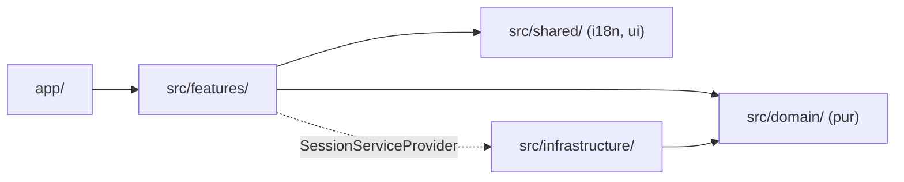
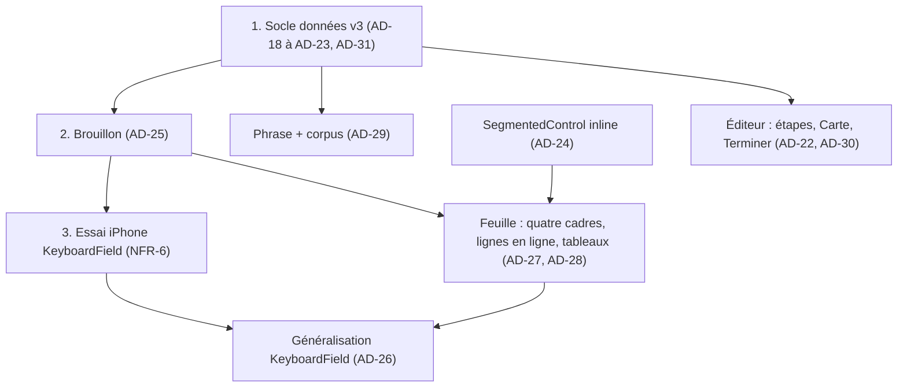
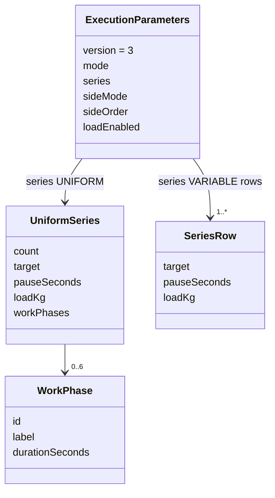

# Architecture Spine — PRE-5 (delta)

Les identifiants FR-n, NFR-n, Δnn, R-nn et les points « §9-n » renvoient au PRD PRE-5 ; Q-A1 à Q-A7 à son addendum ; AD-1 à AD-17 au spine PRE-4 (parent). Les AD de ce spine commencent à AD-18. `EP` = `src/domain/activities/ExecutionParameters.ts`, `Draft` = `ExecutionParametersDraft.ts`, `Sheet` = `src/features/activities/ExecutionParametersSheet.tsx`. Une Rule décrit l'état visé ; « inchangé » ratifie l'existant.

## Design Paradigm

**Architecture en couches à domaine pur**, héritée du parent `[ADOPTED]`, sans changement. Le delta PRE-5 se répartit ainsi :

| Couche | Ce que PRE-5 y ajoute |
|---|---|
| `src/domain/activities/` | Format v3, phases, charge, Condition d'arrêt dérivée, codec des étapes, extensions de la Phrase, transitions du Brouillon. Fonctions pures, sans i18n. |
| `src/infrastructure/database/` | Passage des repositories au lecteur et à l'écrivain v3. Aucune migration, aucun SQL modifié. |
| `src/features/activities/` | Quatre cadres, segmentés en ligne, tableau des phases, `KeyboardField`, surface `keyboard`, Description en étapes. |
| `src/shared/ui/` | Variante `inline` de `SegmentedControl`. Aucun jeton. |
| `src/shared/i18n/` | Clés nouvelles ; clés orphelines retirées (FR-44). |



## Inherited Invariants

| Hérité | Du parent | Ce qu'il impose ici |
|---|---|---|
| AD-1 | Cible typée `NUMBER`/`FAILURE`/`UNSET` | Seule donnée de la Condition d'arrêt (FR-19 à FR-22). **Bornes amendées par AD-31** (Durée 1..3535). |
| AD-2 | Une seule machine de Brouillon | Phases, charge et mémoire « À la cible » y vivent (AD-25) ; chaque transition remet `pendingRemoval` à `null`. |
| AD-3 | Projection scalaire unique ; repositories seuls lecteurs | Ratifié. **Version et forme amendées par AD-18** (conflit C-1). |
| AD-4 | `migration010` figée | Intacte ; aucune migration PRE-5. |
| AD-5 | Un seul calcul de durée | Inchangé : la durée de série dérivée passe par `target` (AD-20). |
| AD-6 | Un seul générateur de Phrase | Étendu par AD-29, sans second générateur. |
| AD-7 | Primitives natives ; roues `DurationWheelPicker`/`NumberWheelPicker`, `AnchoredPanel`, garde zéro `ScrollView` | Roues et panneaux conservés pour les valeurs à roue (Cible, durée de phase, Durée de l'exercice). **Popover du Mode et panneaux Côté/Ordre/Régime remplacés** (R-01 à R-04, conflit C-3) ; option échec retirée des roues en identiques (conflit C-6). |
| AD-8 | Glisser PRE-3, actions accessibles, « Série supprimée — Annuler » | Réutilisés par le tableau des phases (FR-4). ± de cellule retirés (R-05). |
| AD-9 | Clonage profond pour copies et duplications | Étendu aux phases et à la charge (AD-18, FR-41). |
| AD-10 | Preuves SQLite réelles ; corpus 276 inchangé sur disque | Conservé ; extension du corpus par AD-29 (conflit C-4). |
| AD-11 | Lexique et jetons verrouillés | Toute couleur sans jeton = constante locale nommée (FR-26). |
| AD-13 | `validateForSave` unique, tolérance à la ligne de base | Étendu aux phases et à la charge (AD-19, AD-20). |
| AD-14 | Socle de données en premier | Repris par AD-33. |
| AD-15 | Une seule surface ouverte ; réducteur pur `sheetSurface` | Étendu par AD-27 (`keyboard`, cellules de Pause et de phase) ; familles `popover(mode|side|order|regime)` retirées (C-3). |
| AD-16 | Mécanisme ± unique (`InlineStepper`, `steppedValue`) | Seul ± de Pause, N, Cadence « Autre » ; aucun ± de charge. |
| AD-12, AD-17 | Avis de migration ; Média | Non touchés. |

## Invariants & Rules

### AD-18 — Format canonique v3, lecteur unique v2 + v3, sans migration (Q-A1)

- **Binds:** FR-39, FR-41, NFR-3, NFR-10 ; Δ39 ; spécification des phases §5.
- **Prevents:** une donnée PRE-5 relue par un lecteur v2 qui ignore les clés inconnues puis réenregistrée sans phases ni charge (perte silencieuse) ; deux formes concurrentes de la v2 ; un module qui lit encore `readV2` directement.
- **Rule:**
  - `EXECUTION_PARAMETERS_VERSION` = 3. Toute écriture produit du v3, par **`serializeExecutionParameters`**, seul écrivain des repositories et de l'Instantané. Forme : celle de la v2 (clés, ordre, `JSON.stringify` sans espace), plus trois ajouts, **toujours écrits** :

    ```text
    {"version":3,"mode":…,"series":S,"sideMode":…,"sideOrder":…,"sideRecoverySeconds":n,
     "cadenceBeepIntervalSeconds":n,"countdownSeconds":n,"endSeconds":n,"loadEnabled":b}
    S = {"kind":"UNIFORM","count":n,"target":T,"pauseSeconds":n,"loadKg":x,"workPhases":[P,…]}
      | {"kind":"VARIABLE","rows":[{"target":T,"pauseSeconds":n,"loadKg":x},…]}
    P = {"id":n,"label":s,"durationSeconds":n}
    ```

  - **`readExecutionParameters(json)`** est le seul lecteur des repositories et de l'Instantané : version 2 → `readV2` (grammaire inchangée), qui retourne le modèle courant avec `workPhases: []`, `loadEnabled: false`, `loadKg: 0` partout ; version 3 → `readV3`, strict (clé absente ou mal typée → `ExecutionParametersDataError`) ; toute autre version → `ExecutionParametersDataError` (existant).
  - `readV2` et `serializeV2` comparent ou écrivent le littéral 2 (constante `EXECUTION_PARAMETERS_V2`), jamais `EXECUTION_PARAMETERS_VERSION`.
  - Aucune migration SQL, aucune réécriture en masse : une ligne v2 devient v3 à son prochain enregistrement. `migration001` à `migration010` intactes ; `DATABASE_VERSION` reste 10.
  - `serializeV2` est conservé **sans appelant de production**, réservé aux tests de parité de `migration010` (AD-10 inchangé) ; il lève une erreur si on lui passe des phases, une charge active ou une valeur de charge non nulle. Un test de garde, sur le modèle de `legacyModeConfinement.test.ts`, interdit `serializeV2` et `readV2` hors de `EP`, de leurs tests et de `readExecutionParameters`.
  - Instantané : `EXERCISE_SNAPSHOT_VERSION` = 3 ; `parseExerciseSnapshot` lit les enveloppes 1 (`readV1`), 2 et 3 (`readExecutionParameters`).
  - **Retour arrière applicatif** (installer un build PRE-4 après PRE-5) : non pris en charge. Une ligne v3 lève alors `ExecutionParametersDataError` (erreur explicite, aucune perte silencieuse) ; une ligne jamais réenregistrée reste v2 et lisible.

### AD-19 — Charge : activation distincte, valeurs décimales conservées (Q-A2)

- **Binds:** FR-10 à FR-14, FR-23, FR-41, FR-42 ; Δ16 à Δ20, Δ48.
- **Prevents:** une charge stockée en deux unités ; une activation déduite des valeurs ; des valeurs perdues sous Sans ; un arrondi appliqué à deux endroits différents ; une règle différente selon le Mode.
- **Rule:**
  - Données : `loadEnabled: boolean` à la racine ; `loadKg: number` sur `UniformSeries` (charge commune) et sur chaque `SeriesRow` (par ligne). `loadKg` est en kg, fini, ≥ 0, multiple de 0,25 (`Number.isInteger(loadKg * 4)`), sans plafond. Valeur absente à la lecture v2 = 0. Aucune unité technique : les multiples de 0,25 sont exacts en binaire. Aucune valeur par côté. Aucune différence par Mode ni par Condition d'arrêt (Δ48).
  - Sous Sans (`loadEnabled = false`), les `loadKg` sont conservés, sérialisés et relus.
  - Module unique **`src/domain/activities/exerciseLoad.ts`** : `roundLoadUp` (multiple de 0,25 supérieur ; 0 reste 0), `normalizeLoad` (règles du zéro de FR-14 : en identiques, 0 → Sans ; en variables, toutes les lignes à 0 → Sans), `reactivateLoad` (aucune valeur, ou toutes nulles → 0,25 partout ; sinon valeurs restaurées telles quelles), `formatLoadKg` (seul formateur de kg, séparateur décimal du français). L'analyse du texte saisi (`parseLoadText`) y vit aussi ; elle accepte « , » et « . » (la touche décimale du `decimal-pad` iOS suit la région de l'appareil, pas la langue de l'application) ; elle retourne `{ kind: "value", kg } | { kind: "empty" } | { kind: "invalid" }`. Un texte illisible ou négatif ne modifie rien (la valeur précédente reste) ; un champ vide vaut 0.
  - Les transitions du Brouillon (`setLoadEnabled`, `setLoadValue(cible, kg | null)`) appellent ces fonctions ; l'interface ne calcule ni arrondi ni zéro. Une cellule vidée vaut 0 à la sortie du champ, donc aucune charge pour cette série (décision de Hermann du 2026-10-19, §9-10). `normalizeLoad` (passage à Sans) s'applique à la fermeture du clavier, au passage Variables → Identiques et au ✓ ; jamais pendant Précédent / Suivant, pour ne pas masquer la colonne sous le champ visé.
  - Validation : contrôle structurel propre à la charge (fini, ≥ 0, multiple de 0,25) ; `checkStructuralNumber` reste entier et inchangé. Aucun niveau saisie (aucune borne). `sameRowValue` et `alignRowsToBaseline` ignorent la charge.
  - `loadEnabled`, `loadKg` et `workPhases` sont **obligatoires** dans les types (jamais optionnels). Tout constructeur de paramètres ou de série les porte, adapté mécaniquement dans la story 1 : `createEmptyExecutionParameters` (Sans, 0, `[]`), `seriesRowsOf`, `normalizeEffective`, `readV1`, `recoveryExecutionParameters`, `defaultExerciseExecutionParameters` (`SessionDraft.ts`), `composition.ts`, fixtures de test (`executionParametersFixtures.ts`).
  - `normalizeEffective` (N = 1), quand il construit l'uniforme depuis une série variable, reprend le `loadKg` de la première ligne et pose `workPhases: []` ; une série déjà uniforme garde ses phases ; `loadEnabled` est inchangé.
  - `executionParametersEqual` et `cloneExecutionParameters` incluent `loadEnabled`, `loadKg` et `workPhases`. Toute construction de `SeriesRow` dans le Brouillon (`plain`, copie uniforme → variable, ajout de série, réserves) recopie `loadKg` : la charge suit la ligne (FR-11, FR-13).

### AD-20 — Phases : dans la série uniforme, durée de série dérivée et matérialisée (Q-A3)

- **Binds:** FR-1 à FR-9, FR-40, FR-43, FR-45 ; Δ08 à Δ14, Δ40, Δ47.
- **Prevents:** une durée de série écrite indépendamment de ses phases ; deux calculs de D ; des phases en séries variables ; un consommateur (calculs, Composition, Catalogue, projection) qui ignore les phases ; une confusion avec `phasesRow`, `withProfilePhases` ou la variable locale `phases`.
- **Rule:**
  - Nom de code : **`workPhases`**, type `WorkPhase = { id: number; label: string; durationSeconds: number }`. Champ de `UniformSeries` uniquement : une série `VARIABLE` ne porte aucune phase par construction. `[]` = « Aucune ». 0 à 6 éléments, ordre = ordre d'exécution, `id` entier ≥ 1 unique dans la liste, persisté et conservé par le clonage.
  - **Invariant structurel** (validé par `validateForSave` et par `readV3`) : `workPhases` non vide ⇒ Mode `DURATION`, Cible `NUMBER`, chaque `durationSeconds` entier ≥ 1, libellé de 1 à 20 caractères, `target.value` = Σ `durationSeconds`, et Σ dans 1..3535. Un écart est une violation structurelle (ou `ExecutionParametersDataError` à la lecture) : la somme n'a **aucune tolérance de ligne de base** (H25 ne s'y applique pas). Passer à Avec avec une Cible hors de 1..3535 (héritée) crée la phase à renseigner.
  - **Écrivain unique de D** : `deriveSeriesDuration` (domaine) fixe `target` à `NUMBER(Σ)` si Σ ≥ 1, sinon `UNSET`, **pour une liste non vide seulement**. Seules les transitions de phases du Brouillon l'appellent. Une transition qui vide la liste (retrait de la dernière phase, Avec → Sans) ne l'appelle pas : `target` garde la dernière somme, qui devient la durée de série modifiable, et la ligne revient à « Aucune » (FR-8, D-371) ; une somme nulle laisse `UNSET` (rien n'est inventé). Le retrait de la dernière phase reste annulable ; tant que des phases existent, la transition qui règle la Cible commune est sans effet (l'interface affiche D en lecture seule).
  - Conséquence ratifiée : `workSeconds`, `projectScalars`, l'Inversion du total (N seul change), `computeIntrinsicDuration`, les synthèses du Catalogue et de la Composition lisent `target` **sans modification** (Δ47). La somme est bornée par les bornes de saisie de la Cible Durée (AD-31) ; la projection reste dans le CHECK 1..5999 (FR-40).
  - **Table d'appels de `deriveSeriesDuration`** : ajout, retrait d'une phase non dernière, annulation d'un retrait, réglage d'une durée, `normalizeWorkPhases` sur une liste restée non vide → appel ; retrait de la dernière phase, Avec → Sans, liste vidée par la normalisation → aucun appel. Une durée `null` compte pour 0 dans la somme.
  - Brouillon seulement : durée de phase `number | null` (`null` = à renseigner, fond `#FFF1F0`) ou 0 ; libellé vide = libellé par défaut affiché selon la position. **`normalizeWorkPhases(phases, defaultLabel)`** (domaine, au ✓) retire les phases à 0 ou `null`, remplace un libellé vide (après suppression des espaces extérieurs) par `defaultLabel(n)` selon la position finale, puis rappelle `deriveSeriesDuration`. `defaultLabel` est fourni par l'appelant depuis `strings` (le domaine n'importe pas l'i18n).
  - Transitions (Brouillon, AD-25) : Avec sans phase → une phase, durée = Cible `NUMBER` courante, sinon `null` ; ajout → durée de la dernière ; ajout refusé à 6 ; retrait (annulable, instantané d'annulation du Brouillon) ; déplacement (le libellé suit l'`id`) ; Avec → Sans → `workPhases = []`, `target` déjà égal à la somme (FR-8) ; aucune mémoire des anciennes phases. Prédicat unique **`canEnableWorkPhases(draft)`** : Mode `DURATION`, séries identiques **effectives** (N = 1 compris), Cible commune non `FAILURE`. À N = 1 avec un état variable demandé, toute transition de phases ou de charge commune passe d'abord, dans la même transition, par `setVariable(false)` : la Feuille et le Brouillon voient le même uniforme ; hors de ce cas, l'activation est refusée par le domaine et l'option Avec est indisponible. Avec des phases, les transitions vers Répétitions, À l'échec et Variables sont refusées par le domaine (aucune conversion destructive, FR-2), et les options correspondantes sont indisponibles.
  - Bornes : `WORK_PHASE_LIMITS = { maxCount: 6, labelMaxLength: 20, durationMin: 1 }` dans `EP`. La roue d'une durée de phase est `DurationWheelPicker` dans `AnchoredPanel`, bornes 1..3535, sans `failureOption`.

### AD-21 — Côtés : trois valeurs conservées, lecture Avec / Sans (Q-A4)

- **Binds:** FR-15 à FR-18 ; Δ21, Δ22, Δ43, Δ45 ; R-08, R-15, R-16.
- **Prevents:** une nouvelle valeur de CHECK `side_mode` (reconstruction de deux tables) ; une réécriture des données historiques ; un consommateur qui affiche encore une direction.
- **Rule:**
  - `SideMode` garde `UNILATERAL | RIGHT_LEFT | LEFT_RIGHT` ; aucun CHECK modifié. **Avec** ⇔ `isBilateral(sideMode)` ; **Sans** ⇔ `UNILATERAL` ou `null` (normalisé à `UNILATERAL` par `validateForSave`, existant).
  - Passer de Sans à Avec écrit `RIGHT_LEFT` (valeur canonique) et copie la Pause entre les côtés du Profil (P3-10, existant). Une valeur bilatérale existante n'est jamais réécrite tant que l'utilisateur ne repasse pas par Sans.
  - Aucun module ne distingue `RIGHT_LEFT` de `LEFT_RIGHT` : `LedgerSide` devient ordinal (`NONE | SIDE_1 | SIDE_2`), la Phrase emploie la forme neutre (AD-29), le lexique perd les libellés et sous-titres anatomiques, l'indicateur de la Composition n'a plus de direction (seul point de passage modifié dans `CompositionScreen.tsx`). `SideModeControl.tsx`, sans appelant de production, n'est pas étendu.
  - Enchainement (`sideOrder`) : valeurs `BY_SIDE` / `BY_SERIES` inchangées ; à N = 1 la ligne est masquée et la valeur demandée conservée dans le Brouillon ; à l'enregistrement, `normalizeEffective` écrit `BY_SIDE` à N = 1, comportement existant couvert par la ligne NR Δ24 (tests Q38), non modifié (NFR-8). Écart éventuel avec FR-17 : QN-4.
  - Pause entre les côtés : P3-10 (copie du Profil à chaque passage à Avec, `setSideMode`) est conservé tel quel, comme FR-15 l'exige ; la conservation sous Sans vaut tant que la ligne reste masquée. Tension avec « conserve leurs valeurs » : QN-4.
  - `sideMode` n'a qu'un propriétaire, `executionParameters` ; `SessionDraftExercise.sideMode`, `ActivityDefinition.sideMode` et la colonne `side_mode` en sont des projections.

### AD-22 — Étapes de la Description dans la colonne existante (Q-A5, QP5-01)

- **Binds:** FR-33 à FR-35 ; Δ01 à Δ03 ; NFR-9.
- **Prevents:** une migration ou une table pour les étapes ; deux encodages ; une fin de ligne Windows qui crée une étape fantôme ; une copie ou une duplication qui perd les étapes.
- **Rule:**
  - Stockage inchangé : `activity_definitions.description` et `activities.instruction` (texte). Transport (`ActivityDefinition`, copie Définition → Séance, duplication) inchangé : il porte la chaîne encodée. L'Instantané ne porte pas de Description aujourd'hui ; PRE-5 n'en ajoute pas.
  - Codec unique **`src/domain/activities/instructionSteps.ts`** : `decodeInstructionSteps(text | null): string[]` découpe sur `/\r?\n/` ; `encodeInstructionSteps(steps): string | null` retire les étapes vides (après suppression des espaces extérieurs), joint par `\n`, sans numéro, `null` si la liste est vide. Une étape ne contient jamais de saut de ligne.
  - Ancien texte : relu par le même décodage, une ligne = une étape ; aucune conversion ni migration (FR-35).
  - L'Éditeur porte `instructionSteps: readonly string[]` dans sa valeur de formulaire ; `formValueEquals` compare `encodeInstructionSteps` des deux valeurs (une étape vide créée par Entrée n'est pas une modification). Il encode à `Terminer` seulement ; `normalizeInstruction` reste la validation de la chaîne encodée, sans seconde règle.
  - Saisie (décision de Hermann du 2026-10-19, §9-6), par des fonctions pures du codec appelées par l'Éditeur : Entrée au milieu d'une étape la coupe au curseur (`splitStepAt`) ; un collage sur plusieurs lignes donne une étape par ligne (`insertPastedText`, découpage `/\r?\n/`) ; toute saisie (frappe ou collage) qui ferait dépasser la limite est refusée en entier, sans troncature ; aucune étape existante n'est modifiée. La mesure de la limite est une seule fonction du codec (`instructionStepsLength`), utilisée par l'Éditeur et par la validation. Présentation : demandes 17 et 21 du registre et Figma courant, texte à 14, sans cadre (§9-2).
  - Limite : `INSTRUCTION_MAX_LENGTH` (1000, en points de code) s'applique à **la chaîne encodée**, séparateurs compris, ce qui garantit le CHECK `length(instruction) <= 1000` sans migration. Différence avec FR-34 (« textes seuls ») : au plus n − 1 caractères ; question QN-1. Si Hermann retient la lecture du PRD, seule la fonction de comptage de `instructionSteps.ts` change, et une `migration011` relâchant le CHECK devient nécessaire.

### AD-23 — Condition d'arrêt : entrée en identiques, résultat dérivé en variables (Q-A6)

- **Binds:** FR-19 à FR-22 ; Δ25 à Δ28 ; AR-01.
- **Prevents:** une valeur Mixte persistée ; deux règles de dérivation (Feuille, Phrase, synthèses) ; un 0 qui code l'échec ; une valeur chiffrée perdue après un aller-retour À l'échec.
- **Rule:**
  - Seules les Cibles typées sont persistées. Aucun champ « condition ».
  - **`stopConditionOf(parameters)`**, fonction pure de `EP`, seule autorité, lue sur l'état **effectif** (N = 1 = identiques) ; Mode non renseigné : À la cible affiché par défaut. En identiques : `FAILURE` si et seulement si la Cible commune est `FAILURE`, sinon `TARGET` (une Cible `UNSET` affiche À la cible, valeur à renseigner ; FR-19). En variables : `TARGET` (toutes les lignes `NUMBER`), `FAILURE` (toutes `FAILURE`), `MIXED` (au moins une `NUMBER` et une `FAILURE`, quelles que soient les `UNSET`), `INCOMPLETE` (sinon : aucune ligne décisive, ou une `UNSET` sans mélange établi) `[ASSUMPTION]`, rendu par les deux options non modifiables, aucune sélectionnée (convention des résultats incomplets D-384) `[ASSUMPTION]`. Elle s'appuie sur les prédicats existants (`allTargetsFailure`, `hasFailureTarget`, `hasUnsetTarget`). La Feuille l'affiche ; la Phrase garde ses propres branches existantes (aucune régression du corpus).
  - En identiques, choisir À l'échec écrit `FAILURE` dans la Cible commune ; revenir à À la cible restaure la dernière valeur `NUMBER` connue **dans le Brouillon** pour cette identité et ce Mode, sinon `UNSET`. Cette mémoire, `lastNumberById`, est distincte de `targetsById` et n'est jamais écrasée par un `FAILURE` ni un `UNSET` (`rememberCurrentTargets` mémorise aussi `FAILURE`). Rien n'est persisté.
  - En identiques à l'échec, la ligne Durée ou Répétitions est masquée (FR-21) ; la valeur mémorisée la restitue.
  - Roues : en identiques, aucune `failureOption` ; en variables, `failureOption` conservée en tête (Q8, AD-7). Variables → Identiques : `setVariable(false)` existant (l'uniforme reprend la première ligne courante, charge comprise), puis `normalizeLoad` : une charge commune reprise à 0 fait passer l'Exercice à Sans (décision de Hermann du 2026-10-19, §9-9).

### AD-24 — `SegmentedControl` : variante `inline`, sans nouveau composant

- **Binds:** FR-15, FR-17, FR-19, FR-20, FR-27, FR-28, FR-30 ; QP5-06 ; R-01 à R-04, R-07, R-11 ; NFR-1, NFR-7.
- **Prevents:** un second composant segmenté ; un segmenté natif adopté sans la vérification de QP5-06 ; deux rendus du chevron intérieur ; une option indisponible qui perd sa valeur.
- **Rule:**
  - `src/shared/ui/SegmentedControl.tsx` reçoit une troisième valeur de `variant` : `"inline"` (aligné à droite, sans enveloppe blanche, options de même largeur, traitement violet existant pour l'option choisie). `standard` et `parameters` sont inchangés.
  - Ajouts optionnels, sans effet sur les autres variantes : `chevron?: "up" | "down"` par option (chevron intérieur centré avec le libellé, FR-28) ; `compact?: boolean` (police réduite, Enchainement, FR-17, sans changement automatique de géométrie) ; `readOnly?: boolean` (contrôle non interactif annoncé comme information non modifiable, résultat dérivé FR-20). `disabled` par option existe déjà et garde la valeur affichée.
  - Lignes en `inline` : Mode, Condition d'arrêt, Phases, Type de série, Charge, Changement de côté, Enchainement, Cadence. `ClosingSelector` et les panneaux de choix ne sont plus utilisés pour elles.
  - Cadence : l'option affichée est donnée par la fonction pure `cadenceOptionOf(value)` : 0 → Sans, 1 → 1 s, 2 → 2 s, 5 → 5 s, toute autre valeur → Autre (décision de Hermann du 2026-10-19, §9-7). Toucher Autre ne change pas la valeur et ouvre la surface `stepper(beep)` existante (± 0..10, pas 1) ; tant que cette surface est ouverte, l'option affichée est Autre ; à sa fermeture, l'affichage revient à `cadenceOptionOf(value)`. Aucune valeur personnalisée n'est mémorisée (FR-30).
  - Vérification QP5-06 faite à l'écriture du spine : `@expo/ui` 57.0.13 expose `Picker` + `pickerStyle('segmented')`, mais aucune API documentée pour une option désactivée, un chevron intérieur ou une police par option. Aucun gain démontré : le `SegmentedControl` existant est conservé. Aucune autre vérification n'est due.
  - Valeurs numériques relevées sur Figma (S-2), en constantes locales nommées ; aucun jeton modifié.

### AD-25 — Le Brouillon de la Feuille porte phases, charge et mémoire « À la cible »

- **Binds:** FR-2, FR-5, FR-8, FR-9, FR-11, FR-14, FR-19 ; AD-2 (parent).
- **Prevents:** un composant qui gère lui-même des phases, une charge ou une valeur mémorisée ; un champ oublié par `openSheetDraft`, `plain` ou `requestedParameters`, perdu au ✓ sans erreur.
- **Rule:**
  - `ExecutionSheetDraft` reçoit `workPhases` (forme brouillon d'AD-20), `nextPhaseId`, `loadEnabled`, et `loadKg` dans `uniform` et dans chaque ligne (actives, cachées, sauvegardées), et la mémoire `lastNumberById` d'AD-23, distincte de `targetsById`.
  - `openSheetDraft`, `plain` et `requestedParameters` portent tous les nouveaux champs. Un test d'aller-retour `requestedParameters(openSheetDraft(p))` = `p` (charge sous Sans, phases et identifiants compris) le garde.
  - Toute transition nouvelle remet `pendingRemoval` à `null` (Q29) ; le retrait annulable d'une phase passe par le même `pendingRemoval`, étendu à `{ kind: "series" | "phase", … }` : une seule annulation en attente, invalidée par toute autre modification du Brouillon.
  - Une seule fonction pure, **`sheetDraftResult(draft, defaultLabel)`**, applique dans cet ordre `normalizeWorkPhases`, `normalizeLoad`, puis `validateForSave` (AD-13). Elle sert **à la fois** la disponibilité du ✓ de la Feuille et `commitSheetDraft` : des phases à 0 ou à renseigner ne bloquent jamais ✓ ; une somme normalisée hors de 1..3535 le bloque (FR-3, FR-9). Cas de test obligatoires : phases `[0, null]`, somme 3 536 s. ✕ abandonne le Brouillon : phases, charge et étapes reviennent à l'état d'ouverture.

### AD-26 — `KeyboardField` : un seul champ clavier pour la charge et le libellé de phase (Q-A7)

- **Binds:** FR-6, FR-12, FR-13, FR-14, FR-23 à FR-25 ; Δ29, Δ30, Δ49 ; NFR-1, NFR-2, NFR-6, NFR-7.
- **Prevents:** deux mécanismes de saisie (ligne commune et cellules) ; un `ScrollView` ou un `KeyboardAvoidingView` ajouté autour d'une roue ; une barre Précédent / Suivant réimplémentée hors de la primitive iOS ; un champ clavier étendu à d'autres valeurs.
- **Rule:**
  - Composant unique **`KeyboardField`** (`src/features/activities/`), sur `TextInput` de React Native. Charge : `keyboardType="decimal-pad"` ; libellé de phase : clavier texte, 20 au plus. Toute longueur (libellé de phase, étapes) se mesure en points de code (`codePointLength`, comme le CHECK SQLite `length()`), jamais par le seul `maxLength` du `TextInput`, qui compte en UTF-16. Il sert la ligne Charge commune, les cellules de charge du tableau variable et les cellules de libellé du tableau des phases. Aucune autre valeur n'est saisie au clavier (Δ30).
  - Texte local pendant la frappe ; à la sortie du champ (perte de focus, Précédent / Suivant, fermeture), il appelle **une** transition du Brouillon (`setLoadValue` avec `parseLoadText`, ou le libellé). Aucun arrondi pendant la frappe.
  - **Barre du clavier décimal (iOS)** : un `InputAccessoryView` **par champ de charge**, avec un `nativeID` propre dérivé de la clé du champ, monté avec son champ et relié par `inputAccessoryViewID`. Un `nativeID` partagé est interdit : sous Fabric (RN 0.86.2, `RCTInputAccessoryComponentView`), l'accessoire ne se rattache qu'au premier champ trouvé à son montage. Le contenu est un seul composant de barre. Elle porte Précédent et Suivant, et un bouton **« Fermer » à droite**, qui fait sortir du champ (valeur appliquée) et ferme le clavier (décision de Hermann du 2026-10-19, §9-8). L'ordre est donné par la fonction pure `loadFieldOrder(draft)` : `[uniform]` en identiques, identités des lignes dans l'ordre courant en variables, `[]` sous Sans. Le déplacement appelle `focus()` sur le champ voisin sans fermer le clavier ; aux extrémités le bouton est indisponible (aucune boucle). Android et web : pas de barre, champs fonctionnels, rendu non recetté.
  - Fond de la cellule active : dérivé de la surface `keyboard` ouverte (AD-27), jamais d'un état local du champ ; l'état actif est annoncé (`accessibilityState`).
  - **Visibilité** : le corps défilant existant de la Feuille (`SheetMotionScrollView`) est le seul défilement. **Une seule autorité de défilement, en JavaScript** : `automaticallyAdjustKeyboardInsets` n'est pas utilisé (sous Fabric il défile lui-même, sans marge, et ne réagit pas à Précédent / Suivant). Un espace bas égal à la hauteur du clavier (événements `Keyboard`) est ajouté au contenu ; après `keyboardDidShow` et à chaque Précédent / Suivant, un défilement calculé (repère d'AD-28) garde la ligne active, et autant que possible le tableau, au-dessus du clavier avec une marge de 12 ; la ligne active reste toujours visible (décision de Hermann du 2026-10-19, §9-8). Aucun nouveau `ScrollView`, aucun `KeyboardAvoidingView` dans la Feuille ; `DurationWheelPicker.test.tsx:371` et `NumberWheelPicker.test.tsx:260` restent intacts (NFR-2).
  - Le champ de libellé de phase (clavier texte) se ferme par sa touche Retour ; il n'a pas de barre.
  - **Essai précoce (NFR-6)** : story d'essai sur iPhone, dev client existant, avant toute story qui généralise `KeyboardField` aux cellules : `InputAccessoryView` dans la `Modal` de la Feuille, une barre par champ (plusieurs champs, champ ajouté après l'ouverture, passage Sans → Avec), Précédent / Suivant clavier ouvert, « Fermer », fond de la cellule active, ligne visible. **Repli si l'accessoire ne s'affiche pas dans la `Modal`** : écart signalé à Hermann ; aucune barre réimplémentée sans sa décision.

### AD-27 — Surfaces de la Feuille : famille `keyboard` et cellules ouvrantes

- **Binds:** FR-24, FR-25, FR-29 ; AD-15 (parent) ; R-05.
- **Prevents:** un clavier ouvert en même temps qu'une roue ou un ± ; un état de focus tenu hors du réducteur ; ✓ ou ✕ de la Feuille appliqués pendant une saisie.
- **Rule:**
  - `sheetSurface.ts` reste le seul réducteur. Surfaces ajoutées : `{ kind: "keyboard", field: { kind: "load"; row: number | "uniform" } | { kind: "phaseLabel"; phase: number } }` ; `selector(phaseDuration(phase))` ; `stepper(rowPause(row))`. Surfaces retirées : `popover(mode | side | order | regime)`.
  - **Synchronisation focus / surface**, dans un seul hook de la Feuille : `onFocus` → `touch(keyboard(champ))` ; `onBlur` → flush puis `close` de cette clé si elle est encore ouverte ; toute sortie de la surface `keyboard` vers une autre surface ou vers `none` appelle `blur()` sur le champ (avec `keyboardShouldPersistTaps="handled"`, existant, un toucher ailleurs ne retire pas le focus de lui-même). Précédent / Suivant : flush, puis `focus()` du champ voisin, dont `onFocus` ouvre la surface. À la première activation de la charge, le focus va au champ commun (identiques) ou au premier champ de ligne (variables).
  - **Ordre focus / réducteur** : `onFocus` du `TextInput` est la seule source d'ouverture d'une surface `keyboard` (toucher direct, Précédent / Suivant). La cible (identité de ligne ou de phase) est capturée au focus. Avant toute autre transition du Brouillon ou du réducteur (toucher d'une autre surface, ✓, ✕, glisser, retrait, segmenté), la Feuille appelle `flushKeyboardField()`, synchrone, qui applique la valeur en cours ; `onBlur` appelle ce même flush, sans effet s'il a déjà eu lieu. Une sortie sans changement de valeur ne déclenche aucune transition (`pendingRemoval` préservé). Un flush sur une identité disparue est ignoré.
  - Les surfaces désignent des **identités** (ligne : `rowIds` du Brouillon ; phase : `id`), jamais des rangs. `nextPhaseId` vaut, à l'ouverture, max(`id`) + 1 (1 si aucune phase).
  - Une seule annulation de retrait est en attente à la fois (série ou phase) ; un nouveau retrait remplace la précédente ; le message existant « … supprimée — Annuler » sert aux deux tableaux.
  - Tableau des phases : `DraggableRow`, `RemoveRowButton` et le message d'annulation sont extraits de la Feuille dans un module partagé de `src/features/activities/`, utilisé par le tableau des séries et par un composant `WorkPhasesTable` distinct ; aucune copie.
  - Au plus une surface ouverte. `keyboard` suit la famille des champs ± : toucher une autre surface ferme le champ (sa valeur est appliquée par la sortie du champ, AD-26) et ouvre l'autre dans le même geste ; Précédent / Suivant est un toucher de la surface `keyboard` voisine ; un appui extérieur la range.
  - ✓ et ✕ de la Feuille sont absorbés pendant une surface `keyboard` (Q47 : premier appui = sortie du champ, valeur appliquée ; second appui = validation ou abandon). `sheetCommandsAbsorbed` l'inclut.
  - « Ligne disparue » couvre aussi les lignes et phases des surfaces `keyboard`, `stepper(rowPause)` et `selector(phaseDuration)`.
  - Cellules du tableau sans ± permanent : toucher une cellule ouvre son outil, pour elle seule : Cible → `selector(rowTarget)` dans `AnchoredPanel` ; Pause → `stepper(rowPause)` (`InlineStepper`) ; charge et libellé → `keyboard` ; durée de phase → `selector(phaseDuration)`.

### AD-28 — Quatre cadres : repère unique des panneaux

- **Binds:** FR-26, FR-29, FR-31, FR-32 ; R-12.
- **Prevents:** des panneaux ancrés par deux calculs différents ; un cadre recréé hors des briques existantes.
- **Rule:**
  - La Feuille compose quatre `SheetMotionView` (Exécution, Séries, Côtés, Cadence et durée) avec `Row`, `ValuePill`, `Separator` et les animations Q39 à Q41 existantes.
  - **Repère unique** : toute position d'ancrage (`AnchoredPanel`, défilement d'AD-26) est exprimée dans les coordonnées du contenu défilant : y du cadre (mesuré par `onLayout`) + y de la ligne dans son cadre. Une seule fonction de la Feuille calcule cette position ; `groupBox` et `variableGroupY` en deviennent des cas particuliers ou disparaissent.
  - Les panneaux ancrés sont rendus au niveau du contenu défilant, hors des cadres : un cadre arrondi (éventuellement `overflow: "hidden"`) ne les découpe jamais.
  - Ligne Charge en identiques : le segment Avec affiche `formatLoadKg` de la valeur commune dès qu'elle est saisie (FR-12) ; le toucher de ce segment, valeur affichée, donne le focus au `KeyboardField` de la ligne, rendu dans la même ligne.
  - Le gris des cadres est une constante locale nommée (aucun jeton) ; tableaux à fond blanc, lignes de 36 dans les deux tableaux, 44 ailleurs (R-06). La cible tactile des lignes de 36 est vérifiée sur iPhone dans la première story de tableau, avant toute autre géométrie (FR-29, QP5-05).
  - Durée de l'exercice : repli par un chevron propre à la ligne (`DisclosureControl` existant), sans modifier la valeur ; Compte à rebours et Fin restent absents dans un Exercice ouvert depuis une Séance (existant).

### AD-29 — Phrase : points d'extension après la valeur par série, côtés neutres, corpus étendu

- **Binds:** FR-18, FR-42, FR-43 ; Δ42 à Δ45 ; S-3 ; AD-6, AD-10 (parent).
- **Prevents:** un second générateur ; deux placements différents des mentions de phases et de charge ; une phrase sans phases ni charge qui change ; un corpus réécrit sur disque.
- **Rule:**
  - `generateExecutionPhrase` reste le seul générateur, en segments `{texte, gras}`. Deux fonctions pures ajoutées dans `executionPhrase.ts` : `workPhasesClause(parameters)` (« (Descente : **6 s** - Maintien : **3 s**) », exhaustive, même pour une phase) et `loadClause(parameters)` (D-414 : « (charge : 20 kg) », « (charges : 20, 12, 13 kg) », « (charges : 20, 12 kg, ...) » au-delà de trois ; une série à 0 est listée ; rien sous Sans).
  - Point d'insertion unique : à la fin de l'expression de la valeur par série du groupe Contenu (« de 9 s », « de 12 rép. », « menées jusqu'à l'échec », liste ou plage variable), avant la clause de cadence et avant la Pause. Les trois cas Δ48 (Répétitions × Identiques, Répétitions × Variables, À l'échec avec charge) et un cas de charges variables toutes égales sont des cas obligatoires du corpus étendu. L'ordre est une seule constante, `VALUE_SUFFIX_ORDER` = phases, puis charge (décision de Hermann du 2026-10-19, §9-3) : « **3 séries de 9 s** (Descente : **6 s** - Maintien : **3 s**) (charge : 20 kg), … ». Un cas du corpus couvre la combinaison. Sans phases ni charge, aucun segment n'est ajouté.
  - Côtés : forme neutre « côté 1 puis le côté 2 » (ch. 10 l. 515) pour toute valeur bilatérale ; aucune lecture de la direction.
  - Corpus : `phrases-276.json` et `attendus-phrases-276.json` ne sont pas modifiés sur disque. Les attendus neutres des cas bilatéraux et les nouveaux cas (phases, charge, combinaisons) sont des chaînes littérales dans `src/domain/activities/__tests__/fixtures/`. Le test vérifie les cas non bilatéraux contre l'oracle et les cas bilatéraux contre la fixture neutre.

### AD-30 — Champs étendus de la Carte et de l'Éditeur : présentation seulement

- **Binds:** FR-36 à FR-38 ; R-14 ; NFR-8.
- **Prevents:** un retrait de Compte à rebours et de Fin qui toucherait le modèle ou les calculs ; un jeton ajouté pour la conformité Figma.
- **Rule:** la Carte ne rend plus `phasesRow` ni `cardSeparator` ; son nom accessible perd ces deux valeurs. Données, Feuille, `computeExercisePlanDuration` et Phrase inchangés. `Terminer` reste hors du `KeyboardAvoidingView` de l'Éditeur ; sa zone protégée est un espace de défilement réservé, sans remonter avec le clavier (D-349). Tout écart Figma qui exigerait un jeton ou le remplacement d'un composant est signalé (§9-1), jamais implémenté d'office.

### AD-31 — Minimum de 1 s en un seul endroit (D-430)

- **Binds:** FR-3, FR-7, FR-45 ; Δ50 ; R-17 ; AD-1, AD-13, AD-16 (parent).
- **Prevents:** une borne minimale dupliquée dans une roue, un test ou une validation ; une extension non décidée aux pauses.
- **Rule:** `EXECUTION_BOUNDS.durationTarget.min` passe de 5 à 1 (`EP:88`), seul changement de valeur. Roues, `selectorOpeningPosition` (« — » ouvre sur 00:01), `stepTarget`, validation et somme des phases en dérivent. Maxima, CHECK SQL (déjà 1..5999), maintien accéléré 1/5/10 et bornes des pauses inchangés. Les grilles de Pause et de Récupération du Profil (`PAUSE_GRID_VALUES`, pas de 5 s) ne sont pas concernées par D-430 (décision de Hermann du 2026-10-19, §9-5, ambiguïté A1). Avec des phases, l'ajustement de la Durée de l'exercice par N est conservé (§9-4, AD-20).

### AD-32 — Lexique : clés nouvelles, orphelines retirées, identifiants inchangés

- **Binds:** FR-44, NFR-9 ; AD-11 (parent).
- **Prevents:** un texte en dur ; des libellés « Cible », « Définie », « Ordre », « D1/G1 » réintroduits ; un identifiant technique renommé.
- **Rule:** tout texte visible nouveau passe par `src/shared/i18n/` ; exception inchangée pour la Phrase et ses formateurs (`formatLoadKg` compris). Les clés orphelines (sous-titres D/G, `sideModes` anatomiques, Compte à rebours et Fin de la Carte) sont retirées dans la story qui retire leur dernier usage. `SideOrder`, `target`, `sideMode` et les noms de colonnes ne changent pas (D-201).

### AD-33 — Ordre de livraison : socle de données d'abord, essai clavier avant généralisation

- **Binds:** toutes les stories PRE-5 ; NFR-4, NFR-6 ; AD-14 (parent).
- **Prevents:** une écriture v3 sans lecteur ; une story d'interface qui invente un champ de données ; un champ clavier généralisé avant l'essai sur iPhone.
- **Rule:**
  - **Story 1, socle de données**, atomique, trois contrôles verts : modèle (AD-18 à AD-20), `readExecutionParameters` / `readV3` / `serializeExecutionParameters`, garde de `serializeV2`, validation structurelle, égalité et clone, codec des étapes (AD-22), `stopConditionOf` (AD-23), `exerciseLoad.ts`, `AD-31`, passage des deux repositories, de l'Instantané et de `runNativeDatabaseIntegrationCheck` au v3, aller-retour sur `node:sqlite` (v2 relu, v3 écrit, charge sous Sans conservée, phases et identifiants conservés), adaptation mécanique de tous les constructeurs (AD-19) et transport des nouveaux champs par `openSheetDraft`, `plain` et `requestedParameters` (sans transition nouvelle), pour qu'aucun ✓ ne perde une donnée lue. Aucune interface.
  - Puis, ordre obligatoire : transitions du Brouillon (AD-25) avant toute story de Feuille ; essai NFR-6 (AD-26) avant toute story qui généralise `KeyboardField` ; `SegmentedControl` `inline` (AD-24) avant les lignes qui l'utilisent. Le reste (Phrase et corpus, quatre cadres, tableaux, Éditeur, Composition, lexique) est indicatif ; aucune story ne dépend d'une story placée après elle.
  - Recette groupée sur iPhone : lot Feuille, puis lot Éditeur (SM-1). Une suite verte n'est pas une recette (NFR-5).



## Consistency Conventions

| Concern | Convention |
| --- | --- |
| Nommage | Anglais (D-035) : `workPhases`, `WorkPhase`, `loadEnabled`, `loadKg`, `stopConditionOf`, `KeyboardField`, `instructionSteps`. Jamais `phases` seul pour les phases métier. Pas de « Set ». |
| Données | JSON v3 (AD-18) ; durées en secondes entières ; charge en kg décimaux multiples de 0,25 ; aucune Phrase, aucun total, aucune condition d'arrêt persistés. |
| Mutation | Domaine seul : arrondi, zéro, dérivation de D, normalisation des phases et des étapes. L'interface dispatche. |
| Persistance | Repositories seuls (D-043) ; `readExecutionParameters` et `serializeExecutionParameters` seuls points d'entrée. |
| Textes | `strings` ; exception Phrase et formateurs du domaine. |
| Styles | `StyleSheet.create`, jetons existants, constantes locales nommées pour les valeurs Figma sans jeton. |
| Tests | `__tests__/` à côté ; `@jest/globals` explicite ; retrait des `\r` sur toute fixture découpée par lignes ; cas Δ48 explicites (Répétitions × Identiques, Répétitions × Variables, À l'échec avec charge). |
| Commentaires | Français, citant FR, Δ, D et AD. |
| Contrôles | `npm test`, `npx tsc --noEmit`, `npm run lint` verts à chaque story. |

## Stack

Versions relevées dans `node_modules` du clone le 2026-10-19 ; aucune montée de version dans PRE-5.

| Name | Version |
| --- | --- |
| expo | 57.0.16 |
| react-native | 0.86.2 |
| react | 19.2.3 |
| @expo/ui | 57.0.13 |
| react-native-reanimated | 4.5.1 |
| expo-sqlite | 57.0.1 |
| typescript | 6.0.3 |
| jest-expo | 57.0.4 |

## Structural Seed



```text
src/domain/activities/   ExecutionParameters (v3, stopConditionOf, deriveSeriesDuration, normalizeWorkPhases),
                         exerciseLoad (nouveau), instructionSteps (nouveau), ExecutionParametersDraft,
                         executionPhrase, executionCalculations (LedgerSide ordinal), exerciseSnapshot
src/infrastructure/database/repositories/   SqliteActivityDefinitionRepository, SqliteSessionRepository
src/features/activities/ ExecutionParametersSheet, sheetSurface, KeyboardField (nouveau), ActivityEditorForm
src/features/sessions/   ExerciseScreen (étapes), CompositionScreen (indicateur sans direction)
src/shared/ui/           SegmentedControl (variante inline)
src/shared/i18n/         clés
```

## Capability → Architecture Map

| Capability / Area | Lives in | Governed by |
| --- | --- | --- |
| FR-1 à FR-9 Phases | `EP`, `Draft`, Sheet (tableau des phases) | AD-20, AD-25, AD-27, AD-31 |
| FR-10 à FR-14 Charge | `exerciseLoad.ts`, `EP`, `Draft` | AD-19, AD-25 |
| FR-15 à FR-18 Côtés | `sideMode.ts`, `executionCalculations.ts`, `executionPhrase.ts`, `CompositionScreen.tsx` | AD-21, AD-29 |
| FR-19 à FR-22 Condition d'arrêt | `EP` (`stopConditionOf`), `Draft`, roues | AD-23, AD-1 |
| FR-23 à FR-25 Champ clavier | `KeyboardField`, `sheetSurface.ts`, Sheet | AD-26, AD-27 |
| FR-26 à FR-32 Présentation de la Feuille | Sheet, `SegmentedControl` | AD-24, AD-27, AD-28 |
| FR-33 à FR-35 Étapes | `instructionSteps.ts`, `ActivityEditorForm.tsx`, `ExerciseScreen.tsx` | AD-22 |
| FR-36 à FR-38 Écran principal | `ActivityEditorForm.tsx` | AD-30, AD-11 |
| FR-39 à FR-41 Persistance, projection, copies | `EP`, repositories, `exerciseSnapshot.ts` | AD-18, AD-20, AD-9 |
| FR-42, FR-43 Phrase | `executionPhrase.ts`, fixtures du corpus | AD-29 |
| FR-44 Lexique | `src/shared/i18n/` | AD-32 |
| FR-45 Bornes | `EP:88` | AD-31 |
| NFR-6 Essai précoce | story d'essai | AD-26, AD-33 |

## Conflits avec le spine parent

| ID | AD parent | Changement PRE-5 | Autorité |
|---|---|---|---|
| C-1 | AD-3 (« toute écriture produit du v2 » ; « toute modification de la forme exige une nouvelle migration ») | Écriture v3 sans migration, lecture v2 + v3 (AD-18) | Spécification des phases §5 (évolution versionnée, lecture de l'ancienne version) ; FR-39 ; NFR-3. La forme v2 de `migration010` reste figée et relue. |
| C-2 | AD-1, AD-13, AD-16 (bornes Durée 5..3535, ouverture 00:05) | 1..3535, ouverture 00:01 (AD-31) | D-430 ; R-17. |
| C-3 | AD-7, AD-15 (popover du Mode ; panneaux Côté, Ordre, Régime ; familles `popover(…)`) | Segmentés en ligne (AD-24), surfaces retirées (AD-27) ; tests `Sheet.test.tsx:1257`, `:1368` révisés par conception | R-01 à R-04, D-413. |
| C-4 | AD-10 (corpus 276 = oracle intégral) | Cas bilatéraux comparés à une fixture neutre (AD-29) ; fichiers inchangés sur disque | R-16, S-3. |
| C-5 | AD-8, AD-16 (± permanents des cellules, Q44) | Cellule ouvrant son outil (AD-27) | R-05. |
| C-6 | AD-7 (`failureOption` de la roue de Cible commune), AD-15 T25 (✓ de cette roue pouvant écrire `FAILURE`) | En identiques, plus d'option échec dans les roues ; `FAILURE` n'est écrit que par la Condition d'arrêt (AD-23) | R-09, R-10 ; D-412, D-418. |

## Deferred

- **Environnements, déploiement, infrastructure** : sans objet (application locale, sans backend ni CI active) ; ni push, ni EAS. Les trois contrôles locaux et la recette iPhone sont le filet.
- **Points produit du PRD §9** : tranchés par Hermann le 2026-10-19 et intégrés (§9-2 et §9-6 → AD-22 ; §9-3 → AD-29 ; §9-4 et §9-5 → AD-31 ; §9-7 → AD-24 ; §9-8 → AD-26 ; §9-9 → AD-23 ; §9-10 → AD-19). Reste §9-1 (écart Figma exigeant un jeton, un remplacement de composant ou une marge contraire à D-327) : soumis à Hermann écart par écart dans la story Éditeur (AD-30).
- **Propriétés Figma (S-2)** : relevées par chaque story concernée, en lecture seule.
- **Phases dans les formats, moteur d'exécution, annonces** : hors périmètre ; le modèle ne les empêche pas (identité de phase persistée).
- **Tolérance à la ligne de base des phases** : aucune donnée historique n'en porte ; le mécanisme existant suffit pour la Cible dérivée.
- **Rendu Android et web** de la barre clavier et des segmentés en ligne : fonctionnel seulement.

## Questions ouvertes

| ID | Question | Défaut retenu | Bloque |
|---|---|---|---|
| QN-1 | Limite de 1 000 caractères des étapes : le CHECK SQL compte les n − 1 séparateurs, le PRD (FR-34) les textes seuls. | Limite sur la chaîne encodée (AD-22), sans migration ; alternative : `migration011` relâchant le CHECK, ou amendement de QP5-02. | **Oui, pour la story Description seulement** (le socle et la Feuille n'en dépendent pas). |
| QN-2 | Résultat dérivé avec cellules vides : « tableau incomplet » (FR-20) vaut-il dès une cellule vide, sauf mélange déjà établi ? | `[ASSUMPTION]` d'AD-23 ; règle dans `stopConditionOf` seul. | Non. |
| QN-3 | Libellé par défaut « Phase n » stocké en clair après ✓ : relu ensuite comme un libellé personnalisé (il ne se renumérote plus au déplacement). | Stockage littéral (FR-9) `[ASSUMPTION]`. | Non. |
| QN-4 | FR-15 et FR-17 « conservent » Pause entre les côtés et Enchainement, alors que l'existant recopie la Pause du Profil à chaque passage à Avec (P3-10) et enregistre `BY_SIDE` à N = 1 (Δ24 NR). | Existant conservé (NFR-8) ; aucune modification sans décision. | Non. |
