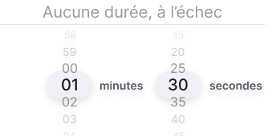

# DSF — Deux modes et cible À l’échec — 13/10/2026

Référence courante pour les composants ci-dessous, en complément du [DSF Circuits](DSF-CIRCUITS-CONTROLES-2026-10-12.md). Source : prompt transmis et inspection directe des deux pages Figma et du set `5544:5146`. Les dates des fichiers désignent le lot source. Les règles métier sont dans la [spécification](Specifications-fonctionnelles/09%20%E2%80%93%20Mod%C3%A8le%20de%20donn%C3%A9es%20fonctionnel.md#cibles-typees), les interactions dans CE-UI-10 ; Figma détermine le layout.

**Mise à jour du 18/10/2026 — spécification v3.0 :**
- Remplacé pour la présentation : « Popover de mode » (D-413 : ligne Mode en contrôle segmenté ; la condition d’arrêt a sa propre ligne, D-411) ; dans « Roulette de cible », l’option « Aucune durée, à l’échec » pour la durée commune des séries identiques (D-412 : roulette numérique seule ; option conservée pour une cellule de série variable en mode Durée). Le tableau variable est complété par la colonne Charge (D-404) et le cas mixte par le résultat non modifiable « À la cible et à l’échec » (D-411). La roulette Répétitions n’est pas visée par D-412. Géométrie, opacités, bornes et règle 00:00 de la variante avec échec sont inchangées.
- Comportements : règles RM-235 à RM-250 du chapitre 10, [Charge, côtés, cadence et condition d’arrêt — règles du 18/10/2026](Specifications-fonctionnelles/10%20%E2%80%93%20Processus%20m%C3%A9tier%20et%20r%C3%A8gles%20m%C3%A9tier%20transverses.md#charge-côtés-cadence-et-condition-darrêt--règles-du-18102026) (décisions D-403 à D-413 du [registre](Specifications-fonctionnelles/07%20%E2%80%93%20Registre%20des%20d%C3%A9cisions%20de%20conception.md#parametres-execution-20261018)) ; ce DSF n’en reprend pas l’énoncé. Les valeurs des captures restent illustratives.
- Présentation nouvelle de la feuille des paramètres (D-413 ; spécification v3.0, GR-01 et PR-01 à PR-04 ; référence 402 × 874) : quatre cadres successifs espacés de 8 px, dans l’ordre de D-413 ; contrôles segmentés alignés à droite, titres à gauche, sans enveloppe blanche ; tableaux à fond blanc sans contour, lignes de 36 px, sans boutons +/− de tableau ; Cadence en 12 px ; labels Regular, plus petits que les valeurs ; options inactives en texte gris Regular sur le fond des champs variables ; option sélectionnée selon le traitement violet existant ; saisie de la charge au clavier décimal, tableau visible au-dessus du clavier avec une marge de 12 px (D-405) ; chevrons à l’intérieur des options Variables (Type de série) et Avec (Changement de côté) (D-410) ; Durée de l’exercice avec son chevron à 12 px du libellé (D-409).
- Tokens : les valeurs correspondantes sont à relever dans Figma avant publication ; aucun nouveau token n’est défini ici.

## Popover de mode

[présentation remplacée par D-413 le 18/10/2026 : ligne Mode en contrôle segmenté ; condition d’arrêt sur sa ligne propre, D-411] Deux options, Durée et Répétitions ; À l’échec quitte le choix de mode et devient une cible. Référence locale184×99, hauteur automatique (anciennement136). Même traitement en séries identiques/variables. Conserver shell, ancrage, voile et comportement de brouillon existants.

## Roulette de cible

[portée restreinte par D-412 le 18/10/2026 : en mode Durée, variante réservée à une cellule de série variable, RM-250] Le set `DSF / Forms / Roulette` contient désormais cinq variantes. Les quatre numériques restent présentes : Secondes `5544:5101`, Minutes secondes `5544:5118`, Fin de séance `5826:4290`, Secondes avec unité `7130:13496`. La cinquième, `État=Minutes secondes avec échec`, est `8452:13297`.

| Élément de la nouvelle variante | Géométrie locale | Rendu |
|---|---|---|
| Ensemble | 330×181 | Hauteur du contenu |
| Option À l’échec | 330×30, y0 | Texte centré, Inter Regular20, marge verticale3 |
| Séparateur | 330×1, y30 | Remplissage des séparateurs de popover |
| Roulette numérique | 330×150, y31 | Structure numérique conservée |
| Popover hôte de cible | 354×249 | Hauteur automatique ; ancien216 |

[remplacé par D-412 et D-418 le 18/10/2026 pour les roulettes Durée et Répétitions des séries identiques : option absente ; conservée pour une cellule de série variable, RM-250] Libellé : **Aucune durée, à l’échec** / **Aucune répétition, à l’échec**, selon le mode. Option en tête ; pas de coche. En Répétitions, cette option est la ligne de tête de la roulette à une colonne ; aucun bloc horaire 00:00 n’y est transposé. Le contrôle ouvre la cible courante ; ✓ de la roulette applique la sélection au brouillon de la feuille ; ✕ de la roulette restaure la valeur à son ouverture. ✓ de la feuille applique l’ensemble au parent ; ✕ de la feuille annule toutes les modifications depuis son ouverture, y compris celles validées dans une roulette. Aucune persistance définitive à la validation de la roulette. La sélection numérique et l’échec s’excluent mutuellement.

Toutes les lignes numériques ont le remplissage `#1a1a1f`. Le dégradé dépend de **l’opacité du remplissage**, pas d’une nouvelle couleur :

| Position | Opacité | Taille |
|---|---|---|
| Sélection | 100% | 20px |
| Voisine | 45% | 16px |
| Distance2 | 20% | 14px |
| Distance3 | 10% | 12px |
| Option échec sélectionnée / non sélectionnée | 100% / 45% | 20px |

À tout instant, exactement une cible est sélectionnée. À l’ouverture : cible numérique → roulette active sur la valeur courante et libellé échec à45% ; cible échec → libellé actif et bloc numérique grisé à45%, affiché à00:00 en mode Durée uniquement. Faire tourner la roulette sélectionne la valeur numérique et grise le libellé. Toucher le libellé sélectionne l’échec et ramène le bloc numérique grisé à00:00 en mode Durée. Le grisé exprime la non-sélection, pas une interdiction de manipuler la roulette. Aucun geste supplémentaire de déverrouillage, aucune coche. ✓ de la roulette applique la sélection au brouillon de la feuille ; ✕ de la roulette restaure la valeur à son ouverture. ✓ de la feuille applique l’ensemble au parent ; ✕ de la feuille annule toutes les modifications depuis son ouverture, y compris celles validées dans une roulette. Aucune persistance définitive à la validation de la roulette. Cible à renseigner (« — ») : la roulette s’ouvre sur la plus petite valeur valide, sélectionnée (00:05 en Durée, 1 en Répétitions) ; rien n’est appliqué avant le ✓ ; ✕ laisse la cible à renseigner (décision PRE-4 Q25, D-385).00:00 n’est jamais une cible valide ; pause0 reste valide.

Le traitement45% porte sur tout le bloc numérique quand il est non sélectionné ; les niveaux de la roulette active restent ceux du tableau. Ne pas bloquer ses gestes avec une désactivation native : cela empêcherait la transition prescrite. La réalisation et l’accessibilité restent à qualifier sur appareil.

**Bornes confirmées le13/10 :** cible Durée de00:05 à58:55 (5–3535s), sélecteur par pas de5s. Hermann corrige explicitement la borne maximale :58min55s ;5999s était une coquille. Répétitions : entiers1–100.00:00 reste réservé à la représentation neutre de l’échec, jamais une cible. Les valeurs historiques ne sont pas arrondies silencieusement à la lecture ; les contrôles de pauses et de Durée totale conservent leurs règles propres. Valeur historique hors grille : conserver et afficher exactement la valeur tant que l’utilisateur ne la modifie pas, sans arrondi ni plafonnement à la lecture ou à l’ouverture. La roulette propose les valeurs de 5 à 3535 s par pas de 5 s ; une sélection explicite remplace la valeur historique. La cible Durée utilise un pas de 5 s, dans les bornes autorisées, sans pied ± (retiré par D-413) ; ne pas confondre ce pas avec celui des pauses ou des phases. 00:00 ne peut pas être validé comme cible numérique et ne sélectionne jamais implicitement À l’échec. 5999 s n’est pas une borne autorisée.

La roulette **Durée totale** reste sur `5544:5118`,330×150, popover354×216 : aucune option À l’échec. Les références `8328:38084` et l’instance Conception `7413:33276` ne sont pas remplacées par la roulette de cible.

## Tableau variable et total

[complété par D-404 le 18/10/2026 : colonne Charge lorsque la charge est Avec, RM-238] Maître de ligne `8129:31593`, deux colonnes cible/Pause, même lorsque toutes les cibles sont À l’échec. La colonne de valeur avait disparu par anomalie d’instance ; il n’existe pas de variante métier à une colonne. En mode Durée, l’en-tête reste Durée ; les cellules peuvent afficher « à l’échec ».

[complété par D-411 le 18/10/2026 : Condition d’arrêt présentée en résultat unique non modifiable « À la cible et à l’échec », RM-249] Le cas mixte `8470:13303` illustre30s/45s/échec, pauses10s/20s/30s, ≥2min15 en lecture seule. Les chiffres restent des données de démonstration ; le moteur détermine les montants. Tout échec : total absent. La règle d’interdiction du calcul inverse n’ajoute aucun nouveau composant : variable était déjà en lecture seule, identiques tout échec omet le total.

Aucun écran uniforme « Série à l’échec » supplémentaire : la frame créée puis supprimée ne doit pas revenir dans l’inventaire. Les huit cartes catalogue, ses filtres, les roulettes de total et les layouts d’exécution/synthèse/suivi sont conservés dans cette passe.

## Phases d’exercice — état des contrôles

La ligne Phases de l’exercice (Avec / Sans) ouvre le cadre Séries, après le cadre Exécution (D-413). Elle n’est modifiable qu’en Durée chiffrée avec séries identiques ; le chevron n’existe qu’à l’intérieur de l’option Avec (D-410). Avec : création de la première phase. Liste existante : chevron de repli, tableau Libellé/Durée à deux colonnes, poignée et suppression, sans pied ni boutons +/− (D-413). Maximum6 phases, libellé20 caractères ; saisie texte pour le libellé, contrôle de durée pour une valeur éditable.

La durée de série calculée et la dernière durée sous format restent lisibles et non modifiables, sans tiret. La ligne Phases indisponible n’a pas le sens d’une valeur calculée ni d’une valeur imposée mais effective. Réutiliser les styles existants, sans déclarer qu’un nouveau maître a été créé. La raison d’indisponibilité doit être accessible ; le seul gris ne porte pas la règle.

Le rapport Figma du15/10 indique une insertion de42px, un fond gris se terminant16px après la dernière ligne et une marge basse de24px ; les feuilles suivent la hauteur de leur contenu et le chevron Séries reste aligné sur son libellé. Ces mesures sont celles du rapport, à vérifier au relevé des frames ; elles ne deviennent pas des hauteurs fixes sur tous les appareils. Corps défilant, clavier et Safe Areas selon le shell existant.

La roulette de cible chiffrée ci-dessus ne détermine pas les bornes de phase : un exemple6+3 est valide dans la conception. Pas/bornes spécifiques et cas extrêmes restent localisés au chapitre08. États et interactions complets : CE-UI-10. Les captures des phases ne sont pas actualisées dans cette consolidation.

## Accessibilité et limites

Adapter les géométries à360/402/440 et au texte agrandi ; conserver focus modal, défilement du corps et actions accessibles. Annoncer l’option sélectionnée et le caractère non éditable du total ; ne pas transmettre l’état uniquement par le gris. Les cibles tactiles suivent le DSF général, indépendamment de la hauteur dessinée30px.

La règle d’unité de la grille Volumes pour les cibles mixtes est désormais énoncée au [chapitre 10, « Grille des volumes »](Specifications-fonctionnelles/10%20%E2%80%93%20Processus%20m%C3%A9tier%20et%20r%C3%A8gles%20m%C3%A9tier%20transverses.md#grille-des-volumes) (transfert G4) ; son rendu n’est pas illustré dans ce lot. Les autres réserves héritées du DSF Circuits ne sont pas déclarées résolues. Voir [matrice de traçabilité](MATRICE-DEUX-MODES-ECHEC-2026-10-13.md).

## Raccordement Formats du 14/10/2026

Le [DSF Formats](DSF-FORMATS-SEANCES-2026-10-14.md) complète ce document : organisation Par exercice/En alternance, compte nommé selon son unité, constantes Tabata grisées mais effectives et phrases contextuelles. L’état imposé effectif conserve une valeur réelle ; ne pas lui appliquer le tiret des valeurs sans effet. Les cartes de modèles illustrées ne changent pas la règle des cartes catalogue. Les points de layout non qualifiés restent signalés dans la [revue transverse](REVUE-COHERENCE-FORMATS-2026-10-14.md).
