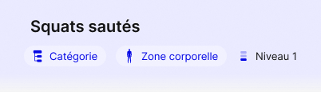

# Figma — Gestes, filiation et niveaux — 23 octobre 2026

**Actualisation normative du 25/10 :** la [v5 définitive](KODJO-Niveaux-Recherche-Parcours-Regles-v5.md) remplace les comportements antérieurs contradictoires de ce relevé : état vide « Niveau », crayon du contenu partagé aussi en édition Catalogue, alias, création par difficulté, recherche et reprise des phases par position. Les images ci-dessous restent des exports du 23/10, pas des preuves de réalisation de la v5. Aucun nouvel export Figma effectué dans cette passe. Les placements de cartes et symboles complémentaires restent ouverts selon v5 §13.

Référence : fichier `G6RY5Ebhgwb4AHIOYDwwvg`, rapport du propriétaire et exports directs vérifiés le 23/10/2026. Ce relevé complète D-437 à D-439 et les contrats CE-T03-02, CE-T03-04 et CE-UI-10 ; il ne modifie ni le modèle ni le périmètre de migration D-440. Aucun fichier Figma ni code applicatif modifié par cette passe documentaire.

## Écrans et couverture

Les cinq états ci-dessous appartiennent au parcours CE-T03-04, pas à cinq nouvelles destinations de navigation. Captures dans le [chapitre 06](Specifications-fonctionnelles/06%20%E2%80%93%20Ecrans%20et%20navigation%20de%20la%20V1.md#gestes-et-niveaux--captures-du-23102026).

| État | Nœud Figma | Contrat et portée |
|---|---|---|
| Suggestion de rapprochement | `9882:19049` | CE-T03-04 : trois choix explicites, sans présélection ; recherche accessible |
| Mouvement repris, lecture seule | `9891:39982` | CE-T03-04 : contenu du geste repris verrouillé, paramètres éditables, crayon pour le contenu |
| Confirmation à la sauvegarde | `9952:44349` | CE-T03-04 : feuille basse de décision conditionnelle, nombre d’exercices concernés |
| Contenu éditable | `9959:19518` | CE-T03-04 : modification du brouillon du geste, pas écriture immédiate du partagé |
| Recherche d’un geste | `9959:19623` | CE-T03-04 : tous les gestes disponibles, locaux compris |
| Popover du niveau | `9577:19843` | CE-T03-04 / CE-T03-02 : « Changer de niveau », « Ajouter un niveau » ; en-tête encore partiellement ancien |

Les captures déjà affichées `8328:36853`, `8328:35698`, `8328:35810`, `8328:36056`, `8328:36348`, `8328:36536` sont réexportées à leurs chemins existants. Leur date de dossier historique n’est pas celle du dernier export. Les autres captures historiques ne sont pas certifiées par ce lot. Le rapport annonce 50 instances MVP et 51 hors MVP touchées : ces nombres ne constituent pas un recensement indépendant de cette passe.

## Composants et layout

| Composant | Référence | Contrat |
|---|---|---|
| `icon/niveau` | `9932:44044` | Variantes Niveau 1, 2, 3 ; trois tranches, atteintes pleines, autres à 28 % |
| `icon/modifier` | `9925:41240` | Crayon au trait, bleu KODJO ; origine Lucide signalée, pas d’adoption implicite d’une nouvelle bibliothèque applicative |
| `Sélecteur classification` | `9925:41506`, `9925:41515` | Rôle Niveau, états Vide / Renseigné ; Rôle accepte Catégorie, Zone, Niveau |
| `Zone bleue — Nom et média` | `9029:18368` ; rangée `9029:18363` | Niveau en troisième position ; espacement 12 pt, marges latérales 6 pt ; zones élastiques et tronquées pour préserver catégorie et niveau |

Les mesures décrivent le composant partagé, pas une mise à l’échelle globale de l’écran. Préserver les cibles tactiles ≥ 44 × 44, les Safe Areas et la taille de texte accessible. La troncature visuelle des zones ne tronque ni les données ni le libellé accessible. Le crayon est annoncé « Modifier le geste » ; le rang est annoncé en texte, jamais par la jauge seule.

La pastille renseigne « Niveau X » ; le choix du niveau affiche aussi le total. Rang et total sont dérivés du groupe, jamais persistés dans l’exercice ou l’historique. Un geste sans groupe ou singleton n’affiche pas un faux « Niveau 1 » : état vide / rang masqué selon MFN-05. Les trois variantes graphiques ne créent aucune limite métier à trois niveaux ; la représentation d’un rang supérieur à trois reste à compléter dans Figma.

## Navigation normative et brouillons

| Origine / action | Destination et effet attendu |
|---|---|
| Nom proche | Suggestion ; aucune attribution implicite |
| Même geste, autres paramètres | Geste repris ; même identité, paramètres propres au nouvel exercice |
| Variante de ce geste | Nouveau geste éditable ; sauvegarde directe après validation, sans question de correction de l’original ; rattachement explicite selon MFN-06/07 |
| Geste indépendant | Création vierge, identité distincte sans groupe |
| Rechercher un autre geste | Recherche spécialisée, y compris gestes créés dans une séance ; pas un Catalogue Mouvement |
| Sélection d’un résultat | Reprise du geste réellement choisi, non d’un exemple Squats codé en dur |
| Crayon du geste repris | Édition du contenu dans le brouillon ; aucune mutation immédiate des autres exercices |
| Terminer sans changement de contenu, ou paramètres seuls | Validation et enregistrement sans dialogue d’identité |
| Terminer avec contenu modifié et geste déjà utilisé | Confirmation MFN-08 ; contenu = nom, description, média ou structure des phases |
| Annuler la confirmation | Retour au brouillon appelant, valeurs et contexte conservés ; aucun enregistrement |
| Changer de niveau | Choix du niveau, puis choix explicite des paramètres si plusieurs exercices |
| Ajouter un niveau | Création d’un nouveau geste et de son exercice, jamais d’un niveau seul |

L’ouverture d’un exercice Catalogue existant reste directement en édition. La lecture seule de `9891:39982` concerne la création sur geste repris, pas un nouveau verrou général. Une occurrence enregistrée reste verrouillée et n’expose aucun crayon de déverrouillage. Les durées et autres paramètres autorisés restent modifiables conformément à CE-UI-10.

En **création sur un geste repris**, les choix sont « Corriger ce geste », « En faire un geste distinct », « Annuler ». En **modification d’un exercice Catalogue**, MFN-08 conserve « Corriger cet exercice », « Créer un nouvel exercice », « Annuler ». La sémantique d’identité est identique ; en création, ne pas créer un second exercice superflu. Le nombre d’autres exercices et le nombre total concernés sont calculés, jamais les constantes 2 et 3 de la maquette. Une création en cours compte dans le total annoncé après sauvegarde, pas comme exercice déjà enregistré. Les copies et historiques sont exclus des modifications annoncées.

La confirmation est une feuille basse selon `9952:44349`, avec deux choix expliqués et Annuler. L’étape de complétion des durées manquantes des exercices frères reste distincte et encore sans frame dédiée.

## Références retirées et écarts explicites

- « Nouveau niveau » en swipe Catalogue hors MVP est retiré. Les trois actions D-196 restent Planifier / Dupliquer / Archiver. Utiliser le popover ; ne pas ajouter une quatrième action.
- « Création exercice — Geste — État vide » n’est plus une référence autonome ; utiliser l’état initial existant. L’export actuel `8328:35698` ne montre pas de pastille Niveau : ne pas revendiquer une propagation visuelle exhaustive à tous les états.
- Le câblage actuel variante → confirmation est non conforme : une variante explicite doit se sauvegarder directement. Le lien systématique Terminer → confirmation n’est pas une condition métier.
- Le lien Annuler → geste repris ne doit pas faire perdre le brouillon éditable ; les cinq résultats de recherche ne doivent pas tous reprendre Squats.
- Les exports vérifiés montrent déjà Squats au niveau 2 et la recherche avec les niveaux 1/2/3 : la remarque du rapport « tous au niveau 1 » n’est plus générale. Les anciennes captures Squats sautés / Niveau 1 et l’en-tête du popover « 2 sur 3 » restent des exemples incohérents, pas des règles.
- La suggestion dit « déjà dans votre catalogue ». Adapter cette mention à l’origine du résultat, ou employer une formulation neutre pour un geste local ; la recherche ne publie pas ce geste au Catalogue.
- La jauge du popover reste ancienne. Le composant partagé fixe la cible d’espacement ; la présence de nouvelles captures ne vaut pas certification de toutes les instances et de leur responsive.
- Les 51 écrans hors MVP affectés par héritage ne deviennent pas la référence MVP. La nouvelle icône vérifiée est au trait : la mention « pleine » du rapport n’est pas retenue.

## Recette complémentaire à MFN/AC01–37

1. Reprendre un geste, changer uniquement les paramètres, enregistrer sans dialogue ; aucun autre exercice modifié.
2. Déverrouiller le contenu repris ; corriger un geste utilisé ; vérifier les comptes et la mise à jour des seules définitions concernées. Annuler conserve le brouillon sans écriture.
3. Créer une variante explicite : nouvelle identité, aucune confirmation redondante, original et historiques inchangés.
4. Rechercher et reprendre un geste local absent du Catalogue ; vérifier l’identité choisie et l’absence de publication automatique.
5. Contrôler les niveaux 1/2/3, groupe singleton, absence de groupe, réordre et noms identiques. Ne pas inventer une limite à trois ; compléter la référence graphique pour les rangs supérieurs avant qualification visuelle.
6. Vérifier le popover, l’absence de Nouveau niveau dans les swipes, le verrouillage des occurrences, la troncature des zones et les cibles accessibles sur 360/402/440 pt avec texte agrandi.

Ces scénarios sont des obligations de recette à l’implémentation, pas des tests applicatifs exécutés par cette mise à jour documentaire.
