# Interface : navigation, écrans et conventions communes

## Composition — actualisation du 28/10/2026

Références de rendu vérifiées le 28/10 : menu 10705:20223 ; deux circuits 10717:20056 et 10725:20142 ; cycle 10744:20108 ; base 10818:20175 ; placement circuit 10819:20344 ; circuit créé 10821:20222 ; placement cycle 10836:20478. Le tableau de la référence consolidée donne les liens. Les captures historiques de composition ne font plus foi pour ces en-têtes. Voir [Composition du 28/10](../KODJO-Composition-conteneurs-2026-10-28.md).

## Catalogue des mouvements — familles, référence du 28/10/2026

Trois écrans documentent le geste continu selon CE-MVT-03 et les [règles A à E](../DSF-FAMILLES-CATALOGUE-MOUVEMENTS-2026-10-28.md). Les niveaux sont recalculés pendant le déplacement. Le message est réservé au changement d’appartenance, avec Annuler pendant 3 secondes ; aucun message de simple réordonnancement.

**Mouvement — Catalogue — Pile — Déplacement** — [10480:23374](https://www.figma.com/design/G6RY5Ebhgwb4AHIOYDwwvg?node-id=10480-23374)

**Mouvement — Catalogue — Pile — Création d’une famille** — [10797:20492](https://www.figma.com/design/G6RY5Ebhgwb4AHIOYDwwvg?node-id=10797-20492)

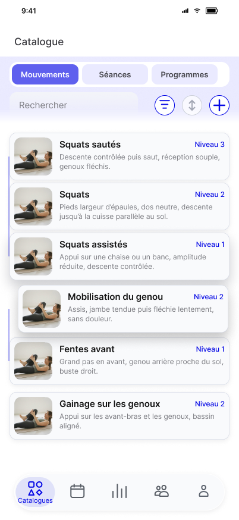

**Mouvement — Catalogue — Pile — Message de confirmation** — [10484:23428](https://www.figma.com/design/G6RY5Ebhgwb4AHIOYDwwvg?node-id=10484-23428)

Exports directs 402 × 874, sans retouche ; [manifest et SHA-256](../figma-familles-2026-10-28/captures.json). Le nœud `10484:23428`, auparavant Réordonnée, porte maintenant Message de confirmation et illustre la création d’une famille. Le nouvel écran `10797:20492` porte le catalogue à 13 frames. Les captures du 27/10 restent historiques pour ces deux nœuds remplacés ; celles-ci constituent la référence actuelle. Sortie et entrée n’exigent aucun écran supplémentaire : voir B2 et C.

> **C08 — actualisation du 28/10/2026.** La [composition des familles depuis le catalogue](../DSF-FAMILLES-CATALOGUE-MOUVEMENTS-2026-10-28.md), règles A à E et CE-MVT-03, est désormais définie : rattacher, détacher et dissoudre une famille par geste. Les mentions antérieures « C08 différé » restent historiques pour ces opérations ; elles ne sont plus une restriction active. La suppression définitive d'un mouvement reste distincte et n'est pas clôturée par ce lot.

## Catalogue Mouvement — Ajouter un niveau dans le glissé

Les libellés des cinq états de fiche/recherche concernés sont actualisés dans les captures existantes. Deux états de catalogue et deux composants sont ajoutés au dossier (29 PNG au total). Le choix depuis le catalogue ne passe jamais par `10415:21939`, réservé à l'entrée depuis les mouvements proches. Voir CE-MVT-02.

| État | Nœud Figma | Capture |
| --- | --- | --- |
| Actions glissées | `10475:47634` | [PNG](images/navigation-2026-10-27/10475-47634.png) |
| Ajouter un niveau, sens déployé | `10579:21580` | [PNG](images/navigation-2026-10-27/10579-21580.png) |
| DSF — Trois actions | `10586:45516` | [PNG](images/mouvements-2026-10-27/10586-45516.png) |
| DSF — Choix du sens | `10586:45517` | [PNG](images/mouvements-2026-10-27/10586-45517.png) |

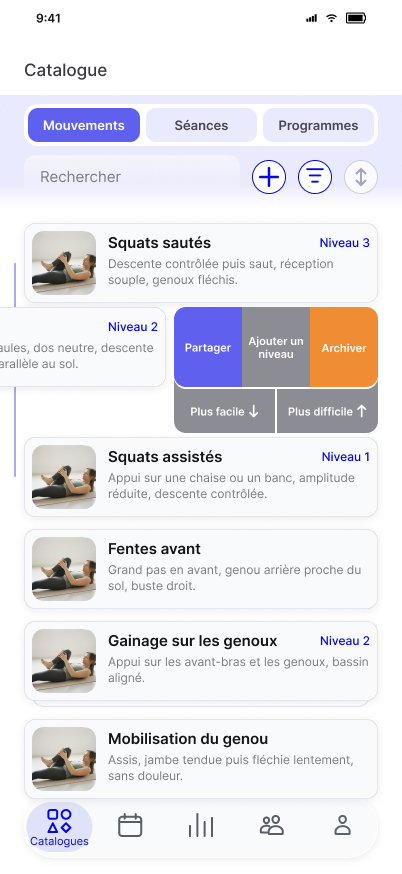

Le relevé du 27/10 comporte 12 états après insertion de cet écran juste après Actions glissées ; le catalogue en comporte 13 au 28/10 avec Création d’une famille. Les références numériques des frames existantes sont conservées. Les captures reproduisent le prototype, sans retouche ; les règles de déploiement et d'allongement du filet sont normatives même si un tracé de démonstration est incomplet.

## Parcours Mouvement — référence visuelle du lot ciblé (27/10/2026)

Le gabarit `10453:23030` et ses états remplacent le shell ancien « Paramètres, Description, Média » pour la fiche Mouvement. Le chapitre 13, CE-MVT-01, définit la navigation et les conditions des dialogues. Clavier ouvert dans la Description ou les Phases (27/10/2026) : contexte et média restent fixes, le contenu éditable remonte devant le média sur une surface claire translucide puis reprend sa place à la fermeture (CE-MVT-01 §10) ; cet état n'est pas représenté dans Figma. Les cadres mesurent 402 × 874, sauf la planche comparative d'icônes. Les tailles sont des références de conception, pas une taille de terminal imposée.

**Mouvement — Initial**

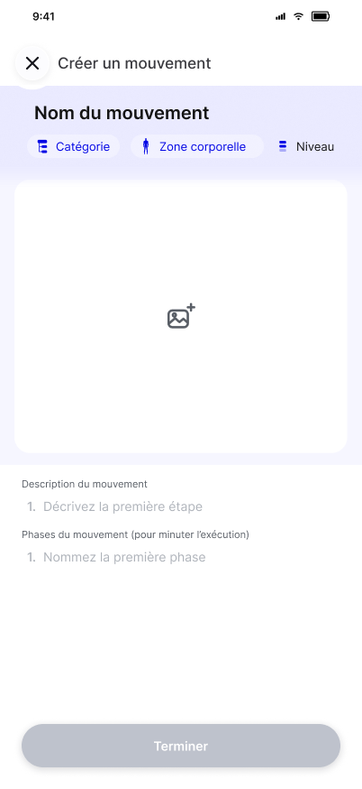

**Mouvement — Fiche**

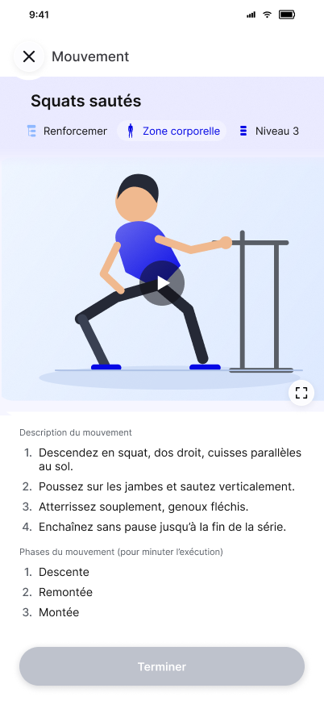

**Référence active PRE-9 — Résultats de recherche des Mouvements :** [spécification finale](../KODJO-Resultats-recherche-mouvements-PRE9-2026-10-30.md) et CE-MVT-RESULT-01. Les nœuds Figma `10415:21713`, `10415:21814`, `10415:21916`, `10415:21939` utilisent la carte Résultat avec bouton « Ajouter un niveau ». Les nœuds `9882:19049`, `10175:20349`, `10131:21995` utilisent la carte Composition **sans bouton**. Les **sept copies PNG des écrans cités** ont été actualisées dans leurs chemins physiques existants depuis Figma le 30/10/2026 ; le composant Résultat `10199:22268` a également sa capture actualisée au chapitre 12. Les noms d'exemples des captures ne sont pas des données fixes.

**Mouvement — Mouvements proches**

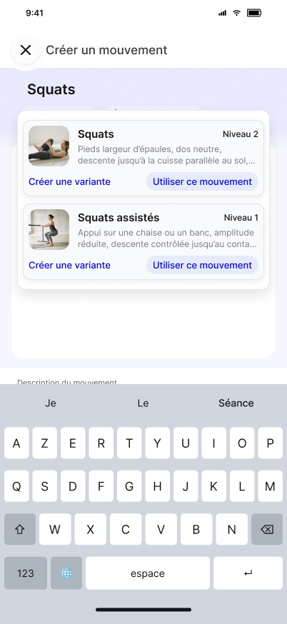

**Mouvement — Niveau, formulaire vierge**

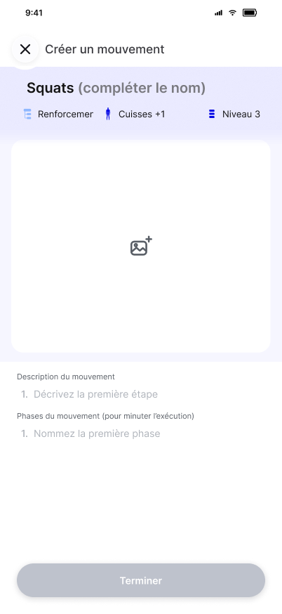

**Mouvement — Sauvegarde — Nom inchangé**

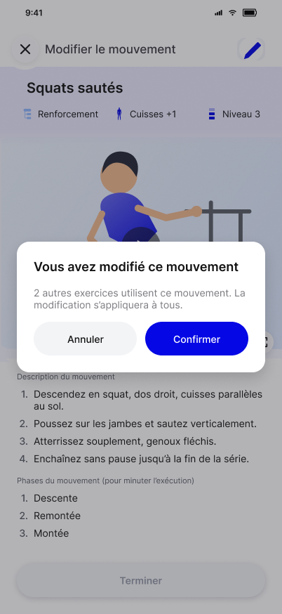

**Mouvement — Sauvegarde — Choix sélectionné**

Le bloc média adopte uniquement l'emplacement et les dimensions du nouveau gabarit Figma. Tous les comportements existants sont conservés : ajout/import, consultation/lecture, retrait et réordonnancement. La disparition de l'accordéon inférieur ne supprime aucune de ces commandes et n'introduit aucun nouveau parcours. Aucun écran ni arbitrage média supplémentaire n'est un prérequis de PRE-8.

### Inventaire exhaustif des 25 états exportés

| État | Figma | Capture locale |
| --- | --- | --- |
| Mouvement — Initial | [10415:21706](https://www.figma.com/design/G6RY5Ebhgwb4AHIOYDwwvg?node-id=10415-21706) | [PNG](images/mouvements-2026-10-27/10415-21706.png) |
| Mouvement — Mouvements proches | [10415:21713](https://www.figma.com/design/G6RY5Ebhgwb4AHIOYDwwvg?node-id=10415-21713) | [PNG](images/mouvements-2026-10-27/10415-21713.png) |
| Mouvement — Nom déjà utilisé | [10415:21814](https://www.figma.com/design/G6RY5Ebhgwb4AHIOYDwwvg?node-id=10415-21814) | [PNG](images/mouvements-2026-10-27/10415-21814.png) |
| Mouvement — Options d’un résultat | [10415:21916](https://www.figma.com/design/G6RY5Ebhgwb4AHIOYDwwvg?node-id=10415-21916) | [PNG](images/mouvements-2026-10-27/10415-21916.png) |
| Mouvement — Niveau, plus facile ou plus difficile | [10415:21939](https://www.figma.com/design/G6RY5Ebhgwb4AHIOYDwwvg?node-id=10415-21939) | [PNG](images/mouvements-2026-10-27/10415-21939.png) |
| Mouvement — Niveau, formulaire vierge | [10415:21980](https://www.figma.com/design/G6RY5Ebhgwb4AHIOYDwwvg?node-id=10415-21980) | [PNG](images/mouvements-2026-10-27/10415-21980.png) |
| Mouvement — Catégories | [10415:21993](https://www.figma.com/design/G6RY5Ebhgwb4AHIOYDwwvg?node-id=10415-21993) | [PNG](images/mouvements-2026-10-27/10415-21993.png) |
| Mouvement — Catégorie — Appui long — Confirmation suppression | [10415:22051](https://www.figma.com/design/G6RY5Ebhgwb4AHIOYDwwvg?node-id=10415-22051) | [PNG](images/mouvements-2026-10-27/10415-22051.png) |
| Mouvement — Nouvelle catégorie | [10415:22111](https://www.figma.com/design/G6RY5Ebhgwb4AHIOYDwwvg?node-id=10415-22111) | [PNG](images/mouvements-2026-10-27/10415-22111.png) |
| Mouvement — Catégorie renseignée | [10415:22269](https://www.figma.com/design/G6RY5Ebhgwb4AHIOYDwwvg?node-id=10415-22269) | [PNG](images/mouvements-2026-10-27/10415-22269.png) |
| Mouvement — Zones corporelles | [10415:22275](https://www.figma.com/design/G6RY5Ebhgwb4AHIOYDwwvg?node-id=10415-22275) | [PNG](images/mouvements-2026-10-27/10415-22275.png) |
| Mouvement — Zones corporelles — Appui long — Confirmation suppression | [10415:22304](https://www.figma.com/design/G6RY5Ebhgwb4AHIOYDwwvg?node-id=10415-22304) | [PNG](images/mouvements-2026-10-27/10415-22304.png) |
| Mouvement — Nouvelle zone corporelle | [10415:22335](https://www.figma.com/design/G6RY5Ebhgwb4AHIOYDwwvg?node-id=10415-22335) | [PNG](images/mouvements-2026-10-27/10415-22335.png) |
| Mouvement — Sauvegarde — Nom inchangé | [10415:22488](https://www.figma.com/design/G6RY5Ebhgwb4AHIOYDwwvg?node-id=10415-22488) | [PNG](images/mouvements-2026-10-27/10415-22488.png) |
| Mouvement — Sauvegarde — Nom modifié | [10415:22524](https://www.figma.com/design/G6RY5Ebhgwb4AHIOYDwwvg?node-id=10415-22524) | [PNG](images/mouvements-2026-10-27/10415-22524.png) |
| Mouvement — Sauvegarde — Choix sélectionné | [10415:22566](https://www.figma.com/design/G6RY5Ebhgwb4AHIOYDwwvg?node-id=10415-22566) | [PNG](images/mouvements-2026-10-27/10415-22566.png) |
| Mouvement — Contenu éditable | [10415:22610](https://www.figma.com/design/G6RY5Ebhgwb4AHIOYDwwvg?node-id=10415-22610) | [PNG](images/mouvements-2026-10-27/10415-22610.png) |
| Mouvement — Abandon (confirmation) | [10415:22638](https://www.figma.com/design/G6RY5Ebhgwb4AHIOYDwwvg?node-id=10415-22638) | [PNG](images/mouvements-2026-10-27/10415-22638.png) |
| Mouvement — Paramètres — Résumé affiché — Niveau (pastilles) — Popover | [10415:22646](https://www.figma.com/design/G6RY5Ebhgwb4AHIOYDwwvg?node-id=10415-22646) | [PNG](images/mouvements-2026-10-27/10415-22646.png) |
| Mouvement — Niveau — Changer de niveau (déployé) | [10415:22683](https://www.figma.com/design/G6RY5Ebhgwb4AHIOYDwwvg?node-id=10415-22683) | [PNG](images/mouvements-2026-10-27/10415-22683.png) |
| Mouvement — Niveau — Ajouter un niveau (déployé) | [10415:22726](https://www.figma.com/design/G6RY5Ebhgwb4AHIOYDwwvg?node-id=10415-22726) | [PNG](images/mouvements-2026-10-27/10415-22726.png) |
| Mouvement — Depuis le catalogue — Sauvegarde — Nom modifié | [10415:22786](https://www.figma.com/design/G6RY5Ebhgwb4AHIOYDwwvg?node-id=10415-22786) | [PNG](images/mouvements-2026-10-27/10415-22786.png) |
| Mouvement — Repris (lecture seule) | [10419:22924](https://www.figma.com/design/G6RY5Ebhgwb4AHIOYDwwvg?node-id=10419-22924) | [PNG](images/mouvements-2026-10-27/10419-22924.png) |
| Mouvement — Niveau — icônes, trois états | [10419:23030](https://www.figma.com/design/G6RY5Ebhgwb4AHIOYDwwvg?node-id=10419-23030) | [PNG](images/mouvements-2026-10-27/10419-23030.png) |
| Mouvement — Fiche | [10453:23030](https://www.figma.com/design/G6RY5Ebhgwb4AHIOYDwwvg?node-id=10453-23030) | [PNG](images/mouvements-2026-10-27/10453-23030.png) |

Les anciens exports du 25/10 restent des preuves historiques pour les autres parcours. Leur statut de quota ne concerne pas ces 25 exports, tous disponibles. Les écarts de libellés/instances sont consignés dans la spécification ciblée ; les PNG reproduisent Figma sans retouche.

> **Référence ciblée — parcours Mouvement, 27/10/2026.** [Création et modification des mouvements](../DSF-MOUVEMENTS-CREATION-EDITION-2026-10-27.md) remplace, sur ce périmètre seulement, les anciens écrans de création d’exercice : nouveau gabarit, structure des phases sans durées, modification et variante depuis le catalogue des mouvements. Le crayon et la création de variante depuis une séance ne sont plus des parcours cibles. Les règles de recherche R01–R08 et de sauvegarde C03 restent applicables. Les autres lots de la simplification ne sont pas déclarés documentés ou livrés par cette mise à jour.

> **Cible validée D-449 — 26/10/2026.** [Six décisions closes](../KODJO-Seance-Objet-Unique-Decisions-2026-10-26.md). Les dispositions ci-dessous sur l’exercice autonome de catalogue, le lancement `ACTIVITY`, le cycle technique unique et les catalogues séparés par nature décrivent le modèle antérieur et sont remplacées sur ces seuls points. Les autres règles restent applicables. La réalisation et les visuels Figma ne sont pas déclarés livrés.

## Écrans à adapter après consolidation — D-449

Un seul catalogue de séances expose désormais les vues « Un exercice | Plusieurs » ; voir la référence du 27/10/2026 ci-dessous. Les actions de lancement portent sur la séance entière. Prévoir la reprise de composition au niveau principal et plusieurs cycles successifs sans imbrication. Les captures existantes reflètent l’état antérieur ; aucune nouvelle capture ni modification Figma n’est prétendue dans cette mise à jour.

**D-445 — décisions validées le 25/10 :** C01–C07 et C09 sont clos ; C08 seul reste différé sur le périmètre MVP. [Spécification consolidée v7](../KODJO-Niveaux-Recherche-Parcours-Regles-v7.md).

Ce chapitre décrit l’interface dans son ensemble : navigation, inventaire des écrans et de leurs contrats, captures, et conventions d’interface communes à plusieurs écrans. La sélection actuelle conserve 62 captures de référence parmi les 197 frames de premier niveau du Prototype MVP ; les 135 autres frames restent dans Figma et sont couvertes comme variantes, sans copie supplémentaire dans ce chapitre. Le comportement propre à chaque écran est défini par son contrat au chapitre 13 ; le rendu visuel par Figma.

**Évolutions v15 du 07/10 :**36captations vérifiées, dont 15PNG changés depuis main 72d1bf4. [Inventaire et preuves](../MATRICE-EVOLUTIONS-V15-2026-10-07.md), [DSF phrases](../DSF-PHRASES-V15-2026-10-07.md). Vue longue renommée 224caractères ; les calculs déjà décidés sont conservés.

## Sommaire

- [Objet et organisation](#objet-et-organisation)
  - [Organisation et lecture](#organisation-et-lecture)
  - [Couverture du Prototype MVP et exclusions justifiées](#couverture-du-prototype-mvp-et-exclusions-justifiées)
  - [Références transverses des cartes et appuis](#références-transverses-des-cartes-et-appuis)
  - [HISTORIQUE — Catalogue Séances — ancien arbre Créer — supersédé D-187](#historique--catalogue-séances--ancien-arbre-créer--supersédé-d-187)
  - [Règles générales d’interface](#règles-générales-dinterface)
  - [Évolution des vues de composition](#évolution-des-vues-de-composition)
- [Navigation, écrans et captures](#navigation-écrans-et-captures)
  - [Navigation principale et articulation des écrans](#navigation-principale-et-articulation-des-écrans)
  - [Vues principales et états intégrés](#vues-principales-et-états-intégrés)
  - [Profil](#profil)
  - [Catalogue des séances](#catalogue-des-séances)
  - [Vues principales et états intégrés](#vues-principales-et-états-intégrés-3)
  - [Modales, panneaux et confirmations](#modales-panneaux-et-confirmations-1)
  - [Composer une séance / Modifier une séance](#composer-une-séance--modifier-une-séance)
  - [Créer ou modifier un exercice](#créer-ou-modifier-un-exercice)
  - [Calendrier](#calendrier)
  - [États de référence actuels](#états-de-référence-actuels)
  - [Exécution — séance ou exercice](#exécution--séance-ou-exercice)
  - [Synthèse — séance ou exercice](#synthèse--séance-ou-exercice)
  - [Suivi — Séances](#suivi--séances)
  - [Formats de séances — inventaire et captures](#formats-de-séances--inventaire-et-captures)
- [Conventions d’interface communes](#conventions-dinterface-communes)
  - [Contrat d’affichage commun aux écrans du MVP](#contrat-daffichage-commun-aux-écrans-du-mvp)
  - [Composant transverse `Status / Badge`](#composant-transverse-status--badge)
  - [Conventions communes d’interface](#conventions-communes-dinterface)
  - [Titres affichés](#titres-affichés)
  - [Principes d’expérience](#principes-dexpérience)
  - [Parcours prévus pour une phase ultérieure — Parcours visuels des cartes](#parcours-prévus-pour-une-phase-ultérieure--parcours-visuels-des-cartes)
  - [MVP T03 — Exercice directement exécutable — Précision MVP T03 — Carte d’Exercice et vignette média](#mvp-t03--exercice-directement-exécutable--précision-mvp-t03--carte-dexercice-et-vignette-média)
  - [Conventions communes d’interface](#conventions-communes-dinterface-1)
  - [Placement des récupérations et des points d’arrêt — Contenu et trait de démarcation](#placement-des-récupérations-et-des-points-darrêt--contenu-et-trait-de-démarcation)
  - [Champs et comportements des fonctionnalités — Planifier une Séance ou un Exercice](#champs-et-comportements-des-fonctionnalités--planifier-une-séance-ou-un-exercice)
  - [Champs et comportements des fonctionnalités — Dialogues de confirmation](#champs-et-comportements-des-fonctionnalités--dialogues-de-confirmation)
  - [Champs et comportements des fonctionnalités — Conventions communes d’interface](#champs-et-comportements-des-fonctionnalités--conventions-communes-dinterface)
  - [Migration T03 — Catalogue des Exercices — Impacts de données de la revue des cartes](#migration-t03--catalogue-des-exercices--impacts-de-données-de-la-revue-des-cartes)
  - [RG des cartes](#rg-des-cartes)
  - [Impact API de la revue des cartes](#impact-api-de-la-revue-des-cartes)
  - [Cartes, grille des volumes et interactions de composition](#cartes-grille-des-volumes-et-interactions-de-composition)
  - [Implantation du bip et comportement des steppers](#implantation-du-bip-et-comportement-des-steppers)
  - [Cartes d’Exercice — règles RG-1 à RG-13](#cartes-dexercice--règles-rg-1-à-rg-13)

## Objet et organisation

### Organisation et lecture

Les familles sont identifiées par leur **titre**, sans numérotation d’écran. Les noms physiques des images sont conservés pour préserver les références existantes. Chaque famille rassemble ses règles et toutes ses captures :

- **Vues principales et états intégrés** : écran de base, variantes, déplacement, sélection ou valeur modifiée ;
- **Modales, panneaux et confirmations** : contenu superposé à l’écran parent, y compris sélection, création d’une valeur, roulette et confirmation ;
- **Bulle contextuelle** : action attachée à un élément précis, sans nouvelle page ;
- **Variantes Information et Média** : rangées dans Exécution, avec leur statut de livraison propre.

Une frame Figma de 402 × 874 peut représenter une modale et son arrière-plan ; sa taille n’en fait pas un écran autonome. Les captures sont intégrées en Markdown standard, affichables hors Obsidian. La [matrice de couverture](../MATRICE-COUVERTURE-FIGMA-CHAPITRE-06.md) sert d’inventaire ; les images se trouvent dans les familles ci-dessous, sans seconde galerie en fin de chapitre.

#### Mise à jour Cadence et DSF

Baseline documentaire 6d03f5be579f2d0e2e7602b6abf1c2b46f4c740b ; 133 frames courantes de Prototype MVP recensées et captures renouvelées sans retouche.  : chaque frame, fichier et contrat hôte. Les références datées précédentes restent des preuves historiques, notamment les états retirés ou horsMVP.

Cadence et phrase relèvent de [Paramètres et brouillon d’un exercice](08%20%E2%80%93%20Conception%20fonctionnelle%20d%C3%A9taill%C3%A9e.md#paramètres-et-brouillon-dun-exercice), [Résultats temporels et agrégation du circuit](10%20%E2%80%93%20Processus%20m%C3%A9tier%20et%20r%C3%A8gles%20m%C3%A9tier%20transverses.md#résultats-temporels-et-agrégation-du-circuit), [Exécution d'une séance — Bip de cadence, progression et sécurité](10%20%E2%80%93%20Processus%20m%C3%A9tier%20et%20r%C3%A8gles%20m%C3%A9tier%20transverses.md#exécution-dune-séance--bip-de-cadence-progression-et-sécurité) et [Phrase de synthèse des paramètres](08%20%E2%80%93%20Conception%20fonctionnelle%20d%C3%A9taill%C3%A9e.md#phrase-de-synthèse-des-paramètres). Figma fournit le rendu ; Excel seulement les formulations. Aucun chiffre de capture ne constitue une règle de durée. DSF, couleurs, composants, police et Safe Areas : [référence courante](../DSF-CADENCE-2026-10-06.md).

### Couverture du Prototype MVP et exclusions justifiées
#### Périmètre intégré

Les tableaux d’états d’écran contiennent une capture lorsqu’une copie courante existe. Les références sans copie sont explicitement historiques, absentes de Figma ou des composants sans écran autonome.

La page Figma `Prototype MVP` (`510:101`) constitue la source visuelle des frames de production. Une capture ne remplace pas la règle écrite : le présent chapitre définit les comportements, tandis que les captures et le chapitre 13 définissent les références visuelles et critères déterministes.

#### Éléments non intégrés comme écrans distincts

Les calques internes, zones tactiles transparentes, cibles de défilement et duplications de liens de prototypage ne constituent pas des écrans distincts. Les états fonctionnels sans frame dédiée réutilisent les composants de leurs écrans parents ; aucune fausse capture Figma ne doit être inventée.

#### Règle de maintenance

Toute frame de premier niveau de `Prototype MVP` appartient au MVP. Le chapitre 06 conserve une capture pour chaque référence visuelle principale retenue ; les variantes peuvent être couvertes par le même contrat et la même capture principale, sans image supplémentaire. Les variantes ne sont pas exclues du périmètre fonctionnel : leurs spécificités sont définies dans les contrats du chapitre 13 et les règles applicables. Aucun état particulier n'est supprimé de Figma du seul fait de cette sélection documentaire.

#### Mise à jour Bilatéralité — rectifiée

Le contrôle Exercice porte le libellé `Changement de côté` et propose `Avec` et `Sans` (D-406, RM-242) ; il ne propose plus de côté de départ anatomique. Sa géométrie suit le Figma courant et le DSF actif. Aucun contrôle de changement de côté n’est exposé au niveau du Circuit.

Dans la Composition actuelle, aucun contrôle de changement de côté n’est affiché dans l’en-tête du Circuit. Le stepper `Nombre de tours` reste la seule commande numérique de ce groupe ; les anciennes références Figma de direction Tour sont historiques et ne constituent plus la cible active.

Aucune confirmation d’activation bilatérale du Circuit n’est exposée dans la version actuelle. Le support technique historique du côté Tour reste conservé pour non-régression, fixé à `UNILATERAL` et non modifiable.

Dans une carte d’Exercice, l’indicateur propre signale le changement de côté lorsque l’Exercice est bilatéral, sans direction (D-407, RM-243) ; il est absent avec Sans. La phrase complète de l’éditeur suit [Phrase de synthèse des paramètres](08%20%E2%80%93%20Conception%20fonctionnelle%20d%C3%A9taill%C3%A9e.md#phrase-de-synthèse-des-paramètres)/corpusv15 : cible, Pause, côtés puis total applicable. La carte de Composition utilise son indicateur compact distinct. Les références géométriques suivent le Figma courant.

Dans la famille Exécution — séance ou exercice, un Exercice effectivement bilatéral affiche `Côté 1` ou `Côté 2` sous son nom (D-407, RM-243). Les indicateurs de progression gardent leur sémantique ; aucun compteur de côté n’est ajouté. Écart Figma relevé le 18/10/2026 : les frames d’Exécution affichent encore `Côté droit` (calque « Côté courant — Côté droit ») ; elles ne sont pas modifiées par cette documentation. Lorsque la charge est active, l’Exécution affiche la charge de la série courante (RM-241) ; aucune frame ne l’illustre encore et son emplacement relève de Figma.

### Références transverses des cartes et appuis
Décisions finales du propriétaire : les 17 points du 30/09 sont clos. Révision des cartes du 03/10/2026 (D-260 à D-264) : un seul format de carte d’Exercice, avec une gouttière permanente de 64 px dans le Catalogue et les listes de sélection d’exercices ; photo si média associé, icône de nature sinon. La vignette utilise le premier média dans l’ordre de la galerie ; si ce média est une vidéo, elle utilise son image de couverture (D-264). Les Séances portent un visuel au Catalogue depuis le 27/10/2026 ; les autres contextes conservent leurs règles. Aucune photo dans les listes mixtes, le Calendrier ou le Suivi. Aucun déploiement d’Exercice ni de carte du Suivi ; le déploiement des Séances reste accessible dans le Catalogue et le Calendrier Semaine. Le Suivi présente deux lignes : nature/titre/statut, puis durée/catégorie/ressenti ; sans heure, zones corporelles ni étiquettes. Le Ressenti y est un indicateur sans action, distinct de sa saisie obligatoire en Synthèse. Les variantes déployées d’Exercice et du Suivi sont historiques, hors MVP. Pauses/récupérations et prochaine planification restent absentes des cartes concernées. Les données, instantanés, calculs et fonctions de planification sont conservés.

Synthèses : « N séries de X », « N séries de N rép. », « N séries à l’échec » ; bilatéralité par miroir dans les variantes concernées. Heure Semaine « 08:00 » ; aucune heure dans la carte du Suivi. Séance sans étiquette : catégories de ses exercices ; listes de catégories/zones séparées par un point médian et tronquées avec « … ». Choix sans badge durée ; récurrence du Calendrier Semaine dans la carte déployée seulement.

RG-10 : le Profil porte une préférence silhouette facultative, homme/femme ; absence = homme affiché. Elle ne pilote que l’icône de zone corporelle, sans filtre, recherche ou effet métier. RG-11 à RG-13 : vignette 64 centrée et recadrée sans déformation (couverture pour une vidéo), place réservée pendant chargement/erreur, texte alternatif égal au nom de l’exercice.

D-239 : Calendrier Jour est une exception compacte (séance 298 × 46, exercice 298 × 48, x=80, hauteur d’instance adaptée à l’événement), avec barre colorée 4, nature 26, titre 13 gras, heure/durée 11, lecture 26 et aucun Déployer. Les deux sets comportent 10 variantes chacun. Suivi — Vue d’ensemble est hors MVP. Les boutons Calendrier Aujourd’hui/Planifier restent à 32, sans cible 44 ajoutée : situation acceptée, à revoir et développer après T04. Les nouvelles icônes sont nommées icon/<nom>, les anciennes ne sont pas renommées ; target est réservé au Programme, pulse aux rapports/Suivi.

Référence normative ciblée : [DSF — Cartes, icônes et appuis](../DSF-CARTES-ICONES-APPUIS-2026-09-30.md). Ces règles finales prévalent sur les anciennes formulations d’affichage du présent chapitre dans ce périmètre uniquement.

Appuis — D-237 : la spécification figée v2 du 29 septembre impose une dilatation au contact, un retour au relâchement et une action immédiate au relâchement, sans attendre le ressort. Annulation hors cible : retour sans action ; nouvel appui : reprise depuis l’état courant. Stepper selon DSF Bip (maintien≈500 ms, répétition 150 ms, paliers 1/5/10) et réduction des animations par opacité seule. Paramètres et preuves dans le complément DSF.

La règle vaut également :
- après le dernier Exercice d’un Tour ;
- à chaque Tour du Circuit ;
- après le dernier Exercice de la Séance, avant la Fin de séance.

Dans l’éditeur d’Exercice, le contrôle générique `Récupération` est remplacé par `Pause entre les côtés` et n’est exposé que lorsque `Changement de côté` vaut `Avec` (D-406). La récupération après exercice ne figure ni dans l’éditeur ni dans la synthèse intrinsèque de l’Exercice.

**Interaction Point d’arrêt (D-217).** L’action dédiée d’ajout affiche les positions autorisées dans la Composition ; l’utilisateur choisit la position et peut quitter ce mode via le snackbar d’annulation. Un appui long sur un Point d’arrêt existant le saisit pour le déplacer par glisser-déposer vers une position autorisée ; une dépose interdite est refusée sans modification. Son retrait se fait uniquement en mode Placement, où les Points existants apparaissent sélectionnés et se désélectionnent pour être retirés à la confirmation (D-441, remplace la bulle de retrait du Point). Deux Points d’arrêt ne se suivent jamais sans Exercice entre eux (RM-251). Depuis D-442 (22/10/2026) : le Point saisi est marqué visuellement par un état soulevé, comme une carte ; pendant le glisser d’une carte ou d’un Point, l’approche du bord haut ou bas de la zone visible fait défiler la liste ; la tête de Circuit (début de Tour) est une position autorisée et proposée ; un déplacement d’Exercice qui laisserait un Point à une position non autorisée est appliqué et retire sans message le ou les Points en cause, le premier de deux Points devenus consécutifs étant conservé ; la suppression d’un Exercice suit la même règle, au lieu du refus doux de D-441, et sa carte disparaît en fondu ; à N ≥ 2 Tours ou Séries, un Point de début de Tour et un Point de fin de Tour qui se suivraient donnent lieu au choix de celui à conserver. La Récupération après exercice reste exécutée et, dans la Composition v2, sa valeur affichable est intégrée à la troisième ligne de la carte (D-435) ; hors placement, cette valeur n’est plus une cible : la récupération s’ajoute, se modifie et se retire uniquement en mode Placement (D-442). Le point d’arrêt reste une action distincte. La Composition n’affiche aucun avertissement d’enchaînement sans pause (D-301 retirée par D-442).

**Contexte d’Exécution (D-220).** La ligne immédiatement sous le nom de l’Exercice est toujours renseignée : nom de Séance et Catégorie de l’Exercice lors d’une Exécution de Séance, Catégorie de l’Exercice seule en Exécution directe. L’indication du côté courant, lorsqu’elle existe, reste distincte.

> **Clôture des contrats — 01/10/2026.** Les règles consolidées du [chapitre 13, §6](13%20%E2%80%93%20Contrats%20d%E2%80%99%C3%A9cran.md#clôture-des-réserves-fonctionnelles-des-contrats) s’appliquent : progression sur le plan complet ; transitions et pauses selon D-248 et [Ordres d’exécution et pauses](10%20%E2%80%93%20Processus%20m%C3%A9tier%20et%20r%C3%A8gles%20m%C3%A9tier%20transverses.md#ordres-dexécution-et-pauses) (ancien repli D-242 retiré) ; fréquence 1..12 semaines ; rappel personnalisé au plus 24 h. En Un côté après l’autre, le reset porte sur le bloc du côté courant ; la même règle s’applique à l’ordre alterné en conservant les résultats de l’autre côté (chapitre 13 R-03). Les étapes et calculs ci-dessous se lisent avec ces précisions ; aucune nouvelle disposition d’écran.

### Règles générales d’interface

Les espaces de contexte et de section, les pieds d’action et les surfaces de modales/blocs suivent le [DSF général](../DSF-INTERFACE-GENERALE-2026-10-08.md). Les captures hors de la galerie de planification n’ont pas été réexportées dans cette passe : leurs mesures antérieures ne remplacent pas ces règles.

### Évolution des vues de composition

Les contrats CE-CIR-01 (choix de nature), CE-CIR-02 (confirmation de perte) et CE-CIR-03 (volumes), ajoutés au chapitre 13, complètent CE-T03-08 et CE-UI-10. En-tête : chiffre pour ± (remplacé par D-442 : stepper − / + toujours affiché et actif autour du nombre), pastille d’unité pour nature, œil permanent sur la ligne du titre pour la grille. Les cartes affichent les volumes, pas seulement N séries variables.

**Alignement documentaire du 12/10 :** 54 captures réexportées, [DSF courant](../DSF-CIRCUITS-CONTROLES-2026-10-12.md) et . Les écarts visuels résiduels y sont explicites ; aucune conformité complète de Figma ou de l’application n’est revendiquée. La page modèles `8334:28437` et le parcours Tabata `8388:28362`, `8388:28484`, `8388:32052`, `8388:32181` sont dans la page Figma Conception — Hors MVP ; ce nom de page ne définit pas le périmètre : les six formats d’entraînement et les départs rapides appartiennent au MVP (D-378).

## Navigation, écrans et captures

### États complémentaires MFN — mise à jour Figma du 23/10/2026

**D-445 — décisions validées le 25/10 :** C01–C07 et C09 sont clos ; C08 seul reste différé sur le périmètre MVP. [Spécification consolidée v7](../KODJO-Niveaux-Recherche-Parcours-Regles-v7.md). [bandeau répété dans ce chapitre, sans portée propre : même renvoi à D-445 que celui d’en-tête — annotation du 26/10/2026]

D-445 : reprise initialement en lecture seule, crayon de correction partagée disponible au Catalogue et en séance ; paramètres locaux et Niveau actifs. Nom modifié : dialogue toujours. Nom inchangé : confirmation pour contenu modifié avec autre exercice ou historique. Variante explicite : création directe. Les captures datées ne modifient pas ces conditions.

### Navigation principale et articulation des écrans
#### Navigation principale

La navigation principale donne accès à cinq destinations :

- `Catalogues` ;
- `Calendrier` ;
- `Suivi` ;
- `Communauté` ; [PRE-8, recette A/B E01 du 27/10/2026 : `Communauté` visible et désactivée, sans écran, tant que son écran n'est pas développé.]
- `Profil`.

Aucun bouton Recherche dans la barre ; composant mutualisé entre les écrans, Safe Areas respectées.

`Catalogues` est le libellé permanent du premier onglet. Dans cet espace, les titres contextuels sont `Catalogue des séances` et `Catalogue des exercices`. Après le splash et après une relance complète, le Catalogue s’ouvre sur le segment `Séances`; le dernier segment utilisé n’est pas persisté entre deux lancements complets.

L’onglet `Calendrier` permet de visualiser les **Séances et Exercices planifiés** et d’accéder à la création et à la gestion des Routines.  
L’onglet `Suivi` permet de consulter les Exécutions enregistrées.  
L’onglet `Profil` permet d’accéder aux informations utilisateur et aux Préférences globales de l’application.

La barre de navigation principale utilise le composant DSF canonique décrit plus haut. L’onglet actif est matérialisé par la variante active correspondante ; aucune substitution par glyphe ou emoji système n’est autorisée.

#### Familles de vues

Les familles sont identifiées par leur titre : Profil, Catalogues, Composition, éditeur d’exercice, Calendrier, Planification, Exécution, Synthèse et Suivi. Les sélections, confirmations et réglages ouverts restent rattachés à leur famille ; ils ne reçoivent pas de numéro d’écran autonome. L’exécution directe est une variante de l’Exécution.

### Vues principales et états intégrés

#### Splash — Kodjo

[Source Figma — `1992:469`](https://www.figma.com/design/G6RY5Ebhgwb4AHIOYDwwvg?node-id=1992-469)

### Profil

#### Choix de silhouette

Sous l’aide du Nom d’affichage, deux cercles de 64 px espacés de 24 px portent des silhouettes de 44 px. Sélection : contour bleu 2 px, dessin #0508E5 ; non sélection : contour #CCD1E0 1 px, dessin #9499A8. Libellés accessibles : `Silhouette homme` et `Silhouette femme`. Une seule préférence ; absence de saisie autorisée. Vérifier l’effet sur toutes les icônes de zone corporelle après enregistrement et après relance. Les autres états Profil héritent de la navigation et des animations communes. Contrat CE-UI-01.

#### Navigation

L’écran est accessible depuis l’onglet **Profil** de la barre de navigation inférieure.

Il s’agit d’un onglet principal : aucun bouton `Retour` spécifique n’est nécessaire pour revenir à un autre onglet.

#### Vues principales et états intégrés

##### Profil — Vue d'ensemble - Vibration désactivée

[Source Figma — `1992:375`](https://www.figma.com/design/G6RY5Ebhgwb4AHIOYDwwvg?node-id=1992-375)

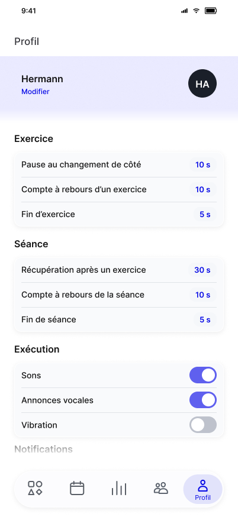

##### Profil — Stepper Pause changement de côté

[Source Figma — `1992:474`](https://www.figma.com/design/G6RY5Ebhgwb4AHIOYDwwvg?node-id=1992-474)

État courant du stepper Pause changement de côté

##### Profil — Stepper Récupération après activité

[Source Figma — `1992:579`](https://www.figma.com/design/G6RY5Ebhgwb4AHIOYDwwvg?node-id=1992-579)

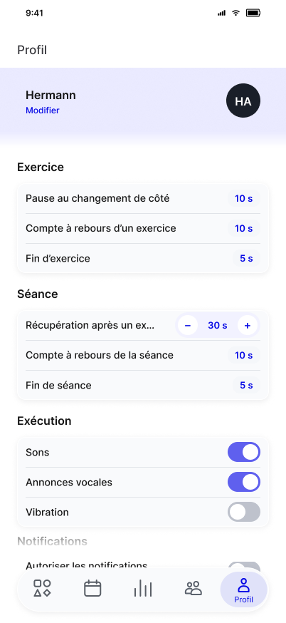

État courant du stepper Récupération après exercice

##### Profil — Vue d'ensemble - Vibration activée

[Source Figma — `1992:684`](https://www.figma.com/design/G6RY5Ebhgwb4AHIOYDwwvg?node-id=1992-684)

Valeur initiale fonctionnelle de la préférence `Vibration`

##### Profil — Modifier le profil — MVP

[Source Figma — `1992:778`](https://www.figma.com/design/G6RY5Ebhgwb4AHIOYDwwvg?node-id=1992-778)

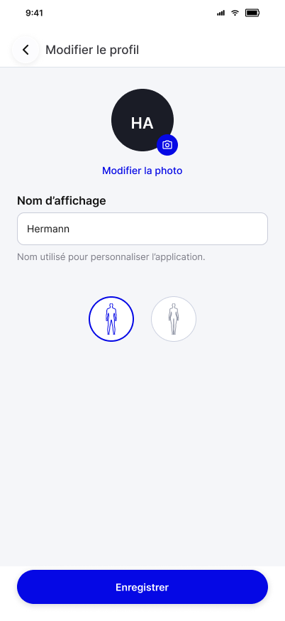

##### Profil — Vue d'ensemble — Parcours vide

[Source Figma — `2139:86`](https://www.figma.com/design/G6RY5Ebhgwb4AHIOYDwwvg?node-id=2139-86)

Présentation du Profil avant que l’utilisateur ait créé du contenu

### Catalogue des séances

**Zone de contexte cible PRE-9.** Le bandeau « Recherche et création » des Catalogues Mouvements et Séances, les deux lignes, les compteurs et leurs états sont définis dans [la spécification finale PRE-9](../KODJO-Zones-contexte-catalogues-PRE9-2026-10-30.md) et le contrat CE-CAT-CTX-01. À 402 × 874 pt, bande lilas `y=92..207`, recherche `216 × 44` à `x=16, y=155` (`107` pt de large en état filtré/archivé), contrôles Filtre/Tri/Créer à `x=260/306/352` et `y=160`, cibles 44 pt ; aucun titre individuel de page. Figma : Mouvements `10266:20575`/`10465:23141`, Séances `1992:9910`/`4549:6742`. Les captures ci-dessous restent des références d'états ; leurs valeurs chiffrées ne sont pas des données statiques à implémenter.

#### Carte unique et écran — référence du 27/10/2026

La [spécification carte et catalogue](../KODJO-Spec-Carte-et-catalogue-seances-2026-10-27.md) remplace ici le gabarit antérieur : une carte pour une ou plusieurs occurrences d'exercice, photo ou vignette de format 64, catégories dédupliquées par première apparition et débordement +N, aucune zone corporelle ni étiquette ni niveau. Nom suivi du seul chevron de déploiement, uniquement pour plusieurs exercices. Synthèse : format si présent, sinon nombre d'exercices pour plusieurs, sinon volume de l'exercice unique ; durée dans le second emplacement, omise pour For time et Death by. Lecture de la séance entière sur carte active ; aucune action directe sur carte archivée, restauration/suppression dans le glissé.

Déployée : composition structurée sur toute la largeur, Cycle/Circuit en en-têtes, décalage 16 par niveau et filet vertical, noms à gauche et volumes à droite ; récupérations à leur position, sans les compter comme exercices. Conteneur visible seulement s'il se répète ou contient plusieurs exercices. Cette lecture ne modifie pas les compteurs de la Composition.

Segmenté Mouvements/Séances/Programmes ; bascule Un exercice | Plusieurs, aucune sélection par défaut, désélection pour revenir à la collection complète. Contrôles Filtre/Tri/Créer à droite. Référence 402 : marges 16, cartes 370 et écart 12. Glissé : bloc de hauteur 80, jointif, marge droite et séparation carte/bloc 8 ; actif Planifier/Dupliquer/Archiver, archivé Restaurer/Supprimer. Panneau : Statut, Catégories, Zones corporelles, Étiquettes, Format ; chevron auprès du titre, sections actives ouvertes, sinon Statut seul ; Réinitialiser fixe au pied. Contrat CE-T03-01 révisé.

[Inventaire contrôlé, composants, tokens et écarts Figma](../DSF-CATALOGUE-SEANCES-2026-10-27.md). Les anciens principes « sans visuel », étiquette sur carte, 354 × 90 et actions de hauteur égale à la carte ne s'appliquent plus au Catalogue. Calendrier/Suivi/Choix restent inchangés. La suppression du catalogue autonome des exercices ne supprime pas les exercices subordonnés à une séance.

#### Vues principales et états intégrés

##### Catalogue des séances — Liste par défaut

[Source Figma — `1992:9910`](https://www.figma.com/design/G6RY5Ebhgwb4AHIOYDwwvg?node-id=1992-9910)

##### Catalogue des séances — Séance déployée

[Source Figma — `1992:10014`](https://www.figma.com/design/G6RY5Ebhgwb4AHIOYDwwvg?node-id=1992-10014)

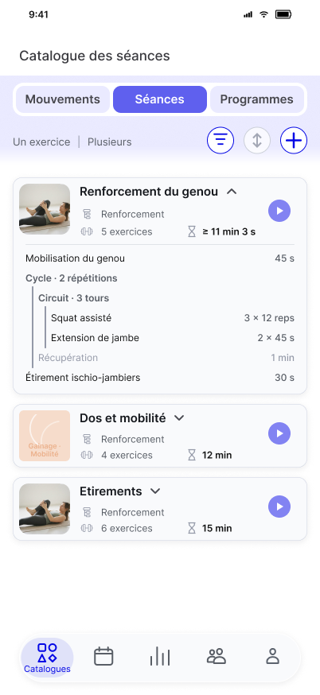

Consultation de la Composition sans quitter le Catalogue

##### Catalogue des séances — Liste condensée — actions glissées

[Source Figma — `1992:10518`](https://www.figma.com/design/G6RY5Ebhgwb4AHIOYDwwvg?node-id=1992-10518)

La carte se déplace avec le glissement et révèle `Planifier`, `Dupliquer` et `Archiver` derrière

##### Catalogue des séances — Séance déployée — actions glissées

[Source Figma — `1992:10628`](https://www.figma.com/design/G6RY5Ebhgwb4AHIOYDwwvg?node-id=1992-10628)

Même convention de glissement avec déplacement réel de la carte

##### Catalogue des séances — Archivées — Séance restaurée

[Source Figma — `1992:10848`](https://www.figma.com/design/G6RY5Ebhgwb4AHIOYDwwvg?node-id=1992-10848)

Snackbar de restauration et action `Annuler`

##### Catalogue des séances — Liste sans Renforcement du genou

[Source Figma — `1992:10937`](https://www.figma.com/design/G6RY5Ebhgwb4AHIOYDwwvg?node-id=1992-10937)

Résultat attendu après retrait de `Renforcement du genou` de la liste active

##### Catalogue des séances — État vide

[Source Figma — `2117:86`](https://www.figma.com/design/G6RY5Ebhgwb4AHIOYDwwvg?node-id=2117-86)

##### Catalogue des séances — Archivées — actions glissées

[Source Figma — `2234:88`](https://www.figma.com/design/G6RY5Ebhgwb4AHIOYDwwvg?node-id=2234-88)

##### Catalogue des séances — Liste — Filtre inactif étendu — référence historique retirée du catalogue cible

[Source Figma — `4549:6382`](https://www.figma.com/design/G6RY5Ebhgwb4AHIOYDwwvg?node-id=4549-6382)

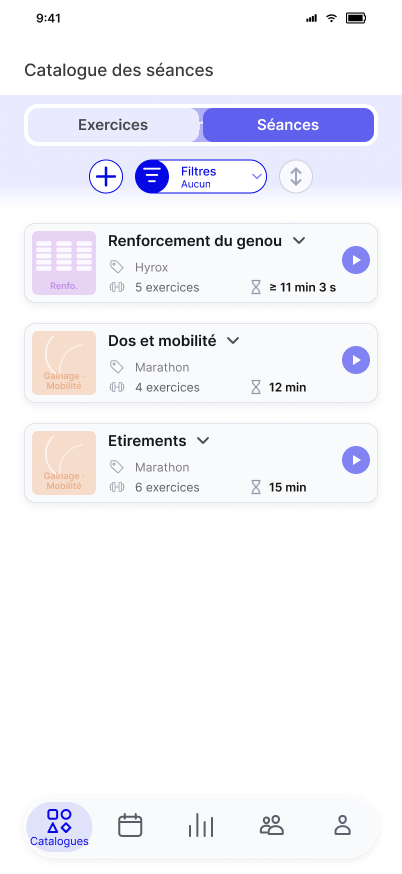

État `Filtres / Aucun`, liste inchangée

##### Catalogue des séances — Filtre actif Archivé

[Source Figma — `4549:6742`](https://www.figma.com/design/G6RY5Ebhgwb4AHIOYDwwvg?node-id=4549-6742)

État actif du contrôle et liste filtrée

##### Catalogue des séances — Liste condensée — actions glissées — Dos et mobilité

[Source Figma — `4592:6217`](https://www.figma.com/design/G6RY5Ebhgwb4AHIOYDwwvg?node-id=4592-6217)

#### Modales, panneaux et confirmations

##### Modal — Confirmer la suppression d’une séance archivée

[Source Figma — `2234:189`](https://www.figma.com/design/G6RY5Ebhgwb4AHIOYDwwvg?node-id=2234-189)

Capture actualisée le 27/10/2026. Titre « Supprimer cette séance ? » ; message et comportement métier inchangés : annuler sans mutation / supprimer définitivement après confirmation. L’arrière-plan conserve un ancien segmenté et bloc d’actions ; voir les écarts du relevé DSF. Aucun câblage interactif n’est certifié par cette capture.

##### Catalogue des séances — Filtrer — Panneau ouvert

[Source Figma — `4168:11149`](https://www.figma.com/design/G6RY5Ebhgwb4AHIOYDwwvg?node-id=4168-11149)

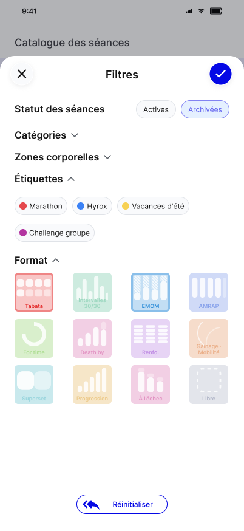

Modale de filtres contextuels Séances : Statut des séances, Catégories, Zones corporelles, Étiquettes, Format (27/10/2026).

##### Modal — Confirmer l’archivage d’une séance planifiée

[Source Figma — `4593:6285`](https://www.figma.com/design/G6RY5Ebhgwb4AHIOYDwwvg?node-id=4593-6285)

### Vues historiques du catalogue autonome d’exercices

Les sept écrans du catalogue autonome sont retirés de la cible ; les captures conservées dans cette section sont historiques. Utiliser la vue Un exercice de CE-T03-01.

#### Catalogue des Exercices — référence historique retirée du catalogue cible — Liste

[Source Figma — `3786:5093`](https://www.figma.com/design/G6RY5Ebhgwb4AHIOYDwwvg?node-id=3786-5093)

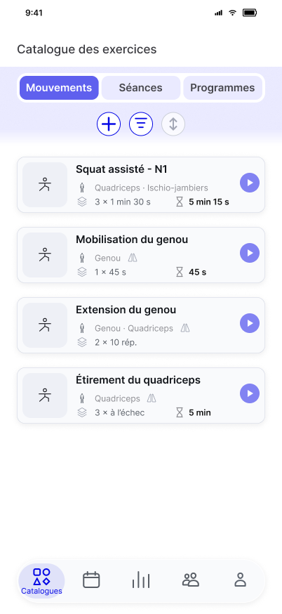

#### Catalogue des exercices — État vide — référence historique retirée du catalogue cible

[Source Figma — `4521:6220`](https://www.figma.com/design/G6RY5Ebhgwb4AHIOYDwwvg?node-id=4521-6220)

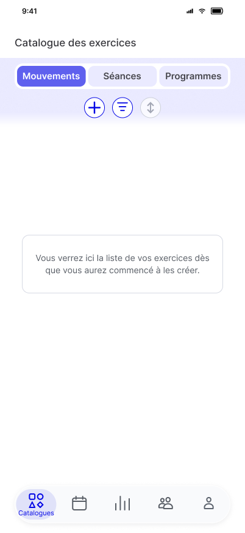

#### Catalogue des Exercices — Liste — Filtre inactif étendu

[Source Figma — `4544:6344`](https://www.figma.com/design/G6RY5Ebhgwb4AHIOYDwwvg?node-id=4544-6344)

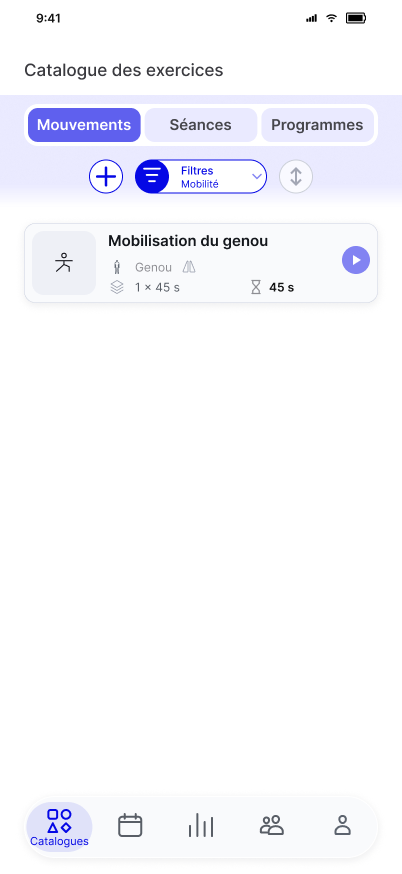

#### Catalogue des Exercices — Liste — Filtre actif étendu

[Source Figma — `4544:6651`](https://www.figma.com/design/G6RY5Ebhgwb4AHIOYDwwvg?node-id=4544-6651)

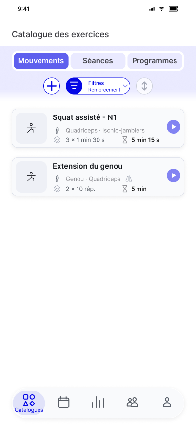

#### Catalogue des Exercices — Liste — actions glissées

[Source Figma — `4738:6209`](https://www.figma.com/design/G6RY5Ebhgwb4AHIOYDwwvg?node-id=4738-6209)

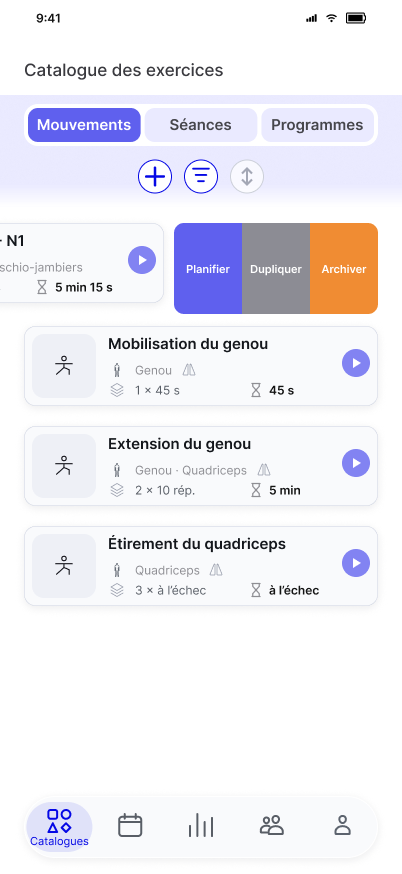

#### Référence historique hors MVP — Catalogue des Exercices — Liste — Première carte déployée — Média

[Source Figma — `4738:6355`](https://www.figma.com/design/G6RY5Ebhgwb4AHIOYDwwvg?node-id=4738-6355)

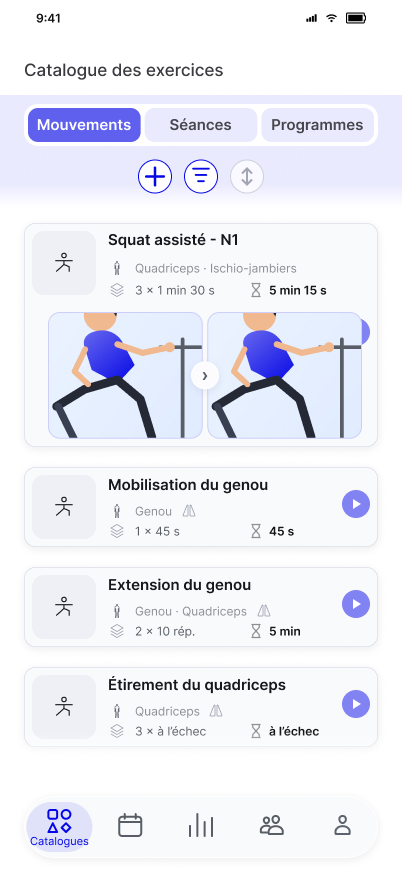

### Modales, panneaux et confirmations

#### Catalogue des Exercices — Filtrer — Panneau ouvert

[Source Figma — `4168:11262`](https://www.figma.com/design/G6RY5Ebhgwb4AHIOYDwwvg?node-id=4168-11262)

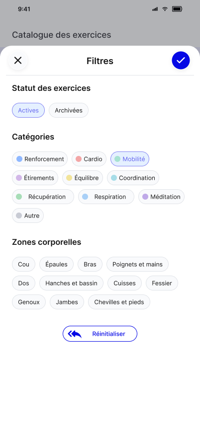

### Composer une séance / Modifier une séance

**Révision du rendu du 21/10/2026 (D-435) :** source visuelle active [Composition Standard `8328:28605`](https://www.figma.com/design/G6RY5Ebhgwb4AHIOYDwwvg?node-id=8328-28605) et [carte v2 `9798:44464`](https://www.figma.com/design/G6RY5Ebhgwb4AHIOYDwwvg?node-id=9798-44464). Les cartes d’Exercice dans cette composition ont trois lignes (Nom et côté ; Catégorie et travail ; Zones corporelles et récupération). Le média est intégré au bloc, le rail vertical est segmenté entre les ancrages réels ; le Circuit est un aplat sans contour, ses cartes n’ont pas de bordure. Les récupérations n’occupent plus de ligne séparée ; les points d’arrêt restent entre les cartes. Le placement mixte est conservé, avec ajout de récupération dans la carte et défilement du contenu sous un pied d’actions protégé. Aucun changement de donnée ni de calcul. Voir [CE-T03-08](13%20%E2%80%93%20Contrats%20d%E2%80%99%C3%A9cran.md#ce-t03-08--composer-une-séance--modifier-une-séance--brouillon-circuit-points-darrêt-et-validation), CE-FMT-03 et [DSF Cartes](../DSF-CARTES-ICONES-APPUIS-2026-09-30.md#exception-locale--cartes-de-composition-de-séance-v2-21102026).

Les vues correspondantes ont été modifiées directement dans Figma le 21/10. Les liens de nœuds présents ci-après donnent accès à leur état courant. Les anciennes images exportées le 12/10 ne sont **plus une preuve visuelle à jour** et ne doivent pas servir de référence au développement ; leur réexport complet demeure non vérifié, sans conditionner l’utilisation des nœuds Figma actuels. Le rapport du 21/10 décrit 38 états de Composition (dont 14 compositions préremplies), et les nœuds des gestes et du placement : [swipe `8328:28863`](https://www.figma.com/design/G6RY5Ebhgwb4AHIOYDwwvg?node-id=8328-28863), [déplacement `8328:33546`](https://www.figma.com/design/G6RY5Ebhgwb4AHIOYDwwvg?node-id=8328-33546), [placement `8328:29270`](https://www.figma.com/design/G6RY5Ebhgwb4AHIOYDwwvg?node-id=8328-29270). Le rapport source propose deux évolutions fonctionnelles non incluses dans ce lot : changement de destination au toucher de récupération et suppression du défaut Profil (voir D-435).

#### Paramètres du Circuit

L’icône affichée à gauche de `Nombre de tours` est exclusivement une instance de `Icon / Tour` (`3066:4685`). Son dessin canonique est celui validé dans `Composition séance — Nom saisi` (`2028:12003`) ; l’ancienne sous-référence graphique supprimée n’est plus utilisée comme preuve active : cadre visuel `18 × 18`, quatre tracés, trait `1,35`, couleur `color.textPrimary` (`#141414`). Les copies vectorielles locales et l’ancien pictogramme Tour ne sont pas autorisés. L’actif exportable correspondant est uniquement `assets/icons/icon-tour.svg`, clé de registre `icon.tour`.

Le Circuit porte une nature tours (défaut) ou séries et un compte de 1 à 99, initialisé à 1.

Le chiffre du compteur ouvre les boutons −/+ (remplacé par D-442 du 22/10/2026 : le stepper − / + est toujours affiché et actif autour du nombre, présenté au format « Valeur modifiable » ; les cibles tactiles du −, du + et de la pastille d’unité sont espacées et d’au moins 44 pt ; nombre, unité et durée ont la taille du titre « Circuit ») ; la pastille portant uniquement tours/séries ouvre le choix de nature. Le bouton œil permanent, sur la ligne du titre, ouvre les volumes. La durée affichée du Circuit est une estimation, arrondie à la minute la plus proche au-delà de 3 minutes (D-442 ; remplacé par D-443 du 23/10/2026 : la durée du Circuit n’est plus affichée dans son en-tête, et le stepper du nombre de Tours ou de Séries y est aligné à droite). Les captures actuelles et les mesures figurent dans le DSF du 12/10 ; les ± visibles dans ces exemples illustrent l’édition, pas le repos (remplacé par D-442 : les ± sont visibles au repos).

La synthèse n’est plus affichée isolément au bas de l’écran. Elle est recalculée uniquement après une modification validée qui affecte les Exercices ou le nombre de Tours. La confirmation du `Compte à rebours initial` ou de la `Fin de séance` actualise seulement le jalon structurel concerné et ne modifie jamais cette synthèse. Celle-ci reste attachée au conteneur Circuit dans ses états applicables.

La diminution est sans message ; une conversion de nature entraînant une perte exige une confirmation atomique. Les modifications appartiennent au brouillon de Composition jusqu’à son enregistrement ; bornes 1–99 et valeur initiale 1 inchangées.

#### Composition — ligne de Série variable — références

#### Vues principales et états intégrés

##### Composition séance — Initial

[Source Figma — `8328:28172`](https://www.figma.com/design/G6RY5Ebhgwb4AHIOYDwwvg?node-id=8328-28172)

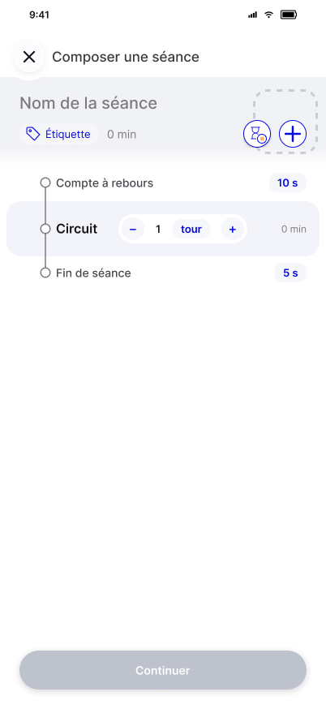

##### Composition séance — Nom saisi

[Source Figma — `8328:28238`](https://www.figma.com/design/G6RY5Ebhgwb4AHIOYDwwvg?node-id=8328-28238)

##### Composition séance — Standard

[Source Figma — `8328:28605`](https://www.figma.com/design/G6RY5Ebhgwb4AHIOYDwwvg?node-id=8328-28605)

##### Composition séance — Actions glissées

[Source Figma — `8328:28863`](https://www.figma.com/design/G6RY5Ebhgwb4AHIOYDwwvg?node-id=8328-28863)

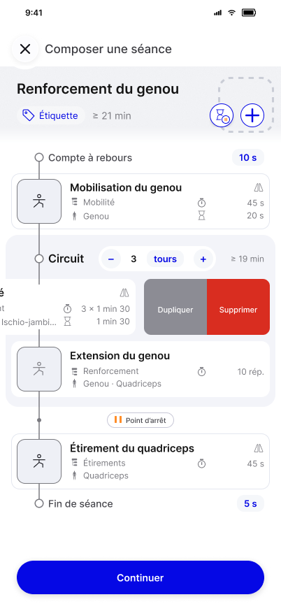

##### Composition séance — Point d’arrêt

[Source Figma — `8328:29428`](https://www.figma.com/design/G6RY5Ebhgwb4AHIOYDwwvg?node-id=8328-29428)

##### Composition séance — Déplacement

[Source Figma — `8328:33546`](https://www.figma.com/design/G6RY5Ebhgwb4AHIOYDwwvg?node-id=8328-33546)

##### Composition séance — Étiquette sélectionnée

Dans la zone de contexte, la puce Étiquette porte l’icône d’étiquette (contour de l’étiquette), dans la couleur de l’Étiquette quand elle est choisie, et non une pastille ronde (D-442).

[Source Figma — `8328:34377`](https://www.figma.com/design/G6RY5Ebhgwb4AHIOYDwwvg?node-id=8328-34377)

##### Composition séance — Standard — Séries variables

[Source Figma — `8328:34520`](https://www.figma.com/design/G6RY5Ebhgwb4AHIOYDwwvg?node-id=8328-34520)

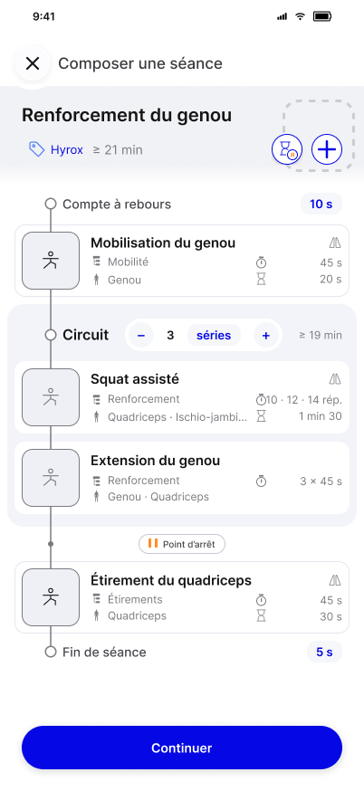

#### Modification d'une séance

[Source Figma — `5271:5455`](https://www.figma.com/design/G6RY5Ebhgwb4AHIOYDwwvg?node-id=5271-5455)

#### Placement, réglage et retrait des pauses

##### Composition séance — Placement d’une pause

[Source Figma — `8328:29270`](https://www.figma.com/design/G6RY5Ebhgwb4AHIOYDwwvg?node-id=8328-29270)

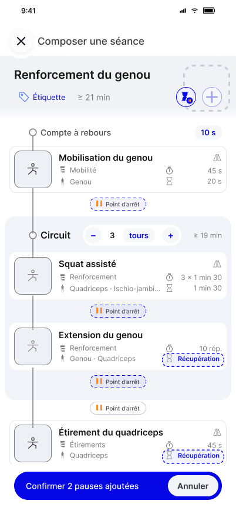

##### Composition séance — Récupération (modale)

[Source Figma — `8328:28733`](https://www.figma.com/design/G6RY5Ebhgwb4AHIOYDwwvg?node-id=8328-28733)

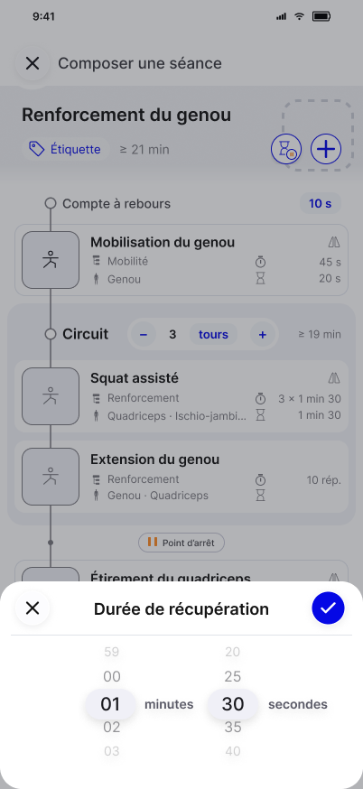

##### Composition séance — Retirer une récupération

Remplacé par D-442 ; capture historique. Hors placement, la récupération n’est plus une cible et n’ouvre plus de bulle ; son retrait se fait par désélection en mode Placement, appliquée par « Confirmer les modifications ».

[Source Figma — `8328:29133`](https://www.figma.com/design/G6RY5Ebhgwb4AHIOYDwwvg?node-id=8328-29133)

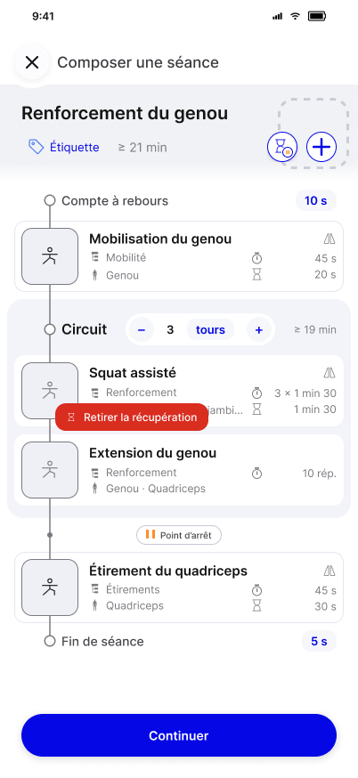

##### Composition séance — Retirer un point d’arrêt

Remplacé par D-441 ; capture historique pour le Point d’arrêt. Le retrait du Point d’arrêt se fait désormais par désélection en mode Placement ; la bulle reste valable pour la récupération (« Composition séance — Retirer une récupération ») (remplacé par D-442 : la récupération se retire elle aussi par désélection en mode Placement).

[Source Figma — `8328:33689`](https://www.figma.com/design/G6RY5Ebhgwb4AHIOYDwwvg?node-id=8328-33689)

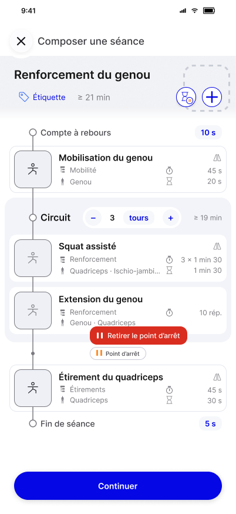

#### Sélections, paramètres et confirmations de Composition

##### Composition séance — Compte à rebours

[Source Figma — `8328:28304`](https://www.figma.com/design/G6RY5Ebhgwb4AHIOYDwwvg?node-id=8328-28304)

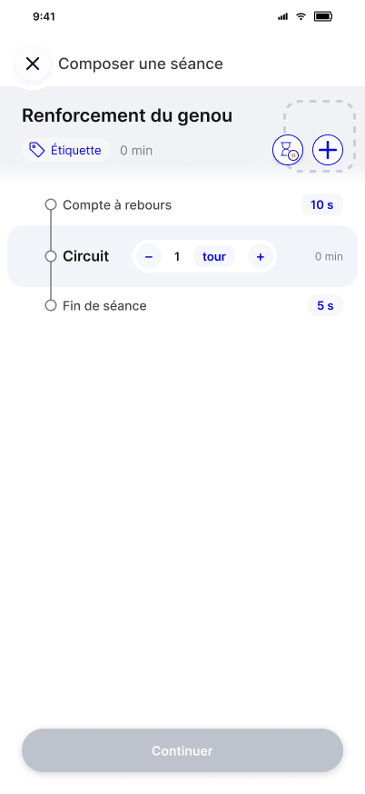

##### Composition séance — Abandon (confirmation)

[Source Figma — `8328:28377`](https://www.figma.com/design/G6RY5Ebhgwb4AHIOYDwwvg?node-id=8328-28377)

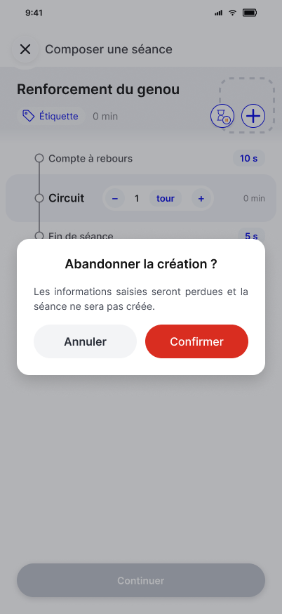

##### Composition séance — Sélection exercices

[Source Figma — `8328:28445`](https://www.figma.com/design/G6RY5Ebhgwb4AHIOYDwwvg?node-id=8328-28445)

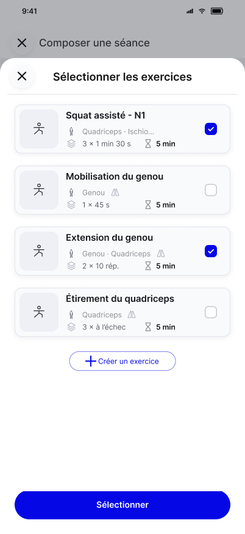

##### Composition séance — Fin de séance

[Source Figma — `8328:28998`](https://www.figma.com/design/G6RY5Ebhgwb4AHIOYDwwvg?node-id=8328-28998)

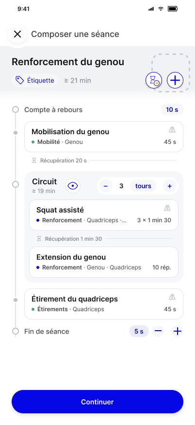

##### Composition séance — Étiquettes

[Source Figma — `8328:33836`](https://www.figma.com/design/G6RY5Ebhgwb4AHIOYDwwvg?node-id=8328-33836)

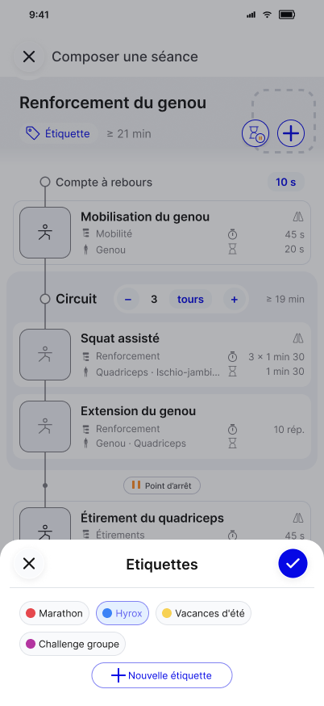

##### Composition séance — Étiquettes — Appui long — Confirmation suppression

[Source Figma — `8328:34006`](https://www.figma.com/design/G6RY5Ebhgwb4AHIOYDwwvg?node-id=8328-34006)

##### Composition séance — Nouvelle étiquette

[Source Figma — `8328:34107`](https://www.figma.com/design/G6RY5Ebhgwb4AHIOYDwwvg?node-id=8328-34107)

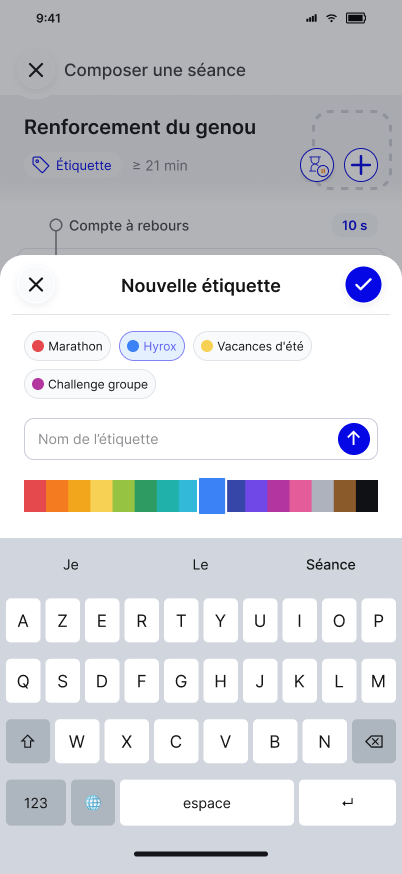

#### Circuit — popover, confirmation et volumes

CE-CIR-01/02/03. La confirmation est conditionnée à la perte de valeurs, pas à tout changement de nature. Les deux grilles illustrent des volumes planifiés, pas des résultats. Écarts de preuve : case absente encore vide au lieu du tiret ; direction de côté absente de la grille. Échec ✓, débordement et colonnes fixes restent des exigences sans capture dédiée.

##### Composition séance — Circuit — Nature (popover)

[Source Figma — `8328:34662`](https://www.figma.com/design/G6RY5Ebhgwb4AHIOYDwwvg?node-id=8328-34662)

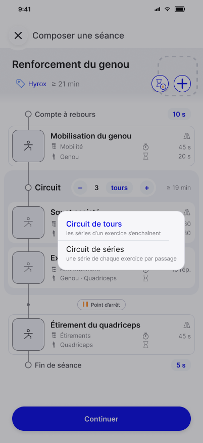

##### Composition séance — Circuit — Nature (confirmation générique)

[Source Figma — `8328:34813`](https://www.figma.com/design/G6RY5Ebhgwb4AHIOYDwwvg?node-id=8328-34813)

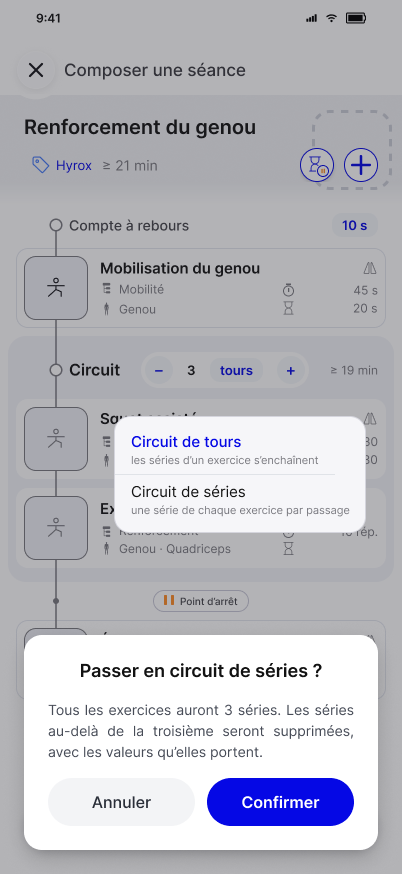

##### Composition séance — Circuit — Volumes (de séries)

[Source Figma — `8328:34965`](https://www.figma.com/design/G6RY5Ebhgwb4AHIOYDwwvg?node-id=8328-34965)

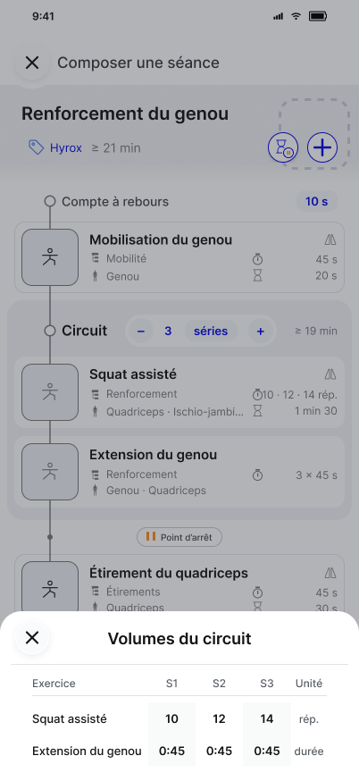

##### Composition séance — Circuit — Volumes (de tours)

[Source Figma — `8328:35135`](https://www.figma.com/design/G6RY5Ebhgwb4AHIOYDwwvg?node-id=8328-35135)

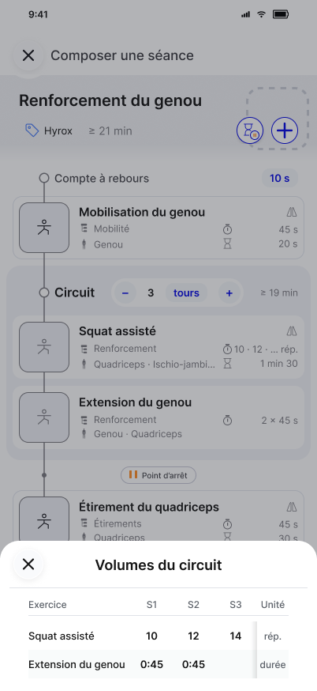

### Créer ou modifier un exercice

Références courantes du 12/10, complétées le 13/10 :32 captures du parcours de création et de ses états de Paramètres d’exécution, issues de Prototype MVP. Contrats CE-T03-04, CE-UI-09 et CE-UI-10. Les anciens relevés du 03/10 et du 06/10 restent historiques pour les états remplacés ; [matrice actuelle](../MATRICE-DSF-CIRCUITS-2026-10-12.md).

**Mise à jour Figma du 18/10 — boutons « Terminer » :** les captures des états incomplets `8328:35698`, `8328:35740`, `8328:36278` et `8328:36853` ont été réexportées depuis « Prototype MVP » après correction du fond du bouton. Dans ces quatre états, « Terminer » est visuellement inactif, lié à `color/disabled` (`#BEC2CC`), sans atténuation supplémentaire par opacité. Sur les états valides, le bouton d’action actif conserve `color/primary` (`#0508E5`). Ce changement ne modifie pas les conditions fonctionnelles de validation de l’Exercice (CE-T03-04).

**Actualisation du 23/10 :** les six captures affichées du formulaire initial, du champ Paramètres vide, des catégories et des zones sont réexportées. La rangée partagée reçoit Niveau en troisième position, espacement 12 pt et marges latérales 6 pt ; les zones sont élastiques et tronquées. Les anciennes dates de dossiers ne datent pas ces nouveaux exports. L’état initial exporté ne montre pas encore de pastille Niveau ; ne pas présenter les 50 instances annoncées comme vérifiées individuellement.

#### Placement et contrôles

Formulaire : conserver les shells et l’ordre visible dans les captures. Toute la zone de phrase ouvre la feuille. Feuille : en-tête fixe ✕ / Paramètres d’exécution / ✓ ; corps défilant en quatre cadres (D-413) : Exécution (Mode, Condition d’arrêt) → Séries (Phases de l’exercice [remplacé par D-448 du 26/10/2026 : libellé « Phases du mouvement »] avec chevron intérieur à Avec et tableau éventuel, Nombre de séries, Type de série avec chevron intérieur à Variables, Durée ou Répétitions et Pause ou tableau de séries variables, Charge) → Côtés (Changement de côté, puis Enchainement et Pause entre les côtés lorsque déployés) → Cadence et durée (Cadence, Durée de l’exercice avec son chevron, puis Compte à rebours et Fin d’exercice lorsque déployés et applicables). La ligne Durée de l’exercice est toujours affichée, avec « — », « Non calculable » ou la valeur (D-433, qui remplace le cas « sans ligne Durée de l’exercice, Compte à rebours et Fin d’exercice directement visibles » de RM-246).

**Décision de Hermann du 26/10/2026 (recette JA, R2) :** nom en saisie : le premier appui dans le corps défilant ferme seulement le clavier, sans ouvrir la Feuille ni la Description ; la rangée Catégorie / Zones / Niveau garde son comportement.

Le tableau variable comporte poignée, numéro, cellules cible/Pause, colonne Charge lorsque la charge est active (RM-238) [remplacé par D-447 du 24/10/2026 : colonne Charge toujours présente, tiret gris non éditable dans chaque cellule en Sans] et retrait ; une seule cellule active ; fond blanc sans contour, lignes de 36 px, sans lignes de boutons +/− (D-413). Mode, Condition d’arrêt, Type de série, Charge, Changement de côté et Cadence sont des contrôles segmentés ; les popovers du 12/10 ne sont plus la présentation de ces lignes (D-413). Les roulettes Durée et Durée de l’exercice restent des états intégrés, avec voile et fenêtre de saisie ; la charge se saisit directement au clavier, le tableau restant visible au-dessus (RM-239). [DSF courant et mesures](../DSF-CIRCUITS-CONTROLES-2026-10-12.md), à lire avec sa mise à jour du 18/10/2026. Les règles et bornes restent celles de v13 et de [Composition d'une séance — Circuits de tours et de séries](10%20%E2%80%93%20Processus%20m%C3%A9tier%20et%20r%C3%A8gles%20m%C3%A9tier%20transverses.md#composition-dune-séance--circuits-de-tours-et-de-séries). Sous nombre hérité, nombre et total affichable sont en lecture seule ; aucun écran dédié identifié ne fixe encore l’emplacement de la mention discrète.

#### Mouvements et niveaux — captures du 25/10/2026

**D-445 — décisions validées le 25/10 :** C01–C07 et C09 sont clos ; C08 seul reste différé sur le périmètre MVP. [Spécification consolidée v7](../KODJO-Niveaux-Recherche-Parcours-Regles-v7.md). [bandeau répété dans ce chapitre, sans portée propre : même renvoi à D-445 que celui d’en-tête — annotation du 26/10/2026]

| Écran courant | Nœud Figma | Contrat / statut |
|---|---|---|
| [Création exercice — Mouvement — Mouvements proches](https://www.figma.com/design/G6RY5Ebhgwb4AHIOYDwwvg?node-id=9882-19049) | `9882:19049` | CE-T03-04 |
| [Création exercice — Mouvement — Nom déjà utilisé](https://www.figma.com/design/G6RY5Ebhgwb4AHIOYDwwvg?node-id=10175-20349) | `10175:20349` | CE-T03-04 |
| [Création exercice — Mouvement — Options d’un résultat](https://www.figma.com/design/G6RY5Ebhgwb4AHIOYDwwvg?node-id=10131-21995) | `10131:21995` | CE-T03-04 |
| [Création exercice — Mouvement — Repris (lecture seule)](https://www.figma.com/design/G6RY5Ebhgwb4AHIOYDwwvg?node-id=9891-39982) | `9891:39982` | CE-T03-04 |
| [Création exercice — Mouvement — Contenu éditable](https://www.figma.com/design/G6RY5Ebhgwb4AHIOYDwwvg?node-id=9959-19518) | `9959:19518` | CE-T03-04 |
| [Création exercice — Mouvement — Niveau, plus facile ou plus difficile](https://www.figma.com/design/G6RY5Ebhgwb4AHIOYDwwvg?node-id=10140-20180) | `10140:20180` | CE-T03-04 |
| [Création exercice — Mouvement — Niveau, formulaire vierge](https://www.figma.com/design/G6RY5Ebhgwb4AHIOYDwwvg?node-id=10187-20340) | `10187:20340` | CE-T03-04 |
| [Création exercice — Mouvement — Sauvegarde — Nom inchangé](https://www.figma.com/design/G6RY5Ebhgwb4AHIOYDwwvg?node-id=10253-20414) | `10253:20414` | CE-T03-04 |
| [Création exercice — Mouvement — Sauvegarde — Nom modifié](https://www.figma.com/design/G6RY5Ebhgwb4AHIOYDwwvg?node-id=9952-44349) | `9952:44349` | CE-T03-04 |
| [Création exercice — Mouvement — Sauvegarde — Choix sélectionné](https://www.figma.com/design/G6RY5Ebhgwb4AHIOYDwwvg?node-id=10257-20651) | `10257:20651` | CE-T03-04 |
| [Création activité — Paramètres — Résumé affiché — Niveau (pastilles) — Popover](https://www.figma.com/design/G6RY5Ebhgwb4AHIOYDwwvg?node-id=10027-40760) | `10027:40760` | CE-UI-NIV-01 |
| [Création activité — Niveau — Changer de niveau (déployé)](https://www.figma.com/design/G6RY5Ebhgwb4AHIOYDwwvg?node-id=10152-20245) | `10152:20245` | CE-UI-NIV-01 |
| [Création activité — Niveau — Ajouter un niveau (déployé)](https://www.figma.com/design/G6RY5Ebhgwb4AHIOYDwwvg?node-id=10152-20369) | `10152:20369` | CE-UI-NIV-01 |
| [Groupe de niveaux — Ordre](https://www.figma.com/design/G6RY5Ebhgwb4AHIOYDwwvg?node-id=10085-20050) | `10085:20050` | CE-UI-NIV-01 |
| [Composition séance — Changer de niveau — Durées à compléter](https://www.figma.com/design/G6RY5Ebhgwb4AHIOYDwwvg?node-id=10070-20073) | `10070:20073` | CE-T03-08 / CE-UI-10 |
| [Catalogue des mouvements — Liste complète](https://www.figma.com/design/G6RY5Ebhgwb4AHIOYDwwvg?node-id=9959-19623) | `9959:19623` | Catalogue mouvements — entretien |
| [Catalogue des mouvements — Aucun résultat](https://www.figma.com/design/G6RY5Ebhgwb4AHIOYDwwvg?node-id=10070-19964) | `10070:19964` | Catalogue mouvements — entretien |
| [Catalogue — Vue Mouvements (piles)](https://www.figma.com/design/G6RY5Ebhgwb4AHIOYDwwvg?node-id=10266-20575) | `10266:20575` | Catalogue mouvements — entretien |
| [Niveau — icônes, trois états](https://www.figma.com/design/G6RY5Ebhgwb4AHIOYDwwvg?node-id=10027-40948) | `10027:40948` | CE-UI-NIV-01 |

**Création exercice — Mouvement — Mouvements proches — `9882:19049`**

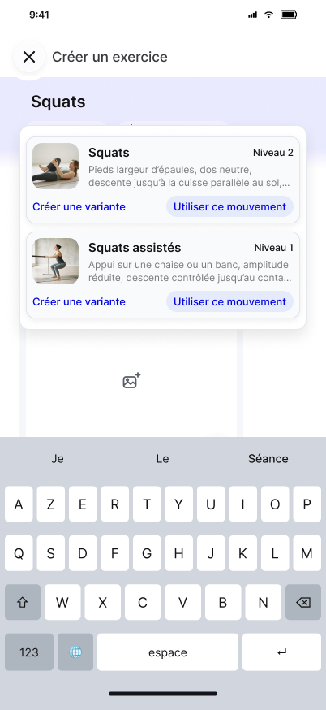

**Création exercice — Mouvement — Nom déjà utilisé — `10175:20349`**

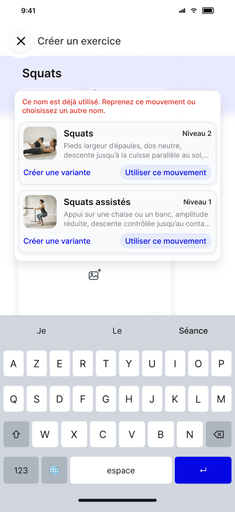

**Création exercice — Mouvement — Options d’un résultat — `10131:21995`**

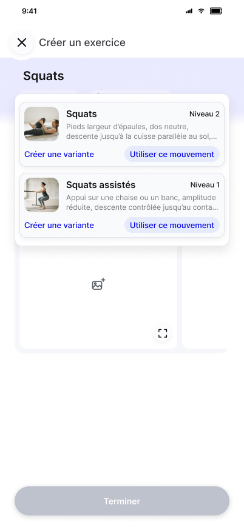

**Création exercice — Mouvement — Repris (lecture seule) — `9891:39982`**

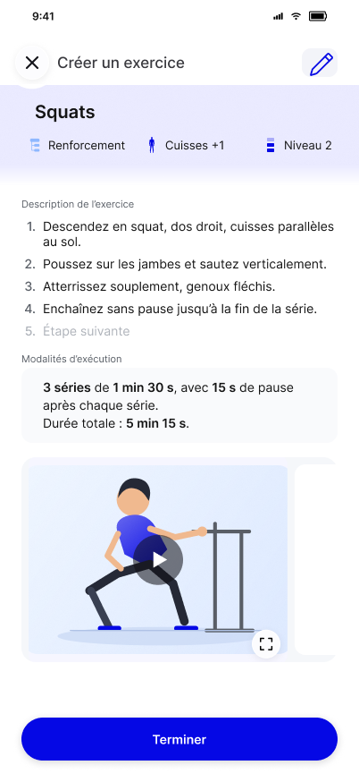

**Création exercice — Mouvement — Contenu éditable — `9959:19518`**

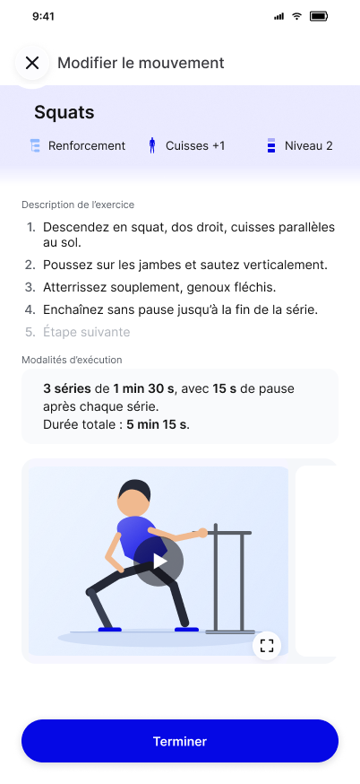

**Création exercice — Mouvement — Niveau, plus facile ou plus difficile — `10140:20180`**

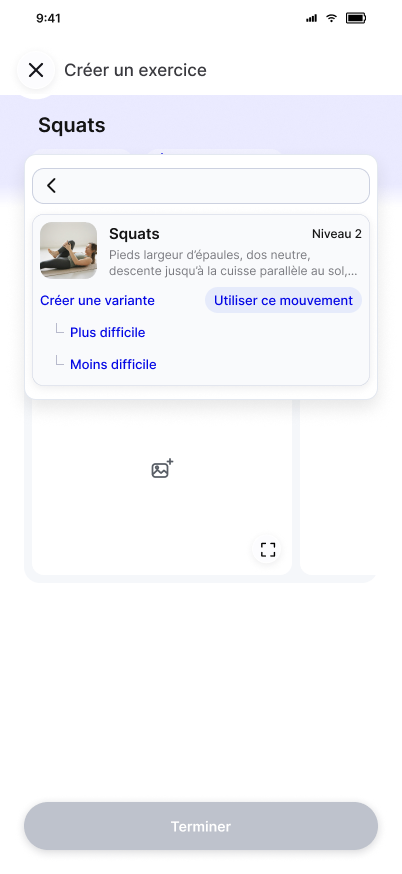

**Création exercice — Mouvement — Niveau, formulaire vierge — `10187:20340`**

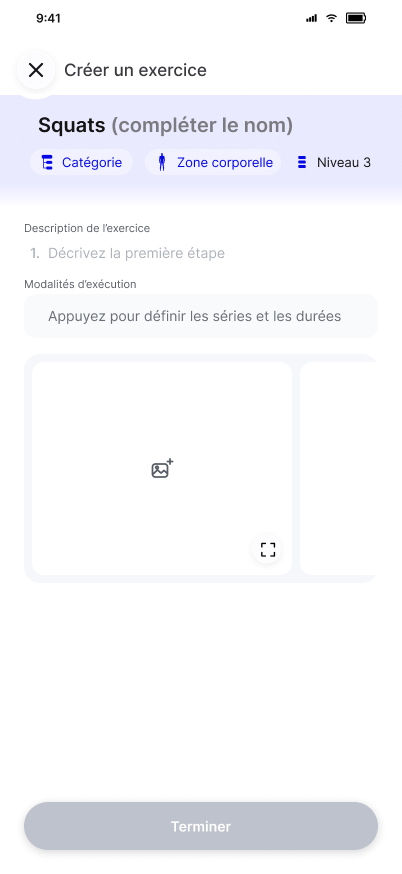

**Création exercice — Mouvement — Sauvegarde — Nom inchangé — `10253:20414`**

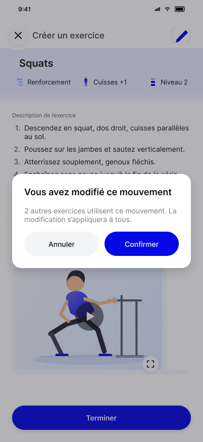

**Création exercice — Mouvement — Sauvegarde — Nom modifié — `9952:44349`**

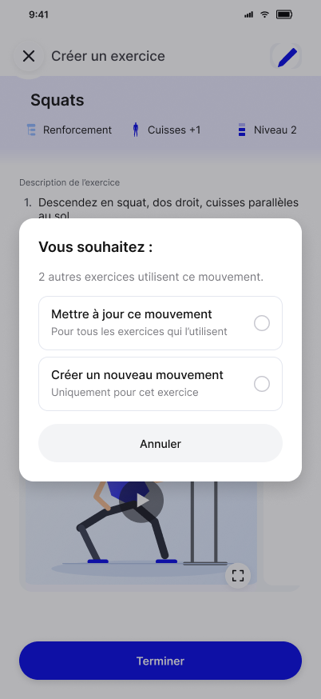

**Création exercice — Mouvement — Sauvegarde — Choix sélectionné — `10257:20651`**

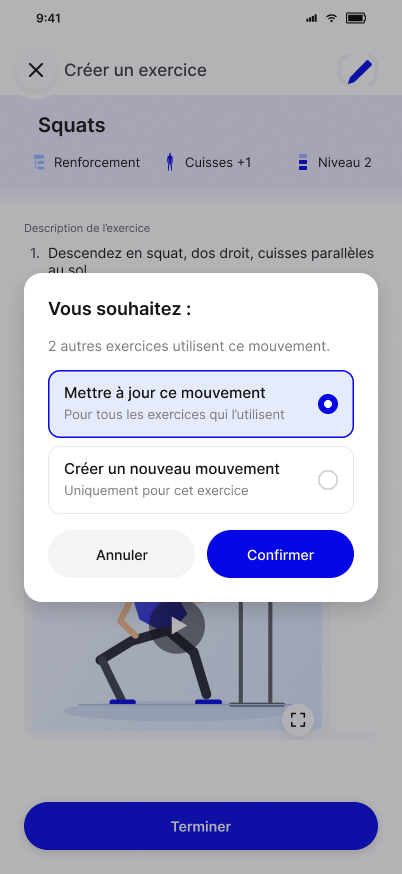

**Création activité — Paramètres — Résumé affiché — Niveau (pastilles) — Popover — `10027:40760`**

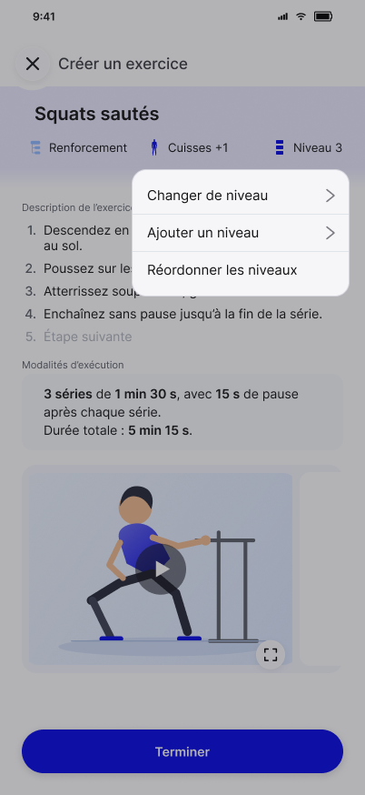

**Création activité — Niveau — Changer de niveau (déployé) — `10152:20245`**

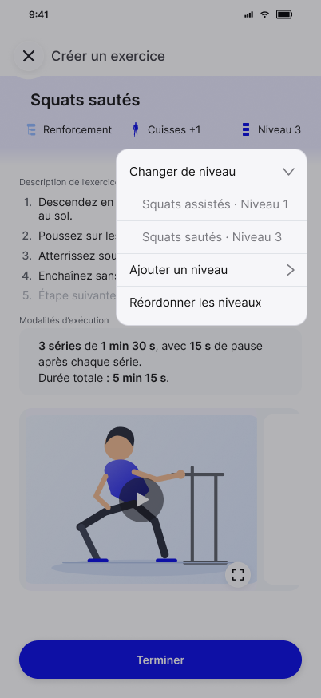

**Création activité — Niveau — Ajouter un niveau (déployé) — `10152:20369`**

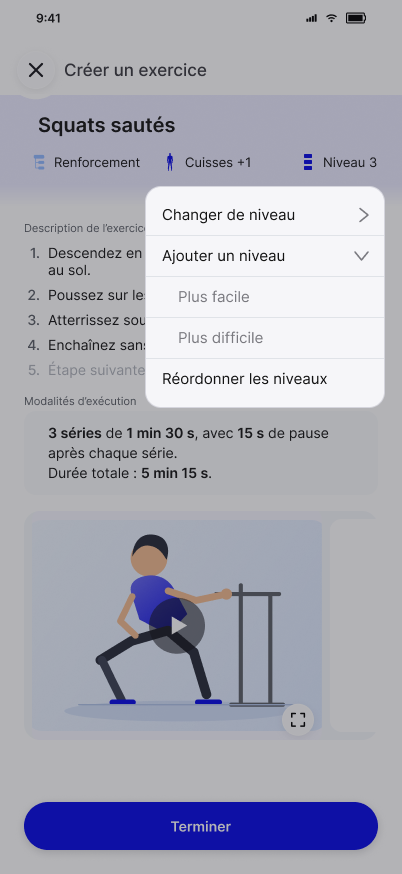

**Groupe de niveaux — Ordre — `10085:20050`**

**Composition séance — Changer de niveau — Durées à compléter — `10070:20073`**

**Catalogue des mouvements — Liste complète — `9959:19623`**

**Catalogue des mouvements — Aucun résultat — `10070:19964`**

**Catalogue — Vue Mouvements (piles) — `10266:20575`**

**Niveau — icônes, trois états — `10027:40948`**

#### Formulaire — vues principales et résumé

##### Création exercice — Paramètres — Champ vide

[Source Figma — `8328:36853`](https://www.figma.com/design/G6RY5Ebhgwb4AHIOYDwwvg?node-id=8328-36853)

##### Création exercice — Paramètres — Résumé affiché

[Source Figma — `8328:37022`](https://www.figma.com/design/G6RY5Ebhgwb4AHIOYDwwvg?node-id=8328-37022)

##### Ajouter un exercice — Initial

[Source Figma — `8328:35698`](https://www.figma.com/design/G6RY5Ebhgwb4AHIOYDwwvg?node-id=8328-35698)

##### Ajouter un exercice — Nom Description Media

[Source Figma — `8328:35740`](https://www.figma.com/design/G6RY5Ebhgwb4AHIOYDwwvg?node-id=8328-35740)

##### Ajouter un exercice — Catégorie renseignée

[Source Figma — `8328:36278`](https://www.figma.com/design/G6RY5Ebhgwb4AHIOYDwwvg?node-id=8328-36278)

#### États complémentaires — Catégories, zones corporelles et abandon

##### Ajouter un exercice — Catégories

[Source Figma — `8328:35810`](https://www.figma.com/design/G6RY5Ebhgwb4AHIOYDwwvg?node-id=8328-35810)

##### Ajouter un exercice — Catégorie — Appui long — Confirmation suppression

[Source Figma — `8328:35932`](https://www.figma.com/design/G6RY5Ebhgwb4AHIOYDwwvg?node-id=8328-35932)

##### Ajouter un exercice — Nouvelle catégorie

[Source Figma — `8328:36056`](https://www.figma.com/design/G6RY5Ebhgwb4AHIOYDwwvg?node-id=8328-36056)

##### Ajouter un exercice — Zones corporelles

[Source Figma — `8328:36348`](https://www.figma.com/design/G6RY5Ebhgwb4AHIOYDwwvg?node-id=8328-36348)

##### Ajouter un exercice — Zones corporelles — Appui long — Confirmation suppression

[Source Figma — `8328:36441`](https://www.figma.com/design/G6RY5Ebhgwb4AHIOYDwwvg?node-id=8328-36441)

##### Ajouter un exercice — Nouvelle zone corporelle

[Source Figma — `8328:36536`](https://www.figma.com/design/G6RY5Ebhgwb4AHIOYDwwvg?node-id=8328-36536)

##### Création activité — Abandon (confirmation)

[Source Figma — `8328:36781`](https://www.figma.com/design/G6RY5Ebhgwb4AHIOYDwwvg?node-id=8328-36781)

#### Modifier un exercice

[Source Figma — `4734:6342`](https://www.figma.com/design/G6RY5Ebhgwb4AHIOYDwwvg?node-id=4734-6342)

### Présentation des phases d’exercice

La ligne Phases de l’exercice [remplacé par D-448 du 26/10/2026 : libellé « Phases du mouvement »] (Avec / Sans) ouvre le cadre Séries, après le cadre Exécution (D-413). Avec crée deux phases à renseigner ; le chevron, à l’intérieur de l’option Avec, replie ou déploie le tableau Libellé/Durée (D-410) ; Sans signifie qu’il n’y a aucune phase. La cible de série reste indépendante et modifiable selon les contraintes du format (PHC-20261026). [D-446 du 26/10/2026 : phases disponibles en séries identiques comme variables, avec une seule séquence de durées commune] Les états incompatibles sont non modifiables, sans transformer une valeur effective calculée en tiret. Contrat CE-UI-10 et [règles métier](08%20%E2%80%93%20Conception%20fonctionnelle%20d%C3%A9taill%C3%A9e.md#phases-exercice).

Le rapport Figma V2 du 15/10 décrit trois écrans dédiés sur Conception — Hors MVP : « Phases (aucune) », « Phases (définies) » et « Phases verrouillées (séries variables) ». Il décrit aussi la ligne ajoutée sur 19 écrans de Prototype MVP et 19 de Conception. Ces nombres sont ceux du rapport fourni, pas un nouvel inventaire direct. Les seize modales de format n’ont pas encore reçu cette ligne selon ce rapport.

Les frames relevées le 18/10/2026 ci-dessous montrent la ligne Phases de l’exercice [remplacé par D-448 du 26/10/2026 : libellé « Phases du mouvement » ; captures conservées comme référence historique] ; deux d’entre elles illustrent des phases. Le report des trois écrans dédiés reste à effectuer ; aucune capture n’est fabriquée ou retouchée. Le cadran et la carte de composition attendent leur précision de présentation.

#### Création activité — Paramètres (modale) — Phases verrouillées (séries variables)

[Source Figma — `8982:15172`](https://www.figma.com/design/G6RY5Ebhgwb4AHIOYDwwvg?node-id=8982-15172)

Séries variables, trois séries à l’échec : Phases de l’exercice [remplacé par D-448 du 26/10/2026 : libellé « Phases du mouvement »] non modifiable ; Condition d’arrêt À l’échec déterminée automatiquement (RM-249) ; aucune ligne Durée de l’exercice (D-397). Écart Figma depuis D-433 (19/10/2026) : la ligne Durée de l’exercice est affichée avec « Non calculable ». [État remplacé par D-446 du 26/10/2026 : en séries variables, Phases de l’exercice [libellé « Phases du mouvement » depuis D-448 du 26/10/2026] reste modifiable ; capture conservée comme référence historique]

#### Création exercice — Paramètres — Proposition 3 — Tableau de 3 phases

[Source Figma — `9207:18817`](https://www.figma.com/design/G6RY5Ebhgwb4AHIOYDwwvg?node-id=9207-18817)

Tableau de trois phases sous l’option Avec déployée (chevron vers le haut), sans boutons +/− ; Variables non modifiable [remplacé par D-446 du 26/10/2026 : Variables reste modifiable avec phases] ; Durée de l’exercice en texte simple. Écarts Figma : nom de frame hors convention (« Proposition 3 ») et barre bleue résiduelle à gauche de la ligne 1.

### Feuille Paramètres d’exécution — états intégrés

Ces 20 frames sont des états de CE-UI-10, pas 20 pages applicatives. Relevé et export du 18/10/2026 dans Prototype MVP (spécification v3.0, D-403 à D-413) ; ils remplacent les captures du 12/10 et du 13/10, qui restent dans le dépôt comme références historiques. Les frames `8328:38301`, `8328:38953`, `8328:39181` et `8328:39390` n’existent plus. Toutes les frames montrent aussi la ligne Phases de l’exercice [remplacé par D-448 du 26/10/2026 : libellé « Phases du mouvement »], décrite à la section « Présentation des phases d’exercice » ci-dessus (D-370 à D-375). Les valeurs affichées sont illustratives. Sur toutes les frames, l’option est affichée « A la cible » : le libellé décidé est « À l’objectif » (D-447, qui remplace « À la cible » de D-411).

##### Création activité — Paramètres (modale) — Champs vides

[Source Figma — `8328:36923`](https://www.figma.com/design/G6RY5Ebhgwb4AHIOYDwwvg?node-id=8328-36923)

Valider désactivé ; Durée de l’exercice affichée avec « — » (D-384, D-396). Écart Figma : aucune Condition d’arrêt n’y est sélectionnée, alors qu’elle vaut À l’objectif par défaut (D-416 ; libellé D-447).

##### Création activité — Paramètres (modale) — Mode d’exécution (sélection segmentée)

[Source Figma — `8328:37092`](https://www.figma.com/design/G6RY5Ebhgwb4AHIOYDwwvg?node-id=8328-37092)

Mode en contrôle segmenté ; Durée d’une série et Durée de l’exercice à « — ». Écart Figma : Valider y apparaît actif alors qu’une cible manque (D-337).

##### Création activité — Paramètres (modale) — Série en durée

[Source Figma — `8328:37760`](https://www.figma.com/design/G6RY5Ebhgwb4AHIOYDwwvg?node-id=8328-37760)

Séries identiques en mode Durée ; signaux repliés sous Durée de l’exercice.

##### Création activité — Paramètres (modale) — Durée d’une série (roulette)

[Source Figma — `8328:37862`](https://www.figma.com/design/G6RY5Ebhgwb4AHIOYDwwvg?node-id=8328-37862)

Roulette de durée commune, durée numérique seule, sans option À l’échec (RM-250).

##### Création activité — Paramètres (modale) — Durée totale (roulette)

[Source Figma — `8328:38084`](https://www.figma.com/design/G6RY5Ebhgwb4AHIOYDwwvg?node-id=8328-38084)

Roulette de la ligne Durée de l’exercice ; 5 min 30 s est une valeur illustrative, pas une règle (le nom de frame garde l’ancien libellé).

##### Création activité — Paramètres (modale) — Changement de côté Replié

[Source Figma — `8328:37972`](https://www.figma.com/design/G6RY5Ebhgwb4AHIOYDwwvg?node-id=8328-37972)

Avec sélectionné, chevron intérieur vers le bas, Enchainement et Pause entre les côtés repliés (RM-242, RM-247).

##### Création activité — Paramètres (modale) — Changement de côté déployé

[Source Figma — `8328:38193`](https://www.figma.com/design/G6RY5Ebhgwb4AHIOYDwwvg?node-id=8328-38193)

Avec déployé : Enchainement (deux stratégies, notation Figma à flèches conservée, RM-243) et Pause entre les côtés.

##### Création activité — Paramètres (modale) — Durée totale ajustée (message)

[Source Figma — `8328:38409`](https://www.figma.com/design/G6RY5Ebhgwb4AHIOYDwwvg?node-id=8328-38409)

Message d’ajustement de la durée (D-340) ; le nom de frame garde l’ancien libellé de la ligne.

##### Création activité — Paramètres (modale) — Mode d’exécution (sélection segmentée) — séries variables

[Source Figma — `8328:38513`](https://www.figma.com/design/G6RY5Ebhgwb4AHIOYDwwvg?node-id=8328-38513)

Mode segmenté au-dessus d’un tableau de séries variables.

##### Création activité — Paramètres (modale) — Séries variables en Répétition Avec Cadence

[Source Figma — `8328:38632`](https://www.figma.com/design/G6RY5Ebhgwb4AHIOYDwwvg?node-id=8328-38632)

Répétitions, cadence 1 s ; Condition d’arrêt déterminée automatiquement (RM-249).

##### Création activité — Paramètres (modale) — Séries variables en répétitions Sans Cadence

[Source Figma — `8328:38741`](https://www.figma.com/design/G6RY5Ebhgwb4AHIOYDwwvg?node-id=8328-38741)

Répétitions sans cadence : aucune ligne Durée de l’exercice (D-397) ; Compte à rebours et Fin d’exercice directement visibles (RM-246). Écart Figma depuis D-433 (19/10/2026) : la ligne Durée de l’exercice est affichée avec « Non calculable », à sa place habituelle, avec son chevron de repli des signaux.

##### Création activité — Paramètres (modale) — Séries variables (tableau replié)

[Source Figma — `8328:38848`](https://www.figma.com/design/G6RY5Ebhgwb4AHIOYDwwvg?node-id=8328-38848)

Chevron intérieur à Variables vers le bas, tableau replié sans perte (RM-247) ; Condition d’arrêt À l’objectif déterminée automatiquement (libellé D-447).

##### Création activité — Paramètres (modale) — Séries variables, cas mixte

[Source Figma — `8470:13303`](https://www.figma.com/design/G6RY5Ebhgwb4AHIOYDwwvg?node-id=8470-13303)

Résultat unique de la Condition d’arrêt pour un mélange de cibles (RM-249) ; total partiel ≥ 2 min 15 s. Écart Figma : le texte affiché est « A la cible età l’échec » ; le libellé décidé est « À l’objectif et à l’échec » (D-447, qui remplace « À la cible et à l’échec »).

##### Création activité — Paramètres (modale) — Durée d’une phase (roulette)

[Source Figma — `9232:44646`](https://www.figma.com/design/G6RY5Ebhgwb4AHIOYDwwvg?node-id=9232-44646)

Roulette ouverte depuis une cellule de séries variables en mode Durée, avec l’option « Aucune durée, à l’échec » (RM-250). Malgré son nom, cette frame n’illustre pas une roulette de phase : les phases y sont à Sans ; le contrat de phase n’en est pas déduit. Écart Figma depuis D-434 (19/10/2026) : la cellule Durée d’une série variable ne s’ouvre plus sur une roulette ; elle se saisit au clavier numérique MMSS dans la cellule, « À l’échec » étant la commande de gauche de la barre du clavier. Cette frame n’est plus une référence conforme.

##### Création activité — Paramètres (modale) — Une seule série

[Source Figma — `8328:39072`](https://www.figma.com/design/G6RY5Ebhgwb4AHIOYDwwvg?node-id=8328-39072)

Une seule série, Sans sélectionné. Écart Figma : Avec y est désactivé ; selon D-415, à N = 1 seule la ligne Enchainement n’apparaît pas et le changement de côté Avec / Sans reste disponible (RM-242).

##### Création activité — Paramètres (modale) — Séries variables (déplacement)

[Source Figma — `8328:39279`](https://www.figma.com/design/G6RY5Ebhgwb4AHIOYDwwvg?node-id=8328-39279)

Déplacement d’une ligne : cible, Pause et charge éventuelle suivent la série (D-249, RM-238).

##### Création activité — Paramètres (modale) — Charge

[Source Figma — `9289:17849`](https://www.figma.com/design/G6RY5Ebhgwb4AHIOYDwwvg?node-id=9289-17849)

Charge commune de séries identiques : « 20 kg » à la place d’Avec, Sans à droite (RM-237). L’état de saisie lui-même n’est pas dessiné.

##### Création activité — Paramètres (modale) — Séries variables avec charge

[Source Figma — `9290:17953`](https://www.figma.com/design/G6RY5Ebhgwb4AHIOYDwwvg?node-id=9290-17953)

Colonnes Durée, Pause, Charge (20, 25, 30 kg illustratifs) ; ligne Charge Avec / Sans sous le tableau (RM-238).

##### Création activité — Paramètres (modale) — Séries variables avec charge — Clavier numérique

[Source Figma — `9292:18077`](https://www.figma.com/design/G6RY5Ebhgwb4AHIOYDwwvg?node-id=9292-18077)

Saisie directe au clavier, tableau visible au-dessus (RM-239, D-413). Écarts Figma : le clavier illustré n’a pas de séparateur décimal ; la cellule mise en évidence est la Durée de la série 1, pas une cellule Charge. La ligne Charge Avec / Sans est volontairement absente de cet état ; le réglage reste disponible hors saisie. Écarts Figma depuis D-434 (19/10/2026) : la cellule Durée active doit afficher sa valeur au format MM:SS (« 00:30 » et non « 30 s ») ; la barre doit porter, de gauche à droite, « À l’échec » | « ← Précédent » | « Suivant → » | « Fermer », « À l’échec » étant absent de la frame ; la mise en évidence d’une cellule Durée sous le clavier n’est plus un écart. Aucune frame n’illustre la cellule Pause ou une durée de phase en saisie.

##### Création activité — Paramètres (modale) — Série en durée — Durée de l’exercice déployée

[Source Figma — `9307:18208`](https://www.figma.com/design/G6RY5Ebhgwb4AHIOYDwwvg?node-id=9307-18208)

Seul exemple déployé : chevron vers le haut, Compte à rebours et Fin d’exercice visibles (RM-246).

#### Couverture et limites

Les états hérités (N et total non modifiables), validation incomplète, douze séries avec défilement, phrase longue et plusieurs résumés spécialisés ne disposent pas d’une nouvelle frame identifiée dans ce relevé. Leurs règles restent requises. Les anciennes captures ne sont pas présentées comme des preuves actuelles de ces états. Les captures de Modifier un exercice `4734:6342` et de Modification d’une séance `5271:5455` sont intégrées ci-dessus dans leur famille d’écran respective ; leurs contrats restent applicables.

Le corpus de phrases et les spécifications déterminent les textes dynamiques, le gras et les calculs ; les valeurs derrière les voiles ne sont pas des recettes. Les captures sont des exports sans retouche.

Références visuelles manquantes au 18/10/2026 (spécification v3.0) : état de saisie de la charge en séries identiques ; affichage de la charge pendant l’Exécution ; clavier décimal (le clavier illustré n’a pas de séparateur) ; séries identiques à l’échec, saisie de durée masquée (D-419) ; roulette Répétitions des séries identiques sans À l’échec (D-418) ; une seule série avec Avec sélectionné et sans ligne Enchainement (D-415) ; phrase avec mention de charge (D-414). Les états Avec et Sans de la charge, du changement de côté et de la Durée de l’exercice sont illustrés par les frames ci-dessus. Les liens de prototype retirés dans Figma n’abolissent aucune navigation de l’application.

### Calendrier

#### Ouverture

L’écran est accessible depuis l’onglet `Calendrier`.

#### Cartes et commandes — vues Jour, Semaine et Mois

| Vue / état | Présentation et règle locale | Contrat |
|---|---|---|
| Jour : initial, appui long, après planification, créneau, jour suivant | Carte à x=80 ; séance 298 × 46, exercice 298 × 48 ; hauteur ajustable selon événement ; barre couleur de l’événement 4 ; nature 26 ; titre 13 gras ; heure/durée11 (`08 h · 13 min`) ; Lecture 26 ; aucun Déployer | CE-UI-02 |
| Semaine : liste, mardi sélectionné, suppression et actions glissées | Carte 354 × 95,5, sans barre ; nature 26 liste/tai-chi ; badge heure `08:00` ; classement catégorie puis étiquette (séance) ou zones (exercice) ; durée et sablier sur ligne des valeurs | CE-UI-03 |
| Semaine : séance déployée | Hauteur de référence 254,5 ; détail des exercices et ligne de récurrence avec calendrier ; badge heure et durée conservés | CE-UI-03 |
| Choisir séance/exercice depuis Calendrier | Cartes de choix à cases à cocher, sans durée ni Déployer/Lecture ; état courant CE-UI-04 et matrice du 08/10 | CE-UI-04 |
| Mois et état vide | Conserver leur structure fonctionnelle ; appliquer segmenté/navigation communs ; ne pas ajouter une carte Jour à une cellule Mois | CE-UI-03 |

Les séances restent sans photo. En Semaine comme en Jour, les cartes d’Exercice restent sans photo et conservent leur icône de nature, même si un média est associé (D-260). Les deux modales de suppression conservent les cartes Semaine actualisées en arrière-plan.

Le segmenté Jour/Semaine/Mois mesure 354 sur référence 402 : padding 4, gaps 4, options 112,67. Aujourd’hui et Planifier restent à 32 sans cible 44 ajoutée : exception acceptée, à revoir et développer après T04. La navigation utilise les cinq dessins DSF courants. Ces règles ne déplacent pas les jalons fonctionnels existants.

#### Vues principales et états intégrés

##### Calendrier — Semaine

[Source Figma — `1992:5101`](https://www.figma.com/design/G6RY5Ebhgwb4AHIOYDwwvg?node-id=1992-5101)

##### Calendrier — Mois

[Source Figma — `1992:5237`](https://www.figma.com/design/G6RY5Ebhgwb4AHIOYDwwvg?node-id=1992-5237)

##### Calendrier — Jour — MVP

[Source Figma — `1992:5510`](https://www.figma.com/design/G6RY5Ebhgwb4AHIOYDwwvg?node-id=1992-5510)

##### Calendrier — Jour — Appui long — MVP

[Source Figma — `1992:5602`](https://www.figma.com/design/G6RY5Ebhgwb4AHIOYDwwvg?node-id=1992-5602)

Sélection d’une plage horaire avant planification

##### Calendrier — Jour — MAJ — MVP

[Source Figma — `1992:5697`](https://www.figma.com/design/G6RY5Ebhgwb4AHIOYDwwvg?node-id=1992-5697)

Résultat attendu après enregistrement

##### Calendrier — Jour — Créneau à planifier — MVP

[Source Figma — `1992:5794`](https://www.figma.com/design/G6RY5Ebhgwb4AHIOYDwwvg?node-id=1992-5794)

Étape intermédiaire issue de la plage sélectionnée

##### Calendrier — Semaine — Actions glissées

[Source Figma — `1992:5962`](https://www.figma.com/design/G6RY5Ebhgwb4AHIOYDwwvg?node-id=1992-5962)

`Dupliquer` et `Supprimer` sur une occurrence hebdomadaire

##### Calendrier — Semaine — Séance déployée

[Source Figma — `1992:6389`](https://www.figma.com/design/G6RY5Ebhgwb4AHIOYDwwvg?node-id=1992-6389)

Détail d’une occurrence et zone `Démarrer`

##### Calendrier — Jour suivant — Glissement gauche — MVP

[Source Figma — `2059:267`](https://www.figma.com/design/G6RY5Ebhgwb4AHIOYDwwvg?node-id=2059-267)

Résultat d’un glissement gauche ou du chevron suivant

##### Calendrier — Semaine — Après suppression d’une planification

[Source Figma — `2074:86`](https://www.figma.com/design/G6RY5Ebhgwb4AHIOYDwwvg?node-id=2074-86)

Liste hebdomadaire actualisée après suppression

##### Calendrier — Semaine — Étirements — Actions glissées

[Source Figma — `2094:86`](https://www.figma.com/design/G6RY5Ebhgwb4AHIOYDwwvg?node-id=2094-86)

Même interaction appliquée à une autre occurrence représentée

##### Calendrier — Jour — État vide

[Source Figma — `2128:86`](https://www.figma.com/design/G6RY5Ebhgwb4AHIOYDwwvg?node-id=2128-86)

État sans occurrence planifiée

##### Calendrier — Semaine — Mardi sélectionné

[Source Figma — `2252:86`](https://www.figma.com/design/G6RY5Ebhgwb4AHIOYDwwvg?node-id=2252-86)

Mardi placé en tête ; lundi se trouve au-dessus et n’est plus visible

#### Modales, panneaux et confirmations

##### Modal — Supprimer une planification unique — Calendrier

[Source Figma — `1992:5365`](https://www.figma.com/design/G6RY5Ebhgwb4AHIOYDwwvg?node-id=1992-5365)

##### Modal — Supprimer des occurrences — Calendrier

[Source Figma — `1992:6102`](https://www.figma.com/design/G6RY5Ebhgwb4AHIOYDwwvg?node-id=1992-6102)

### États de référence actuels

Captures du 08/10 sauf réserve explicite dans la matrice. Le retrait de « Éléments planifiés » a été réalisé à la demande du propriétaire. Après correction de Claude confirmée terminée, Planifier un parcours et Fréquence ont été relus et leurs captures reprises.

#### Planifier une séance — Création

Frame `1992:6838` ; [Figma](https://www.figma.com/design/G6RY5Ebhgwb4AHIOYDwwvg?node-id=1992-6838).

#### Modal — Planifier une séance — Sélectionner une séance

Frame `7599:14197` ; [Figma](https://www.figma.com/design/G6RY5Ebhgwb4AHIOYDwwvg?node-id=7599-14197).

Les deux captures « Liste longue » ci-dessous ont été exportées le 15/10/2026. Elles illustrent la présentation des listes, mais montrent encore une sélection unique sans CTA « Ajouter ». Elles ne remplacent pas le contrat CE-UI-04 : sélection à cases et CTA « Ajouter 1 élément » / « Ajouter n éléments ».

#### Modal — Choisir une séance — Planification — Liste longue

[Source Figma — `1992:6249`](https://www.figma.com/design/G6RY5Ebhgwb4AHIOYDwwvg?node-id=1992-6249)

#### Modal — Choisir un exercice — Planification — Liste longue

[Source Figma — `5451:4272`](https://www.figma.com/design/G6RY5Ebhgwb4AHIOYDwwvg?node-id=5451-4272)

#### Planifier une séance — Sélecteur de date ouvert

Frame `1992:6622` ; [Figma](https://www.figma.com/design/G6RY5Ebhgwb4AHIOYDwwvg?node-id=1992-6622).

#### Planifier une séance — Rappel personnalisé ouvert

Frame `1992:7187` ; [Figma](https://www.figma.com/design/G6RY5Ebhgwb4AHIOYDwwvg?node-id=1992-7187).

#### Planifier une séance — Stepper du nombre de semaines

Frame `1992:7537` ; [Figma](https://www.figma.com/design/G6RY5Ebhgwb4AHIOYDwwvg?node-id=1992-7537).

#### Planifier une séance — Rappel personnalisé sélectionné

Frame `1992:7369` ; [Figma](https://www.figma.com/design/G6RY5Ebhgwb4AHIOYDwwvg?node-id=1992-7369).

#### Planifier une séance — Sans répétition

Frame `1992:7716` ; [Figma](https://www.figma.com/design/G6RY5Ebhgwb4AHIOYDwwvg?node-id=1992-7716).

#### Modal — Planifier un parcours — Sélectionner plusieurs séances

Frame `7594:34809` ; [Figma](https://www.figma.com/design/G6RY5Ebhgwb4AHIOYDwwvg?node-id=7594-34809).

#### Planifier un parcours

Frame `7594:34531` ; [Figma](https://www.figma.com/design/G6RY5Ebhgwb4AHIOYDwwvg?node-id=7594-34531).

#### Modal — Planifier un parcours — Fréquence

Frame `7594:34653` ; [Figma](https://www.figma.com/design/G6RY5Ebhgwb4AHIOYDwwvg?node-id=7594-34653).

### Exécution — séance ou exercice

#### Écarts de terminologie constatés

Le vocabulaire d’interface attendu est **Exercice** (glossaire : anciennement Activité). Les captures Figma sont conservées sans retouche : les confirmations `1992:8224` et `1992:8326`, ainsi que certains contrôles de sélection, affichent encore « activité ». Leur rendu n’est donc pas une preuve de conformité terminologique. Les identifiants techniques `ActivityDefinition`, `SessionActivity` et `ACTIVITY` ne sont pas renommés.

**Circuit et Tour — D-209** : le Circuit est le conteneur ordonné d’exercices ; un Tour est une exécution de ce Circuit. Le nombre de Tours règle ses répétitions. Le mot parcours ne désigne plus un objet autonome (D-328). Les 17 occurrences du libellé de Composition ont été corrigées en « Circuit » le 05/10/2026 (journal, §8). Les anciens états archivés restent historiques ; le libellé parcours suit désormais D-328.

#### Vues principales et états intégrés

##### Exécution d'une séance — Démarrée

[Source Figma — `1992:8132`](https://www.figma.com/design/G6RY5Ebhgwb4AHIOYDwwvg?node-id=1992-8132)

##### Exécution d'un exercice — Démarrée

[Source Figma — `4968:8188`](https://www.figma.com/design/G6RY5Ebhgwb4AHIOYDwwvg?node-id=4968-8188)

##### Exécution d'une séance — Démarrée — Bips et vocal désactivés

[Source Figma — `1992:8530`](https://www.figma.com/design/G6RY5Ebhgwb4AHIOYDwwvg?node-id=1992-8530)

État alternatif des deux commandes de guidage sonore

##### Exécution d'une séance — Initial

[Source Figma — `1992:8626`](https://www.figma.com/design/G6RY5Ebhgwb4AHIOYDwwvg?node-id=1992-8626)

La Séance ne démarre pas automatiquement ; Retour mène au Catalogue renseigné dans le prototype

#### Modales, panneaux et confirmations

##### Modal — Réinitialiser l’activité

[Source Figma — `1992:8224`](https://www.figma.com/design/G6RY5Ebhgwb4AHIOYDwwvg?node-id=1992-8224)

##### Modal — Passer à l’activité suivante

[Source Figma — `1992:8326`](https://www.figma.com/design/G6RY5Ebhgwb4AHIOYDwwvg?node-id=1992-8326)

##### Modal — Séance en pause

[Source Figma — `1992:8428`](https://www.figma.com/design/G6RY5Ebhgwb4AHIOYDwwvg?node-id=1992-8428)

#### Variantes Information et Média

##### Exécution d'un exercice — Initial — Bascule basse (média) avec Cercle

[Source Figma — `4997:6113`](https://www.figma.com/design/G6RY5Ebhgwb4AHIOYDwwvg?node-id=4997-6113)

##### Exécution d'un exercice — Initial — Bascule haute avec média

[Source Figma — `5588:4363`](https://www.figma.com/design/G6RY5Ebhgwb4AHIOYDwwvg?node-id=5588-4363)

##### Exécution d'un exercice — Média plein écran

[Source Figma — `5009:6069`](https://www.figma.com/design/G6RY5Ebhgwb4AHIOYDwwvg?node-id=5009-6069)

##### Exécution d'un exercice — Initial - Cercle avec Texte

[Source Figma — `5021:5994`](https://www.figma.com/design/G6RY5Ebhgwb4AHIOYDwwvg?node-id=5021-5994)

##### Exécution d'un exercice — Démarré —  Bascule haute avec texte

[Source Figma — `5581:4257`](https://www.figma.com/design/G6RY5Ebhgwb4AHIOYDwwvg?node-id=5581-4257)

### Synthèse — séance ou exercice

Variantes partielles illustrées ci-dessous, couvertes par CE-UI-08 :

- `4760:6448 — Synthèse de séance — Partielle — Évaluation initiale` ;
- `4760:6500 — Synthèse de séance — Partielle — Ressenti sélectionné`.

#### Navigation

`Enregistrer` enregistre le ressenti et le Commentaire puis ouvre le `Suivi`.

Aucune action `Relancer la séance` n’est prévue dans le MVP.

#### Vues principales et états intégrés

##### Synthèse de séance — Terminée —  Évaluation initiale

[Source Figma — `1992:8718`](https://www.figma.com/design/G6RY5Ebhgwb4AHIOYDwwvg?node-id=1992-8718)

##### Synthèse de séance — Terminée — Ressenti sélectionné

[Source Figma — `1992:8780`](https://www.figma.com/design/G6RY5Ebhgwb4AHIOYDwwvg?node-id=1992-8780)

##### Synthèse d'exécution — Exercice Terminé —  Évaluation initiale

[Source Figma — `4968:8055`](https://www.figma.com/design/G6RY5Ebhgwb4AHIOYDwwvg?node-id=4968-8055)

##### Synthèse d'exécution — Exercice Terminé —  Ressenti sélectionné

[Source Figma — `4968:8105`](https://www.figma.com/design/G6RY5Ebhgwb4AHIOYDwwvg?node-id=4968-8105)

##### Synthèse de séance — Partielle — Évaluation initiale

[Source Figma — `4760:6448`](https://www.figma.com/design/G6RY5Ebhgwb4AHIOYDwwvg?node-id=4760-6448)

##### Synthèse de séance — Partielle — Ressenti sélectionné

[Source Figma — `4760:6500`](https://www.figma.com/design/G6RY5Ebhgwb4AHIOYDwwvg?node-id=4760-6500)

### Suivi — Séances

#### Carte d’Exécution

Chaque carte affiche au minimum :

- le nom de la Séance exécutée ;
- sa couleur issue de l’Instantané ;
- la date portée par le groupe chronologique, sans heure dans la carte ;
- la durée réelle ;
- le statut `Terminée`, `Partielle` ou `Interrompue` ;
- le ressenti lorsqu’il a été renseigné.

Présentation commune aux cartes Séance/Exercice : largeur 354, hauteur 67 à taille standard, titre 15, aucune barre verticale ni photo. Ligne 1 : nature 26, titre, statut 76 à droite (x262/y9). Ligne 2 : durée réelle, catégorie, indicateur Ressenti 20 × 20 à droite (x318/y39). Pas de chevron, heure, zones corporelles ni étiquettes. Les instantanés et résultats complets restent conservés même si la source a disparu. Aucun miroir Catalogue/choix ajouté au Suivi. Filtrer/Trier : boutons 34, dessins 20, gap 12, cibles 44 ; état vide et navigation conservés. Contrat CE-T03-15, D-262.

#### Vues principales et états intégrés

##### Suivi — Séances — Liste condensée

[Source Figma — `1992:8843`](https://www.figma.com/design/G6RY5Ebhgwb4AHIOYDwwvg?node-id=1992-8843)

`Terminée`, `Partielle`, `Interrompue`

##### Référence historique hors MVP — Suivi — Séances — Vue déployée

[Source Figma — `1992:8996`](https://www.figma.com/design/G6RY5Ebhgwb4AHIOYDwwvg?node-id=1992-8996)

État conservé pour traçabilité ; aucun chemin d’accès dans le MVP depuis D-262.

`Terminée`, `Partielle`, `Interrompue`

##### Suivi — Séances — État vide

[Source Figma — `2117:190`](https://www.figma.com/design/G6RY5Ebhgwb4AHIOYDwwvg?node-id=2117-190)

### Formats de séances — inventaire et captures

46 états de formats représentés dans Figma ; seules les captures classées comme références principales sont conservées ci-dessous. Les captures décrivent le layout observé ; les règles de [Formats de séances](08%20%E2%80%93%20Conception%20fonctionnelle%20d%C3%A9taill%C3%A9e.md#formats-conception) priment pour les comportements et les calculs. Les écarts F-01…04 sont suivis dans la revue transverse. Une capture sans écart signalé ne vaut pas recette fonctionnelle. Les écrans d’exécution et de confirmation Death by ne sont pas illustrés par cet inventaire ; leurs contrats restent partiels sur le layout.

Le relevé du 12/10 sur Conception reste historique ; les références ci-dessous décrivent désormais le parcours observé sur Prototype MVP. Leur présence ne change pas le périmètre de livraison PRE-3/PRE-4.

#### Pages de choix, paramètres, récapitulatif et composition

##### Composition séance — Modèles

Nœud [8598:29271](https://www.figma.com/design/G6RY5Ebhgwb4AHIOYDwwvg?node-id=8598-29271) · Contrat [CE-FMT-01](13%20–%20Contrats%20d’écran.md#ce-fmt-01). Capture du layout courant ; données illustratives.

##### Composition séance — Modèles — Tabata (quels exercices)

Nœud [8624:29980](https://www.figma.com/design/G6RY5Ebhgwb4AHIOYDwwvg?node-id=8624-29980) · Contrat [CE-FMT-02](13%20–%20Contrats%20d’écran.md#ce-fmt-02). F-01 : compte présenté comme tours et pause comme récupération ; représentation à aligner.

##### Composition séance — Modèles — Tabata (sélection des exercices)

Nœud [8598:29503](https://www.figma.com/design/G6RY5Ebhgwb4AHIOYDwwvg?node-id=8598-29503) · Contrat [CE-FMT-02](13%20–%20Contrats%20d’écran.md#ce-fmt-02). Capture du layout courant ; données illustratives.

##### Composition séance — Modèles — Tabata (récapitulatif)

Nœud [8624:30306](https://www.figma.com/design/G6RY5Ebhgwb4AHIOYDwwvg?node-id=8624-30306) · Contrat [CE-FMT-02](13%20–%20Contrats%20d’écran.md#ce-fmt-02). F-01 : compte corrigé, récupération encore à distinguer de la pause.

##### Composition séance — Tabata (préremplie)

Nœud [8624:30749](https://www.figma.com/design/G6RY5Ebhgwb4AHIOYDwwvg?node-id=8624-30749) · Contrat [CE-FMT-03](13%20–%20Contrats%20d’écran.md#ce-fmt-03). F-01 : ancienne représentation par tours/récupérations ; ne pas en dériver la prescription.

##### Composition séance — Modèles — EMOM (paramètres)

Nœud [8624:30040](https://www.figma.com/design/G6RY5Ebhgwb4AHIOYDwwvg?node-id=8624-30040) · Contrat [CE-FMT-02](13%20–%20Contrats%20d’écran.md#ce-fmt-02). Capture du layout courant ; données illustratives.

##### Composition séance — Modèles — EMOM (récapitulatif)

Nœud [8624:30392](https://www.figma.com/design/G6RY5Ebhgwb4AHIOYDwwvg?node-id=8624-30392) · Contrat [CE-FMT-02](13%20–%20Contrats%20d’écran.md#ce-fmt-02). Capture du layout courant ; données illustratives.

##### Composition séance — EMOM (préremplie)

Nœud [8624:30880](https://www.figma.com/design/G6RY5Ebhgwb4AHIOYDwwvg?node-id=8624-30880) · Contrat [CE-FMT-03](13%20–%20Contrats%20d’écran.md#ce-fmt-03). Capture du layout courant ; données illustratives.

##### Composition séance — Modèles — AMRAP (paramètres)

Nœud [8624:30143](https://www.figma.com/design/G6RY5Ebhgwb4AHIOYDwwvg?node-id=8624-30143) · Contrat [CE-FMT-02](13%20–%20Contrats%20d’écran.md#ce-fmt-02). Capture du layout courant ; données illustratives.

##### Composition séance — Modèles — AMRAP (récapitulatif)

Nœud [8624:30521](https://www.figma.com/design/G6RY5Ebhgwb4AHIOYDwwvg?node-id=8624-30521) · Contrat [CE-FMT-02](13%20–%20Contrats%20d’écran.md#ce-fmt-02). Capture du layout courant ; données illustratives.

##### Composition séance — AMRAP (préremplie)

Nœud [8624:31043](https://www.figma.com/design/G6RY5Ebhgwb4AHIOYDwwvg?node-id=8624-31043) · Contrat [CE-FMT-03](13%20–%20Contrats%20d’écran.md#ce-fmt-03). Capture du layout courant ; données illustratives.

##### Composition séance — Modèles — Death by (paramètres)

Nœud [8624:30198](https://www.figma.com/design/G6RY5Ebhgwb4AHIOYDwwvg?node-id=8624-30198) · Contrat [CE-FMT-02](13%20–%20Contrats%20d’écran.md#ce-fmt-02). F-04 : description du résultat à compléter avec les répétitions partielles.

##### Composition séance — Modèles — Death by (récapitulatif)

Nœud [8624:30602](https://www.figma.com/design/G6RY5Ebhgwb4AHIOYDwwvg?node-id=8624-30602) · Contrat [CE-FMT-02](13%20–%20Contrats%20d’écran.md#ce-fmt-02). Capture du layout courant ; données illustratives.

##### Composition séance — Death by (préremplie)

Nœud [8624:31157](https://www.figma.com/design/G6RY5Ebhgwb4AHIOYDwwvg?node-id=8624-31157) · Contrat [CE-FMT-03](13%20–%20Contrats%20d’écran.md#ce-fmt-03). Capture du layout courant ; données illustratives.

##### Composition séance — Modèles — For time (paramètres)

Nœud [8624:30255](https://www.figma.com/design/G6RY5Ebhgwb4AHIOYDwwvg?node-id=8624-30255) · Contrat [CE-FMT-02](13%20–%20Contrats%20d’écran.md#ce-fmt-02). Capture du layout courant ; données illustratives.

##### Composition séance — Modèles — For time (récapitulatif)

Nœud [8624:30672](https://www.figma.com/design/G6RY5Ebhgwb4AHIOYDwwvg?node-id=8624-30672) · Contrat [CE-FMT-02](13%20–%20Contrats%20d’écran.md#ce-fmt-02). Capture du layout courant ; données illustratives.

##### Composition séance — For time (préremplie)

Nœud [8624:31263](https://www.figma.com/design/G6RY5Ebhgwb4AHIOYDwwvg?node-id=8624-31263) · Contrat [CE-FMT-03](13%20–%20Contrats%20d’écran.md#ce-fmt-03). Capture du layout courant ; données illustratives.

##### Composition séance — Modèles — Intervalles 30/30 (paramètres)

Nœud [8656:33799](https://www.figma.com/design/G6RY5Ebhgwb4AHIOYDwwvg?node-id=8656-33799) · Contrat [CE-FMT-02](13%20–%20Contrats%20d’écran.md#ce-fmt-02). Capture du layout courant ; données illustratives.

##### Composition séance — Modèles — Intervalles 30/30 (récapitulatif)

Nœud [8656:33857](https://www.figma.com/design/G6RY5Ebhgwb4AHIOYDwwvg?node-id=8656-33857) · Contrat [CE-FMT-02](13%20–%20Contrats%20d’écran.md#ce-fmt-02). Capture du layout courant ; données illustratives.

##### Composition séance — Intervalles 30/30 (préremplie)

Nœud [8656:33941](https://www.figma.com/design/G6RY5Ebhgwb4AHIOYDwwvg?node-id=8656-33941) · Contrat [CE-FMT-03](13%20–%20Contrats%20d’écran.md#ce-fmt-03). Capture du layout courant ; données illustratives.

##### Composition séance — Modèles — Renforcement (paramètres)

Nœud [8656:34196](https://www.figma.com/design/G6RY5Ebhgwb4AHIOYDwwvg?node-id=8656-34196) · Contrat [CE-FMT-02](13%20–%20Contrats%20d’écran.md#ce-fmt-02). Capture du layout courant ; données illustratives.

##### Composition séance — Modèles — Renforcement (récapitulatif)

Nœud [8656:34263](https://www.figma.com/design/G6RY5Ebhgwb4AHIOYDwwvg?node-id=8656-34263) · Contrat [CE-FMT-02](13%20–%20Contrats%20d’écran.md#ce-fmt-02). Capture du layout courant ; données illustratives.

##### Composition séance — Renforcement (préremplie)

Nœud [8656:34356](https://www.figma.com/design/G6RY5Ebhgwb4AHIOYDwwvg?node-id=8656-34356) · Contrat [CE-FMT-03](13%20–%20Contrats%20d’écran.md#ce-fmt-03). Capture du layout courant ; données illustratives.

##### Composition séance — Modèles — Gainage · Mobilité (paramètres)

Nœud [8656:34494](https://www.figma.com/design/G6RY5Ebhgwb4AHIOYDwwvg?node-id=8656-34494) · Contrat [CE-FMT-02](13%20–%20Contrats%20d’écran.md#ce-fmt-02). Capture du layout courant ; données illustratives.

##### Composition séance — Modèles — Gainage · Mobilité (récapitulatif)

Nœud [8656:34548](https://www.figma.com/design/G6RY5Ebhgwb4AHIOYDwwvg?node-id=8656-34548) · Contrat [CE-FMT-02](13%20–%20Contrats%20d’écran.md#ce-fmt-02). Capture du layout courant ; données illustratives.

##### Composition séance — Gainage · Mobilité (préremplie)

Nœud [8656:34628](https://www.figma.com/design/G6RY5Ebhgwb4AHIOYDwwvg?node-id=8656-34628) · Contrat [CE-FMT-03](13%20–%20Contrats%20d’écran.md#ce-fmt-03). Capture du layout courant ; données illustratives.

##### Composition séance — Modèles — Superset (paramètres)

Nœud [8656:34753](https://www.figma.com/design/G6RY5Ebhgwb4AHIOYDwwvg?node-id=8656-34753) · Contrat [CE-FMT-02](13%20–%20Contrats%20d’écran.md#ce-fmt-02). Capture du layout courant ; données illustratives.

##### Composition séance — Modèles — Superset (récapitulatif)

Nœud [8656:34807](https://www.figma.com/design/G6RY5Ebhgwb4AHIOYDwwvg?node-id=8656-34807) · Contrat [CE-FMT-02](13%20–%20Contrats%20d’écran.md#ce-fmt-02). Capture du layout courant ; données illustratives.

##### Composition séance — Superset (préremplie)

Nœud [8656:34887](https://www.figma.com/design/G6RY5Ebhgwb4AHIOYDwwvg?node-id=8656-34887) · Contrat [CE-FMT-03](13%20–%20Contrats%20d’écran.md#ce-fmt-03). Capture du layout courant ; données illustratives.

##### Composition séance — Modèles — Progression (paramètres)

Nœud [8656:35005](https://www.figma.com/design/G6RY5Ebhgwb4AHIOYDwwvg?node-id=8656-35005) · Contrat [CE-FMT-02](13%20–%20Contrats%20d’écran.md#ce-fmt-02). Capture du layout courant ; données illustratives.

##### Composition séance — Modèles — Progression (récapitulatif)

Nœud [8656:35062](https://www.figma.com/design/G6RY5Ebhgwb4AHIOYDwwvg?node-id=8656-35062) · Contrat [CE-FMT-02](13%20–%20Contrats%20d’écran.md#ce-fmt-02). Capture du layout courant ; données illustratives.

##### Composition séance — Progression (préremplie)

Nœud [8656:35145](https://www.figma.com/design/G6RY5Ebhgwb4AHIOYDwwvg?node-id=8656-35145) · Contrat [CE-FMT-03](13%20–%20Contrats%20d’écran.md#ce-fmt-03). Capture du layout courant ; données illustratives.

##### Composition séance — Modèles — À l’échec (paramètres)

Nœud [8656:35273](https://www.figma.com/design/G6RY5Ebhgwb4AHIOYDwwvg?node-id=8656-35273) · Contrat [CE-FMT-02](13%20–%20Contrats%20d’écran.md#ce-fmt-02). Capture du layout courant ; données illustratives.

##### Composition séance — Modèles — À l’échec (récapitulatif)

Nœud [8656:35331](https://www.figma.com/design/G6RY5Ebhgwb4AHIOYDwwvg?node-id=8656-35331) · Contrat [CE-FMT-02](13%20–%20Contrats%20d’écran.md#ce-fmt-02). Capture du layout courant ; données illustratives.

##### Composition séance — À l’échec (préremplie)

Nœud [8656:35415](https://www.figma.com/design/G6RY5Ebhgwb4AHIOYDwwvg?node-id=8656-35415) · Contrat [CE-FMT-03](13%20–%20Contrats%20d’écran.md#ce-fmt-03). Capture du layout courant ; données illustratives.

##### Composition séance — Tabata (préremplie) — Par exercice

Nœud [8747:14320](https://www.figma.com/design/G6RY5Ebhgwb4AHIOYDwwvg?node-id=8747-14320) · Contrat [CE-FMT-03](13%20–%20Contrats%20d’écran.md#ce-fmt-03). Capture du layout courant ; données illustratives.

##### Composition séance — EMOM (préremplie) — Par exercice

Nœud [8795:14449](https://www.figma.com/design/G6RY5Ebhgwb4AHIOYDwwvg?node-id=8795-14449) · Contrat [CE-FMT-03](13%20–%20Contrats%20d’écran.md#ce-fmt-03). Capture du layout courant ; données illustratives.

##### Composition séance — Progression (préremplie) — Par alternance

Nœud [8795:14681](https://www.figma.com/design/G6RY5Ebhgwb4AHIOYDwwvg?node-id=8795-14681) · Contrat [CE-FMT-03](13%20–%20Contrats%20d’écran.md#ce-fmt-03). Capture du layout courant ; données illustratives.

#### Modales de paramètres d’exercice

##### Modification activité — Paramètres (modale) — Exercice Tabata

Nœud [8598:30059](https://www.figma.com/design/G6RY5Ebhgwb4AHIOYDwwvg?node-id=8598-30059) · Contrat [CE-FMT-04](13%20–%20Contrats%20d’écran.md#ce-fmt-04). F-01 : ancienne représentation effort par tour/récupération.

##### Modification activité — Paramètres (modale) — Exercice EMOM

Nœud [8598:30515](https://www.figma.com/design/G6RY5Ebhgwb4AHIOYDwwvg?node-id=8598-30515) · Contrat [CE-FMT-04](13%20–%20Contrats%20d’écran.md#ce-fmt-04). Capture du layout courant ; données illustratives.

##### Modification activité — Paramètres (modale) — Exercice AMRAP

Nœud [8598:30873](https://www.figma.com/design/G6RY5Ebhgwb4AHIOYDwwvg?node-id=8598-30873) · Contrat [CE-FMT-04](13%20–%20Contrats%20d’écran.md#ce-fmt-04). Capture du layout courant ; données illustratives.

##### Modification activité — Paramètres (modale) — Exercice Death by

Nœud [8598:31210](https://www.figma.com/design/G6RY5Ebhgwb4AHIOYDwwvg?node-id=8598-31210) · Contrat [CE-FMT-04](13%20–%20Contrats%20d’écran.md#ce-fmt-04). Capture du layout courant ; données illustratives.

##### Modification activité — Paramètres (modale) — Exercice For time

Nœud [8598:31560](https://www.figma.com/design/G6RY5Ebhgwb4AHIOYDwwvg?node-id=8598-31560) · Contrat [CE-FMT-04](13%20–%20Contrats%20d’écran.md#ce-fmt-04). F-02 : phrase « à chaque tour » incompatible avec l’échelle par tour validée.

##### Modification activité — Paramètres (modale) — Exercice Intervalles 30/30

Nœud [8656:34070](https://www.figma.com/design/G6RY5Ebhgwb4AHIOYDwwvg?node-id=8656-34070) · Contrat [CE-FMT-04](13%20–%20Contrats%20d’écran.md#ce-fmt-04). F-03 : valeur de travail 20 s incompatible avec la constante de format 30 s.

##### Modification activité — Paramètres (modale) — Exercice Tabata — Par exercice

Nœud [8747:14451](https://www.figma.com/design/G6RY5Ebhgwb4AHIOYDwwvg?node-id=8747-14451) · Contrat [CE-FMT-04](13%20–%20Contrats%20d’écran.md#ce-fmt-04). Capture du layout courant ; données illustratives.

##### Modification activité — Paramètres (modale) — Exercice EMOM — Par exercice

Nœud [8795:14588](https://www.figma.com/design/G6RY5Ebhgwb4AHIOYDwwvg?node-id=8795-14588) · Contrat [CE-FMT-04](13%20–%20Contrats%20d’écran.md#ce-fmt-04). Capture du layout courant ; données illustratives.

### États complémentaires observés — Douleur, résultats et exécution des formats

Ces captures documentent les frames présentes dans `Prototype MVP` ; elles ne créent aucune règle métier ni ne valident à elles seules le statut MVP de la fonctionnalité. Les spécifications fonctionnelles et décisions restent les références du comportement.

#### Avant la séance — Douleur

[Source Figma — `8921:35275`](https://www.figma.com/design/G6RY5Ebhgwb4AHIOYDwwvg?node-id=8921-35275)

#### Synthèse de séance — Effort et douleur — Douleur renseignée

[Source Figma — `8921:35340`](https://www.figma.com/design/G6RY5Ebhgwb4AHIOYDwwvg?node-id=8921-35340)

#### Synthèse de séance — Effort et douleur — Douleur repliée

[Source Figma — `8925:15593`](https://www.figma.com/design/G6RY5Ebhgwb4AHIOYDwwvg?node-id=8925-15593)

#### Modale — Répétitions partielles

[Source Figma — `8928:15098`](https://www.figma.com/design/G6RY5Ebhgwb4AHIOYDwwvg?node-id=8928-15098)

#### Modale — Résultat de série

[Source Figma — `8937:35362`](https://www.figma.com/design/G6RY5Ebhgwb4AHIOYDwwvg?node-id=8937-35362)

#### Exécution d'une séance — Tabata — Par alternance

[Source Figma — `8982:15383`](https://www.figma.com/design/G6RY5Ebhgwb4AHIOYDwwvg?node-id=8982-15383)

#### Exécution d'une séance — Tabata — Par exercice

[Source Figma — `8982:15448`](https://www.figma.com/design/G6RY5Ebhgwb4AHIOYDwwvg?node-id=8982-15448)

#### Exécution d'une séance — Intervalles 30/30 — Par alternance

[Source Figma — `8982:15513`](https://www.figma.com/design/G6RY5Ebhgwb4AHIOYDwwvg?node-id=8982-15513)

#### Exécution d'une séance — Intervalles 30/30 — Par exercice

[Source Figma — `8982:15578`](https://www.figma.com/design/G6RY5Ebhgwb4AHIOYDwwvg?node-id=8982-15578)

#### Exécution d'une séance — EMOM

[Source Figma — `8982:15643`](https://www.figma.com/design/G6RY5Ebhgwb4AHIOYDwwvg?node-id=8982-15643)

#### Exécution d'une séance — EMOM — repos déclaré

[Source Figma — `8982:15709`](https://www.figma.com/design/G6RY5Ebhgwb4AHIOYDwwvg?node-id=8982-15709)

#### Exécution d'une séance — AMRAP

[Source Figma — `8982:15775`](https://www.figma.com/design/G6RY5Ebhgwb4AHIOYDwwvg?node-id=8982-15775)

#### Exécution d'une séance — For time

[Source Figma — `8982:15849`](https://www.figma.com/design/G6RY5Ebhgwb4AHIOYDwwvg?node-id=8982-15849)

#### Exécution d'une séance — Death by

[Source Figma — `8982:15917`](https://www.figma.com/design/G6RY5Ebhgwb4AHIOYDwwvg?node-id=8982-15917)

#### Exécution d'une séance — Progression — Série en cours

[Source Figma — `8982:15983`](https://www.figma.com/design/G6RY5Ebhgwb4AHIOYDwwvg?node-id=8982-15983)

#### Exécution d'une séance — Progression — Récupération

[Source Figma — `8982:16049`](https://www.figma.com/design/G6RY5Ebhgwb4AHIOYDwwvg?node-id=8982-16049)

## Conventions d’interface communes

### Contrat d’affichage commun aux écrans du MVP
Les captures Figma définissent l’apparence de référence à une largeur de `402` points logiques. Elles ne doivent pas être reproduites avec des coordonnées absolues. Les valeurs partagées, les Screen Shells et les composants réutilisables sont centralisés dans le Design System décrit au chapitre 12 ; les règles ci-dessous définissent le comportement fonctionnel attendu lorsque la taille disponible change.

La spécification d’un écran suit la composition canonique suivante :

1. **Screen Shell** : structure les zones fixes et les slots disponibles ;
2. **composants et contrôles du Design System** : portent les règles visuelles et interactives communes ;
3. **règles spécifiques de l’écran** : définissent son contenu, ses états et son comportement fonctionnel.

Une règle déjà portée par le Screen Shell ou un composant commun n’est pas redéfinie localement. Une valeur ou un état propre au métier reste documenté dans l’écran ou la spécification fonctionnelle concernée, et non dans le composant générique.

#### Contrats d’écran et conformité de l’implémentation

Chaque frame de production est complétée par un contrat d’écran dans le chapitre `13 – Contrats d’écran`. Le contrat constitue la checklist exécutable de développement et de recette de la frame concernée. Il identifie notamment :

- la frame Figma de référence et, lorsqu’elle est imposée, la ressource graphique exacte à utiliser ;
- les éléments obligatoires, leurs libellés exacts et leurs conditions de visibilité ;
- la source de chaque donnée affichée afin d’interdire les valeurs de démonstration codées en dur ;
- les contrôles, leurs zones tactiles, leurs états et leur résultat attendu ;
- les règles de layout propres à la frame, exprimées en relations adaptatives plutôt qu’en copie générale de coordonnées absolues ;
- les critères de conformité fonctionnelle, visuelle, technique et d’accessibilité ;
- les cas de recette qui doivent échouer lorsqu’un élément obligatoire manque, lorsqu’un contrôle ne produit pas son effet ou lorsque l’écran ne respecte pas sa structure.

Figma demeure la référence visuelle de la surface standard `402 × 874`. Le présent chapitre définit les comportements, la navigation et les règles adaptatives communes ; le chapitre 13 rend ces exigences vérifiables frame par frame. Les textes, noms, dates, durées et catégories visibles dans Figma sont des données de démonstration, sauf lorsqu’un contrat les déclare explicitement comme libellés statiques obligatoires.

Pour être déclaré conforme, un écran doit satisfaire simultanément son contrat, les règles communes du présent chapitre, les règles fonctionnelles et métier applicables, et les composants du Design System. Une simple ressemblance partielle avec la capture Figma ne suffit pas. À l’inverse, un choix d’implémentation peut différer des coordonnées absolues de la capture s’il respecte les relations de layout, les composants et le rendu attendu sur les largeurs de référence.

L’absence ou la substitution d’un logo, d’une icône, d’un texte ou d’un contrôle déclaré obligatoire est une non-conformité bloquante. Il en va de même pour une valeur métier codée en dur, une zone tactile inactive, une mauvaise destination de navigation, un chevauchement ou un contenu masqué par une zone fixe.

#### Révision écran par écran

Les descriptions locales ci-dessous et les contrats CE-T03/CE-UI du chapitre 13 intègrent les décisions closes D-233 à D-239. La [matrice courante des écrans](../MATRICE-ECRANS-CARTES-2026-09-30.md) relie chaque frame concernée à son contrat et à ses critères. Contrôle exhaustif du 30 septembre 2026 : 113 frames du prototype et les 6 références complémentaires du rapport utilisateur, soit 119 captures Figma. Les 84 écrans du rapport sont couverts (78 dans le prototype). 74 fichiers existants sont actualisés et 45 copies documentaires complètent des écrans déjà présents dans Figma ; aucun écran applicatif ou Figma créé. La [matrice exhaustive](../MATRICE-COUVERTURE-FIGMA-CHAPITRE-06.md) donne les sources et les empreintes ; les captures du chapitre 06 sont regroupées par famille, près de leurs règles.

Sur tous les écrans concernés, les appuis suivent D-237 : dilatation au contact, retour et action immédiate au relâchement ; sortie de cible sans action ; réduction des animations par opacité. Les contrôles désactivés ne deviennent pas actifs par l’animation. L’inventaire des 27 icônes de sélection ne recolore ni visages, ni statuts, ni boutons à fond coloré. Navigation présente : composant 6513:20151, traits 2, dessins≤24 ; état sélectionné bleu, autre gris.

#### Unités et largeur utile

- Les dimensions de l’interface sont exprimées en points logiques React Native (`dp` côté Android, points côté iOS), jamais en pixels physiques.
- La largeur minimale cible du MVP est `360` points. Les trois modes de référence Figma sont `Compact 360`, `Standard 402` et `Grand téléphone 440`. Les largeurs intermédiaires, notamment `390` et `430`, restent couvertes par la matrice de contrôle d’implémentation du chapitre 12 sans constituer des modes Figma supplémentaires.
- Jusqu’à `389` points, l’écran est considéré comme **compact** : la marge horizontale standard peut passer de `24` à `16` points.
- À partir de `390` points, la marge horizontale standard est de `24` points.
- Au-delà de `440` points, le contenu principal est centré avec une largeur maximale de `440` points ; l’interface spécifique tablette reste hors MVP.
- Les cartes, champs et boutons principaux occupent la largeur utile disponible. La largeur Figma de `354` points correspond à `402 − 2 × 24` et ne doit pas être codée en dur.

#### Structure verticale standard et Screen Shells

Un écran standard est composé de trois zones indépendantes :

1. un en-tête placé sous la Safe Area supérieure ;
2. un contenu central, défilant lorsqu’il ne tient pas dans la hauteur disponible ;
3. selon le parcours, une navigation basse fixe ou une zone d’action finale fixe, complétée par la Safe Area inférieure.

Le contenu central ne doit jamais passer sous la navigation ou l’action finale. Son espacement inférieur comprend la hauteur réelle de l’élément fixe, l’inset système et au moins `16` points de respiration.

À la référence Figma `402 × 874`, ces zones sont matérialisées par les Screen Shells suivants :

| Shell               | Variante                         | Zones de référence                                                              |
| ------------------- | -------------------------------- | ------------------------------------------------------------------------------- |
| `Shell / Screen`    | `Context=On, Bottom=Navigation`  | Header `0–92` ; Context `92–207` ; Body `207–797` ; Bottom Navigation `797–874` |
| `Shell / Screen`    | `Context=Off, Bottom=Navigation` | Header `0–92` ; Body `92–797` ; Bottom Navigation `797–874`                     |
| `Shell / Screen`    | `Context=On, Bottom=Action`      | Header `0–92` ; Context `92–207` ; Body `207–790` ; Bottom Action `790–874`     |
| `Shell / Screen`    | `Context=Off, Bottom=Action`     | Header `0–92` ; Body `92–790` ; Bottom Action `790–874`                         |
| `Shell / Execution` | `Mode=Run`                       | Header `0–92` ; Content `92–782` ; Footer `782–874`                             |
| `Shell / Execution` | `Mode=Summary`                   | Header `0–92` ; Content `92–874`                                                |

Le `Shell / Modal Fullscreen`, utilisé par le parcours de planification, possède un gabarit interne `378 × 822` : Header `0–60`, Content `60–752`, Bottom Action `752–822`. Ces coordonnées décrivent la composition de référence dans Figma ; l’implémentation adapte les insets et la hauteur disponible au système sans déformer ni redimensionner proportionnellement le gabarit.

Tous les écrans et états représentés dans la page Figma `Prototype MVP` utilisent l’un de ces Shells. Le Splash constitue l’unique exception explicite.

#### En-têtes

- Dans le gabarit Figma de référence, la région d’en-tête fixe mesure `92` points. Elle contient une zone utile de `48` points et la place réservée à la zone système de référence. À l’exécution, cette seconde partie est remplacée par l’inset supérieur réel ; la hauteur système n’est jamais codée en dur.
- Le titre d’écran utilise le token `type.screenTitle`, reste aligné sur la grille horizontale et peut occuper deux lignes sur un écran compact.
- Lorsqu’un bouton Retour est présent, sa cible tactile reste distincte du titre et mesure au minimum `48 × 48` points logiques sur toutes les plateformes du MVP.
- Une action placée à droite de l’en-tête conserve la même cible tactile minimale.
- La ligne de démarcation reste attachée au bas de l’en-tête, quelle que soit la hauteur de la Safe Area.

#### Textes et contenus longs

- Les textes utilisateur autorisent l’agrandissement système.
- Un titre d’écran ou de modale peut passer sur deux lignes ; il n’est jamais tronqué silencieusement.
- Les noms de Séance et d’Exercice utilisent au maximum deux lignes dans une carte. Au-delà, ils sont tronqués avec une ellipse et leur contenu complet reste disponible dans l’écran de détail ou d’édition.
- Les libellés d’action ne sont pas réduits pour tenir. Un bouton principal peut augmenter sa hauteur ou son libellé peut passer sur deux lignes si nécessaire.
- Les valeurs numériques et leurs unités restent regroupées autant que possible ; elles ne doivent pas être séparées sur deux lignes de manière ambiguë.

#### Boutons et zones tactiles

- Un bouton principal occupe la largeur utile, possède une hauteur minimale de `48` points et un rayon de `24` points.
- Depuis D-444 (23/10/2026), le bouton d’action principal a un format unique sur tous les écrans, celui du bouton « Terminer » de l’écran Exercice (dimensions, marges latérales, typographie, couleurs, arrondis, ombre) ; seuls le libellé, l’état et l’action varient. Il reste fixe en bas de l’écran, centré verticalement dans une zone protégée (marge supérieure, bouton, marge inférieure et zone de sécurité) avant laquelle le contenu défilant s’arrête, sans qu’aucun élément soit masqué ni rendu inaccessible ; un dégradé vertical blanc, de 0 % d’opacité en haut à 100 % en bas, couvre toute la largeur de cette zone. Les barres d’action de mode (Composition, placement ✓ / Annuler) respectent la zone de sécurité inférieure d’iOS sans chevaucher la zone du geste d’accueil et gardent le même positionnement vertical que les autres barres d’action, sans saut au changement de mode.
- Un bouton secondaire compact peut avoir une hauteur visuelle de `32` points et un rayon de `16` points, mais il est placé dans une cible tactile de `48 × 48` points logiques, dimension spécifique conservée au-dessus du minimum commun de `44 × 44` (D-087, D-234).
- Une icône seule possède la cible tactile minimale commune de `44 × 44`, même si son dessin est plus petit (D-087).
- Un champ, un contrôle segmenté ou une autre commande visuelle de `32` à `42` points conserve sa hauteur visuelle lorsqu’elle est intentionnelle. Son composant interactif utilise néanmoins un conteneur tactile ou un `hitSlop` portant sa cible effective à `44 × 44` au minimum (D-087, D-234), sans chevauchement avec une cible voisine.
- Deux actions adjacentes conservent au moins `8` points entre leurs cibles. Si elles ne tiennent plus, elles passent verticalement plutôt que de réduire leur surface tactile.
- Les états actif, pressé, désactivé, sélectionné et destructif utilisent les tokens sémantiques ; leur signification ne repose jamais uniquement sur la couleur.

#### Contrôles segmentés

- Chaque option occupe une fraction égale de la largeur intérieure du contrôle, y compris lorsqu’une option est désactivée dans le MVP.
- Le fond sélectionné occupe exactement une option ; il ne doit jamais dépasser la moitié disponible dans un contrôle à deux options.
- Le libellé de chaque option est centré horizontalement et verticalement dans sa propre zone, et non par rapport au gabarit d’écran ou au contrôle complet.
- Les segments utilisent une mise en page flexible. Les largeurs et positions observées dans le gabarit `402` ne sont pas codées en dur.

#### Navigation basse

- La région de navigation du Screen Shell mesure `77` points dans le gabarit `402 × 874`. Elle contient la barre principale visuelle de `66` points et la place réservée à l’inset inférieur de référence. À l’exécution, la navigation est positionnée avec l’inset inférieur réel, qui n’est jamais codé en dur.
- Sa largeur s’adapte à la largeur disponible. Les positions horizontales des cinq destinations ne sont pas codées depuis le gabarit Figma.
- Les cinq destinations principales `Catalogues`, `Calendrier`, `Suivi`, `Communauté`, `Profil` occupent les cinq emplacements du composant de navigation. Aucun contrôle Recherche n’est présent dans le MVP (D-221/D-225).
- L’onglet actif peut afficher son libellé ; les autres conservent uniquement leur pictogramme. Le libellé actif ne doit pas chevaucher les pictogrammes voisins avec l’agrandissement du texte.
- Le composant canonique est `Navigation / Bottom — 5 onglets` (`6513:20151`). Les destinations utilisent les variantes `6513:20152` Catalogues, `6513:20168` Calendrier, `6513:20184` Suivi, `6514:20240` Communauté et `6513:20200` Profil. Chaque dessin reste ≤ `24 pt`, centré dans une boîte optique `32 × 32 pt`, avec cible tactile ≥ `48 × 48 pt`. Aucun glyphe, emoji ou pictogramme système ne remplace ces vecteurs DSF.

#### Listes et cartes

- Les listes utilisent toute la largeur utile et défilent verticalement.
- Deux cartes successives d’une liste compacte utilisent un écart de `8` points. Un regroupement chronologique de plusieurs cartes, notamment dans le Suivi, sépare ses groupes de dates de `16` points.
- Les cartes grandissent verticalement lorsque leur contenu passe sur plusieurs lignes ; aucune hauteur de carte contenant du texte variable n’est considérée comme fixe.
- Un groupe d’actions placé à droite d’une carte est ancré au bord droit intérieur de cette carte, avec une marge de `6` points. L’écart entre ses actions reste constant lorsque la carte s’élargit ; les actions ne sont ni distribuées sur la largeur de la carte ni positionnées depuis le bord de l’écran.
- Lors d’un glissement gauche contextuel, la carte suit visiblement le geste et révèle progressivement les actions placées derrière ; au seuil d’ouverture elle se stabilise ouverte. Une seule carte peut exposer simultanément ses actions. Les autres contrôles restent actifs. Un tap sur le fond ne referme pas la carte et un tap sur la surface principale d’une carte ouverte, hors actions, n’exécute rien. Seul un glissement droit commencé sur la carte ouverte la referme.
- Les états condensé et déployé conservent les mêmes marges horizontales.
- Après ajout, restauration, archivage ou suppression, la position de défilement reste stable lorsque cela ne masque pas le résultat de l’action.

#### Formulaires, roulettes et clavier

- Les champs occupent la largeur utile et leurs libellés restent visibles lorsque la valeur est saisie.
- L’ouverture du clavier déplace ou fait défiler le contenu afin que le champ actif et l’action finale restent accessibles. Exception Créer / Modifier un exercice (D-349) : Terminer reste en bas, sous le clavier, et redevient accessible à sa fermeture ; la Description se place juste au-dessus du clavier, curseur visible. Aucun liseré sous l’en-tête ni autour du champ Nom (D-348). Un bouton ↑ dans la Description ferme le clavier sans enregistrer (D-351).
- Les contrôles disposés côte à côte restent horizontaux tant que chacun conserve sa largeur minimale lisible ; en mode compact, ils peuvent passer sur plusieurs lignes.
- Un cadre de synthèse ou d’aide occupe la largeur utile de son formulaire. Son texte utilise la largeur intérieure après déduction de ses marges internes et augmente la hauteur du cadre si plusieurs lignes sont nécessaires ; il ne peut ni dépasser horizontalement ni être masqué par une hauteur fixe.
- Toute roulette numérique ouverte est rendue dans une **modale basse standardisée**, indépendante de la position du déclencheur et du défilement du contenu. Le voile `overlayScrim` (`color/overlay/scrim`, #1F2129 à 34 %), commun à tous les dialogues, feuilles et modales y compris CE-UI-10, atténue le fond et bloque ses interactions ainsi que son défilement jusqu’à `Annuler` ou `Confirmer`. Une action principale fixe inférieure (`Continuer`, `Terminer`, etc.) conserve son apparence visuelle normale sous le voile, mais devient fonctionnellement et accessibilité-inactive jusqu’à fermeture de la roulette.
- La variante canonique `Type=Duration` mesure `330 × 203` points : barre d’actions supérieure de `53` points et zone de roulette native de `150` points. Les sélecteurs d’heure de la Planification conservent la géométrie propre à leur référence Figma, d’environ `310 × 201`, sans modifier les dimensions canoniques de `Type=Duration`.
- La barre d’actions place Annuler à gauche et Confirmer à droite. Chaque action possède une cible tactile de `48 × 48` points ; sa représentation est un cercle de `38 × 38`, gris neutre avec une croix sombre pour Annuler, bleu primaire avec une coche blanche pour Confirmer, contenant une icône `24 × 24`. Le conteneur de mise en page peut mesurer `48 × 53` pour conserver `7,5` points de respiration verticale autour du cercle : cette hauteur ne redéfinit pas la cible tactile, qui reste `48 × 48`. La barre est placée en haut conformément aux usages iOS : les actions sont identifiées avant le défilement et restent éloignées de l’indicateur d’accueil.
- La roulette conserve deux zones de sélection grises distinctes, une par colonne numérique. Chaque zone mesure `56 × 34` points, avec un rayon de `17`, et couvre uniquement les chiffres centrés. Les unités `min`, `s` ou `h` restent hors de ces zones, en gras, rapprochées de leur colonne et alignées verticalement sur la valeur centrée. Aucun cadre gris continu ni cadre bleu supplémentaire ne doit apparaître.
- Toucher une valeur ou la zone de sélection ne ferme pas la roulette. Le défilement modifie uniquement un brouillon local. Annuler ferme sans enregistrer ; Confirmer enregistre exactement les valeurs centrées puis ferme. Toute carte ou synthèse liée reste inchangée pendant le défilement et n’est actualisée qu’après confirmation. Une réouverture restitue la dernière valeur confirmée.
- Les durées utilisent la variante de roulette en modale basse du DSF. Conformément à D-219, les entiers simples `Nombre de Séries` et `Nombre de Tours` utilisent un stepper inline et n’ouvrent aucune roulette. La cible `Nombre de répétitions` utilise une roulette native à une colonne, 1 à 100, avec « Aucune répétition, à l’échec » en tête dans une cellule de séries variables seulement (décision PRE-4 Q8 du 16/10, D-385 ; retirée en séries identiques par D-418).

#### Modales basses / bottom sheets

Les modales basses utilisent le gabarit DSF commun : en-tête de `60` points, zone utile de `378` points dans une largeur de référence `402`, avec `12` points de marge latérale de chaque côté. Le premier élément fonctionnel visible du contenu est placé à `spacing/modal-content-top-inset = 16` points sous l’en-tête. Le dernier élément fonctionnel visible conserve `spacing/modal-bottom-inset = 22` points avant le bas de la modale.

Ces insets sont des règles de composition du contenu et ne doivent pas être recalculés depuis la taille des zones tactiles. Lorsqu’un contrôle compact possède une cible tactile `48 × 48` plus grande que sa représentation visible, l’espacement vertical ou horizontal avec le contrôle voisin est mesuré entre les boîtes visuelles ; la zone tactile transparente ne constitue pas une marge supplémentaire. La hauteur de la modale suit son contenu et n’ajoute pas de vide structurel au-delà de ces insets, sous réserve de la limite maximale de hauteur de la famille.

#### Dialogues d’action et modales plein écran

- Une décision contextuelle s’affiche dans un dialogue flottant centré, jamais dans une feuille ancrée au bas de l’écran. Le dialogue mesure `354` points de large, possède un rayon de `18` et une ombre ; le voile `overlayScrim` (#1F2129 à 34 %) laisse le contexte visible mais non interactif.
- Sa hauteur est déterminée par son contenu. Le dernier paragraphe est séparé de la première ligne d’actions par `spacing/16`, soit `16` points, et la dernière action conserve un inset inférieur de `24` points.
- Une action destructrice et son action d’annulation ne doivent jamais être masquées par l’indicateur d’accueil ou le clavier.
- Avec deux choix, les boutons `147 × 48` sont alignés sur une ligne et séparés de `12` points. Avec trois choix, les deux décisions destructives occupent la première ligne ; `Annuler`, neutre, occupe seul la seconde ligne en pleine largeur `306 × 48`, avec `12` points d’écart vertical.
- Les libellés sont centrés horizontalement et verticalement dans leur cadre. Une action principale est bleue, une action destructive est rouge avec texte blanc et une action neutre est grise avec texte sombre.
- Le fond de contexte reste visible selon l’état Figma de référence, mais n’est pas interactif tant que la modale est ouverte.

#### Exceptions adaptatives par famille d’écran

| Famille d’écran | Règle adaptative spécifique |
| --- | --- |
| Splash | Logo et textes sont centrés dans la zone sûre ; le logo conserve ses proportions et ne doit jamais être étiré. Aucun défilement n’est prévu. |
| Catalogue, Calendrier, Suivi, Profil | En-tête et navigation basse fixes ; seule la zone centrale défile. Les listes conservent un espace final d’au moins `16` points avant la séparation ou la navigation, en plus de l’inset inférieur applicable. |
| Composition, Exercice, Planification | En-tête et action finale fixes ; le formulaire central défile. Avec le clavier ouvert, l’action reste atteignable sans recouvrir le champ actif. |
| Exercice | Aucun contrôle de type n’est affiché. Les accès `Catégorie` et `Zones corporelles`, le `Mode d’exécution` et la zone Média suivent le Figma courant. L’import/ajout de médias est actif au MVP dans PRE-3 (D-333) ; les états système et règles d’import non représentés restent à clarifier. Le contrôle segmenté Mode propose Répétitions et Durée (D-413) ; À l’échec se règle par la Condition d’arrêt en séries identiques et dans la cible de chaque série en séries variables (RM-248 à RM-250). Le résumé et la feuille de paramètres suivent D-247 à D-255, [Paramètres et brouillon d’un exercice](08%20%E2%80%93%20Conception%20fonctionnelle%20d%C3%A9taill%C3%A9e.md#paramètres-et-brouillon-dun-exercice) et CE-T03-04/CE-UI-10 ; aucune ancienne double rangée fixe de synthèse. L’action `Terminer` reste accessible avec le clavier et le texte agrandi. |
| Planification | Rappel par interrupteur, options égales ; récapitulatif protégé et pied fixe. Voir CE-UI-05 et spécification 08/10. |
| Calendrier Semaine | La barre des jours reste lisible sur la largeur compacte ; les sept jours se répartissent la largeur disponible sans défilement horizontal. La liste journalière défile verticalement, utilise `8` points entre ses cartes et s’arrête `16` points avant la séparation de navigation. |
| Calendrier Mois | Les sept colonnes se répartissent la largeur disponible ; une cellule peut grandir verticalement mais ne défile pas horizontalement. |
| Exécution | Les commandes essentielles restent visibles sans défilement à la taille de texte standard. Le libellé du temps écoulé est séparé de la progression par Tours de `24` points. Avec agrandissement accessible, le contenu peut défiler, mais l’Exercice courant, le temps et les commandes restent atteignables. |
| Synthèse | Le choix du ressenti reste composé de trois options de largeur égale. Les séparations verticales structurantes utilisent `16` points entre statut et date, `32` points avant la section Ressenti et `24` points avant la section Commentaire. Sur écran compact ou texte agrandi, les libellés explicatifs se placent sous les icônes sans réduire leur cible tactile. |
| Suivi | `Séances` et `Vue d’ensemble` occupent deux segments égaux. Le groupe `Filtrer / Trier` est centré comme un ensemble et précède la liste de `32` points. Les groupes de dates sont séparés de `16` points. Les actions de chaque carte restent ancrées à droite et la liste défile dans une zone arrêtée au moins `16` points avant la navigation basse. |
| Modales d’Exécution ou de suppression | Les actions passent en pile verticale si elles ne tiennent pas horizontalement ; l’ordre fonctionnel défini par le Figma est conservé. |

Ces règles communes prévalent sur les coordonnées des captures. Une exception non décrite doit être résolue avec les mêmes tokens et principes, puis ajoutée à ce chapitre si elle affecte le comportement utilisateur.

### Composant transverse `Status / Badge`
La référence historique du composant est le node `3959:5970`, `Status / Badge — Source exact`. Les références courantes et archivées suivent l’inventaire DSF-CADENCE-2026-10-06 ; l’ancienne référence ne doit pas remplacer le mapping courant. Elle porte les sept variantes de la propriété `Status` dans un composant unique.

*Composant — `Status / Badge — Source exact` — Figma `3959:5970` — export PNG ×2*

Les sept variantes se répartissent en deux familles sémantiques, sans que cette répartition scinde le composant :

| Famille | Variantes | Node de variante |
| --- | --- | --- |
| Statuts d’exécution | `Terminée`, `Partielle`, `Interrompue` | `3959:5966`, `3959:5963`, `3959:5969` |
| Statuts d’élément / provenance | `Catalogue`, `Planifiée`, `Exécutée`, `Archivée` | `3959:5951`, `3959:5954`, `3959:5957`, `3959:5960` |

Les preuves d’usage sont distinctes de la preuve du composant et ne s’y substituent pas :

| N° | Écran | Capture | Variantes visibles | Node Figma |
| --- | --- | --- | --- | --- |
| Suivi — Séances | Suivi : Séances — Liste condensée | Voir les captures dans **Suivi — Séances** ci-dessus | `Terminée`, `Partielle`, `Interrompue` | `1992:8843` |
| Suivi — Séances — historique hors MVP | Suivi : Séances — Vue déployée | Voir les captures dans **Suivi — Séances** ci-dessus | `Terminée`, `Partielle`, `Interrompue` | `1992:8996` |

### Conventions communes d’interface
- **Navigation** : cinq destinations actives seulement — `Catalogues`, `Calendrier`, `Suivi`, `Communauté`, `Profil`. Les écrans de Recherche globale sont archivés ; aucune recherche locale de Catalogue n’est active (D-221/D-225). [PRE-8, recette A/B E01 du 27/10/2026 : `Communauté` visible et désactivée, sans écran, tant que son écran n'est pas développé.]
- **Sélection en modale** : la planification utilise des cases à cocher et Ajouter n éléments, même pour un seul choix (D-222 révisée). Les référentiels conservent leurs contrats de sélection simple ; la Composition conserve cases à cocher + `Sélectionner` ; filtres = validation explicite + `Réinitialiser`.
- **Planifier** : titre `Planifier` avant connaissance du type, puis `Planifier une séance` ou `Planifier un exercice`. La modale suit le gabarit D-229.
- **Fondations DSF** : fond `#FFFFFF` sauf Splash `#0006F1` et média plein écran `#0A0A0C`; zone de contexte `#EAEAFF`→transparent sur les familles couvertes ; navigation, halo, boutons circulaires, steppers et badges selon D-224 à D-227.
- **Listes/modales** : listes scrollables avec rognage ; feuilles longues alignées en haut sur la zone de contexte ; comportements et dégradés bas selon D-228.
- **Composants spécialisés** : Point d’arrêt, Profil et Exécution suivent D-230 ; les cartes et l’indicateur Ressenti suivent la révision D-260 à D-264 ; les cartes média déployées sont historiques hors MVP.

#### Référence DSF V2 détaillée — clôture

- **Navigation basse** : set `6513:20151`, cinq destinations. Au gabarit 402 pt, pilule `354 × 62`, marges latérales 24 ; icônes `24 × 24` dans boîtes `32 × 32`. Cadre actif `66 × 50` (`78 × 50` pour Communauté). Actif `#0508E5`, inactif `#595E66` ; fond `color/navigation/pill #F9FAFC`. Répartition responsive et inset bas natif. Les captures et mesures courantes sont dans DSF-NAVIGATION-CINQ-DESTINATIONS-2026-10-27.md ; les anciennes coordonnées à quatre onglets ne sont plus applicables.
- **Fond / contexte** : écran ordinaire `#FFFFFF`; Splash `#0006F1`; média plein écran `#0A0A0C`. Zone de contexte `#EAEAFF`→transparent sur les 20 % inférieurs pour Catalogues, Composition, Calendrier, Suivi, Profil et Ajout d’exercice. Le séparateur 1 px n’est retiré que si ce dégradé assure la séparation.
- **Halo et action circulaire** : halo Annuler/Retour blanc opaque `59,28 px`, placé devant la zone de contexte et hors du conteneur clippé ; bouton circulaire clair `32 × 32`, la valeur observée référencée au chapitre 12, stroke blanc 1 px, ombre `rgba(26,26,38,0.08)` blur 10 offset `0,2`.
- **Stepper / valeur** : variante lavande `#F2F2FF` pour Profil/paramètres, variante blanche pour Tours de Composition ; `−/+` ronds bleus, 12 px autour de la valeur centrale. Le stepper remplace la valeur sur la même ligne sans étirer le groupe ; un seul stepper actif à la fois. Badge replié `#F5F7FA (surface ; ancienne valeur historique #F4F4F8)`, texte bleu Semi Bold 13 px, rayon 6, marges 8 px horizontales et 2 px verticales ; contour bleu 1,5 px lorsque le contrôle est ouvert (DSF V2 lot 3, T4). Le nombre de semaines utilise la pilule de stepper rayon 18.
- **Point d’arrêt** : bouton rond blanc opaque, icône Pause, contour 1 px `#0508E5`; l’action complète porte le contour. Les occurrences de Composition utilisent cette référence commune.
- **Ressenti** : ne pas confondre contrôle de choix et pictogramme de résultat. Résultats : vert Bien, orange Neutre, rouge Mal ; rouge source `#EF4444`. Aucun état actif Figma ne prouve un contrôle « Mal sélectionné ».
- **Profil** : titres de section Semi Bold 16 px ; `Modifier` en `#0508E5`; groupes blancs 126 px ; zone de contexte 115 px ; ouverture d’un stepper sans étirement du groupe.
- **Exécution** : sur les cinq écrans portant `Zone — Progression et suite`, début `y=449`, hauteur `305 px`. Dans la variante haute avec texte, conserver 95 px avant la zone. Variante média : `Série X/3 • Tour X/3` en Roboto Condensed Medium 24 px.
- **Photo sur les cartes** : la prescription historique de carte déployée est remplacée par D-261 : aucun Déployer d’Exercice, avec ou sans média ; l’exécution média conserve ses variantes propres.

#### Paramètres — référence courante

La section [Paramètres et brouillon d’un exercice](08%20%E2%80%93%20Conception%20fonctionnelle%20d%C3%A9taill%C3%A9e.md#paramètres-et-brouillon-dun-exercice) remplace le champ éditable v10.2. Les anciennes captures d’éditeur ne constituent plus des écarts à corriger vers la phrase inline. Les limites actuelles sont celles de la feuille (câblage incomplet et données de démonstration), décrites dans la section Créer ou modifier un exercice et CE-UI-10.

### Titres affichés

| Contexte | Titre visible | Contrat |
|---|---|---|
| Création d’Exercice | Créer un exercice | CE-T03-04 |
| Modification d’Exercice | Modifier un exercice | CE-T03-04 |
| Composition d’une nouvelle Séance | Composer une séance | CE-T03-08 |
| Modification d’une Séance | Modifier une séance | CE-T03-08 |

*Texte identique à celui de la section [« Titres affichés »](01%20%E2%80%93%20Vision%20G%C3%A9n%C3%A9rale.md#titres-affichés) ; il n’est pas recopié ici.*

### Principes d’expérience

- interface mobile en portrait, compatible avec les Safe Areas du système ;
- navigation principale fixe : `Catalogues`, `Calendrier`, `Suivi`, `Communauté`, `Profil` ;
- l’espace `Catalogues` utilise les titres contextuels `Catalogue des séances` et `Catalogue des exercices` ;
- libellé affiché uniquement sous l’onglet actif ;
- actions contextuelles cohérentes entre les listes ;
- sauvegarde immédiate des Préférences ;
- confirmation explicite avant toute suppression définitive ou abandon de création ;
- vocabulaire fonctionnel uniforme dans tous les écrans.

### Parcours prévus pour une phase ultérieure — Parcours visuels des cartes

Décisions finales du propriétaire : les 17 points du 30/09 sont clos. Révision des cartes du 03/10/2026 (D-260 à D-264) : un seul format de carte d’Exercice, avec une gouttière permanente de 64 px dans le Catalogue et les listes de sélection d’exercices ; photo si média associé, icône de nature sinon. La vignette utilise le premier média dans l’ordre de la galerie ; si ce média est une vidéo, elle utilise son image de couverture (D-264). Les Séances portent un visuel au Catalogue depuis le 27/10/2026 ; les autres contextes conservent leurs règles. Aucune photo dans les listes mixtes, le Calendrier ou le Suivi. Aucun déploiement d’Exercice ni de carte du Suivi ; le déploiement des Séances reste accessible dans le Catalogue et le Calendrier Semaine. Le Suivi présente deux lignes : nature/titre/statut, puis durée/catégorie/ressenti ; sans heure, zones corporelles ni étiquettes. Le Ressenti y est un indicateur sans action, distinct de sa saisie obligatoire en Synthèse. Les variantes déployées d’Exercice et du Suivi sont historiques, hors MVP. Pauses/récupérations et prochaine planification restent absentes des cartes concernées. Les données, instantanés, calculs et fonctions de planification sont conservés.

Synthèses : « N séries de X », « N séries de N rép. », « N séries à l’échec » ; bilatéralité par miroir dans les variantes concernées. Heure Semaine « 08:00 » ; aucune heure dans la carte du Suivi. Séance sans étiquette : catégories de ses exercices ; listes de catégories/zones séparées par un point médian et tronquées avec « … ». Choix sans badge durée ; récurrence du Calendrier Semaine dans la carte déployée seulement.

RG-10 : le Profil porte une préférence silhouette facultative, homme/femme ; absence = homme affiché. Elle ne pilote que l’icône de zone corporelle, sans filtre, recherche ou effet métier. RG-11 à RG-13 : vignette 64 centrée et recadrée sans déformation (couverture pour une vidéo), place réservée pendant chargement/erreur, texte alternatif égal au nom de l’exercice.

D-239 : Calendrier Jour est une exception compacte (séance 298 × 46, exercice 298 × 48, x=80, hauteur d’instance adaptée à l’événement), avec barre colorée 4, nature 26, titre 13 gras, heure/durée 11, lecture 26 et aucun Déployer. Les deux sets comportent 10 variantes chacun. Suivi — Vue d’ensemble est hors MVP. Les boutons Calendrier Aujourd’hui/Planifier restent à 32, sans cible 44 ajoutée : situation acceptée, à revoir et développer après T04. Les nouvelles icônes sont nommées icon/<nom>, les anciennes ne sont pas renommées ; target est réservé au Programme, pulse aux rapports/Suivi.

Référence normative ciblée : [DSF — Cartes, icônes et appuis](../DSF-CARTES-ICONES-APPUIS-2026-09-30.md). Ces règles finales prévalent sur les anciennes formulations d’affichage du chapitre 03 – Parcours utilisateur dans ce périmètre uniquement.

### MVP T03 — Exercice directement exécutable — Précision MVP T03 — Carte d’Exercice et vignette média

Dans le Catalogue des Exercices, l’appui sur la carte ouvre la consultation ou la modification et le bouton Lecture lance l’Exécution directe. L’état Photo affiche la vignette sans contrôle Déployer et sans agrandissement dû à la seule photo (D-238). L’acquisition/import n’est pas activé par cette règle.

### Conventions communes d’interface

D-221 : le MVP n’inclut aucune recherche globale ni recherche locale dans les Catalogues. Les écrans de recherche globale sont archivés ; la recherche pourra être reconçue dans une version ultérieure. La navigation active reste limitée à `Catalogues`, `Calendrier`, `Suivi`, `Communauté`, `Profil`. Les règles D-222 à D-230 précisent les comportements de sélection/planification et les contraintes DSF sans étendre le périmètre fonctionnel du MVP. [PRE-8, recette A/B E01 du 27/10/2026 : `Communauté` visible et désactivée, sans écran, tant que son écran n'est pas développé.]

### Placement des récupérations et des points d’arrêt — Contenu et trait de démarcation

| Contexte | Récupération positive | R absente ou 0 | Point présent | Trait |
|---|---|---|---|---|
| Composition ordinaire | Icône et valeur visibles | Informations récupération absentes | Informations point visibles | Conservé |
| R absente/0 et aucun point | — | Aucune information de pause | — | Conservé hors placement |
| Placement | Bloc Récupération sélectionnable et valeur si renseignée | Emplacement Récupération sélectionnable | Bloc Point d’arrêt selon sélection | Trait de démarcation supprimé pendant le choix |

Le trait ne désigne pas la ligne entière de contenu. Supprimer les informations ne doit pas supprimer ce trait hors placement ni faire disparaître les contrôles pendant le choix. Même distinction après la dernière occurrence : récupération absente/0 sans phase et sans contenu, trait selon le layout hors placement. Aucun Point d’arrêt terminal n’est créé.

**Écart de capture maintenu explicitement :** certains écrans Figma, dont 2028:11700, ont supprimé tout l’emplacement à zéro. Les PNG sont fidèles à Figma et ne corrigent pas artificiellement ce rendu ; le contrat D-303 gouverne le trait. Cette mission documentaire ne modifie pas la géométrie Figma.

### Champs et comportements des fonctionnalités — Planifier une Séance ou un Exercice

Les sélecteurs ouverts `Heure` et `Rappel personnalisé` conservent la géométrie propre à leur référence Figma, d’environ `310 × 201`, adaptée à la largeur disponible. Chaque colonne numérique possède son propre cadre de sélection gris `56 × 34`, rayon `17`, limité aux chiffres. Le nombre de semaines utilise désormais un stepper intégré (frame 1992:7537), sans roulette dédiée. Annuler, à gauche, abandonne le brouillon ; Confirmer, à droite, applique les valeurs centrées au formulaire. Les actions utilisent respectivement un cercle gris neutre et un cercle bleu primaire de `38 × 38`, une icône `24 × 24` et une cible tactile de `48 × 48`. Le cadre de mise en page `48 × 53` conserve les marges autour du cercle sans modifier la cible tactile.

### Champs et comportements des fonctionnalités — Dialogues de confirmation

| Action                                           | Confirmation      | Boutons                 | Conséquence                                                            |
| ------------------------------------------------ | ----------------- | ----------------------- | ---------------------------------------------------------------------- |
| Supprimer une séance archivée                    | Oui               | Annuler / Confirmer | Dialogue centré ; disponible uniquement via le filtre `Archivées` ; conserve les Exécutions |
| Arrêter une séance en cours                      | Oui               | Reprendre la séance / Arrêter la séance | Dialogue centré ; enregistre une exécution interrompue |
| Archiver une séance                              | Conditionnelle : oui si ≥ 1 Routine associée ; sinon non | Sans Routine : snackbar `Séance archivée` + `Annuler` ; avec Routine(s) : dialogue de confirmation, puis aucun snackbar d’annulation | Archive la Séance ; suppression établie pour les seules Routines à contenu unique ; effet sur les Routines multicontenus `À CLARIFIER` (RM-008) |
| Restaurer une séance                             | Non               | Snackbar + Annuler      | Replace la séance dans le catalogue                                    |
| Supprimer une valeur de référentiel (`Étiquette`, `Catégorie`, `Zone corporelle`) | Oui | Annuler / Supprimer | Appui long sur l’option ; toutes les valeurs sont supprimables. Retire la valeur des choix futurs, conserve les affectations existantes et les Instantanés/Exécutions historiques |
| Réinitialiser les préférences                    | Oui               | Annuler / Réinitialiser | Restaure les préférences par défaut                                    |
| Supprimer l'historique                           | Oui               | Annuler / Supprimer     | Supprime toutes les exécutions enregistrées                            |
| Quitter la création d'une séance non enregistrée | Oui               | Annuler / Confirmer | Dialogue centré ; `Confirmer` abandonne la création |

Tous les dialogues de décision utilisent `Overlay / Decision Dialog` (`2590:2961`) : largeur `354`, rayon `18`, centrage dans l’écran et voile bloquant `overlayScrim` (`color/overlay/scrim`, #1F2129 à 34 %), identique à celui de toutes les feuilles et modales. Le dernier paragraphe est séparé de la première ligne d’actions par `spacing/16`. Avec deux choix, les boutons `147 × 48` sont alignés ; avec trois choix, `Seulement cette occurrence` et `Toutes les occurrences à venir` sont les deux actions destructives de la première ligne, puis `Annuler` occupe la seconde ligne en pleine largeur `306 × 48`. Les textes sont centrés horizontalement et verticalement.

### Champs et comportements des fonctionnalités — Conventions communes d’interface

D-221 retire la recherche globale et toute recherche locale des Catalogues du MVP. D-222, révisée le 08/10, impose en planification la modale à cases à cocher validée par « Ajouter 1 élément » ou « Ajouter n éléments », même pour un seul contenu ; les contrats de Composition et de référentiels conservent leurs règles propres. D-223 rend le titre de Planifier contextuel. Les règles de rendu communes sont celles de D-224 à D-230 : fonds/zones de contexte, navigation, halo et actions circulaires, steppers/badges, listes/modales, roulettes et composants spécialisés. Elles ne modifient le métier que lorsqu’un comportement est explicitement décrit.

### Migration T03 — Catalogue des Exercices — Impacts de données de la revue des cartes

*Texte identique à celui de la section [« Références transverses des cartes et appuis »](06%20%E2%80%93%20Ecrans%20et%20navigation%20de%20la%20V1.md#références-transverses-des-cartes-et-appuis) ; il n’est pas recopié ici.*

Contrat de donnée : ajouter au Profil la préférence facultative `silhouette`, valeurs `homme` / `femme` ; absence ou null conserve le rendu homme, sans imposer de saisie aux profils existants. Ce champ ne représente pas un sexe. Les références média et les instantanés existants sont conservés.

Référence normative ciblée : [DSF — Cartes, icônes et appuis](../DSF-CARTES-ICONES-APPUIS-2026-09-30.md). Ces règles finales prévalent sur les anciennes formulations d’affichage du chapitre 09 – Modèle de données fonctionnel dans ce périmètre uniquement.

> **Clôture des contrats — 01/10/2026.** Les règles consolidées du [chapitre 13, §6](13%20%E2%80%93%20Contrats%20d%E2%80%99%C3%A9cran.md#clôture-des-réserves-fonctionnelles-des-contrats) s’appliquent : progression sur le plan complet ; transitions et pauses selon D-248 et [Ordres d’exécution et pauses](10%20%E2%80%93%20Processus%20m%C3%A9tier%20et%20r%C3%A8gles%20m%C3%A9tier%20transverses.md#ordres-dexécution-et-pauses) (ancien repli D-242 retiré) ; fréquence 1..12 semaines ; rappel personnalisé au plus 24 h. En Un côté après l’autre, le reset porte sur le bloc du côté courant ; la même règle s’applique à l’ordre alterné en conservant les résultats de l’autre côté (chapitre 13 R-03). Les étapes et calculs ci-dessous se lisent avec ces précisions ; aucune nouvelle disposition d’écran.

### RG des cartes

Référence normative ciblée : [DSF — Cartes, icônes et appuis](../DSF-CARTES-ICONES-APPUIS-2026-09-30.md). Ces règles finales prévalent sur les anciennes formulations d’affichage du chapitre 10 – Règles métier et calculs dans ce périmètre uniquement.

*Texte identique à celui de la section [« Références transverses des cartes et appuis »](06%20%E2%80%93%20Ecrans%20et%20navigation%20de%20la%20V1.md#références-transverses-des-cartes-et-appuis) ; il n’est pas recopié ici.*

> **Clôture des contrats — 01/10/2026.** Les règles consolidées du [chapitre 13, §6](13%20%E2%80%93%20Contrats%20d%E2%80%99%C3%A9cran.md#clôture-des-réserves-fonctionnelles-des-contrats) s’appliquent : progression sur le plan complet ; transitions et pauses selon D-248/v13 (ancien repli D-242 retiré) ; fréquence 1..12 semaines ; rappel personnalisé au plus 24 h. En Un côté après l’autre, le reset porte sur le bloc du côté courant ; la même règle s’applique à l’ordre alterné en conservant les résultats de l’autre côté (chapitre13 R-03). Les étapes et calculs ci-dessous se lisent avec ces précisions ; aucune nouvelle disposition d’écran.

### Impact API de la revue des cartes

*Texte identique à celui de la section [« Références transverses des cartes et appuis »](06%20%E2%80%93%20Ecrans%20et%20navigation%20de%20la%20V1.md#références-transverses-des-cartes-et-appuis) ; il n’est pas recopié ici.*

Contrat Profil : la lecture et la mise à jour du Profil portent la préférence facultative `silhouette` (homme/femme). Champ absent : rendu homme ; lors d’une mise à jour partielle, omission = préférence conservée, null = préférence non renseignée. Aucun endpoint distinct ni nouveau mécanisme d’import média n’est requis.

Référence normative ciblée : [DSF — Cartes, icônes et appuis](../DSF-CARTES-ICONES-APPUIS-2026-09-30.md). Ces règles finales prévalent sur les anciennes formulations d’affichage du chapitre 11 – API fonctionnelles dans ce périmètre uniquement.

### Cartes, grille des volumes et interactions de composition

#### La fenêtre des volumes du circuit

##### Le besoin

Dans un circuit, la composition ne dit pas ce que contient chaque série de chaque exercice : il faut ouvrir chaque exercice pour le savoir. La vue d'ensemble manque au moment où elle est la plus utile — quand on compose.

##### La règle

Un bouton œil, posé **sur la ligne du titre de l'en-tête de circuit**, ouvre une fenêtre **en lecture seule** présentant une grille :

- une colonne `Exercice` ;
- une colonne par série, `S 1` … `S n` ;
- une **dernière colonne d’unité ou de mode**, à droite : `rép.`, `min:ss` ou `À l’échec`. Les rendus complétés sont définis dans [Grille des volumes](10%20%E2%80%93%20Processus%20m%C3%A9tier%20et%20r%C3%A8gles%20m%C3%A9tier%20transverses.md#grille-des-volumes).

**Pas de pauses, pas de récupérations.** On y lit des volumes, pas un déroulé.

##### Le bouton est permanent, dans les deux natures

Il serait défendable de ne l'offrir qu'au circuit à séries alternées, où il est le plus utile. Il est **présent dans les deux natures**, et actif dans les deux : un en-tête de circuit a une composition fixe, qui ne se réorganise pas quand on change sa nature.

##### La grille accepte deux régimes dans la même colonne

Un circuit peut contenir un exercice en séries variables et un autre en séries identiques. La grille les présente dans les mêmes colonnes :

- une ligne **plate** — « 45 · 45 · 45 » — pour un exercice en séries identiques ;
- une ligne de valeurs propres — « 10 · 12 · 14 », par exemple — pour un exercice en séries variables ; elles peuvent aussi décroître ou être égales.

La grille montre les valeurs. Elle ne permet pas de déduire le régime lorsque des séries variables ont des valeurs égales ; le régime reste une donnée explicite de l’exercice.

##### Sens de lecture, et défilement

Le tableau se lit **par colonne** dans un circuit à séries alternées — une colonne est un passage — et **par ligne** dans un circuit à séries groupées — une ligne est un exercice et toutes ses séries. Les deux lectures sont légitimes ; **la structure n'en privilégie aucune**.

Si l'on veut guider la lecture : coloriser une colonne sur deux, ou une ligne sur deux. Pour la place : **figer la colonne de titre et la colonne d'unité**, et faire défiler les colonnes de séries.

**Au-delà de la hauteur de l'écran, la fenêtre défile.** Ce n'est pas une décision de conception, c'est le comportement par défaut ; il n'appelle aucune règle particulière. Mesure utile au dimensionnement : à douze séries, le contenu dépasse de 153 px.

---

#### Ce que porte la carte d'un exercice, en composition

##### La règle

**La carte affiche le volume de l'exercice.** Les valeurs séparées par un point médian quand les séries varient, la forme courte sinon. L'unité est en fin d'énoncé.

| cas | affichage | statut |
|---|---|---|
| série unique, durée | `45 s` | inchangé |
| trois séries identiques, durée | `3 × 45 s` | inchangé |
| trois séries variables, répétitions | **`10 · 12 · 14 rép.`** | **nouveau** — remplaçait « 3 séries variables » |
| trois séries, durée composée | `3 × 1 min 30` | inchangé |
| bilatéral | `3 × 10 rép.` + pastille de changement de côté, sans direction (D-407) | inchangé |
| à l'échec | `3 séries à l'échec` | inchangé |
| douze séries variables | **`10 · 12 · … rép.`** | **nouveau** — remplaçait « 12 séries variables » |

Les rendus variables remplacent l’ancien libellé limité au nombre de séries. Le tableau ci-dessus présente sept exemples, sans prétendre constituer un inventaire exhaustif des états Figma.

##### Le repli, et sa règle

**Autant de valeurs que la place en autorise, trois au maximum, puis `…`.** En pratique : trois valeurs pour les répétitions et les secondes, une seule pour les durées composées, qui sont longues.

Le `…` ne signifie pas « plus de trois séries ». Il signifie **« la suite est dans la fenêtre des volumes »**, ce qui est vrai dans les deux cas.

##### La forme suit le régime, pas les valeurs

Un exercice en régime **variables** dont les trois valeurs se trouvent être égales affiche **`45 · 45 · 45 s`**, et non `3 × 45 s`.

La raison est la **stabilité à l'édition** : sous une règle qui regarderait les valeurs, corriger une seule série ferait changer la *forme* du libellé, pas seulement son contenu. Le lecteur verrait la notation sauter d'un format à l'autre sans avoir rien demandé de tel.

##### Deux arbitrages actés, à ne pas rouvrir

**Le préfixe « N × » est conservé même dans un circuit à séries alternées**, où le nombre est pourtant hérité et déjà écrit dans l'en-tête. La régularité de la carte l'emporte sur l'économie de place.

**La notation ne change pas selon le contexte.** Une carte s'écrit de la même façon qu'elle soit dans un circuit ou hors circuit, dans un circuit à séries groupées ou de séries. Un lecteur peut inférer une absence ; il ne peut pas inférer une règle de notation qui varie. *Omettre ce qui est redondant* reste un principe recevable ; *changer de notation selon le contexte* ne l'est pas.

---

#### Le modèle d'interaction des valeurs réglables

Cette section décrit les contrôles numériques à boutons contextuels, lorsque ce comportement est applicable. Elle ne remplace pas les steppers permanents explicitement prévus pour Nombre de séries ou Pauses, ni, depuis D-442 (22/10/2026), le stepper toujours actif du nombre de Tours ou de Séries de l’en-tête du Circuit, les roulettes ni le sélecteur propre à chaque cellule de séries variables (D-413, D-417).

##### Au repos, seule la valeur est visible

Pour les contrôles numériques contextuels uniquement, les boutons `−` et `+` n'apparaissent **qu'à l'appui sur la valeur**. Au repos, la ligne ne porte qu'un libellé à gauche et une valeur à droite. Cette convention n’impose pas la disparition des boutons d’un stepper permanent explicitement défini par son contrat.

Les boutons apparaissent **à droite de la valeur**, qui recule d'une translation constante. Les mettre à gauche ferait couvrir le chiffre par la main pendant qu'il change.

##### Un seul champ actif à la fois

Appuyer sur une autre valeur ferme le précédent et ouvre le nouveau **d'un seul mouvement**. Les boutons disparaissent et réapparaissent plutôt que de voyager d'une ligne à l'autre.

##### Il n'y a rien à valider

Chaque appui sur `−` ou `+` est acquis. **L'appui à l'extérieur range l'outil** ; il n'y a pas de bouton Annuler.

C'est ce qui distingue ce modèle du popover de roulette, qui a besoin d'une validation parce qu'un défilement continu n'a pas d'instant de décision.

##### Deux règles de sûreté

**L'appui qui range l'outil ne doit pas activer ce qu'il touche lorsque la cible est destructive.** Sinon on supprime une série en croyant terminer un réglage. Pour une cible inoffensive — une autre valeur, un chevron — l'appui peut faire les deux.

Ranger l’outil ne revient pas sur les appuis ±. Ils restent cependant dans le brouillon transactionnel : ✕ annule l’ouverture de la feuille, ✓ applique au parent. **La suppression manuelle par croix est immédiate, sans confirmation, avec une action « Annuler » restaurant position et paramètres** ([Suppression et interactions](10%20%E2%80%93%20Processus%20m%C3%A9tier%20et%20r%C3%A8gles%20m%C3%A9tier%20transverses.md#suppression-et-interactions)).

##### La cellule active a deux coordonnées

Dans le tableau des séries variables de CE-UI-10, aucun pied commun de boutons ± n’est conservé (D-413). La cellule sélectionnée utilise le contrôle existant de son champ et ne modifie qu’elle-même (D-417). La notion de cellule active n’impose donc plus un libellé dans un pied commun.

---

#### Le marqueur d'un déclencheur de popover

##### L'état des lieux, établi par recensement

- le seul composant du DSF qui porte un chevron **déploie ou replie** ; son second emploi, pointant à droite, est la **navigation** ;
- le composant qui sert de déclencheur de popover **ne contient qu'un texte**, sans marqueur — **341 instances** sur la page du prototype, plus 65 contrôles segmentés ;
- une seule exception dans tout le fichier, dans un écran d'exploration ancien, jamais généralisée.

**La convention établie, à l'échelle de 341 champs, est : valeur bleue, sans marqueur.** Un chevron y dirait « ceci se déploie », ce qui est faux.

##### La règle retenue

**Un déclencheur de popover situé en dehors du formulaire de l'exercice reçoit un fond — une pastille — là où la couleur bleue ne suffit pas à dire qu'on peut appuyer.**

À l'intérieur du formulaire, toute valeur bleue s'appuie : la pastille n'y ajouterait rien et multiplierait les boîtes par écran. **Les 341 champs restent nus.** En faire la règle générale serait une campagne à part, à décider explicitement.

Le cas d'application est l'en-tête de circuit : « 3 **tours** », où seul le mot d'unité reçoit la pastille, le nombre restant nu puisqu'il relève des boutons.

---

### Implantation du bip et comportement des steppers

#### Interface et steppers

Placement remplacé le 18/10/2026 par D-413 : la ligne Cadence (Autre | 5 s | 2 s | 1 s | Sans, RM-245) ouvre le cadre Cadence et durée, avant Durée de l’exercice ; la ligne Durée de l’exercice est toujours affichée depuis D-433 (19/10/2026), qui remplace « sans ligne de durée, Compte à rebours et Fin d’exercice suivent directement (RM-246) » ; la feuille s’adapte au contenu visible, sans hauteur vide. Texte d’origine : « Bip au premier niveau x36 sur référence 402, séparateur 330px ; juste avant Durée totale, ou à sa position lorsque le total est omis, avant Compte à rebours/Fin. Les sous-lignes Séries variables/cible/Pause et Ordre/PC restent indentées x52, séparateurs 314px. La feuille se raccourcit de 42px par le haut lorsque le total disparaît, en restant ancrée en bas ; texte agrandi et petits écrans : contenu défilant, aucun rognage. » Le comportement des steppers ci-dessous reste applicable, notamment au stepper de la cadence personnalisée (Autre).

Step simple=1 unité. Maintien après environ 500 ms : répétition au pas1 ; après 2 s : pas5 vers le prochain multiple dans le sens du geste ; après 4 s : pas10 de même. Relâchement arrête immédiatement et rétablit le pas1, sans pas supplémentaire de fin de maintien. Cadence de répétition technique existante 150 ms conservée tant que le produit ne la révise pas. Exemple+ depuis 13→15→20 ; − depuis 13→10→5. Bornes saturées, pas de dépassement ni rebouclage.

L’accélération est désactivée pour Bip, Compte à rebours et Fin d’exercice ; ils restent au pas1 pendant tout maintien. Les steppers de plus grande plage utilisent les paliers ; aucune accélération appliquée aux roulettes. La règle remplace l’ancienne grille de pas des steppers de pauses dépendante de la valeur. Aucun arrondi au chargement ou à l’ouverture, uniquement lors d’un geste accéléré. Bornes des champs inchangées hors Bip 0..10.

Seul le bouton touché s’anime ; nombre, fond et bouton opposé immobiles. Dilatation/retour et réduction des animations selon DSF existant. Action sans attente de fin du ressort ; un maintien ne doit pas provoquer un second tap au relâchement. Cibles tactiles44 minimum, boutons séparés, nom du champ et valeur annoncés au lecteur d’écran. (transféré du [DSF — Bip de cadence et steppers du 07/10/2026](../DSF-BIP-CADENCE-2026-10-07.md), § « Composant Stepper », G4.)

### Cartes d’Exercice — règles RG-1 à RG-13

Règles de gestion transférées sans modification depuis le [DSF — Cartes, icônes et appuis](../DSF-CARTES-ICONES-APPUIS-2026-09-30.md) (§ « État avec photo/vidéo et RG-1 à RG-13 »), conformément à G4 et D-402. Le DSF renvoie désormais ici.

| ID | Règle et portée | Statut |
|---|---|---|
| RG-1 | Un seul format au Catalogue et dans les choix d’exercices : gouttière permanente 64, photo si média, icône de nature sinon. Aucun réglage utilisateur de format. | Validé — D-260 |
| RG-2 | La vignette utilise le premier média dans l’ordre de la galerie ; si ce média est une vidéo, elle utilise son image de couverture (D-264). | Validé par le propriétaire — 03/10/2026, D-264 |
| RG-3 | Visuel au Catalogue des séances depuis le 27/10/2026 ; aucune photo dans les listes mixtes, le Calendrier ou le Suivi. | Validé définitivement — D-260 |
| RG-4 | Aucun déploiement accessible sur les cartes d’Exercice ou du Suivi, avec ou sans média. Déploiement des Séances conservé au Catalogue et au Calendrier Semaine. | Validé — D-261/D-262 |
| RG-5 | Une seule famille d’icônes de zone corporelle dans toute l’application ; variante Homme/Femme suivant la préférence de Profil définie par RG-10. | Validé |
| RG-6 | La gouttière permanente est 64 ; texte à x=88 ; Catalogue replié/archivé : titre 250px et lignes basses 207px ; Choix : largeur selon son contrôle de sélection. Le chargement du média ne change pas la hauteur. | Validé ; référence à taille standard |
| RG-7 | Minimum tactile 44 × 44, sans chevauchement. Boutons contextuels visibles 34. Une cible existante de 48 reste conforme et ne doit pas être réduite sans nécessité. | Validé ; révise le minimum commun de D-087, conserve les dimensions spécifiques supérieures |
| RG-8 | Zones des cartes d’Exercice : largeur du cadre = position du contrôle droit − début du texte − 8 px ; troncature finale, une ligne, sans scroll horizontal (D-263). Les Séances conservent leur minimum 20. | Clarification validée par correction de l’audit du 04/10/2026 ; aucune marge optique 20 additionnelle pour ces zones |
| RG-9 | Marges latérales 24 sur la référence écran 402, sauf retraits volontaires documentés. | Validé ; ne remplace pas les règles responsive |
| RG-10 | Profil : champ silhouette facultatif, valeurs homme/femme ; absence = homme affiché. Effet limité à l’icône de zone corporelle, sans filtre, recherche ni autre effet métier. | Validé |
| RG-11 | Image ou couverture vidéo centrée, remplissant le carré 64 sans déformation ; excédent recadré. | Validé |
| RG-12 | Sans média, pendant le chargement ou si le média est indisponible, conserver la gouttière 64, son fond #EEF0F6 et l’icône de nature de l’exercice. | Validé — D-260 |
| RG-13 | Texte alternatif de la vignette : nom de l’exercice. | Validé |

## Conventions actualisées — cartes et niveaux (25/10/2026)

Référence : [relevé et écarts](../DSF-NIVEAUX-RECHERCHE-2026-10-25.md). Carte simple repliée 80 pt ; photo 64 à 8/8, texte x84 ; pas de photo ajoutée aux séances ni aux listes mixtes. Carte Mouvement — Résultat : ancienne mesure 107 pt du relevé du 25/10, **supersédée pour les états PRE-9 du 30/10** par CE-MVT-RESULT-01 ; état déplié « Plus facile | Plus difficile » de 338 × 104 pt. La carte Composition distincte mesure 338 × 73 pt et ne porte aucun bouton. Ne pas appliquer à ces cartes le gabarit simple de 80 pt. Petites icônes de ligne 14 sans cercle, bilatéralité après les zones en ligne 2. Sablier et horloge alignés dans une réserve commune de largeur adaptée à la valeur la plus longue ; aucun point médian avant l’heure du calendrier semaine.

**D-445 — décisions validées le 25/10 :** C01–C07 et C09 sont clos ; C08 seul reste différé sur le périmètre MVP. [Spécification consolidée v7](../KODJO-Niveaux-Recherche-Parcours-Regles-v7.md). [bandeau répété dans ce chapitre, sans portée propre : même renvoi à D-445 que celui d’en-tête — annotation du 26/10/2026]

Les dialogues de sauvegarde de mouvement sont centrés ; la feuille basse des paramètres d’exécution reste distincte. Le panneau de rapprochement est superposé sous le champ nom, clavier visible. Les cartes de résultat portent les deux actions ; Entrée ne sélectionne aucun résultat.

## Captures secondaires conservées — limite du connecteur Figma

Le 25/10/2026, 97 exports ont réussi, dont tous les nouveaux états du parcours et les composants. Le quota Figma a empêché le rafraîchissement de 43 autres références documentaires. Les versions antérieures disponibles restent conservées pour ces références ; les règles de rendu du relevé courant prévalent sur leurs anciens détails visuels. La liste ci-dessous est exhaustive pour les exports demandés restés bloqués.

| Écran | Nœud | État |
|---|---|---|
| Création activité — Paramètres (modale) — Séries variables en répétitions Sans Cadence | `8328:38741` | Réexport nécessaire ; référence antérieure conservée |
| Création activité — Paramètres (modale) — Séries variables (tableau replié) | `8328:38848` | Réexport nécessaire ; référence antérieure conservée |
| P-Création activité — Paramètres (modale) — Séries variables (déplacement) | `8328:39279` | Réexport nécessaire ; référence antérieure conservée |
| P-Création activité — Paramètres (modale) — Séries variables, cas mixte | `8470:13303` | Réexport nécessaire ; référence antérieure conservée |
| P-Composition séance — Modèles | `8598:29271` | Réexport nécessaire ; référence antérieure conservée |
| P-Composition séance — Modèles — Tabata (quels exercices) | `8624:29980` | Réexport nécessaire ; référence antérieure conservée |
| P-Composition séance — Modèles — Tabata (sélection des exercices) | `8598:29503` | Réexport nécessaire ; référence antérieure conservée |
| P-Composition séance — Modèles — Tabata (récapitulatif) | `8624:30306` | Réexport nécessaire ; référence antérieure conservée |
| Composition séance — Modèles — EMOM (paramètres) | `8624:30040` | Réexport nécessaire ; référence antérieure conservée |
| Composition séance — Modèles — EMOM (récapitulatif) | `8624:30392` | Réexport nécessaire ; référence antérieure conservée |
| Composition séance — EMOM (préremplie) | `8624:30880` | Réexport nécessaire ; référence antérieure conservée |
| Modification activité — Paramètres (modale) — Exercice EMOM | `8598:30515` | Réexport nécessaire ; référence antérieure conservée |
| Composition séance — Modèles — AMRAP (récapitulatif) | `8624:30521` | Réexport nécessaire ; référence antérieure conservée |
| Composition séance — AMRAP (préremplie) | `8624:31043` | Réexport nécessaire ; référence antérieure conservée |
| Modification activité — Paramètres (modale) — Exercice AMRAP | `8598:30873` | Réexport nécessaire ; référence antérieure conservée |
| Composition séance — Modèles — Death by (paramètres) | `8624:30198` | Réexport nécessaire ; référence antérieure conservée |
| Composition séance — Modèles — Death by (récapitulatif) | `8624:30602` | Réexport nécessaire ; référence antérieure conservée |
| Composition séance — Death by (préremplie) | `8624:31157` | Réexport nécessaire ; référence antérieure conservée |
| Composition séance — Modèles — For time (paramètres) | `8624:30255` | Réexport nécessaire ; référence antérieure conservée |
| Composition séance — Modèles — For time (récapitulatif) | `8624:30672` | Réexport nécessaire ; référence antérieure conservée |
| Modification activité — Paramètres (modale) — Exercice For time | `8598:31560` | Réexport nécessaire ; référence antérieure conservée |
| Composition séance — Modèles — Intervalles 30/30 (paramètres) | `8656:33799` | Réexport nécessaire ; référence antérieure conservée |
| Composition séance — Modèles — Intervalles 30/30 (récapitulatif) | `8656:33857` | Réexport nécessaire ; référence antérieure conservée |
| Modification activité — Paramètres (modale) — Exercice Intervalles 30/30 | `8656:34070` | Réexport nécessaire ; référence antérieure conservée |
| Composition séance — Modèles — Renforcement (paramètres) | `8656:34196` | Réexport nécessaire ; référence antérieure conservée |
| Composition séance — Modèles — Renforcement (récapitulatif) | `8656:34263` | Réexport nécessaire ; référence antérieure conservée |
| Composition séance — Renforcement (préremplie) | `8656:34356` | Réexport nécessaire ; référence antérieure conservée |
| Composition séance — Modèles — Gainage · Mobilité (paramètres) | `8656:34494` | Réexport nécessaire ; référence antérieure conservée |
| Composition séance — Modèles — Gainage · Mobilité (récapitulatif) | `8656:34548` | Réexport nécessaire ; référence antérieure conservée |
| Composition séance — Gainage · Mobilité (préremplie) | `8656:34628` | Réexport nécessaire ; référence antérieure conservée |
| Composition séance — Modèles — Superset (paramètres) | `8656:34753` | Réexport nécessaire ; référence antérieure conservée |
| Composition séance — Superset (préremplie) | `8656:34887` | Réexport nécessaire ; référence antérieure conservée |
| Composition séance — Modèles — Progression (paramètres) | `8656:35005` | Réexport nécessaire ; référence antérieure conservée |
| Composition séance — Modèles — Progression (récapitulatif) | `8656:35062` | Réexport nécessaire ; référence antérieure conservée |
| Composition séance — Progression (préremplie) | `8656:35145` | Réexport nécessaire ; référence antérieure conservée |
| Composition séance — Modèles — À l’échec (paramètres) | `8656:35273` | Réexport nécessaire ; référence antérieure conservée |
| Composition séance — Modèles — À l’échec (récapitulatif) | `8656:35331` | Réexport nécessaire ; référence antérieure conservée |
| Composition séance — À l’échec (préremplie) | `8656:35415` | Réexport nécessaire ; référence antérieure conservée |
| Composition séance — Tabata (préremplie) — Par exercice | `8747:14320` | Réexport nécessaire ; référence antérieure conservée |
| Modification activité — Paramètres (modale) — Exercice Tabata — Par exercice | `8747:14451` | Réexport nécessaire ; référence antérieure conservée |
| Modification activité — Paramètres (modale) — Exercice EMOM — Par exercice | `8795:14588` | Réexport nécessaire ; référence antérieure conservée |
| Composition séance — Progression (préremplie) — Par alternance | `8795:14681` | Réexport nécessaire ; référence antérieure conservée |
| P-Création exercice — Paramètres — Tableau de 3 phases | `9207:18817` | Réexport nécessaire ; référence antérieure conservée |

## Décisions C01–C09 consolidées — D-445

| ID | Décision validée | Statut |
|---|---|---|
| C01 | Nom de mouvement unique après normalisation espaces/casse/accents ; alias partagés possibles | Clos |
| C02 | Variante : description et médias vierges ; catégorie et zones reprises ; nom commencé conservé avec invite grise (compléter le nom), non persistée et effacée à la reprise de saisie | Clos |
| C03 | Nom modifié : dialogue toujours ; nom inchangé et contenu modifié : confirmation si autre exercice ou exécution enregistrée ; sinon silencieux | Clos |
| C04 | Crayon disponible depuis une séance pour éditer le mouvement partagé ; nouvelle identité = remplacement de l’occurrence | Clos |
| C05 | Contenu courant lu directement depuis le mouvement ; paramètres locaux ; instantanés et exécution en cours figés ; phases manquantes signalées avant lancement | Clos |
| C06 | Pastille Niveau N, état vide Niveau ; sans pastille, suffixe - Nn calculé près du nom, jamais stocké | Clos |
| C07 | Catalogue d’entretien des mouvements compatible avec recherche/sélection dans le parcours de création | Clos — aucune contradiction |
| C08 | Rattacher, détacher, supprimer : inclusion MVP à décider ultérieurement ; aucune exclusion décidée | Périmètre différé |
| C09 | Commande Niveau active hors crayon ; sélectionner un autre niveau ne reclasse pas le mouvement courant | Clos |

Référence : [spécification v7](../KODJO-Niveaux-Recherche-Parcours-Regles-v7.md). Les captures du 25/10 restent datées ; aucune nouvelle inspection ni correction de Figma n’est déclarée par cette mise à jour documentaire.

### Contrôle transversal de navigation — 27 octobre 2026

La référence courante est le composant `6513:20151`, utilisé sur les 62 écrans recensés de Prototype MVP. Le [relevé exhaustif](../DSF-NAVIGATION-CINQ-DESTINATIONS-2026-10-27.md) associe chaque écran à sa capture courante et au contrat commun CE-UI-05, et fournit les dix exports SVG disponibles dans `KodjoIcon`. La présence de Communauté dans la barre ne vaut pas spécification de ses fonctionnalités ; une destination non livrée reste explicitement désactivée. Les anciennes preuves datées à quatre destinations ne constituent plus la cible.
