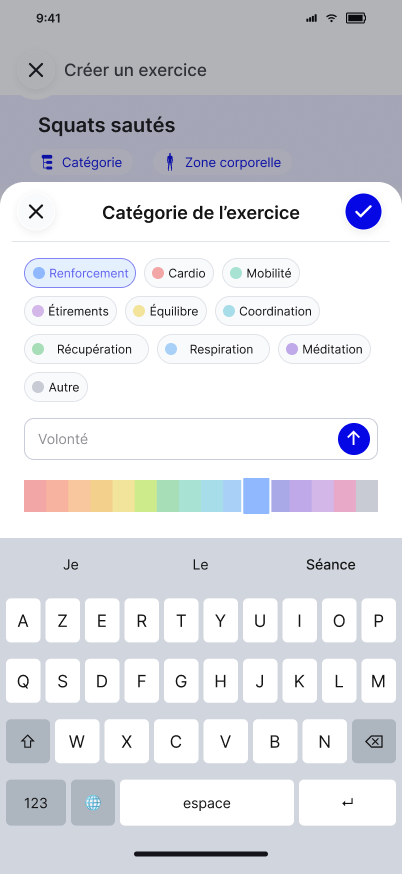

# Règles métier et calculs

Ce chapitre réunit les règles métier testables et les calculs, identifiés ou non, dans l’ordre du plan de domaine commun. Le chapitre 08 décrit les enchaînements qui les appliquent ; les contrats du chapitre 13 en décrivent l’effet à l’écran.

> Planification à plusieurs contenus (08/10) : les règles antérieures d’archivage supprimant les Routines associées restent décrites pour le cas à contenu unique. Leur extension à une Routine contenant d’autres contenus est **non définie** ; ne pas supprimer ces autres planifications par généralisation. Voir la chapitre 08, Planification.

## Sommaire

- [Objet et organisation du chapitre](#objet-et-organisation-du-chapitre)
  - [Objet](#objet)
- [Séances](#séances)
  - [Gestion du Catalogue et des Séances](#gestion-du-catalogue-et-des-séances)
  - [Parcours principal — Créer et exécuter une séance — Points d'attention](#parcours-principal--créer-et-exécuter-une-séance--points-dattention)
  - [Parcours complémentaire 1 — Créer une séance à partir d'une référence — Points d'attention](#parcours-complémentaire-1--créer-une-séance-à-partir-dune-référence--points-dattention)
  - [Parcours complémentaire 3 — Archiver puis supprimer une Séance — Points d'attention](#parcours-complémentaire-3--archiver-puis-supprimer-une-séance--points-dattention)
  - [Catalogue des séances — Suppression d’une Séance](#catalogue-des-séances--suppression-dune-séance)
  - [Catalogue des séances — Archivage](#catalogue-des-séances--archivage)
  - [Catalogue des séances — Séance vide](#catalogue-des-séances--séance-vide)
  - [Archives et références hors prototype actif](#archives-et-références-hors-prototype-actif)
  - [Cycle de vie d'une séance — Suppression d'une séance](#cycle-de-vie-dune-séance--suppression-dune-séance)
  - [Étiquettes de la séance — Règles fonctionnelles](#étiquettes-de-la-séance--règles-fonctionnelles)
- [Exercices](#exercices)
  - [Exercices, Séries et Récupérations](#exercices-séries-et-récupérations)
  - [Créer ou modifier un exercice — Parcours, données et validation](#créer-ou-modifier-un-exercice--parcours-données-et-validation)
  - [Règles transverses de l’éditeur d’Exercice](#règles-transverses-de-léditeur-dexercice)
  - [Exercice — Règles fonctionnelles](#exercice--règles-fonctionnelles)
- [Paramètres d’exécution](#paramètres-dexécution)
  - [Saisie des paramètres d’exécution](#saisie-des-paramètres-dexécution)
  - [Cadence — règles transverses complémentaires](#cadence--règles-transverses-complémentaires)
  - [Charge, côtés, cadence et condition d’arrêt — règles du 18/10/2026](#charge-côtés-cadence-et-condition-darrêt--règles-du-18102026)
  - [Calculs et cas de recette des cibles mixtes](#calculs-et-cas-de-recette-des-cibles-mixtes)
  - [Créer ou modifier un Exercice — Déroulement d’un Exercice](#créer-ou-modifier-un-exercice--déroulement-dun-exercice)
  - [Déroulement d’un Exercice](#déroulement-dun-exercice)
  - [Phrase de synthèse des paramètres — Grammaire française v15](#phrase-de-synthèse-des-paramètres--grammaire-française-v15)
  - [Phrase de synthèse des paramètres — Côtés et durée](#phrase-de-synthèse-des-paramètres--côtés-et-durée)
  - [Conventions communes d’interface — Contrôles et bornes v13](#conventions-communes-dinterface--contrôles-et-bornes-v13)
- [Composition des séances](#composition-des-séances)
  - [Création et modification d’une Séance](#création-et-modification-dune-séance)
  - [Composition, Circuit et Cycle technique](#composition-circuit-et-cycle-technique)
  - [Avertissement non bloquant d’enchaînement (D-301)](#avertissement-non-bloquant-denchaînement-d-301)
  - [Périmètre fonctionnel du MVP — Création et composition](#périmètre-fonctionnel-du-mvp--création-et-composition)
  - [Extension du contenu planifiable — Parcours — Récupération après exercice portée par l’occurrence](#extension-du-contenu-planifiable--parcours--récupération-après-exercice-portée-par-loccurrence)
  - [Composer une séance / Modifier une séance — Validation de la Composition](#composer-une-séance--modifier-une-séance--validation-de-la-composition)
  - [Composer une séance / Modifier une séance — Enregistrement](#composer-une-séance--modifier-une-séance--enregistrement)
  - [Composer une séance / Modifier une séance — Composition — Récupération après exercice — D-208 révisée sur l’affichage](#composer-une-séance--modifier-une-séance--composition--récupération-après-exercice--d-208-révisée-sur-laffichage)
  - [Composition d'une séance — Validation](#composition-dune-séance--validation)
  - [Composition d'une séance — Principes de conception](#composition-dune-séance--principes-de-conception)
  - [Placement des récupérations et des points d’arrêt — Positions, ordre et retrait](#placement-des-récupérations-et-des-points-darrêt--positions-ordre-et-retrait)
  - [Consultation média pendant l’Exécution — MVP — Récupérations — conception détaillée D-208](#consultation-média-pendant-lexécution--mvp--récupérations--conception-détaillée-d-208)
  - [Cadence — comportements communs complémentaires — Avertissement d’enchaînement sans pause (D-301)](#cadence--comportements-communs-complémentaires--avertissement-denchaînement-sans-pause-d-301)
  - [Champs et comportements des fonctionnalités — Pauses et symboles](#champs-et-comportements-des-fonctionnalités--pauses-et-symboles)
- [Circuits](#circuits)
  - [Règles transverses — circuits](#règles-transverses--circuits)
  - [Extension validée du modèle — Développement des circuits](#extension-validée-du-modèle--développement-des-circuits)
  - [Composition d'une séance — Circuit et compte](#composition-dune-séance--circuit-et-compte)
  - [Composition d'une séance — Cycle technique](#composition-dune-séance--cycle-technique)
  - [Composition d'une séance — Circuits de tours et de séries](#composition-dune-séance--circuits-de-tours-et-de-séries)
- [Formats de séances](#formats-de-séances)
  - [Formats — règles métier transverses](#formats--règles-métier-transverses)
  - [Cas de recette des formats](#cas-de-recette-des-formats)
  - [Phrase de synthèse des paramètres — Raccordement aux formats de séance](#phrase-de-synthèse-des-paramètres--raccordement-aux-formats-de-séance)
  - [Formats de séances — comportements consolidés — Concepts et invariants](#formats-de-séances--comportements-consolidés--concepts-et-invariants)
  - [Formats de séances — comportements consolidés — Tabata et Intervalles](#formats-de-séances--comportements-consolidés--tabata-et-intervalles)
  - [Formats de séances — comportements consolidés — EMOM : fenêtres et borne](#formats-de-séances--comportements-consolidés--emom--fenêtres-et-borne)
  - [Formats de séances — comportements consolidés — AMRAP, For time et départs rapides](#formats-de-séances--comportements-consolidés--amrap-for-time-et-départs-rapides)
  - [Formats de séances — comportements consolidés — Death by](#formats-de-séances--comportements-consolidés--death-by)
- [Bilatéralité](#bilatéralité)
  - [Catalogue des Exercices — cycle de vie d’un Exercice persistant — MVP T03 — Bilatéralité](#catalogue-des-exercices--cycle-de-vie-dun-exercice-persistant--mvp-t03--bilatéralité)
- [Exécution](#exécution)
  - [Exécution d’une Séance](#exécution-dune-séance)
  - [Arrière-plan, verrouillage et sécurité temporelle](#arrière-plan-verrouillage-et-sécurité-temporelle)
  - [Règles métier — Exécution directe d’un Exercice — MVP T03](#règles-métier--exécution-directe-dun-exercice--mvp-t03)
  - [Périmètre fonctionnel du MVP — Exécution guidée](#périmètre-fonctionnel-du-mvp--exécution-guidée)
  - [Parcours complémentaire 3 — Gérer une séance interrompue ou partiellement réalisée — Points d'attention](#parcours-complémentaire-3--gérer-une-séance-interrompue-ou-partiellement-réalisée--points-dattention)
  - [Exécution — séance ou exercice — Séries](#exécution--séance-ou-exercice--séries)
  - [Exécution — séance ou exercice — Récupérations](#exécution--séance-ou-exercice--récupérations)
  - [Règles générales d’interface — Clarification — Préparation et fin dans une Séance](#règles-générales-dinterface--clarification--préparation-et-fin-dans-une-séance)
  - [Informations affichées — Temps écoulé et durée réelle](#informations-affichées--temps-écoulé-et-durée-réelle)
  - [Informations affichées — Barre de progression globale](#informations-affichées--barre-de-progression-globale)
  - [Exécution d'une séance — Passage à l'exercice suivante](#exécution-dune-séance--passage-à-lexercice-suivante)
  - [Exécution d'une séance — Reprise](#exécution-dune-séance--reprise)
  - [Arrêt anticipé — Pause prolongée](#arrêt-anticipé--pause-prolongée)
  - [Exécution d'une séance — Fin de séance](#exécution-dune-séance--fin-de-séance)
  - [Exécution d'une séance — Principes de conception](#exécution-dune-séance--principes-de-conception)
  - [Exécution d'une séance — Bip de cadence, progression et sécurité](#exécution-dune-séance--bip-de-cadence-progression-et-sécurité)
  - [Exécution d'une séance — Cibles et relevés d’exécution](#exécution-dune-séance--cibles-et-relevés-dexécution)
  - [Exécution d'une séance — Sons et annonces](#exécution-dune-séance--sons-et-annonces)
- [Médias pendant l’Exécution](#médias-pendant-lexécution)
  - [RM-203 — Consultation média pendant l’Exécution](#rm-203--consultation-média-pendant-lexécution)
- [Planification](#planification)
  - [Planification et Calendrier](#planification-et-calendrier)
  - [Notifications et rappels](#notifications-et-rappels)
  - [Planification multi-contenus](#planification-multi-contenus)
  - [Vision cible — médias pendant l’Exécution — Cible de planification commune](#vision-cible--médias-pendant-lexécution--cible-de-planification-commune)
  - [Synthèse des parcours du MVP — Principes communs](#synthèse-des-parcours-du-mvp--principes-communs)
  - [Cycle de vie d'une séance — Planification d’un contenu](#cycle-de-vie-dune-séance--planification-dun-contenu)
  - [Planification des créneaux et de leurs contenus — La fréquence d'un contenu : « x fois sur n »](#planification-des-créneaux-et-de-leurs-contenus--la-fréquence-dun-contenu---x-fois-sur-n-)
  - [Planification des créneaux et de leurs contenus — La répétition du créneau](#planification-des-créneaux-et-de-leurs-contenus--la-répétition-du-créneau)
  - [Champs et comportements des fonctionnalités — Calendrier](#champs-et-comportements-des-fonctionnalités--calendrier)
  - [Planifier une Séance ou un Exercice — Règles liées à la couleur](#planifier-une-séance-ou-un-exercice--règles-liées-à-la-couleur)
- [Suivi et synthèse](#suivi-et-synthèse)
  - [Synthèse, Suivi et historique](#synthèse-suivi-et-historique)
  - [Périmètre fonctionnel du MVP — Suivi](#périmètre-fonctionnel-du-mvp--suivi)
  - [Parcours complémentaire 4 — Consulter le suivi des séances — Points d'attention](#parcours-complémentaire-4--consulter-le-suivi-des-séances--points-dattention)
  - [Historisation](#historisation)
  - [Synthèse — séance ou exercice — Statut](#synthèse--séance-ou-exercice--statut)
  - [Suivi et historique des séances — Statut d'une exécution](#suivi-et-historique-des-séances--statut-dune-exécution)
  - [Suivi et historique des séances — Conservation des historiques](#suivi-et-historique-des-séances--conservation-des-historiques)
  - [Suivi et historique des séances — Principes de conception](#suivi-et-historique-des-séances--principes-de-conception)
  - [Synthèse de séance — Règles fonctionnelles](#synthèse-de-séance--règles-fonctionnelles)
  - [Suivi - Séances — Règle fonctionnelle liée à la couleur](#suivi---séances--règle-fonctionnelle-liée-à-la-couleur)
- [Profil et préférences](#profil-et-préférences)
  - [Préférences, sons, voix et vibrations](#préférences-sons-voix-et-vibrations)
  - [Profil — Règles fonctionnelles](#profil--règles-fonctionnelles)
- [Référentiels](#référentiels)
  - [Contrat d’affichage commun aux écrans du MVP — Gestion des référentiels dans les modales de sélection](#contrat-daffichage-commun-aux-écrans-du-mvp--gestion-des-référentiels-dans-les-modales-de-sélection)
  - [Créer ou modifier un exercice — Sélections, créations de référentiels et confirmation d’abandon](#créer-ou-modifier-un-exercice--sélections-créations-de-référentiels-et-confirmation-dabandon)
  - [Règles communes aux sélections et réglages](#règles-communes-aux-sélections-et-réglages)
  - [Exercice — Gestion commune des référentiels de classification](#exercice--gestion-commune-des-référentiels-de-classification)
- [Calculs transverses](#calculs-transverses)
  - [Calculs et progression](#calculs-et-progression)
  - [Calculs des durées et ordre des phases](#calculs-des-durées-et-ordre-des-phases)
  - [Résultats temporels et agrégation du circuit](#résultats-temporels-et-agrégation-du-circuit)
  - [Composition d'une séance — Estimation](#composition-dune-séance--estimation)
  - [Phrase de synthèse des paramètres — Format d'affichage des durées](#phrase-de-synthèse-des-paramètres--format-daffichage-des-durées)
  - [Conventions communes d’interface — Générateur de phrase de synthèse v13](#conventions-communes-dinterface--générateur-de-phrase-de-synthèse-v13)
- [Interface transverse](#interface-transverse)
  - [Navigation principale et articulation des écrans — Enregistrement automatique](#navigation-principale-et-articulation-des-écrans--enregistrement-automatique)
  - [Composer une séance / Modifier une séance — Retour haptique des roulettes](#composer-une-séance--modifier-une-séance--retour-haptique-des-roulettes)
- [Sujets transverses](#sujets-transverses)
  - [Langue, terminologie et accessibilité structurelle](#langue-terminologie-et-accessibilité-structurelle)
  - [Règles RM-213 à RM-221 — consolidation](#règles-rm-213-à-rm-221--consolidation)
  - [Extension validée du modèle — Consolidation du modèle — D-209 à D-217](#extension-validée-du-modèle--consolidation-du-modèle--d-209-à-d-217)
  - [Champs et comportements des fonctionnalités — Règles communes — D-209 à D-217](#champs-et-comportements-des-fonctionnalités--règles-communes--d-209-à-d-217)

## Objet et organisation du chapitre

### Objet

Ce chapitre rassemble les règles fonctionnelles qui s’appliquent à plusieurs écrans ou parcours. Les interactions écran par écran sont définies par les contrats du chapitre 13 ; la navigation et les conventions d’interface communes, par le chapitre 06 ; le rendu visuel, par Figma.

## Séances

### Gestion du Catalogue et des Séances

| ID | Règle |
| --- | --- |
| RM-001 | Une Séance possède un identifiant unique et un nom obligatoire. Son Étiquette est facultative ; lorsqu’elle existe, sa couleur devient la couleur affichée de la Séance. |
| RM-002 | Le Catalogue des séances est l’écran d’accueil après le splash. |
| RM-003 | Une Séance est soit active, soit archivée. Les vues actives excluent les Séances archivées. |
| RM-004 | Toucher le corps d’une carte de Séance active ouvre cette Séance en mode modification. |
| RM-005 | Le glissement sur une Séance active expose uniquement les actions prévues pour ce contexte : `Planifier`, `Dupliquer` et `Archiver`. |
| RM-006 | La duplication crée une copie indépendante de la Séance et de sa Composition. Elle ne crée ni Routine ni Exécution. |
| RM-007 | Une Séance active ne peut pas être supprimée. Elle doit d’abord être archivée, puis supprimée depuis le résultat du filtre `Archivées`. |
| RM-008 | L’archivage supprime les Routines futures dont la Séance est l’unique contenu (D-023) et conserve les Exécutions et leurs Instantanés historiques. Sans Routine associée, l’archivage est immédiat et sans confirmation, puis un snackbar `Séance archivée` propose temporairement `Annuler`. Si au moins une Routine est associée, une confirmation explicite est requise avant l’archivage ; après confirmation, aucun snackbar d’annulation n’est affiché. L’effet sur une Routine à plusieurs contenus reste `À CLARIFIER` (D-328) : ne pas généraliser la suppression à ses autres contenus. |
| RM-009 | Une Séance archivée peut être restaurée. La restauration ne recrée aucune ancienne Routine. |
| RM-010 | Après restauration, un message `Séance restaurée` propose temporairement `Annuler`. |
| RM-011 | Une Séance archivée peut être supprimée définitivement après confirmation explicite. Cette suppression ne supprime pas ses Exécutions historiques. |
| RM-012 | Le glissement gauche déplace visiblement la carte avec le geste et révèle progressivement les actions placées derrière. Une fois ouverte, la carte se referme uniquement par un glissement droit commencé sur cette même carte ; un glissement droit ailleurs, un appui sur le fond ou un appui sur sa surface principale hors options n’a aucun effet de fermeture. Une seule carte peut exposer simultanément ses actions, sans désactiver les autres contrôles de l’écran. |
| RM-013 | **Supersédée par D-221.** Aucune recherche globale ni recherche locale de Catalogue n’est incluse dans le MVP. |
| RM-014 | L’état vide du Catalogue permet de lancer la création de la première Séance. |

### Parcours principal — Créer et exécuter une séance — Points d'attention

- Une séance décrit uniquement son contenu.
- Une séance peut être exécutée immédiatement, sans être planifiée.
- Les modifications d'une séance n'altèrent jamais les exécutions déjà enregistrées.
- La planification des séances est gérée par les routines, décrites dans le parcours dédié.
### Parcours complémentaire 1 — Créer une séance à partir d'une référence — Points d'attention

- La séance créée est totalement indépendante de la séance d'origine.
- Les modifications apportées à l'une n'ont aucun impact sur l'autre.
- La duplication reprend l'intégralité de la structure de la séance et de ses paramètres.
### Parcours complémentaire 3 — Archiver puis supprimer une Séance — Points d'attention

- Une Routine ne modifie jamais le contenu de sa source.
- *Texte identique à celui de la section [« Synthèse des parcours du MVP — Principes communs »](10%20%E2%80%93%20Processus%20m%C3%A9tier%20et%20r%C3%A8gles%20m%C3%A9tier%20transverses.md#synthèse-des-parcours-du-mvp--principes-communs) ; il n’est pas recopié ici.*
- La suppression d'une Routine ne supprime jamais sa source.
- Les exécutions déjà réalisées sont toujours conservées.
- L’archivage d’une Séance supprime les Routines dont elle est l’unique contenu. Une confirmation est requise lorsqu’au moins une Routine est associée ; sans Routine, l’archivage est immédiat avec snackbar `Séance archivée` et `Annuler`. Après une confirmation ayant entraîné une suppression de Routines à contenu unique, aucun snackbar d’annulation n’est affiché et leur restauration n’est pas automatique. Pour les Routines à plusieurs contenus, l’effet reste `À CLARIFIER` (RM-008) ; aucun autre contenu ne peut être supprimé par simple généralisation.
### Catalogue des séances — Suppression d’une Séance

Une Séance non archivée ne peut pas être supprimée. Elle doit d’abord être archivée.

Depuis le résultat du filtre `Archivées`, un glissement gauche déplace la carte et révèle l’action `Supprimer` placée derrière. L’action ouvre une modale de confirmation sur le fond de la liste archivée.

La suppression demande toujours une confirmation explicite. Les Routines à contenu unique associées ont déjà été supprimées lors de l’archivage ; pour une Routine à plusieurs contenus, l’effet de l’archivage reste `À CLARIFIER` (avertissement en tête de chapitre) (D-023).

Après confirmation :

- la Séance est supprimée ;
- les occurrences futures cessent d’être calculées ;
- les Exécutions déjà enregistrées restent conservées dans le Suivi grâce à leur Instantané.

### Catalogue des séances — Archivage

L’archivage retire la Séance de la liste principale.

Si aucune Routine n’est associée, l’archivage est immédiat et ne demande pas de confirmation. Un snackbar `Séance archivée` est affiché avec l’action `Annuler`. `Annuler` restaure immédiatement la Séance dans la liste active.

Si au moins une Routine est associée, une confirmation explicite est demandée avant l’archivage ; après confirmation, les Routines à contenu unique dont elle est la seule source sont supprimées. Pour les Routines multicontenus, l’effet reste `À CLARIFIER` et aucune suppression de leurs autres contenus n’est déduite. Aucun snackbar `Séance archivée` avec `Annuler` n’est affiché après confirmation.

La restauration d’une Séance archivée ne restaure aucune ancienne Routine.

Une Séance archivée est consultable mais ne peut être ni modifiée, ni exécutée, ni planifiée. Elle peut être restaurée ou supprimée depuis le résultat du filtre `Archivées`.

### Catalogue des séances — Séance vide

Le MVP ne comporte pas de statut `Brouillon`.

Une nouvelle Séance n’est enregistrable qu’avec un nom et au moins un Exercice valide ; l’Étiquette est facultative et porte seule la couleur affichée lorsqu’elle est choisie (RM-001, RM-017). Aucun statut `Brouillon` persistant n’est introduit.

Une Séance déjà enregistrée qui se retrouve sans Exercice reste conservée et peut être ouverte pour modification, archivée puis supprimée conformément au cycle de vie. Elle ne peut être ni exécutée ni enregistrée après modification tant qu’au moins un Exercice valide n’a pas été ajouté (RM-017).

### Archives et références hors prototype actif

L’écran/arbre intermédiaire `Une nouvelle exercice / Une séance / Un parcours / Annuler` est supprimé par D-187.

Dans chaque Catalogue, `Créer` ouvre directement la création de l’objet correspondant au Catalogue courant :
- `Catalogue des Exercices` → création d’un Exercice persistant ;
- `Catalogue des Séances` → création d’une Séance ;
- `Catalogue des Parcours` : ancienne cible retirée (D-328) ; le segment Parcours n’existe plus (D-324).

Cette règle n’active pas les Parcours dans T03/MVP. Les anciennes frames Figma `3787:5148` et `3841:8375`, ainsi que leurs captures physiques, sont conservées uniquement pour traçabilité et ne constituent plus des états fonctionnels à implémenter.

### Cycle de vie d'une séance — Suppression d'une séance

Une séance active ne peut pas être supprimée : elle doit d'abord être archivée, puis supprimée depuis le résultat du filtre `Archivées` (RM-007, D-121).

La suppression est définitive.

La suppression d'une séance archivée demande une confirmation explicite (RM-011).

Les Routines à contenu unique associées ont déjà été supprimées lors de l’archivage (RM-008) ; le cas multicontenu reste `À CLARIFIER`.

Les exécutions déjà enregistrées restent conservées dans l'historique.

### Étiquettes de la séance — Règles fonctionnelles

- Étiquette et couleur de Séance désignent la même classification visuelle : il n’existe pas de couleur indépendante de l’Étiquette ;
- l’ouverture de la modale ne modifie pas les autres données de Composition ;
- la création d’une nouvelle Étiquette se fait depuis la modale sans écran autonome ;
- les valeurs `Marathon`, `Hyrox`, `Vacances d'été` et `Challenge groupe` sont des exemples Figma et non un référentiel statique imposé ;
- les Catégories sont réservées aux Exercices et ne doivent plus être utilisées comme classification de la Séance.

## Exercices

### Exercices, Séries et Récupérations

| ID | Règle |
| --- | --- |
| RM-033 | Deux modes communs à l’Exercice : Durée et Répétitions. Chaque Série porte une cible chiffrée dans l’unité du mode ou une cible À l’échec. Cette dernière n’est ni un troisième mode, ni une cible manquante. Aucun type Exercice/Récupération ne revient. |
| RM-034 | Uniforme : cible/Pause communes ; variable : paramètres ordonnés propres à chaque Série. PC intrinsèque ; R contextuelle à l’occurrence. |
| RM-035 | Toute Exercice possède un nombre entier de Séries de 1 à 99 (D-092) ; la valeur initiale est 1. |
| RM-036 | Une Série est une définition cible/Pause subordonnée à l’Exercice ; N1..99 par côté, modes non mélangés. Pi est stockée et exécutée après chaque Série, dernière comprise. À la frontière des côtés successifs, PN puis PC se cumulent. Par paire, Pi suit chaque paire, dernière comprise, et PC reste dans chaque paire. Seule la toute dernière Pause est remplacée par la récupération positive qui suit l’occurrence ; aucune récupération en direct. N=1 normalisé uniforme/par côté. Formules et séquences : chapitre 10, Calculs des durées et ordre des phases. |
| RM-037 | L’ordre d’exécution vient du paramètre Ordre des côtés : Un côté après l’autre (défaut) ou Les deux côtés à chaque série. En bilatéral N est toujours par côté, paramètres communs aux deux côtés. Les successions et pauses sont celles de chapitre 08, paramètres d’exercice ; aucun repli de PC vers la Pause. Les cibles et Pauses variables proviennent de la ligne courante. |
| RM-038 | Récupération ajoutée explicitement à l’occurrence ; 0 sans phase ; positive après l’Exercice à chaque Tour concerné. R positive remplace seulement la dernière Pause ; sa suppression la rétablit. |
| RM-039 | Un nouvel Exercice valide est associé à une ou plusieurs Zones corporelles ; la sélection reste multiple. |
| RM-040 | Les Zones corporelles constituent un référentiel utilisateur administrable : sélection multiple sur un Exercice, création, renommage et suppression sont autorisés dans le MVP. Une suppression utilisée demande confirmation, retire la valeur des choix futurs, conserve les associations des Exercices existants et préserve les Instantanés/Exécutions historiques. |
| RM-200 | Dans les modales de sélection des Étiquettes, Catégories et Zones corporelles, en sélection simple (Catégorie, Étiquette), l’appui court marque la valeur sans fermer et ✓ confirme puis ferme (D-343, D-355) ; en sélection multiple, l’appui court sélectionne/désélectionne (D-222) ; l’appui long ouvre, sans modifier la sélection, le dialogue `Modifier` / `Supprimer` (D-259, D-354), `Supprimer` demandant une confirmation de suppression. Toutes les valeurs sont supprimables, initiales comme personnalisées. `Annuler` ne modifie rien ; `Supprimer` retire la valeur des nouveaux choix, conserve les affectations existantes sur les objets déjà enregistrés, puis conserve la modale de sélection ouverte. L’historique reste inchangé. |
| RM-041 | Dans le MVP, le média associé à un Exercice est affiché dans la gouttière permanente de sa carte Catalogue, sans déploiement (D-260/D-261). L’import/ajout local et les associations ordonnées sont inclus au MVP dans PRE-3 (D-333), sans activation implicite de la caméra. |
| RM-042 | L’action de validation de l’édition d’un Exercice est libellée `Terminer`. |
| RM-129 | Durée intrinsèque calculable : unilatéral Σ(Ti+Pi) ; succession des côtés 2Σ(Ti+Pi)+PC ; par paire 2ΣTi+ΣPi+N×PC. N=1 normalisé succession. Occurrence calculable To=T−PN+R si R>0, sinon To=T. Durée : exact si toutes les cibles sont chiffrées ; Répétitions avec bip : ≈ si toutes les cibles sont chiffrées. Mélange chiffré/échec calculable : ≥ au niveau Exercice, prioritaire sur ≈, somme du travail connu ou estimable et des pauses prévues. Répétitions sans bip, ou toutes les cibles À l’échec : aucun total d’Exercice (omitted). Séance/Circuit : agrégation des contributions connues du plan, ≥ si travail inconnu. Travail + pause après chaque série, dernière comprise ; seule la dernière Pause est remplacée par la Récupération positive qui suit. Compte à rebours/Fin exclus du total intrinsèque. Aucun calcul issu de Figma ou d’Excel. |
| RM-130 | En Durée uniforme seulement, saisie Tv recalcule N1..99 au plus proche, égalité vers le haut, avec normalisation N=1 ; réafficher T(N), message si différent. En variable aucune inversion ; chapitre 08, paramètres d’exercice. |
| RM-131 | La ligne active de roulette/segmenté porte le contour ; les steppers restent permanents sans contour pilote. Le total variable/Répétitions est en lecture seule ; aucun état pilote persisté. |
| RM-132 | Durée : exact si toutes les cibles sont chiffrées ; Répétitions avec bip : ≈ si toutes les cibles sont chiffrées. Mélange chiffré/échec calculable : ≥ au niveau Exercice, prioritaire sur ≈, somme du travail connu ou estimable et des pauses prévues. Répétitions sans bip, ou toutes les cibles À l’échec : aucun total d’Exercice (omitted). Séance/Circuit : agrégation des contributions connues du plan, ≥ si travail inconnu. |

### Phases internes d’un exercice

<a id="regles-phases"></a>

Les [règles détaillées des phases](08%20%E2%80%93%20Conception%20fonctionnelle%20d%C3%A9taill%C3%A9e.md#phases-exercice) appliquent D-370 à D-375. Elles ne créent pas un troisième mode ni un compteur de répétitions du motif.

| Règle | Prescription |
|---|---|
| Éligibilité | Durée chiffrée, séries identiques, jusqu’à 6 phases, libellés de 20 caractères maximum. |
| Séquence | Une série déroule une fois toutes les phases ; aucune pause entre phases. |
| Durée | D = somme des phases ; unilatéral N × (D + P), dernière pause comprise. Préparation/fin exclues du total intrinsèque. |
| Formats | Durée de travail imposée : dernière phase calculée ; ajout à zéro ; déplacement sans changement de valeurs ; temps supprimé repris par la dernière. |
| Intégration au format | Adaptation proportionnelle si somme différente, dans les deux sens, copie de séance seule ; message informatif. Ne pas assimiler fenêtre EMOM et durée de travail. |
| Normalisation | Zéros de saisie retirés à validation, libellés vides remplacés par Phase n ; aucune nouvelle confirmation. |
| Guidage | Cadence continue ; transition prioritaire ; annonce au début sans attente, interruption de la précédente. |
| Reprise et commandes | Périmètre de série/côté inchangé ; position de phase conservée en pause ; reset repart de la première phase du périmètre réinitialisé ; Suivant ne devient pas phase suivante. |
| Progression | Une subdivision ne change pas le poids global de la série ; conserver son unité contributive dans les plans mixtes plutôt qu’augmenter M pour chaque phase. |

Les zéros dus aux arrondis d’adaptation, les bornes spécifiques et les données initiales incomplètes restent les compléments explicités au chapitre 08. Les règles de Récupération positive, de pause terminale, de bilatéralité et de compte de circuit ne sont pas remplacées.

### Créer ou modifier un exercice — Parcours, données et validation

Créer depuis Catalogue ouvre le formulaire ; Modifier reprend les données existantes. Nom, une Catégorie et au moins une Zone sont requis pour un nouvel Exercice. Carte Paramètres → feuille transactionnelle ; ✕/retour annule son brouillon, ✓ applique au parent ; Terminer seul persiste. Abandon du formulaire modifié ouvre la confirmation existante. Ouvrir un référentiel conserve les paramètres, même variables.

Section [Paramètres et brouillon d’un exercice](08%20%E2%80%93%20Conception%20fonctionnelle%20d%C3%A9taill%C3%A9e.md#paramètres-et-brouillon-dun-exercice) : mode unique, N séries par côté, cibles/Pauses propres à chaque ligne en variable, Changement de côté (Avec / Sans) et Ordre des côtés (D-406), charge facultative (RM-235 à RM-241). N=1 effectif uniforme/Un côté après l’autre ; restauration temporaire avant✓. Déplacement cible/Pause conjoint ; nouvelle première reprise à désactivation, nouvelle dernière Pause stockée et exécutée, sauf substitution par récupération positive. Total variable readonly ; ligne Durée de l’exercice (D-409) toujours affichée, dans tous les modes et tous les états de saisie, y compris à N = 1 (D-396, D-433), avec « — » lorsqu’une donnée nécessaire au calcul manque (D-384) ; Répétitions : ≈ avec cadence, omission sans bip à l’Exercice ; À l’échec aucun total. Dans la feuille, une durée omise s’affiche « Non calculable », prioritaire sur « — », et le symbole ≈ ou ≥ précède immédiatement la valeur (D-433).

### Règles transverses de l’éditeur d’Exercice
Les écrans Exercice placent le champ Nom en premier dans la zone bleue et suppriment le contexte de Séance. Aucun type d’Exercice n’est affiché. Le mode d’exécution propose `Durée` et `Répétitions`. `À l’échec` est un type de cible de série, choisi par la Condition d’arrêt en séries identiques et dans la cellule du tableau en séries variables (RM-248 à RM-250), et non un troisième mode. Dans le MVP, la zone Média suit les frames courantes et la carte d’Exercice du Catalogue conserve sa gouttière permanente avec premier média ou icône de nature, sans déploiement (D-260/D-261/D-264). Les capacités d’import/capture restent régies par leur périmètre propre. Les accès `Catégorie` et `Zones corporelles` utilisent une icône `+` séparée de leur libellé.

La frame historique `3561:7802` illustrait l’état À l’échec : ordre `Séries` → cadre informatif `à l’échec` → `Pause`, seconde rangée `Changement de côté / Récupération / Durée totale >=`, sans cible chiffrée. Cette ancienne disposition ne définit plus l’éditeur actif : la feuille ([Feuille et contrôles](13%20%E2%80%93%20Contrats%20d%E2%80%99%C3%A9cran.md#feuille-et-contrôles)) utilise les contrôles de CE-UI-10 et aucun total d’Exercice en À l’échec ; la ligne Durée de l’exercice y affiche « Non calculable » (D-433). Les roulettes de cette feuille restent inline ; les contrôles de durée du Profil sont des steppers. Dans les états renseignés, `Renforcement du genou` est une donnée de démonstration ; seul `3943:6064` conserve `Nom de l’exercice` comme placeholder de l’état vide.

### Exercice — Règles fonctionnelles

| Règle             | Description                                                                                                                                                                                                                                                                                                                                                                                |
| ----------------- | ------------------------------------------------------------------------------------------------------------------------------------------------------------------------------------------------------------------------------------------------------------------------------------------------------------------------------------------------------------------------------------------ |
| Mode Durée        | Affiche le sélecteur de durée.                                                                                                                                                                                                                                                                                                                                                             |
| Mode Répétitions  | Affiche le champ "Nombre de répétitions".                                                                                                                                                                                                                                                                                                                                                  |
| Cible À l’échec   | Cible de Série et non troisième mode (D-111) ; n’affiche aucune cible chiffrée ; conserve l’ordre `Séries` → cadre informatif transparent bordé `à l’échec` → `Pause`. |
| Séries            | Un Exercice possède un nombre de Séries propre, de 1 à 99 (D-092). En bilatéral autonome, ce nombre s’entend par côté. Une Série exécute la cible du mode ; chaque Série porte sa Pause, y compris la dernière, selon les successions de [Calcul, pauses et périmètres](10%20%E2%80%93%20Processus%20m%C3%A9tier%20et%20r%C3%A8gles%20m%C3%A9tier%20transverses.md#calcul-pauses-et-périmètres), Pause terminale comprise. |
| Changement de côté | Réglage propre Avec / Sans (RM-242, D-406) ; `UNILATERAL` correspond à Sans, les valeurs historiques `RIGHT_LEFT` et `LEFT_RIGHT` sont lues Avec (RM-244). Aucun réglage de côté n’est exposé au niveau Circuit. |
| Pause entre les côtés | Durée intrinsèque facultative `sideRecoverySeconds`, uniquement en bilatéral. Elle intervient selon l’Ordre des côtés. Sa valeur initiale lors de l’activation bilatérale provient du défaut global **Pause entre les côtés** du Profil (`10 s` dans le Figma de référence) et reste modifiable dans l’éditeur de l’Exercice. |
| Charge | Paramètre facultatif et informatif en kilogrammes, Avec / Sans, commun aux séries identiques ou propre à chaque série variable : RM-235 à RM-241 (D-403 à D-405). |
| Durée totale calculée | Durée intrinsèque calculable : unilatéral Σ(Ti+Pi) ; succession des côtés 2Σ(Ti+Pi)+PC ; par paire 2ΣTi+ΣPi+N×PC. N=1 normalisé succession. Occurrence calculable To=T−PN+R si R>0, sinon To=T. Durée : exact si toutes les cibles sont chiffrées ; Répétitions avec bip : ≈ si toutes les cibles sont chiffrées. Mélange chiffré/échec calculable : ≥ au niveau Exercice, prioritaire sur ≈, somme du travail connu ou estimable et des pauses prévues. Répétitions sans bip, ou toutes les cibles À l’échec : aucun total d’Exercice (omitted). Séance/Circuit : agrégation des contributions connues du plan, ≥ si travail inconnu. Travail + pause après chaque série, dernière comprise ; seule la dernière Pause est remplacée par la Récupération positive qui suit. Compte à rebours/Fin exclus du total intrinsèque. Aucun calcul issu de Figma ou d’Excel. |
| Durée totale pilotée | Voir RM-130 (calcul inverse en Durée uniforme) et [Durées, affichage et inversion](10%20%E2%80%93%20Processus%20m%C3%A9tier%20et%20r%C3%A8gles%20m%C3%A9tier%20transverses.md#durées-affichage-et-inversion). |
| Sélection de ligne | Dans CE-UI-10, le contour désigne uniquement la ligne de roulette/segmenté activée (les lignes Mode, Type de série et Changement de côté sont des contrôles segmentés, les popovers de D-377 étant remplacés par D-413 ; rendu à vérifier dans Figma). Aucun contour sur Séries/stepper. Si T(N)≠Tv, message sous Durée de l’exercice (D-409) ; sinon aucun message. |
| Modes non chronométrés | Voir RM-129 et [Durées, affichage et inversion](10%20%E2%80%93%20Processus%20m%C3%A9tier%20et%20r%C3%A8gles%20m%C3%A9tier%20transverses.md#durées-affichage-et-inversion). |
| Zones corporelles | Sélection multiple dans un référentiel utilisateur administrable. Le référentiel est initialisé avec dix valeurs par défaut ; l’utilisateur peut créer, renommer et supprimer une Zone corporelle. Une suppression retire la valeur des choix futurs après confirmation et conserve les affectations existantes ainsi que l’historique. |
| Validation        | Impossible tant que les champs obligatoires ne sont pas renseignés. Un contrôle ou champ obligatoire sans valeur est signalé par son fond rouge pâle, qui redevient normal dès qu’une valeur valide est renseignée ; aucun message supplémentaire (D-389).                                                                                                                                                                                                                                                                                                                        |
| Retour            | Si des modifications non enregistrées existent, une confirmation est demandée.                                                                                                                                                                                                                                                                                                             |
| Synthèse          | Cadre immuable, indépendant du déploiement des sections et placé en bas du contenu à `spacing/24` de l’action finale. Style `KODJO / Body` (`14/20`). La phrase commence par le nombre de Séries et ne répète pas le mode. Sans mode sélectionné, elle est vide. Elle suit les fragments conditionnels de la [phrase de synthèse des paramètres](08%20%E2%80%93%20Conception%20fonctionnelle%20d%C3%A9taill%C3%A9e.md#phrases) (RM-232, D-298), inclut la mention de charge selon RM-240, se régénère à chaque modification et exclut nom d’Exercice, Compte à rebours, Fin d’exercice et Récupération post-activité.

## Paramètres d’exécution

### Saisie des paramètres d’exécution

La référence active est [Paramètres et brouillon d’un exercice](08%20%E2%80%93%20Conception%20fonctionnelle%20d%C3%A9taill%C3%A9e.md#paramètres-et-brouillon-dun-exercice), contrats CE-T03-04/CE-UI-10. Elle intègre Séries variables, Ordre des côtés, pauses terminales et récupération de l’occurrence. Feuille transactionnelle : ✕ annule, ✓ applique au parent, Terminer persiste. Les calculs et comportements sont normatifs dans les spécifications ; Figma définit le layout seulement. Les anciens textes v11 sont historiques. Charge, Changement de côté, Cadence, Durée de l’exercice, chevrons, Condition d’arrêt et roulettes de durée : [RM-235 à RM-250](10%20%E2%80%93%20Processus%20m%C3%A9tier%20et%20r%C3%A8gles%20m%C3%A9tier%20transverses.md#charge-côtés-cadence-et-condition-darrêt--règles-du-18102026) ci-dessous (D-403 à D-413).

### Cadence — règles transverses complémentaires

CAD-01 à CAD-30 sont transcrites sans doublon dans D-268 à D-297 ; appliquer [Exécution d'une séance — Bip de cadence, progression et sécurité](10%20%E2%80%93%20Processus%20m%C3%A9tier%20et%20r%C3%A8gles%20m%C3%A9tier%20transverses.md#exécution-dune-séance--bip-de-cadence-progression-et-sécurité). Intervalles sonores et progression sont distincts de la fin métier. Pause abandonne la fraction pour progression seulement ; reset n’efface pas le temps réel. Arrière-plan n’est pas Pause, aucun rejeu de signal manqué. Cadence commune à toutes les Séries dans l’éditeur, aucun défaut ni préférence Profil ; choix Autre, 5 s, 2 s, 1 s et Sans selon RM-245. Les formules de pauses/Récupération de RM-129 restent inchangées hors Ti.

### Charge, côtés, cadence et condition d’arrêt — règles du 18/10/2026

Décisions D-403 à D-421 du [registre](07%20%E2%80%93%20Registre%20des%20d%C3%A9cisions%20de%20conception.md#parametres-execution-20261018). Les règles existantes de saisie, de validation, de séries identiques et variables, de pauses, d’enchaînement, de cadence et de calcul s’appliquent sans changement lorsqu’elles ne sont pas nommées ci-dessous ; les valeurs des captures Figma sont illustratives.

#### RM-235 — Charge : nature

La charge est une valeur numérique facultative en kilogrammes, informative. Elle représente exactement la valeur saisie : aucune convention liée au matériel, aucun doublement par côté ou par nombre d’haltères. Kodjo n’en déduit ni durée, ni performance, ni instruction de sécurité. Elle ne modifie ni minuteurs, ni répétitions cibles, ni cadence, ni pauses, ni ordre d’exécution, ni condition d’arrêt, ni calcul de durée, ni phases, ni formats de séance ; elle ne crée aucune combinaison interdite avec le mode, la condition d’arrêt ou le changement de côté. Aucune valeur distincte par côté. Hors périmètre : résistance d’élastique ou niveau de machine, autres unités, convention par haltère ou poids total, tonnage, estimation de force ou de calories, recommandations de charge, saisie d’une charge réalisée distincte de la charge prévue, nouveaux rapports de suivi (D-403).

#### RM-236 — Charge : activation et conservation

La charge est désactivée par défaut : Sans est sélectionné. Un Exercice qui ne porte pas ce paramètre, notamment s’il est antérieur à cette évolution, est lu sans charge ; il n’est jamais converti en charge de 0 kg. L’état activé et les valeurs sont distincts : Sans désactive la charge sans effacer la dernière valeur commune ni les dernières valeurs par série ; Avec les restaure (RM-239 pour les cas à zéro). Les valeurs conservées d’une charge désactivée ne sont ni une consigne d’exécution ni une mention de la synthèse. Elles suivent le cycle normal d’enregistrement des paramètres (brouillon de la feuille, ✓, Terminer), y compris après réouverture de l’Exercice enregistré ; la copie, la duplication et l’instantané transportent l’activation et ces valeurs (D-403).

#### RM-237 — Charge : séries identiques

Une seule charge s’applique aux séries identiques. La ligne Charge (Avec / Sans) suit la Pause dans le groupe Séries. Activer la charge ouvre directement sa saisie, sans écran préalable de choix de matériel ou de type de résistance. Après saisie, la valeur et son unité remplacent Avec, par exemple « 20 kg », et restent modifiables (D-404).

#### RM-238 — Charge : séries variables

La ligne Charge (Avec / Sans) reste sous le tableau. Avec affiche la colonne Charge, Sans la masque sans effacer ses valeurs ; le titre de colonne n’est pas interactif. Chaque série porte sa charge ; la charge est une valeur de la série au même titre que sa cible et sa Pause : elle la suit lors d’un déplacement et suit les règles communes de remplissage initial, de champ vide, d’ajout et de retrait, de suppression et de restauration et de passage identiques/variables ([Paramètres et brouillon d’un exercice](08%20%E2%80%93%20Conception%20fonctionnelle%20d%C3%A9taill%C3%A9e.md#paramètres-et-brouillon-dun-exercice), D-249, D-389). Aucune autorisation particulière de cellule de charge vide ; aucune propagation automatique d’une nouvelle charge aux autres cellules hors de ces règles communes ; l’initialisation commune à 0,25 kg de RM-239 est le seul cas propre à la charge. Colonnes de référence : Durée ou Répétitions, Pause, Charge (D-404).

#### RM-239 — Charge : saisie, pas et zéro

- **Saisie** : clavier numérique avec séparateur décimal, saisie directe dans le champ ou la cellule, sans fenêtre intermédiaire ; le séparateur suit la langue de l’interface ; la valeur est normalisée avant enregistrement ; « kg » est une unité d’affichage, pas une partie du nombre enregistré. Cette saisie au clavier ne s’étend pas aux autres paramètres numériques (D-405) [remplacé par D-434 le 19/10/2026 pour les cellules Durée et Pause du tableau des séries variables et les durées de phase, saisies au clavier numérique en MMSS ; hors tableaux, inchangé]. Dans une cellule de charge, la sélection native de texte n’est pas utilisée et la première frappe remplace la valeur (D-434).
- **Pas** : 0,25 kg ; première valeur positive 0,25 kg ; aucun plafond métier. Une valeur positive hors pas est arrondie au multiple de 0,25 kg immédiatement supérieur, sans message, à la sortie du champ ou à la validation, jamais pendant la frappe : 1,3 → 1,5 ; 0,01 → 0,25 ; 1,25 et 2,5 inchangés ; 0 inchangé.
- **Valeur négative** : ce n’est pas une charge valide ; le comportement standard des champs numériques s’applique (refus, sans correction silencieuse).
- **Zéro** : sans charge. En séries identiques, zéro désactive la charge de l’Exercice. En séries variables, zéro vaut pour la seule série ; tant qu’une autre série a une charge positive, la charge reste activée ; si toutes les séries passent à zéro, l’Exercice passe automatiquement à Sans. Un zéro saisi n’est jamais remplacé par une ancienne charge positive. Exemple : [0 ; 10 ; 15] laisse la seule première série sans charge.
- **Première activation**, sans valeur mémorisée : la charge commune, ou chaque série variable, est initialisée à 0,25 kg et la saisie s’ouvre directement.
- **Réactivation après Sans** : les valeurs mémorisées sont restaurées telles quelles, zéros compris ([0 ; 10 ; 15] → Sans → Avec redonne [0 ; 10 ; 15]). Si toutes valent zéro, chaque série est initialisée à 0,25 kg ([0 ; 0 ; 0] passe à Sans, puis Avec donne [0,25 ; 0,25 ; 0,25]).

#### RM-240 — Charge : phrase de synthèse

Lorsque la charge est active et valide, la phrase de synthèse inclut une mention de charge entre parenthèses, dans les formes de D-414, placée après la valeur par série (D-422) :

| Cas | Mention |
|---|---|
| Charge commune (séries identiques) | `(charge : 20 kg)` |
| Charges variables, jusqu’à trois séries | `(charges : 20, 12, 13 kg)` |
| Charges variables, plus de trois séries | `(charges : 20, 12 kg, ...)` |
| Sans charge | Aucune mention |

Les valeurs sont celles des séries, dans leur ordre, avec le séparateur décimal de la langue ; une charge unique n’est jamais présentée comme commune si les séries ont des charges différentes. Aucune autre règle de compaction ou de calcul n’est appliquée. Une série à zéro apparaît dans la liste avec sa valeur 0, par exemple `(charges : 0, 10, 15 kg)` (D-423) ; elle reste sans charge pour cette série (RM-239). La phrase reste produite en segments structurés (valeurs en gras), recalculée depuis les paramètres et non persistée. La charge ne change ni le statut des durées ni leurs symboles (D-403, D-414).

#### RM-241 — Charge : exécution

Lorsque la charge est active, l’exécution affiche la charge de la série courante : la valeur commune en séries identiques, la valeur de la série courante en séries variables ; une série à zéro n’affiche pas de charge. Aucun acquittement ni confirmation de charge n’est ajouté ; aucune modification de charge en cours d’exécution. L’emplacement et le traitement visuel relèvent de Figma ; aucun emplacement « à côté de la cible » n’est arrêté (D-403).

#### RM-242 — Changement de côté : Avec / Sans

Le contrôle Changement de côté présente Avec à gauche et Sans à droite. L’utilisateur choisit lui-même le côté par lequel il commence ; Kodjo ne le qualifie pas anatomiquement. Avec rend disponibles Enchainement, avec les deux stratégies existantes (un côté après l’autre, les deux côtés à chaque série, RM-037), et Pause entre les côtés ; le chevron intérieur à Avec replie ou déploie ces lignes (RM-247). Sans masque ces lignes selon le comportement existant. Avec / Sans ne crée aucune restriction selon le nombre de séries et reste disponible à N = 1. À N = 1, la ligne Enchainement n’est pas affichée ; la normalisation existante (un côté après l’autre effectif) s’applique (D-250, D-415). La désignation du côté de départ et l’enchaînement des séries sont deux informations distinctes ; seule la première est supprimée (D-406).

#### RM-243 — Côtés : désignation neutre

Les descriptions, phrases de synthèse, instructions, affichages d’exécution et annonces vocales désignent les côtés par « côté 1 », le côté par lequel l’utilisateur commence, et « côté 2 », ou par « changement de côté » selon le contexte. Aucun texte n’impose un côté anatomique de départ. Aucune nouvelle notation de l’enchaînement n’est créée : les options d’Enchainement conservent leur notation Figma à flèches, exactement `(D1 → D2) ➜ (G1 → G2)` et `(D1 → G1) ➜ (D2 → G2)`, affichée telle quelle dans l’option Avec de 146 depuis la décision RC-12 de Hermann du 19/10 (le raccourcissement de RC-11 est levé), sans libellé long dans le contrôle ; cette notation est graphique et propre au contrôle, la désignation fonctionnelle des côtés restant neutre (D-431). L’indicateur de carte d’un Exercice bilatéral signale le changement de côté sans direction (D-407).

#### RM-244 — Côtés : compatibilité des données

Une donnée historique qui encode Droite puis gauche ou Gauche puis droite (`RIGHT_LEFT`, `LEFT_RIGHT`) vaut Avec. Elle n’est pas réinterprétée comme un choix d’enchaînement : l’Ordre des côtés enregistré est conservé, ainsi que la Pause entre les côtés. Les historiques ne sont pas réécrits sans nécessité ; les résultats déjà enregistrés par côté restent lisibles. La stratégie technique de compatibilité suit le schéma réel (D-406).

#### RM-245 — Cadence : choix rapides

La ligne Cadence propose, dans cet ordre, Autre, 5 s, 2 s, 1 s et Sans. 5 s, 2 s et 1 s fixent directement l’intervalle du bip ; Sans désactive la cadence (valeur 0) ; Autre permet de saisir une autre valeur avec le mécanisme numérique existant du paramètre, dans les bornes et au pas existants (0..10 s, pas de 1 s, D-308, D-312). L’option sélectionnée reflète la valeur courante. Le modèle reste la valeur de cadence et son activation : aucun champ par raccourci. L’affichage de la valeur personnalisée suit le contrôle existant ou sa référence Figma, sans nouvel état. Aucune valeur personnalisée n’est mémorisée en plus de la valeur courante : Sans puis Autre ne restaure pas une valeur personnalisée antérieure (D-420). Les règles de bip, son influence selon les modes, la durée estimée et la condition d’arrêt sont inchangées (D-408).

#### RM-246 — Durée de l’exercice et signaux

« Durée de l’exercice » est le libellé visible de la ligne de durée de la feuille des paramètres ; « Durée totale » n’y est pas rétabli. Un chevron placé à côté du libellé indique l’état de la section : replié (état initial), chevron vers le bas, Compte à rebours et Fin d’exercice masqués ; déployé, chevron vers le haut, deux lignes visibles. Masquer ne désactive pas : les valeurs et leur activation sont conservées. Ouvrir la section est indépendant de l’édition de la durée. La durée affichée conserve son périmètre de calcul et n’inclut pas les signaux du fait de leur position. Depuis D-433 (19/10/2026), la ligne Durée de l’exercice est toujours affichée dans la feuille, dans tous les modes et tous les états de saisie, et reste à la même place lors des transitions entre ses trois états : « — » lorsque des données nécessaires au calcul manquent (D-384) ; « Non calculable » lorsque la configuration exclut le calcul (Répétitions sans cadence, À l’échec, combinaison dont une partie empêche le calcul), cet état primant sur « — » ; sinon la valeur calculée, précédée immédiatement, dans la même zone d’affichage, du symbole prévu (« ≥ » borne inférieure, « ≈ » estimation, aucun symbole si la durée est déterminée), jamais placé à côté du libellé (ex. « ≥ 5 min 30 s », « ≈ 5 min 30 s »). « — » et « Non calculable » ne valent jamais zéro. Formules, attribution des symboles, conditions de modification et validation sont inchangées. Texte remplacé par D-433, la ligne n’étant plus jamais absente : « Lorsqu’aucune ligne Durée de l’exercice n’est affichée (D-397), Compte à rebours et Fin d’exercice restent directement visibles lorsqu’ils sont applicables, sans faux total ni autre contrôle de repli. » Dans un Exercice ouvert depuis une Séance, les signaux propres restent absents (RM-218) ; le chevron ne les réintroduit pas et ne crée aucun réglage d’activation (D-409).

#### RM-247 — Chevrons intégrés aux options

Le chevron du tableau de séries variables est à l’intérieur de l’option Variables du contrôle Type de série ; celui du changement de côté, à l’intérieur de l’option Avec ; pour les phases d’exercice, à l’intérieur de l’option Avec du contrôle Phases de l’exercice, à droite du nombre de phases, visible même quand le stepper du nombre est replié (D-432). Le chevron est graphique, jamais une flèche ni un caractère (D-432). Le chevron est vers le haut si le contenu est déployé, vers le bas s’il est replié. Replier un tableau conserve ses valeurs et son mode actif ; le chevron ne crée aucune étape de configuration. Les conditions d’activation et les incompatibilités existantes ne changent pas. Une option non modifiable conserve sa valeur réelle avec l’état visuel correspondant (D-410).

#### RM-248 — Condition d’arrêt : séries identiques

La ligne Condition d’arrêt propose « À l’échec » (à gauche) et « À la cible » (à droite). En séries identiques, les deux options sont sélectionnables et le choix s’applique à toutes les séries, selon le mode de l’Exercice : À la cible donne une cible chiffrée commune (durée ou répétitions), À l’échec une cible À l’échec commune, sans nombre prescrit. La condition n’est pas définie à un second endroit (RM-250). À la création, la Condition d’arrêt vaut À la cible (D-416). Lorsque la condition commune est À l’échec, la saisie de la durée numérique (Durée d’une série) est masquée (D-419) ; aucune cible chiffrée n’est affichée, selon la règle existante de la cible À l’échec. Le type de cible par série reste la seule donnée (D-411).

#### RM-249 — Condition d’arrêt : séries variables

En séries variables, la ligne Condition d’arrêt est un résultat dérivé des séries, actualisé à chaque modification et non modifiable à cet endroit :

| Détail des séries | Résultat présenté |
|---|---|
| Toutes à cible chiffrée | Deux options visibles, À la cible sélectionnée automatiquement |
| Toutes à l’échec | Deux options visibles, À l’échec sélectionnée automatiquement |
| Au moins une série à cible chiffrée et une à l’échec | Une seule option : « À la cible et à l’échec » |

Trois résultats possibles, jamais trois boutons ni un choix manuel Mixte ; dès que le détail redevient homogène, les deux options réapparaissent avec la sélection correspondante. Le résultat n’est pas un paramètre persisté et ne peut pas diverger des séries. Il est présenté comme une valeur déterminée par le détail, non modifiable, avec un libellé et une sémantique accessibles ; cette présentation ne signifie pas que la condition d’arrêt est sans effet. Tableau incomplet : une cellule vide n’est comptée ni à la cible ni à l’échec ; la convention des résultats calculés incomplets s’applique (D-384), sans validation supplémentaire (D-411).

#### RM-250 — Roulettes de durée selon le type de série

- **Séries identiques** : la roulette Durée d’une série propose uniquement une durée numérique et la roulette Répétitions ne propose plus « Aucune répétition, à l’échec » (D-418) ; À l’échec se règle par la Condition d’arrêt. Lorsque celle-ci vaut À l’échec, la saisie de la durée numérique est masquée (D-419).
- **Cellules du tableau de séries variables** : chaque cellule utilise le sélecteur existant de son champ, pour cette seule cellule : roulette de durée, roulette Répétitions (avec « Aucune répétition, à l’échec » en tête), stepper de Pause, clavier décimal de la charge (RM-239) ; aucun pied commun ± ni stepper permanent (D-413, D-417). [Remplacé par D-434 le 19/10/2026 : cellules Durée et Pause saisies au clavier numérique MMSS dans la cellule, sans roulette ni stepper ; affichage « 5 s », « 1 min 5 s », « 12 min », « 0 s » sans focus, « MM:SS » avec focus ; barre « À l’échec | ← Précédent | Suivant → | Fermer » ; la cellule Répétitions n’est pas visée (question ouverte QD-434-1).]
- **Séries variables, mode Durée** : la roulette ouverte depuis une cellule propose une durée numérique ou « À l’échec », pour la seule série éditée [roulette remplacée par D-434 le 19/10/2026 : la cellule se saisit au clavier numérique MMSS et « À l’échec » est la commande de gauche de la barre du clavier, qui bascule entre cible numérique et À l’échec pour cette seule série ; le reste de la règle est inchangé] ; le tableau affiche alors « à l’échec ». À l’échec n’est pas une durée nulle : il n’a pas de cible temporelle et 00:00 n’en est jamais le code. Chaque modification d’une cellule actualise immédiatement la Condition d’arrêt (RM-249), sans modifier les pauses ni les autres paramètres de la série.
- **Retour d’À l’échec vers une durée** : conventions existantes de conservation et de saisie des valeurs ; aucune borne ni durée par défaut supplémentaire.
- La roulette propre à une phase d’exercice n’est pas modifiée par cette règle [remplacée par D-434 le 19/10/2026 : durée de phase saisie au clavier numérique MMSS, sans « À l’échec »]. Les calculs des séries à l’échec sont inchangés (D-412).

<a id="cibles-mixtes"></a>
### Calculs et cas de recette des cibles mixtes

#### Calcul de la durée prévisionnelle

Pour une série i :

- Durée chiffrée : travail connu Ti = durée prescrite.
- Répétitions chiffrées, bip b > 0 : travail estimable Ti = Ri × b.
- À l’échec : travail inconnu, quel que soit le mode ou le bip.
- Répétitions sans bip : travail inconnu, même avec cible numérique.

Les pauses et répétitions de passages proviennent du plan développé, sans réintroduire les phases propres d’un exercice dans une séance. Compte à rebours/Fin sont exclus du total intrinsèque de l’exercice selon les règles existantes.

| Configuration de l’exercice | Résultat prévisionnel | Affichage |
|---|---|---|
| Durée, toutes cibles chiffrées | exact | Durée sans symbole |
| Durée, mélange chiffré/échec | lowerBound | ≥ suivi du total partiel |
| Répétitions avec bip, toutes cibles chiffrées | estimated | ≈ suivi du total |
| Répétitions avec bip, mélange chiffré/échec | lowerBound | ≥ suivi du total partiel |
| Répétitions sans bip, toutes configurations de cibles | omitted | Aucun total d’Exercice |
| Toutes séries à l’échec, dans les deux modes | omitted | Aucun total d’Exercice |

Pour un mélange calculable, le total partiel comprend les contributions de travail connues ou estimables et les pauses réellement prévues. Le travail inconnu n’est pas remplacé par une estimation arbitraire.

Comme dans l’agrégation existante, ≥ sur des répétitions cadencées exprime un total prévisionnel partiel intégrant une estimation. Il ne garantit pas une borne mathématique du temps réel si l’utilisateur accélère ou abrège.

L’omission à l’Exercice ne supprime pas ses pauses du total Circuit/Séance. Ceux-ci conservent le traitement de travail inconnu et de contributions connues déjà spécifié. Une saisie invalide reste une erreur de validation et n’est pas assimilée à omitted.

Dès qu’une cible est À l’échec, aucun calcul inverse depuis un total saisi n’est disponible. Le total applicable est en lecture seule ; omitted reste absent. Le verrouillage déjà imposé par un circuit de séries reste également applicable.

#### Recettes déterministes à intégrer

| ID | Situation | Attendu |
|---|---|---|
| R01 | Durée : 30 s, 45 s, échec ; pause 10 s après chaque série, unilatéral direct | ≥ 1 min 45 s ; total non éditable |
| R02 | Répétitions : 10, 12, échec ; bip 2 s ; mêmes pauses | ≥ 1 min 14 s prévisionnel partiel, incluant du travail estimé |
| R03 | Même exercice avec bip 0 | Aucun total d’Exercice |
| R04 | Trois cibles à l’échec, pauses positives, dans chaque mode et avec/sans bip | Aucun total d’Exercice ; pauses conservées dans le plan et l’agrégat |
| R05 | Durée à l’échec avec bip | Pas de fin automatique ni de nominal estimé ; Suivant termine |
| R06 | 12 bips proposés, utilisateur poursuit | 12 conservé comme estimation, enchaînement non bloqué |
| R07 | 12 proposés, confirmation | 12 déclaré |
| R08 | 12 proposés, correction à 10 | 10 déclaré ; origine et proposition distinguables |
| R09 | Répétitions à l’échec sans bip, pas de saisie | Relevé absent, pas zéro ; suite autorisée |
| R10 | Temps 20 s, reset, 35 s, Suivant | Temps cumulé 55 s ; relevé 35 s |
| R11 | Pause/Reprendre et sons désactivés | Pas de répétitions issues des pauses ; proposition fondée sur intervalles logiques, indépendante du son |
| R12 | Bilatéral et circuit à plusieurs passages | Relevés distincts par côté et occurrence ; séquences de pauses inchangées |
| R13 | Reprise ou double événement de fin | Pas de double comptage ni double relevé ; qualification préservée |
| R14 | Cible vide/invalide | Validation bloquée selon règle existante, pas conversion en échec |
| R15 | Ancien mode À l’échec | Lecture/migration vers Répétitions + cibles échec ; historique sans valeur inventée |
| R16 | Phrase à 2/3/>3 cibles mixtes | Énumération puis compaction actée, segments/gras corrects ; calcul indépendant du corpus |

Ces recettes sont des obligations de la future réalisation, pas des tests exécutés sur l’application.

### Créer ou modifier un Exercice — Déroulement d’un Exercice

Lorsqu’elle est exécutée, l’Exercice suit son propre enchaînement intrinsèque : Compte à rebours d’Exercice éventuel → Séries et Pause entre les côtés éventuelle selon l’Ordre des côtés (D-247) → Fin d’exercice éventuelle. La Pause est exécutée après chaque Série, dernière comprise ; à la frontière des côtés successifs, PN puis PC se cumulent ; dans une occurrence de Séance, seule la dernière Pause est remplacée par une Récupération après exercice positive (D-248). Dans une Séance, la Récupération après exercice de l’occurrence est exécutée ensuite ; en Exécution directe, elle n’existe pas.

### Déroulement d’un Exercice

L’ordre d’exécution vient du paramètre Ordre des côtés : Un côté après l’autre (défaut) ou Les deux côtés à chaque série. En bilatéral N est toujours par côté, paramètres communs aux deux côtés. Les successions et pauses sont celles de chapitre 08, paramètres d’exercice ; aucun repli de PC vers la Pause. Les cibles et Pauses variables proviennent de la ligne courante.

Pi est stockée et exécutée après chaque Série, dernière comprise. À la frontière des côtés successifs, PN puis PC se cumulent. Par paire, Pi suit chaque paire, dernière comprise, et PC reste dans chaque paire. Seule la toute dernière Pause est remplacée par la récupération positive qui suit l’occurrence ; aucune récupération en direct. N=1 normalisé uniforme/par côté. Formules et séquences : chapitre 10, Calculs des durées et ordre des phases.

Le Compte à rebours propre précède les passages et la Fin propre reste unique à l’Exercice complet. En Durée chiffrée, Ti est chronométrée ; en Répétitions et pour toute cible À l’échec, Suivant termine la Série. Construire le plan depuis les paramètres effectifs de chaque Série. Les phases terminales sont substituées avant sommation ; ne jamais ajouter une récupération déjà comprise dans To. Le plan de Séance conserve ses phases structurelles et ses Points d’arrêt.

### Phrase de synthèse des paramètres — Grammaire française v15

Ordre : nombre de séries → contenu → mention de charge éventuelle, après la valeur par série (RM-240, D-422) → pause → côtés → durée applicable. Ponctuation et accords conformes aux 276 cas ; série/séries, menée/menées. Les espaces et unités font partie du texte. Mode affiché à part, absent du début de phrase.

| Cas | Forme |
|---|---|
| Durée uniforme | `{N} séries de {durée}` |
| Durée variable, jusqu’à 3 | `{N} séries de durée variable ({d1}, {d2} puis {d3})` ; à 2, séparer par « puis » |
| Durée variable, plus de 3 | `{N} séries variables, de {min} à {max}` |
| Répétitions uniformes | `{N} séries de {R} répétitions` |
| Répétitions variables, jusqu’à 3 | `{N} séries de {r1}, {r2} puis {r3} répétitions` |
| Répétitions variables, plus de 3 | `{N} séries variables, de {min} à {max} répétitions` |
| Bip positif en Répétitions | Accoler `cadencées toutes les {bip}` aux répétitions |
| À l’échec | `1 série menée jusqu’à l’échec` / `{N} séries menées jusqu’à l’échec` |
| Uniforme, pause positive, N≥1 | `, avec {pause} de pause après chaque série` |
| Uniforme, pause nulle, N>1 | `, enchaînées sans pause` |
| Uniforme, pause nulle, N=1 | Aucune clause de pause |
| Séries variables, tous modes | Clause de pause omise conformément aux 276 cas, même À l’échec ; aucune liste de pauses ajoutée |
| Charge active | `(charge : {c} kg)` en séries identiques, `(charges : {c1}, {c2}, {c3} kg)` jusqu’à trois séries variables, `(charges : {c1}, {c2} kg, ...)` au-delà ; rien sans charge ; accolée à la valeur par série ; une série à zéro figure avec 0 (RM-240, D-414, D-422, D-423) |

N=1 est normalisé uniforme avant génération. Les min/max viennent des cibles actives, pas de la première et dernière ligne. Aucune ellipse après les trois premières valeurs des cibles ; la mention de charge suit ses propres formes, ellipse comprise (D-414). L’omission rédactionnelle des pauses variables ne les retire jamais du plan ni du calcul. La grammaire du classeur dit « la pause figure dans l’énumération », mais ses 276 phrases variables n’énumèrent pas les pauses : conserver exactement leurs formulations, sans inventer cette énumération.

En Durée et À l’échec, le bip n’ajoute aucune clause. En Répétitions, le suffixe cadencé n’existe que pour b>0. Le texte n’explique pas les règles audio.

### Phrase de synthèse des paramètres — Côtés et durée

Sans changement de côté : aucune clause. N=1 bilatéral : « en faisant le côté 1 puis le côté 2 ». N>1 par paire : « en alternant le côté 1 puis le côté 2 à chaque série ». N>1 par côté : « en faisant d’abord toutes les séries du côté 1, puis du côté 2 ». Le côté 1 est celui par lequel l’utilisateur commence ; aucune clause ne désigne un côté anatomique (RM-243, D-407). PC>0 ajoute « , avec {PC} de pause au changement de côté » ; PC=0 omet le suffixe. Les modèles exacts de ponctuation sont ceux des 276 cas.

Après le point final, afficher « Durée totale : {total}. » sans symbole en Durée ; « Durée totale : ≈ {total}. » en Répétitions avec bip. Omettre intégralement en Répétitions sans bip et À l’échec. Le mélange de cibles chiffrées et À l’échec affiche ≥ lorsque sa durée partielle est calculable ; aucun zéro ni tiret de remplacement pour une durée omise. **Redondance : omettre le total seulement pour une Série Durée sans côté ET sans pause.** Avec une pause positive, même une seule Série possède son total affiché. Cette exception rédactionnelle ne masque pas la durée de la carte Catalogue.

La pause après chaque série, dernière comprise, fait partie du calcul intrinsèque. Une récupération positive qui suit l’Exercice remplace seulement la dernière pause dans le plan de Séance ; la phrase intrinsèque demeure descriptive des paramètres de l’Exercice.

### Conventions communes d’interface — Contrôles et bornes v13

Séries : stepper `1..99`. Répétitions : roulette native à une colonne, `1..100` ; « Aucune répétition, à l’échec » en tête dans une cellule de séries variables seulement (décision PRE-4 Q8 du 16/10, D-385 ; retirée en séries identiques par D-418). Dans le tableau de séries variables, chaque cellule utilise le sélecteur de son champ, pour cette seule cellule (D-417) ; depuis D-434 (19/10/2026), les cellules Durée et Pause et les durées de phase se saisissent au clavier numérique MMSS, la charge au clavier décimal, hors tableaux rien ne change. Durée par Série : roulette `1 s..58 min 55 s`, pas de 1 s (D-430) ; en séries identiques, durée numérique seule, À l’échec se réglant par la Condition d’arrêt ; dans une cellule de séries variables en mode Durée, durée numérique ou « À l’échec » (RM-250, D-412). Pause après chaque série et Pause entre les côtés : stepper dans la feuille Exercice, `0..5 min`, tap 1 s et maintien accéléré 1/5/10 selon DSF Bip (D-313) ; stepper pour les réglages du Profil. Cadence : choix Autre, 5 s, 2 s, 1 s et Sans, Autre conservant les bornes et le pas existants (RM-245, D-408). La Pause après chaque série est initialisée à `0 s` dans la feuille ; la Pause entre les côtés copie la valeur courante du Profil. Au changement de mode, les paramètres communs et les dernières valeurs spécifiques de chaque mode sont conservés pendant l’édition. Après la première sélection, le mode ne peut plus revenir à l’état vide. `Terminer` est désactivé avant cette première sélection.

## Composition des séances

### Création et modification d’une Séance

| ID | Règle |
| --- | --- |
| RM-015 | La création s’effectue dans un écran unique `Composer une séance` ; il n’existe plus d’écran préalable réservé au nom. |
| RM-016 | La palette de 12 couleurs organisée en 4 × 3 sert au choix de la couleur d’une Étiquette. La Séance ne possède pas de couleur indépendante : son Étiquette est facultative et fournit sa couleur affichée lorsqu’elle est renseignée (D-188, D-212, RM-001, RM-022). |
| RM-017 | `Continuer` reste désactivé tant que le nom est vide, qu’aucun Exercice valide n’est présent ou qu’un Exercice comporte une cible obligatoire non renseignée : une telle Séance ne peut pas être enregistrée (D-380, D-123). Un contrôle ou champ obligatoire sans valeur est signalé par son fond rouge pâle, qui redevient normal dès qu’une valeur valide est renseignée ; le signalement concerne le contrôle, pas la carte entière, et aucun message d’erreur supplémentaire n’est affiché (D-389). L’Étiquette est facultative ; lorsqu’elle est renseignée, sa couleur devient celle de la Séance. |
| RM-018 | Retour pendant une création commencée ouvre un dialogue flottant centré. `Annuler`, action neutre, conserve les données ; `Confirmer`, action destructive rouge, supprime le brouillon et revient au Catalogue. |
| RM-019 | La Composition expose un seul bouton global `+ Ajouter un exercice`. |
| RM-020 | Le premier Exercice créé est insérée après le Compte à rebours initial et avant le Circuit. Les suivantes sont insérées après le dernier Exercice existant de la Composition ; toutes peuvent ensuite être déplacées manuellement avant, dans ou après le Circuit. |
| RM-021 | Toucher brièvement une carte d’Exercice ouvre directement son édition. Un appui long amorce son déplacement ; l’ordre et la position structurelle ne sont modifiés qu’à la dépose dans une destination valide. La duplication et la suppression sont accessibles par glissement gauche dans la Composition. Dupliquer crée une copie indépendante avec un nouvel identifiant, le suffixe de nom `(copie)` puis numéroté si nécessaire, tous les paramètres et associations média de la source ; la copie est placée immédiatement après la source dans la même zone structurelle et ne crée aucun Exercice dans le catalogue. Cette règle d’appui long ne s’applique pas au Compte à rebours initial ni à la Fin de séance, qui ne sont pas déplaçables. |
| RM-022 | La Séance est classée par Étiquette ; la couleur affichée de la Séance est celle de cette Étiquette. |
| RM-023 | Une Catégorie qualifie un Exercice et porte sa couleur sémantique ; les Zones corporelles restent distinctes. |
| RM-024 | L’enregistrement des Catégories termine la création ou la modification et revient au `Catalogue des séances`, segment `Séances` sélectionné. |
| RM-124 | Dans le MVP, la création d’une Catégorie personnalisée attribue automatiquement l’icône officielle KODJO, persistée et non modifiable par l’utilisateur. Sa couleur est choisie dans la palette de 12 couleurs à la création (D-344) et reste modifiable par l’action `Modifier` (D-259). La couleur de la Séance reste choisie indépendamment de ses Catégories. |

### Composition, Circuit et Cycle technique

| ID | Règle |
| --- | --- |
| RM-025 | Une Séance contient exactement un Circuit visible et un Cycle technique. |
| RM-026 | Le Circuit est le conteneur ordonné d’Exercices ; un Tour est une exécution complète. Le nombre de Tours vaut de 1 à 99, avec 1 par défaut (D-209). |
| RM-027 | Le nombre de Tours est modifié avec un contrôle compact affichant uniquement `N`, sans préfixe `x` ni signe `×`, et ouvrant un sélecteur. Son bord droit est aligné avec celui des cartes d’Exercice. Les boutons `+ / −` et le chevron de repli ne font pas partie de l’UX de référence. **Remplacée le 12/10/2026 pour la commande du compteur (CIR-10 ; [« Le contrôle »](10%20%E2%80%93%20Processus%20m%C3%A9tier%20et%20r%C3%A8gles%20m%C3%A9tier%20transverses.md#le-contrôle)) : appuyer sur le chiffre révèle les boutons `−` et `+` ; l’ancienne cible unique sur toute la valeur ne s’applique plus.** |
| RM-028 | Le Cycle est conservé pour l’évolutivité du modèle. Dans le MVP, son nombre de répétitions vaut toujours 1, n’est pas modifiable et n’est jamais affiché. |
| RM-029 | Des Exercices peuvent être placées avant le Circuit, dans le Circuit ou après le Circuit. Leur ordre est persistant. |
| RM-030 | Le Compte à rebours initial et la Fin de séance sont structurellement présents. Une valeur de 0 seconde rend la phase instantanée sans la supprimer. Ces deux cartes structurelles ne sont pas déplaçables et n’acceptent aucun appui long de déplacement. |
| RM-031 | Les valeurs initiales de l’application sont de 10 secondes pour le Compte à rebours initial et de 5 secondes pour la Fin de séance. |
| RM-032 | Une modification des valeurs globales s’applique aux nouvelles Séances ; elle ne modifie pas une Séance existante ni une Exécution en cours. |

### Avertissement non bloquant d’enchaînement (D-301)

Lorsque deux Exercices consécutifs n’ont ni pause effective de transition ni Récupération positive après son occurrence, la Composition affiche l’avertissement non bloquant : « Attention, les exercices vont s’enchaîner sans pause. » Il concerne l’enchaînement entre Exercices ; aucun avertissement distinct entre Séries n’est ajouté. Il n’empêche ni l’enregistrement ni l’exécution et ne modifie aucun paramètre. La condition concerne la frontière entre deux Exercices dans leur ordre d’exécution, y compris aux transitions du Circuit ; elle utilise les paramètres de l’occurrence, sans modifier les règles de substitution R/PN de [Calculs des durées et ordre des phases](10%20%E2%80%93%20Processus%20m%C3%A9tier%20et%20r%C3%A8gles%20m%C3%A9tier%20transverses.md#calculs-des-durées-et-ordre-des-phases).

### Périmètre fonctionnel du MVP — Création et composition

La création est réalisée dans un écran unique `Composer une séance`. Une Séance possède obligatoirement un nom et une couleur choisie dans une palette prédéfinie de 12 couleurs. Elle devient validable lorsqu’elle contient au moins un Exercice valide et qu’aucun de ses Exercices ne comporte de cible obligatoire non renseignée (D-380).

Une Séance contient :

1. un Compte à rebours initial ;
2. des Exercices éventuellement placées avant le Circuit ;
3. un Circuit unique, visible et répétable de 1 à 99 Tours ;
4. des Exercices éventuellement placées après le Circuit ;
5. une Fin de séance.

Un Exercice peut également porter son propre Compte à rebours et sa propre Fin d’exercice. La Composition peut contenir un Point d’arrêt déplaçable ; son attente n’est pas comptabilisée dans la durée d’exécution.

Le Cycle est conservé uniquement dans le modèle technique pour l’évolutivité. Dans le MVP, sa répétition vaut toujours 1, n’est pas modifiable et n’est jamais affichée à l’utilisateur.

Un Exercice est une action exécutée en mode Durée ou Répétitions, avec cible chiffrée ou À l’échec par série. Elle comprend au moins une Série et peut inclure une Pause après chaque série. Un Exercice bilatéral peut en outre définir une **Pause entre les côtés**, exécutée selon l’Ordre des côtés. La **Récupération après exercice** n’est pas intrinsèque à l’Exercice : elle appartient à son occurrence lorsqu’elle est placée dans une Séance.

Durée intrinsèque calculable : unilatéral Σ(Ti+Pi) ; succession des côtés 2Σ(Ti+Pi)+PC ; par paire 2ΣTi+ΣPi+N×PC. N=1 normalisé succession. Occurrence calculable To=T−PN+R si R>0, sinon To=T. Durée : exact si toutes les cibles sont chiffrées ; Répétitions avec bip : ≈ si toutes les cibles sont chiffrées. Mélange chiffré/échec calculable : ≥ au niveau Exercice, prioritaire sur ≈, somme du travail connu ou estimable et des pauses prévues. Répétitions sans bip, ou toutes les cibles À l’échec : aucun total d’Exercice (omitted). Séance/Circuit : agrégation des contributions connues du plan, ≥ si travail inconnu. Travail + pause après chaque série, dernière comprise ; seule la dernière Pause est remplacée par la Récupération positive qui suit. Compte à rebours/Fin exclus du total intrinsèque. Aucun calcul issu de Figma ou d’Excel.

Les valeurs initiales de l’application sont de 10 secondes pour le Compte à rebours initial et de 5 secondes pour la Fin de séance. L’utilisateur peut choisir 0 seconde, ce qui rend la phase instantanée sans la supprimer du modèle. Ces deux cartes structurelles ne sont pas déplaçables.

### Extension du contenu planifiable — Parcours — Récupération après exercice portée par l’occurrence

La récupération après exercice d’une `SessionActivity` est ajoutée explicitement, jamais créée automatiquement ; `postActivityRecoverySeconds` en est la projection de calcul, 0 en l’absence de récupération (D-304, D-307, RM-209). La récupération suit l’occurrence lors des déplacements, duplications et suppressions. Dans le Circuit, elle est exécutée après chaque occurrence, y compris la dernière, à chaque Tour. Hors Circuit, elle est exécutée après l’occurrence ; si celle-ci est la dernière de la Séance, elle précède `SESSION_END`.

### Composer une séance / Modifier une séance — Validation de la Composition

L’écran ne comporte pas de bouton `Démarrer`.

L’action `Continuer` valide la Composition. Elle reste désactivée tant que le nom n’est pas renseigné, que la Composition ne contient pas au moins un Exercice valide ou qu’un de ses Exercices comporte une cible obligatoire non renseignée (D-380, D-123). Le contrôle ou champ obligatoire sans valeur est signalé par son fond rouge pâle, sans message supplémentaire (D-389). L’Étiquette est facultative ; lorsqu’elle est sélectionnée, sa couleur devient celle de la Séance.

En création comme en modification, l’Étiquette de la Séance est gérée depuis la Composition par la modale `Étiquettes`. L’Étiquette sélectionnée est affichée sous le nom de la Séance et porte sa couleur.

La Séance n’est exécutable que si elle contient au moins un Exercice valide.

### Composer une séance / Modifier une séance — Enregistrement

Les modifications internes sont conservées au fur et à mesure dans le brouillon de la Composition, sous réserve des validations explicites prévues par les écrans d’édition ; seule l’action `Continuer` les enregistre (D-388).

### Composer une séance / Modifier une séance — Composition — Récupération après exercice — D-208 révisée sur l’affichage

En Composition, la récupération après occurrence n’a plus de ligne structurelle propre : sa valeur, si elle est affichable, apparaît dans la troisième ligne de la carte de l’Exercice qui la précède, avec son sablier. Un sablier de présentation sans valeur sur une maquette ne crée aucune récupération ; une récupération absente est distincte d’une récupération existante à `0 s`, dont la valeur reste masquée. La donnée reste solidaire de chaque occurrence lors du déplacement, de la duplication et de la suppression. Son exécution après l’occurrence (y compris fin de Tour/Séance) et les calculs restent ceux de D-208. Changement de présentation uniquement, selon D-435.

L’éditeur conserve `Pause entre les côtés`, exposée uniquement avec changement de côté (Avec, D-406) ; aucune récupération post-exercice n’est ajoutée à la synthèse intrinsèque.

### Composition d'une séance — Validation

Une séance est considérée comme valide lorsqu'elle contient au minimum un Exercice.

Un exercice est valide lorsque toutes les informations obligatoires correspondant à son type sont renseignées.

Lorsqu’un contrôle obligatoire ne possède aucune valeur renseignée, son fond habituellement gris devient rouge pâle ; pour un stepper, les cercles des boutons − et + conservent strictement leurs couleurs normales ; aucun contour orange n’est appliqué (D-398) ; la valeur absente reste représentée par « — ». Un champ obligatoire vide suit le même principe. Le fond redevient normal lorsque le contrôle possède une valeur valide ; les champs facultatifs vides ne sont pas concernés. Le signalement concerne le contrôle, pas la carte entière (CIR-09 : aucun marqueur d’incomplétude sur la carte) ; aucun message d’erreur supplémentaire n’est affiché (D-389).

Une séance dont un Exercice comporte une cible obligatoire non renseignée ne peut pas être enregistrée (D-380).

### Composition d'une séance — Principes de conception

La composition d'une séance repose sur les principes suivants :

- chaque exercice est indépendante ;
- l'utilisateur garde en permanence la maîtrise complète de la structure de sa séance ;
- les modifications de la Composition restent dans le brouillon jusqu’à l’action `Continuer`, seule action qui les enregistre ; les règles d’annulation et de restitution applicables sont conservées (D-388) ;
- toute séance peut être modifiée ultérieurement sans impact sur les exécutions déjà enregistrées.

### Placement des récupérations et des points d’arrêt — Positions, ordre et retrait

Les points d’arrêt sont positionnés entre les cartes de Composition, au centre de la séquence et sur le rail ; les emplacements de récupération éligibles sont intégrés en zone pointillée à la troisième ligne de la carte. L’absence de valeur visible ne rend pas éligible une occurrence ayant déjà un objet récupération, même à zéro. Le mode placement doit permettre le défilement jusqu’à la dernière position sans recouvrir les actions de confirmation/annulation. Les gestes, contraintes de position, brouillons et calculs restent identiques (D-435).

Récupération uniquement après une occurrence, y compris la dernière ; aucune récupération avant le premier Exercice. Point d’arrêt : frontières existantes conservées, interdit juste après le compte à rebours initial et juste avant Fin de séance, permis avant/après Circuit et entre ses Exercices. Les deux types ont donc un parcours commun sans devenir interchangeables à toutes les frontières.

À un emplacement partagé : Exercice → récupération positive → Point d’arrêt → suite. Les éléments internes au Circuit s’exécutent à chaque Tour. Circuit désigne le groupe, Tour sa répétition.

Appui long sur la récupération existante ouvre la bulle Retirer la récupération, comme Retirer le point d’arrêt. Choisir Retirer supprime du brouillon ; toucher hors bulle ferme sans mutation. Ne pas ajouter un second dialogue absent de la référence. La suppression d’une récupération retire sa durée du plan et rétablit la Pause terminale configurée ; elle ne modifie pas la définition d’Exercice.

### Consultation média pendant l’Exécution — MVP — Récupérations — conception détaillée D-208

L’éditeur d’Exercice porte `sideRecoverySeconds` uniquement pour un Exercice bilatéral. Le passage du Changement de côté à Sans rend ce paramètre sans objet. Lors du passage de Sans à Avec (D-406), la valeur initiale provient du défaut global **Pause entre les côtés** du Profil (`10 s` dans le Figma de référence) et reste modifiable dans l’éditeur de l’Exercice.

La Composition expose pour chaque occurrence `postActivityRecoverySeconds`, projection dérivée de la récupération explicite `recovery` lorsqu’elle existe et égale à 0 sinon ; ce n’est pas une seconde source persistée (RM-209). Hors placement, le trait de démarcation reste présent, indépendamment du contenu. Récupération absente/0 : aucune information de récupération ; aucun point : aucune information de point. Pendant le choix des emplacements, le trait est masqué au profit des contrôles de placement (D-303). D-238 retire seulement les informations de pause/récupération dans le corps des cartes. Dans un Circuit répété, cette même valeur est exécutée à chaque Tour. Une Exécution directe ne possède jamais de récupération post-exercice.

### Cadence — comportements communs complémentaires — Avertissement d’enchaînement sans pause (D-301)

Lorsque deux Exercices consécutifs n’ont ni pause effective de transition ni Récupération positive après son occurrence, la Composition affiche l’avertissement non bloquant : « Attention, les exercices vont s’enchaîner sans pause. » Il concerne l’enchaînement entre Exercices ; aucun avertissement distinct entre Séries n’est ajouté. Il n’empêche ni l’enregistrement ni l’exécution et ne modifie aucun paramètre.

### Champs et comportements des fonctionnalités — Pauses et symboles

Aucune récupération automatique à la création d’une occurrence. Une récupération explicite est proposée au défaut Profil (30 s initialement) lors de son ajout ; elle reste solidaire de son occurrence. postActivityRecoverySeconds est sa projection de calcul, 0 en l’absence de récupération (D-304/D-307). Hors placement, le trait de démarcation reste présent, indépendamment du contenu. Récupération absente/0 : aucune information de récupération ; aucun point : aucune information de point. Pendant le choix des emplacements, le trait est masqué au profit des contrôles de placement (D-303). Sélection multiple, ouverture immédiate de la durée, sous-brouillon atomique et retrait par bulle selon la spécification consolidée. Les frontières du Point d’arrêt ne deviennent pas celles de toutes les récupérations.

## Circuits

### Règles transverses — circuits

- Nature tours : développement historique conservé. Nature séries : boucle i=1..N, puis exercices dans l’ordre, série i seulement.
- Passage bilatéral unique : côté de départ → PC → autre côté → Pi. Aucun Pi ajouté avant PC ; réglage propre non réécrit. R positive remplace seulement Pi terminale.
- Conversion tours→séries : extension par dernière ligne active ; troncature au-delà de N. Confirmation si au moins un exercice perd des séries. Annuler préserve intégralement l’état précédent. Séries→tours : aucun message, valeurs conservées.
- Diminution de N sans conversion : immédiate, sans message, réserve jusqu’à enregistrement de la séance ; augmentation restaure d’abord, puis préremplit.
- Ajout catalogue avec perte : confirmer ou abandonner l’ajout, sans modification du catalogue. Sortie : conserver nombre et paramètres. Multicircuit hors MVP.
- Régime identiques/variables indépendant de la nature. Normalisations et validations existantes conservées, sauf déroulement contextuel bilatéral explicitement défini ci-dessus.
- Préparation/fin : séance uniquement en SESSION, exercice uniquement en autonome ; aucun booléen.
- Points/récupérations internes répétés ; externes non répétés. R0 ne supprime pas Pi. Ne jamais compter une récupération deux fois.
- Durée et progression suivent le plan effectif. lowerBound prime sur estimated, qui prime sur exact dans les agrégats ; omitted reste propre à l’exercice concerné.

### Extension validée du modèle — Développement des circuits

Un circuit par composition MVP. Tours : répéter N fois le bloc contenant toutes les séries de chaque exercice. Séries : pour i=1..N, exécuter série i de A, série i de B, etc. A/B à 3 séries et compte 3 : 18 occurrences en tours,6 en séries, avant côtés et pauses.

Le régime n’est pas contraint par le circuit. Conversion vers séries adapte chaque copie locale à N, avec confirmation uniquement si des valeurs sont perdues ; retour tours conserve les valeurs actives. Le nombre hérité et le total affichable sont en lecture seule dans l’exercice. La sortie du circuit conserve N et les paramètres actifs. Ajout catalogue et déplacement/sortie ne modifient jamais la définition source.

Les récupérations et points internes sont développés à chaque passage à leur position ; extérieurs au circuit, ils ne se répètent pas. Compte à rebours/Fin propres exclus en SESSION sans booléen. Bilatéral dans un circuit de séries : premier côté → PC → second côté → Pi ; récupération positive remplace seulement Pi terminale.

### Composition d'une séance — Circuit et compte

Le MVP comporte un seul Circuit par composition. Sa nature est Tours ou Séries ; le compte vaut de 1 à 99, par défaut 1, dans la composition libre. Un circuit de tours répète les exercices complets ; un circuit de séries entrelace leurs séries de même indice. Les contraintes propres aux formats sont détaillées dans la section Formats.

### Composition d'une séance — Cycle technique

Le Cycle technique reste exécuté une fois dans le MVP. Il ne constitue pas un réglage supplémentaire exposé à l’utilisateur. Le compte du Circuit est la référence effective ; aucune multiplication supplémentaire par un ancien compteur technique.

<a id="circuits"></a>
### Composition d'une séance — Circuits de tours et de séries

#### Un circuit est *de tours* ou *de séries*

##### La règle

Un circuit porte désormais une **nature**, qui prend deux valeurs. L’ordre des exercices est conservé, mais le développement de leurs séries et le nombre d’occurrences exécutées diffèrent. La nature détermine aussi **d’où vient le nombre de séries de chaque exercice**.

| | circuit **de tours** | circuit **de séries** |
|---|---|---|
| exemple : compte 3, A et B à 3 séries | (A1 A2 A3 B1 B2 B3) × 3 | A1 B1 A2 B2 A3 B3 |
| nombre de séries par exercice | propre à chaque exercice, **indépendant** d'un exercice à l'autre | **identique pour tous**, hérité du circuit |
| ce qu'un passage exécute | toutes les séries de chaque exercice | **une et une seule** série de chaque exercice |
| statut | comportement actuel, inchangé | nouveau |

Le circuit de tours **est** le comportement existant : rien n'y change. Le circuit de séries **ne crée pas de paramètre**, il **contraint** un paramètre existant — le nombre de séries de chaque exercice du circuit vaut N, le nombre porté par l'en-tête.

C'est le circuit de séries qui rend exprimable le **circuit à volumes progressifs** : X exercices qui s'enchaînent, dont les volumes croissent d'un passage au suivant.

##### Le contrôle

La nature est portée par **le mot d'unité du compteur de l'en-tête de circuit**, déjà présent : « 3 tours » ou « 3 séries ».

- appuyer sur **le chiffre** révèle les boutons `−` et `+`, qui changent le nombre ;
- appuyer sur la pastille **« tours » ou « séries »** ouvre le choix de nature ;
- la pastille n’entoure jamais le chiffre.

Les deux cibles tactiles sont distinctes. Cette décision du 12 octobre remplace l’ancienne cible unique sur toute la valeur.

##### La conversion entre les deux natures

Le nombre affiché ne change pas : « 3 tours » devient « 3 séries ».

**Séries → tours ne perd rien.** La contrainte disparaît, chaque exercice garde son compte et ses valeurs. Aucune confirmation.

**Tours → séries force tous les exercices à N.** Un exercice qui a moins de N séries en gagne, **préremplies en répétant sa dernière valeur** ; un exercice qui en a plus **perd les séries au-delà de N, avec leurs valeurs**.

**L'aller-retour n'est donc pas réversible**, et c'est ce qui justifie une confirmation.

##### La règle de déclenchement de la confirmation

Une fenêtre de confirmation — Annuler / Confirmer — s'affiche **si et seulement si au moins un exercice perd des valeurs**.

Un exercice qui en gagne ne la déclenche pas : rien n'est détruit, et la valeur ajoutée est visible et corrigible à l'écran suivant.

**Les séries tronquées par une conversion confirmée ne sont pas mémorisées.** Un retour vers « tours » ne les restitue pas. Annuler abandonne toute la conversion : nature, compte et exercices restent inchangés. La diminution du compte sans changement de nature suit une règle distincte de brouillon, définie dans [Nombre imposé et diminution](10%20%E2%80%93%20Processus%20m%C3%A9tier%20et%20r%C3%A8gles%20m%C3%A9tier%20transverses.md#nombre-imposé-et-diminution).

##### Ce que le circuit ne contraint pas

**Une correction d'une formulation antérieure.** La définition du circuit de séries a été écrite une première fois comme « les exercices ont des séries variables, leur nombre est identique d'un exercice à l'autre et il est hérité ». **Le mot « variables » n'a pas lieu d'y être.**

**Le circuit contraint le nombre de séries, jamais leur régime.** Le régime — séries identiques ou séries variables — est un réglage propre à chaque exercice, et il existe déjà dans les écrans (contrôle « Type de série » de la modale des modalités d'exécution, D-413). Basculer de tours à séries ne change que le compte.

**Le défaut d’un exercice nouvellement créé et ajouté à un circuit est « identiques ».** Un exercice existant provenant du catalogue conserve son régime (voir [Ajout et sortie du circuit](10%20%E2%80%93%20Processus%20m%C3%A9tier%20et%20r%C3%A8gles%20m%C3%A9tier%20transverses.md#ajout-et-sortie-du-circuit)). Il naît à une série ; le circuit porte son compte à N ; le préremplissage répète la même valeur. Sa carte lit alors « 3 × 30 s ».

---

#### Le régime des séries d'un exercice

##### Deux valeurs

| régime | signification |
|---|---|
| **identiques** | toutes les séries ont la même valeur |
| **variables** | chaque série a sa propre valeur |

Le réglage est porté par le contrôle segmenté « Type de série » (Variables / Identiques), qui remplace le champ de la ligne « Séries » et son popover à deux entrées (D-413).

##### Trois états d'affichage, pas deux

Le régime et le repli de la liste sont **deux informations distinctes**, portées par l’option sélectionnée du contrôle Type de série pour le régime et par le chevron intégré à l’option Variables pour le repli (RM-247, D-410).

| état | Type de série | chevron intégré à Variables |
|---|---|---|
| séries identiques | `Identiques` | **absent** — il n'y a pas de liste |
| variables, liste visible | `Variables` | déployé (vers le haut) |
| variables, liste masquée | `Variables` | replié (vers le bas) |

##### Le préremplissage, et la disparition du marqueur d'incomplétude

**Une série validée satisfait les paramètres requis par son mode.** Durée et Répétitions exigent une cible valide ; À l’échec n’exige pas de cible numérique. Une nouvelle série copie les paramètres de la dernière ligne active dans l’ordre courant, après restauration prioritaire des lignes temporairement retirées lorsque celle-ci s’applique. Cette règle existe déjà dans paramètres d’exercice du chapitre 08; elle comprend la cible et la Pause. Le Bip reste commun à l’exercice.

Conséquence directe : **il n'y a pas d'état « volume manquant » à signaler sur une carte de composition.** Le marqueur d'incomplétude envisagé pour la carte n'a plus d'objet et ne doit pas apparaître dans la documentation.

Le préremplissage s'applique dans les deux cas où une série apparaît sans saisie : l'ajout manuel d'une série, et l'extension forcée par la conversion tours → séries.

---

#### Compléments normatifs issus des arbitrages du 12 octobre

##### Périmètre et plan d’exécution

Le MVP comporte **un seul circuit par composition**. Aucun écran de gestion multicircuit n’est introduit. Les décisions sur les déplacements entre circuits sont conservées pour une évolution future.

Circuit de séries : pour chaque indice i de 1 à N, parcourir les exercices dans l’ordre de composition et exécuter leur série i. Chaque passage d’un exercice bilatéral réalise ses deux côtés avant de passer à l’exercice suivant. Le côté de départ est conservé. **Le circuit n’écrit pas le réglage Ordre des côtés de l’exercice et ne le rend pas en lecture seule.** Le déroulement est unique : premier côté → Pause entre les côtés → second côté → Pause après la série → exercice suivant. Le réglage enregistré « Un côté après l’autre » ne crée pas de seconde variante de passage dans un circuit de séries.

Une récupération interne suit son emplacement de composition à chaque passage. Exemple, récupération après B : A1 → B1 → R → A2 → B2 → R → A3 → B3 → R. Si R>0, elle remplace uniquement la pause terminale du passage de B ; les pauses de A sont conservées. R=0 n’ajoute aucune phase et ne remplace aucune pause. La pause configurée reste dans les données de l’exercice.

Un point d’arrêt **interne** suit également son emplacement à chaque passage. Conserver l’ordre existant : Exercice → Récupération positive éventuelle → Point d’arrêt → suite. Les points extérieurs au circuit restent extérieurs : ils ne sont pas dupliqués avec ses passages. Leur attente reste exclue des durées prévues.

**Préparation et fin :** un exercice seul utilise son Compte à rebours et sa Fin d’exercice une fois. Dans une séance, ces paramètres propres ne sont jamais exécutés : seuls ceux de la séance s’appliquent, par substitution, une fois aux frontières de la séance. Cette décision explicite remplace pour la cible de cette évolution les mentions contraires du référentiel (voir §10). Aucun compte à rebours supplémentaire à chaque série ou passage. **Clarification du 12/10 à 09h28 : aucun booléen de Séance, même désactivé par défaut, ni contrôle correspondant. La règle est inconditionnelle. Figma est confirmé aligné par le propriétaire.**

Le déplacement d’une série conserve le comportement de paramètres d’exercice du chapitre 08 : ses paramètres se déplacent ensemble, l’ordre est renuméroté et les autres exercices restent inchangés. Aucun nouvel arbitrage ni redesign.

##### Nombre imposé et diminution

Dans un circuit de séries, le nombre de séries de chaque exercice est N, porté par l’en-tête. Dans la feuille de l’exercice, il reste visible avec sa valeur réelle, non modifiable. La mention discrète de son origine et un éventuel astérisque seront positionnés dans Figma. Pas de tiret à la place du nombre. **Ce nouvel état de lecture seule ne concerne pas l’Ordre des côtés.** Le régime reste celui de l’exercice, sous réserve des règles existantes de N=1.

Diminuer N, sans changer la nature du circuit, est immédiat et sans message. Les lignes retirées sont conservées pendant **l’édition de la séance** ; réaugmenter les restaure avec leurs paramètres et leur ordre. L’enregistrement ne conserve que les lignes actives. Une augmentation postérieure copie la dernière ligne persistée. Une ouverture/validation de la feuille d’un exercice ne doit pas purger à elle seule la réserve créée par le compteur du circuit : cette réserve appartient au brouillon de séance.

Cette réserve est une exception limitée au brouillon, pas un historique persistant. Elle est distincte de la troncature définitive d’une conversion confirmée. Les lignes retirées ne participent ni aux cartes, ni à la grille, ni au calcul, ni au plan.

Hors héritage du circuit, conserver la frontière existante de la feuille : restauration avant ✓ ; après ✓ les lignes retirées de cette feuille ne sont plus conservées. Aucun allongement implicite de leur durée de vie à toute la séance.

##### Ajout et sortie du circuit

Un exercice du catalogue ajouté au circuit conserve son régime et ses paramètres, puis son exemplaire de séance est adapté à N. S’il manque des séries, copier la dernière ligne ; s’il faut en retirer, confirmation avant application. Annuler abandonne l’ajout ; confirmer applique l’ajout et l’adaptation atomiquement. **L’exercice du catalogue n’est jamais modifié.**

Sortir l’exercice du circuit conserve le nombre actif et les paramètres actuels. Le nombre redevient modifiable ; aucun ancien nombre n’est restauré et aucun message n’est nécessaire.

Futur, hors MVP : déplacement vers un autre circuit de séries selon la même adaptation. Annuler conserve emplacement et données d’origine ; confirmer réalise déplacement et adaptation ensemble.

##### Régime et validation : règles existantes conservées

Variables → identiques reprend la première ligne dans l’ordre actuel : cible **et Pause**, déjà définies dans paramètres d’exercice du chapitre 08. Aucun nouveau message. La réactivation avant ✓ retrouve le tableau variable ; validation en uniforme ne persiste pas les alternatives cachées.

Ajouter une série restaure d’abord une ligne récupérable, sinon copie la dernière ligne active. Les pauses et cibles suivent la règle existante. Changer de mode ne convertit pas arbitrairement les cibles : les validations et la conservation temporaire propres aux modes restent celles de [Paramètres et brouillon d’un exercice](08%20%E2%80%93%20Conception%20fonctionnelle%20d%C3%A9taill%C3%A9e.md#paramètres-et-brouillon-dun-exercice).

L’absence de marqueur d’incomplétude sur la carte de composition **ne supprime pas les erreurs de saisie dans la feuille**. Un changement de mode peut exiger une nouvelle cible ; ✓ reste interdit tant qu’une cible requise est invalide. À l’échec ne demande jamais de volume numérique.

##### Grille des volumes

- Colonnes S1…Smax, où Smax est le nombre maximal de séries des exercices ; circuit de séries : Smax=N.
- Série inexistante : `—`, sans signifier zéro ou erreur de saisie.
- Répétitions : nombres dans les cellules ; `rép.` en dernière colonne.
- Durées : `min:ss` dans toutes les cellules, par exemple `0:45`, `1:00`, `1:30` ; `min:ss` en dernière colonne.
- À l’échec : `✓` dans chaque cellule existante, `À l’échec` en dernière colonne. Dans cette vue de composition, le symbole signifie série prévue, jamais résultat réalisé. Libellé accessible : « Série N, à l’échec ».
- La grille Volumes devra conserver l’unité du mode pour les cibles mixtes. (transféré du [DSF — Deux modes et cible À l’échec du 13/10/2026](../DSF-DEUX-MODES-ECHEC-2026-10-13.md), § « Accessibilité et limites », G4.)
- Bilatéral : cible **par côté**, sans doublement ; pastille de côté près du nom. Une cible de 10 répétitions par côté affiche 10.
- Lecture seule ; aucune pause ou récupération dans cette grille. Les durées `min:ss` sont des cibles de travail et non des totaux incluant les pauses.
- Conserver défilement horizontal des séries, colonne Exercice et colonne Unité/mode fixes ; contenu vertical accessible et défilant.

##### Suppression et interactions

Croix de suppression : retirer immédiatement, sans confirmation ; message discret « Série supprimée — Annuler ». Annuler restaure les paramètres et la position. Toute modification du brouillon de la feuille (Cible, Pause, N, Mode, Régime, Bip, Pause commune, réordonnancement, autre retrait) invalide Annuler ; seules l’ouverture et la fermeture d’un popover ou du sélecteur, sans application, ne l’invalident pas (décision PRE-4 Q29 du 16/10, D-385). Réutiliser la convention existante de notification ; ne pas inventer une durée ou un nouvel écran. Les bornes de validité existantes restent applicables.

Dans un circuit de séries, le nombre se règle dans l’en-tête : pas de suppression locale permettant de rompre l’invariant N dans un seul exercice. Le déplacement de lignes reste possible.

Un appui extérieur sur une cible destructive range d’abord l’outil sans déclencher la destruction. Un appui sur une cible inoffensive peut fermer et agir en un seul geste.

La pastille de nature et le chiffre sont deux cibles distinctes ([Le contrôle](10%20%E2%80%93%20Processus%20m%C3%A9tier%20et%20r%C3%A8gles%20m%C3%A9tier%20transverses.md#le-contrôle) corrigé). Le régime et le repli restent deux informations distinctes ; le chevron est intégré à l’option Variables (RM-247, D-410). Leur position, la couleur de la suppression et l’indication de lecture seule sont des finitions DSF/Figma, pas de nouveaux choix métier.

## Formats de séances

<a id="formats-regles"></a>
### Formats — règles métier transverses

<a id="fmt-01"></a>
#### RM-FMT-01

**FMT-01 — Format appliqué.** Une séance peut porter Tabata, Intervalles 30/30, EMOM, AMRAP, For time ou Death by. Ce champ détermine des contraintes et un comportement d’exécution. Une séance libre ne porte aucun format contraignant.

<a id="fmt-02"></a>
#### RM-FMT-02

**FMT-02 — Origine de création.** Le modèle de départ est conservé séparément. Il classe la provenance, sans imposer à lui seul de comportement. Renforcement, Gainage · Mobilité, Superset, Progression, À l’échec et Libre alimentent cette origine sans devenir des formats.

<a id="fmt-03"></a>
#### RM-FMT-03

**FMT-03 — Identité du format.** Le format est fixé à la création et ne devient pas un autre format par édition ordinaire. Les constantes restent imposées.

<a id="fmt-04"></a>
#### RM-FMT-04

**FMT-04 — Réglages de séance.** Les réglages autorisés par le format restent modifiables après composition. Leur portée est la séance, distincte des paramètres propres à chaque exercice.

<a id="fmt-05"></a>
#### RM-FMT-05

**FMT-05 — Valeurs dérivées.** Toute modification d’un réglage ou de la composition met à jour les valeurs calculées et la synthèse courante. Une valeur calculée n’est pas un second réglage concurrent.

<a id="fmt-06"></a>
#### RM-FMT-06

**FMT-06 — Historique.** Modifier la séance ne modifie pas rétroactivement les paramètres ni les résultats de ses exécutions passées. Cette préservation réutilise l’exigence générale d’instantané ; elle n’invente pas un nouvel historique parallèle.

<a id="fmt-07"></a>
#### RM-FMT-07

**FMT-07 — Présentation et synthèse.** Le texte descriptif du modèle peut rester fixe ; la synthèse de la séance décrit ses paramètres effectifs. Une synthèse ne disparaît pas au seul motif que la séance a été composée ou modifiée.

<a id="fmt-08"></a>
#### RM-FMT-08

**FMT-08 — Indexation explicite.** Une échelle de valeurs est indexée sur l’unité nommée par le paramètre. Une liste numérique ne change pas d’unité par simple changement de libellé ou réinterprétation technique.

<a id="fmt-09"></a>
#### RM-FMT-09

**FMT-09 — Réemploi des circuits.** Conserver les circuits de tours et de séries de SRC-04. Les circuits de séries ne sont pas réservés aux seules progressions ou pyramides. Un format peut imposer une organisation ; cela ne retire pas les choix existants à une séance libre.

<a id="fmt-10"></a>
#### RM-FMT-10

**FMT-10.** Le format impose huit séries par exercice, 20 secondes d’effort par série et une pause de 10 secondes après chaque série.

<a id="fmt-11"></a>
#### RM-FMT-11

**FMT-11.** Avec plusieurs exercices, le réglage global propose « Par exercice » et « En alternance ». Avec un exercice unique, la question est inutile puisque l’enchaînement est identique.

<a id="fmt-12"></a>
#### RM-FMT-12

**FMT-12.** Par exercice : A1…A8, puis B1…B8. La configuration illustrée comporte un circuit d’un tour et deux cartes affichant chacune `8 × 20 s`. Le réglage de répétition de l’ensemble reste distinct des huit séries imposées.

<a id="fmt-13"></a>
#### RM-FMT-13

**FMT-13.** En alternance : A1, B1, A2, B2…A8, B8. Le circuit de séries existant exprime cette organisation avec huit séries par exercice. Les huit séries ne deviennent pas huit efforts au total répartis entre A et B.

<a id="fmt-14"></a>
#### RM-FMT-14

**FMT-14.** Le récapitulatif nomme le compte commun « Séries par exercice — 8 », compatible avec les deux organisations. Il ne présente pas ce compte comme huit tours de circuit dans le cas par exercice.

<a id="fmt-15"></a>
#### RM-FMT-15

**FMT-15.** Le contrôle « Exécution » est en dernière ligne du bloc Paramètres, après Durée totale, avec séparateur. Son libellé et les options sont alignés sur la même ligne ; la taille de texte est celle des paramètres voisins. Le layout précis relève du DSF et du Figma courant.

<a id="fmt-16"></a>
#### RM-FMT-16

**FMT-16.** Dans la composition par exercice, la carte affiche le volume `8 × 20 s`, sans afficher la pause dans cette expression.

<a id="fmt-17"></a>
#### RM-FMT-17

**FMT-17.** La modale correspondante affiche Mode d’exécution = Durée, Nombre de séries = 8, Durée d’une série = 20 s et Pause après chaque série = 10 s. Les quatre valeurs sont visibles, grisées et non modifiables ; leur caractère imposé par Tabata est expliqué. Elles restent effectives et ne sont pas remplacées par un tiret.

<a id="fmt-18"></a>
#### RM-FMT-18

**FMT-18.** Les 10 secondes constituent la pause après chaque série. Une récupération de séance n’est pas créée pour rendre cette pause visible. Aucune récupération supplémentaire n’est ajoutée par défaut. Si une récupération positive est explicitement ajoutée là où le modèle l’autorise, sa substitution à la dernière pause suit SRC-04/05, sans double comptage.

<a id="fmt-19"></a>
#### RM-FMT-19

**FMT-19.** Les constantes sont 30 secondes de travail et 30 secondes de pause. La borne réglée est un compte, jamais une durée totale saisie. La durée se déduit des occurrences effectivement prévues et de leurs phases. Les réglages de compte et la récupération éventuelle restent ceux du format décrit par SRC-01 ([Formats de séance — analyse d’impacts V2](../sources/formats-2026-10-14/concept-V2.md)) ; ne pas déduire d’un chiffre de maquette une règle supplémentaire.

<a id="fmt-20"></a>
#### RM-FMT-20

**FMT-20 — Réglages.** L’utilisateur règle la cadence, c’est-à-dire la durée d’une fenêtre, le nombre de tours et l’organisation « Par exercice » ou « En alternance ».

<a id="fmt-21"></a>
#### RM-FMT-21

**FMT-21 — Durée.** La durée du bloc EMOM est calculée et affichée en direct : `nombre de tours × nombre d’exercices × durée de fenêtre`. Elle n’est jamais saisie. Les éventuelles phases propres de séance restent distinguées de ce total de bloc.

<a id="fmt-22"></a>
#### RM-FMT-22

**FMT-22 — Composition.** Ajouter ou retirer un exercice conserve le nombre de tours et recalcule la durée. La durée n’entraîne aucun arrondi du nombre de tours ni dernier tour tronqué.

<a id="fmt-23"></a>
#### RM-FMT-23

**FMT-23 — Fenêtre.** Chaque fenêtre va jusqu’à son terme ; la suivante commence à l’échéance. Terminer l’objectif avant l’échéance ne raccourcit pas la fenêtre. Ne pas terminer l’objectif ne prolonge pas la fenêtre.

<a id="fmt-24"></a>
#### RM-FMT-24

**FMT-24 — Appui.** L’appui sur le cadran indique que le travail de la fenêtre est terminé et révèle le repos restant. Il ne passe pas à la fenêtre suivante.

<a id="fmt-25"></a>
#### RM-FMT-25

**FMT-25 — Repos.** Le repos de la fenêtre est le temps qui reste entre la fin effective du travail et son échéance. Il est variable, non réglable et inclus dans la fenêtre ; il ne s’ajoute pas une deuxième fois à la durée totale. Sans fin de travail signalée avant l’échéance, aucune durée de repos positive n’est inventée.

<a id="fmt-26"></a>
#### RM-FMT-26

**FMT-26.** L’AMRAP a une durée imposée réglable. Le circuit est répété jusqu’à l’échéance globale ; le nombre de tours réalisés est un résultat, pas une borne saisie.

<a id="fmt-27"></a>
#### RM-FMT-27

**FMT-27.** Pour les formats cadencés Tabata, Intervalles et EMOM, la borne saisie est un compte. Cette règle ne s’applique pas à l’AMRAP ni au For time. Elle ne change pas les possibilités des séances libres en dehors du périmètre décidé.

<a id="fmt-28"></a>
#### RM-FMT-28

**FMT-28.** Renforcement, Gainage · Mobilité, Superset, Progression, À l’échec et Libre ne font que préremplir une séance libre. Aucun verrouillage métier ne provient de cette origine.

<a id="fmt-29"></a>
#### RM-FMT-29

**FMT-29.** Progression propose « Par exercice » et « En alternance ». Ses valeurs sont des répétitions **par série**. En alternance, les passages restent comptés en séries : A10, B10, A12, B12, A14, B14. Par exercice : A10, A12, A14, puis B10, B12, B14. L’ordre n’efface ni ne réindexe la prescription.

<a id="fmt-30"></a>
#### RM-FMT-30

**FMT-30.** Le paramètre s’appelle « Volume par tour ». Pour `21 · 15 · 9`, chaque exercice est exécuté à 21 répétitions au premier tour, 15 au deuxième, 9 au troisième.

<a id="fmt-31"></a>
#### RM-FMT-31

**FMT-31.** Aucun sélecteur « Par exercice / En alternance » n’est proposé pour For time. L’échelle reste indexée par tour ; elle n’est pas transformée en trois séries successives à l’intérieur de chaque exercice.

<a id="fmt-32"></a>
#### RM-FMT-32

**FMT-32.** La phrase normative est : « 21 répétitions au premier tour, 15 au deuxième, 9 au troisième. Le plus vite possible. » Le travail prescrit borne le format ; le temps réellement nécessaire pour l’accomplir est un résultat.

<a id="fmt-33"></a>
#### RM-FMT-33

**FMT-33.** Le rang de fenêtre est déduit de l’horloge d’exécution ; l’utilisateur ne déclare jamais un nombre de tours à chaque passage. L’objectif est calculé depuis le rang, le départ et l’incrément du format. Dans le cas de référence : une répétition la première minute, puis une de plus à chaque minute.

<a id="fmt-34"></a>
#### RM-FMT-34

**FMT-34.** Un seul bouton met fin à la séance et ouvre une confirmation distinguant « Limite atteinte » et « Abandonner ».

<a id="fmt-35"></a>
#### RM-FMT-35

**FMT-35.** Un tour est acquis lorsque l’objectif de sa fenêtre est accompli, signalé par l’appui sur le cadran. Cet appui révèle le repos restant ; il ne fait pas avancer la fenêtre et ne compte pas les mouvements individuellement.

<a id="fmt-36"></a>
#### RM-FMT-36

**FMT-36.** Une fenêtre entamée sans appui n’est pas un tour acquis. Son échéance ne vaut pas confirmation implicite. Le rang courant et le nombre de tours acquis sont deux données distinctes. Un appui répété dans la même fenêtre ne peut acquérir deux tours.

<a id="fmt-37"></a>
#### RM-FMT-37

**FMT-37.** Lorsqu’une dernière fenêtre est entamée sans être achevée, elle ne compte pas comme tour. La confirmation d’arrêt demande le nombre de répétitions réalisées dans cette fenêtre, prérempli à zéro. La validation confirme la valeur affichée. Avant validation, ce zéro est une valeur proposée dans le formulaire, pas une mesure constatée.

<a id="fmt-38"></a>
#### RM-FMT-38

**FMT-38.** Le résultat associe les tours acquis et les répétitions partielles, par exemple « 12 tours + 5 répétitions ». Le motif est « limite atteinte » ou « abandon ». Dans les deux cas, l’état d’achèvement reste **incomplet**, conformément à la décision du 14/10 à 17:13.

<a id="fmt-39"></a>
#### RM-FMT-39

**FMT-39.** Conserver les données effectives nécessaires à l’historique selon les règles générales existantes. Ne pas définir maintenant les critères de comparaison, classements ou rapports de suivi.

<a id="fmt-40"></a>
#### RM-FMT-40

**FMT-40.** Les séances existantes sans format conservent leur comportement libre. Ne pas leur attribuer un format d’après un titre « Tabata » ou une coïncidence numérique ; ne pas leur imposer de nouveaux verrouillages.

<a id="fmt-41"></a>
#### RM-FMT-41

**FMT-41.** Les phases Compte à rebours d’exercice et Fin d’exercice restent exclues des séances dans tous les cas. Les seules phases propres de séance s’exécutent selon les règles existantes ; aucun booléen d’activation n’est ajouté.

<a id="fmt-42"></a>
#### RM-FMT-42

**FMT-42.** Les phrases restent générées depuis les paramètres sous forme de segments `{texte, gras}` et ne sont pas persistées comme vérité métier. Le For time conserve son texte validé et son indexation par tour.

<a id="recette-formats"></a>
### Cas de recette des formats

#### Recettes fonctionnelles et preuves attendues

Ces recettes sont prescrites, **non exécutées sur l’application**. Elles constituent des unités de recette à rattacher aux exigences dans le futur dossier VNext.

| Repère | Situation | Attendu | Exigences |
|---|---|---|---|
| REC-01 | Créer une séance via Renforcement puis modifier ses valeurs | Origine conservée, aucun format contraignant ni verrouillage ajouté | 01–03, 28 |
| REC-02 | Modifier un réglage autorisé après composition | Même séance, synthèse et calculs actualisés ; format conservé | 03–07 |
| REC-03 | Reconsulter une exécution antérieure après cette modification | Paramètres et résultats passés inchangés | 06, 39 |
| REC-04 | Tabata A/B, par exercice, un tour | A1…A8 puis B1…B8 ; 16 efforts | 10–12 |
| REC-05 | Même Tabata en alternance | A1 B1…A8 B8 ; même volume | 10–11, 13 |
| REC-06 | Tabata unilatéral sans autres phases | 480 s pour A/B avec toutes les pauses ; aucune récupération ajoutée | 10, 18 |
| REC-07 | Ouvrir la composition par exercice | Cartes 8 × 20 s ; aucune pause incorporée au libellé de volume | 16 |
| REC-08 | Ouvrir la modale Tabata | Quatre valeurs réelles grisées, non éditables ; raison visible | 17 |
| REC-09 | Tabata avec un exercice | Pas de question d’organisation inutile | 11 |
| REC-10 | EMOM 2 exercices, 6 tours, fenêtre 60 s | 12 min calculées, aucune saisie de durée totale | 20–21 |
| REC-11 | Ajouter un troisième exercice | 6 tours conservés ; 18 min | 22 |
| REC-12 | Fin de travail à 35 s d’une fenêtre de 60 s | 25 s de repos ; pas de transition avant 60 s | 23–25 |
| REC-13 | Échéance EMOM sans signal de fin du travail | Fenêtre suivante ; pas d’allongement ni de repos positif inventé | 23, 25 |
| REC-14 | Intervalles : modifier le compte | Durée recalculée ; aucune durée globale saisie | 19, 27 |
| REC-15 | AMRAP atteint sa durée | Arrêt selon borne temporelle, non selon nombre prédéfini de tours | 26 |
| REC-16 | Progression A/B 10 · 12 · 14, changer organisation | Ordre modifié, valeurs toujours indexées par série | 08–09, 29 |
| REC-17 | For time A/B 21 · 15 · 9 | A21 B21 A15 B15 A9 B9 ; aucun sélecteur d’organisation | 30–31 |
| REC-18 | Phrase For time | Texte exact validé ; segments/gras conformes au générateur existant | 32, 42 |
| REC-19 | Death by, fenêtre 13, départ 1/incrément 1 | Objectif 13 calculé ; aucune saisie du rang | 33 |
| REC-20 | Death by : appui puis second appui dans la même fenêtre | Un seul tour acquis ; repos révélé ; échéance inchangée | 35–36 |
| REC-21 | Fenêtre Death by sans appui | Pas de tour acquis, même si l’échéance passe | 36 |
| REC-22 | 12 tours acquis puis arrêt après 5 répétitions dans la fenêtre 13 | Formulaire initial à 0, saisie 5 ; résultat 12 tours + 5 répétitions | 37–38 |
| REC-23 | Clôture Death by par limite puis cas séparé par abandon | Motifs différents ; état incomplet dans les deux cas | 34, 38 |
| REC-24 | Valider 0 répétition partielle | Zéro déclaré ; aucun objectif automatiquement substitué | 37 |
| REC-25 | Charger une ancienne séance sans format | Comportement libre inchangé ; aucun classement inféré depuis le nom | 40 |
| REC-26 | Exercice doté de compte à rebours/fin, utilisé en séance | Phases propres non exécutées ; seules phases de séance applicables | 41 |
| REC-27 | Reprise, événement d’échéance répété, son désactivé | Pas de double acquisition ; fenêtre déterminée temporellement, pas par audio | 23, 33, 36 |
| REC-28 | Contrôle visuel du récapitulatif | Alignement, séparateurs, proportions et couleurs conformes aux sources DSF/Figma retenues | 14–15 |

Preuves : tests fonctionnels pour calculs et transitions ; analyse statique pour types, compatibilité et propagation ; comparaison visuelle et contrôle d’accessibilité pour les contrats UI ; contrôle sur appareil pour horloge, reprise et interactions. Un test de calcul ne prouve pas le layout. Aucun résultat de ces preuves n’est déclaré obtenu par ce document.

<a id="formats-raccordement"></a>
### Phrase de synthèse des paramètres — Raccordement aux formats de séance

Le générateur reste une fonction des paramètres produisant des segments {texte, gras} ; aucune phrase persistée. For time : « 21 répétitions au premier tour, 15 au deuxième, 9 au troisième. Le plus vite possible. » L’échelle est indexée par tour ; Progression conserve les répétitions par série. Tabata : pause après chaque série, jamais récupération substituée comme simple artifice de présentation. EMOM : fenêtre et objectif distincts, repos résiduel. Le corpus historique v15 reste conservé ; les nouvelles phrases ne permettent pas de recalculer une durée ni de requalifier ses 276 cas comme un modèle de formats.

### Formats de séances — comportements consolidés — Concepts et invariants

#### 3.1 Format, origine et paramètres

- **FMT-01 — Format appliqué.** Une séance peut porter Tabata, Intervalles 30/30, EMOM, AMRAP, For time ou Death by. Ce champ détermine des contraintes et un comportement d’exécution. Une séance libre ne porte aucun format contraignant.
- **FMT-02 — Origine de création.** Le modèle de départ est conservé séparément. Il classe la provenance, sans imposer à lui seul de comportement. Renforcement, Gainage · Mobilité, Superset, Progression, À l’échec et Libre alimentent cette origine sans devenir des formats.
- **FMT-03 — Identité du format.** Le format est fixé à la création et ne devient pas un autre format par édition ordinaire. Les constantes restent imposées.
- **FMT-04 — Réglages de séance.** Les réglages autorisés par le format restent modifiables après composition. Leur portée est la séance, distincte des paramètres propres à chaque exercice.
- **FMT-05 — Valeurs dérivées.** Toute modification d’un réglage ou de la composition met à jour les valeurs calculées et la synthèse courante. Une valeur calculée n’est pas un second réglage concurrent.
- **FMT-06 — Historique.** Modifier la séance ne modifie pas rétroactivement les paramètres ni les résultats de ses exécutions passées. Cette préservation réutilise l’exigence générale d’instantané ; elle n’invente pas un nouvel historique parallèle.
- **FMT-07 — Présentation et synthèse.** Le texte descriptif du modèle peut rester fixe ; la synthèse de la séance décrit ses paramètres effectifs. Une synthèse ne disparaît pas au seul motif que la séance a été composée ou modifiée.

#### 3.2 Trois dimensions à distinguer

| Dimension | Question traitée | Exemples |
|---|---|---|
| Organisation / parcours | Dans quel ordre les efforts sont-ils exécutés ? | Par exercice ; en alternance ; circuit de tours ou de séries selon les règles du format |
| Indexation des objectifs | À quelle unité chaque valeur se rapporte-t-elle ? | Répétitions par série ; volume par tour |
| Borne | Qu’est-ce qui termine l’exécution prévue ? | Compte atteint ; durée écoulée ; travail accompli ; arrêt déclaré |

- **FMT-08 — Indexation explicite.** Une échelle de valeurs est indexée sur l’unité nommée par le paramètre. Une liste numérique ne change pas d’unité par simple changement de libellé ou réinterprétation technique.
- **FMT-09 — Réemploi des circuits.** Conserver les circuits de tours et de séries de SRC-04. Les circuits de séries ne sont pas réservés aux seules progressions ou pyramides. Un format peut imposer une organisation ; cela ne retire pas les choix existants à une séance libre.

« Exécution » sur un contrôle d’organisation ne remplace pas le mode Durée/Répétitions de l’exercice. À l’échec reste une cible par série, pas un troisième mode ni un format supplémentaire.

### Formats de séances — comportements consolidés — Tabata et Intervalles

#### 4.1 Tabata

- **FMT-10.** Le format impose huit séries par exercice, 20 secondes d’effort par série et une pause de 10 secondes après chaque série.
- **FMT-11.** Avec plusieurs exercices, le réglage global propose « Par exercice » et « En alternance ». Avec un exercice unique, la question est inutile puisque l’enchaînement est identique.
- **FMT-12.** Par exercice : A1…A8, puis B1…B8. La configuration illustrée comporte un circuit d’un tour et deux cartes affichant chacune `8 × 20 s`. Le réglage de répétition de l’ensemble reste distinct des huit séries imposées.
- **FMT-13.** En alternance : A1, B1, A2, B2…A8, B8. Le circuit de séries existant exprime cette organisation avec huit séries par exercice. Les huit séries ne deviennent pas huit efforts au total répartis entre A et B.
- **FMT-14.** Le récapitulatif nomme le compte commun « Séries par exercice — 8 », compatible avec les deux organisations. Il ne présente pas ce compte comme huit tours de circuit dans le cas par exercice.
- **FMT-15.** Le contrôle « Exécution » est en dernière ligne du bloc Paramètres, après Durée totale, avec séparateur. Son libellé et les options sont alignés sur la même ligne ; la taille de texte est celle des paramètres voisins. Le layout précis relève du DSF et du Figma courant.
- **FMT-16.** Dans la composition par exercice, la carte affiche le volume `8 × 20 s`, sans afficher la pause dans cette expression.
- **FMT-17.** La modale correspondante affiche Mode d’exécution = Durée, Nombre de séries = 8, Durée d’une série = 20 s et Pause après chaque série = 10 s. Les quatre valeurs sont visibles, grisées et non modifiables ; leur caractère imposé par Tabata est expliqué. Elles restent effectives et ne sont pas remplacées par un tiret.
- **FMT-18.** Les 10 secondes constituent la pause après chaque série. Une récupération de séance n’est pas créée pour rendre cette pause visible. Aucune récupération supplémentaire n’est ajoutée par défaut. Si une récupération positive est explicitement ajoutée là où le modèle l’autorise, sa substitution à la dernière pause suit SRC-04/05, sans double comptage.

Exemple normatif unilatéral, sans récupération ni autre phase : deux exercices × huit séries × (20 + 10) secondes = **480 secondes, soit 8 minutes** dans les deux organisations. Il s’agit du total de ces efforts et pauses, pas du total incluant le compte à rebours et la fin de séance.

La copie avec 1 tour et 8 × 20 s est nommée « Par exercice », indépendamment de sa position de deuxième écran sur le canvas. L’ordre des copies Figma n’est pas une identité métier.

#### 4.2 Intervalles 30/30

- **FMT-19.** Les constantes sont 30 secondes de travail et 30 secondes de pause. La borne réglée est un compte, jamais une durée totale saisie. La durée se déduit des occurrences effectivement prévues et de leurs phases. Les réglages de compte et la récupération éventuelle restent ceux du format décrit par SRC-01 ([Formats de séance — analyse d’impacts V2](../sources/formats-2026-10-14/concept-V2.md)) ; ne pas déduire d’un chiffre de maquette une règle supplémentaire.

La généralisation aux formats cadencés porte sur la borne par compte. Elle ne suffit pas à créer, à elle seule, un sélecteur d’organisation pour tous les formats : ce sélecteur est explicitement décidé pour Tabata, EMOM et Progression, et explicitement exclu pour For time.

### Formats de séances — comportements consolidés — EMOM : fenêtres et borne

- **FMT-20 — Réglages.** L’utilisateur règle la cadence, c’est-à-dire la durée d’une fenêtre, le nombre de tours et l’organisation « Par exercice » ou « En alternance ».
- **FMT-21 — Durée.** La durée du bloc EMOM est calculée et affichée en direct : `nombre de tours × nombre d’exercices × durée de fenêtre`. Elle n’est jamais saisie. Les éventuelles phases propres de séance restent distinguées de ce total de bloc.
- **FMT-22 — Composition.** Ajouter ou retirer un exercice conserve le nombre de tours et recalcule la durée. La durée n’entraîne aucun arrondi du nombre de tours ni dernier tour tronqué.
- **FMT-23 — Fenêtre.** Chaque fenêtre va jusqu’à son terme ; la suivante commence à l’échéance. Terminer l’objectif avant l’échéance ne raccourcit pas la fenêtre. Ne pas terminer l’objectif ne prolonge pas la fenêtre.
- **FMT-24 — Appui.** L’appui sur le cadran indique que le travail de la fenêtre est terminé et révèle le repos restant. Il ne passe pas à la fenêtre suivante.
- **FMT-25 — Repos.** Le repos de la fenêtre est le temps qui reste entre la fin effective du travail et son échéance. Il est variable, non réglable et inclus dans la fenêtre ; il ne s’ajoute pas une deuxième fois à la durée totale. Sans fin de travail signalée avant l’échéance, aucune durée de repos positive n’est inventée.

Avec deux exercices et six passages chacun : « Par exercice » regroupe les six fenêtres de A puis les six de B ; « En alternance » alterne A et B six fois. La fenêtre commune et le nombre total de fenêtres restent identiques. Cette description est fonctionnelle : le raccordement aux champs du circuit doit éviter de multiplier une seconde fois les séries et les tours.

Exemple : 6 tours × 2 exercices × 60 s = **12 min**. Ajouter C donne **18 min**, toujours avec 6 tours. Fin du travail à 35 s dans une fenêtre de 60 s : **25 s de repos**. La durée de la fenêtre n’est pas le paramètre « Bip de cadence » de l’exercice ; ce sont deux informations distinctes.

### Formats de séances — comportements consolidés — AMRAP, For time et départs rapides

#### 6.1 AMRAP

- **FMT-26.** L’AMRAP a une durée imposée réglable. Le circuit est répété jusqu’à l’échéance globale ; le nombre de tours réalisés est un résultat, pas une borne saisie.
- **FMT-27.** Pour les formats cadencés Tabata, Intervalles et EMOM, la borne saisie est un compte. Cette règle ne s’applique pas à l’AMRAP ni au For time. Elle ne change pas les possibilités des séances libres en dehors du périmètre décidé.

SRC-01 ([Formats de séance — analyse d’impacts V2](../sources/formats-2026-10-14/concept-V2.md)) exclut pour l’AMRAP le circuit de séries et les séries variables : ne pas lui appliquer le sélecteur de Progression par généralisation. Les objectifs par exercice restent les valeurs prescrites du format.

#### 6.2 Départs rapides et Progression

- **FMT-28.** Renforcement, Gainage · Mobilité, Superset, Progression, À l’échec et Libre ne font que préremplir une séance libre. Aucun verrouillage métier ne provient de cette origine.
- **FMT-29.** Progression propose « Par exercice » et « En alternance ». Ses valeurs sont des répétitions **par série**. En alternance, les passages restent comptés en séries : A10, B10, A12, B12, A14, B14. Par exercice : A10, A12, A14, puis B10, B12, B14. L’ordre n’efface ni ne réindexe la prescription.

Les exemples 3 × 15, postures, deux exercices enchaînés, 10 · 12 · 14 et trois séries à l’échec sont des préremplissages de leurs modèles respectifs, pas des constantes du moteur. La charge additionnelle et une entrée Pyramide distincte restent hors périmètre.

#### 6.3 For time

- **FMT-30.** Le paramètre s’appelle « Volume par tour ». Pour `21 · 15 · 9`, chaque exercice est exécuté à 21 répétitions au premier tour, 15 au deuxième, 9 au troisième.
- **FMT-31.** Aucun sélecteur « Par exercice / En alternance » n’est proposé pour For time. L’échelle reste indexée par tour ; elle n’est pas transformée en trois séries successives à l’intérieur de chaque exercice.
- **FMT-32.** La phrase normative est : « 21 répétitions au premier tour, 15 au deuxième, 9 au troisième. Le plus vite possible. » Le travail prescrit borne le format ; le temps réellement nécessaire pour l’accomplir est un résultat.

Avec A et B : A21, B21, A15, B15, A9, B9. Les trois valeurs décrivent trois tours. Le modèle doit garantir la cohérence entre nombre de tours et valeurs applicables, sans inventer un objectif pour une entrée manquante. La mécanique exacte de l’éditeur d’échelle sera raccordée au contrat d’écran courant, sans recopier automatiquement la règle des séries variables si elle change l’unité.

« Le plus vite possible » exprime l’objectif du format, pas l’interdiction de faire une pause ni une détection automatique des mouvements. Les commandes générales non remplacées restent applicables.

### Formats de séances — comportements consolidés — Death by

#### 7.1 Fenêtres, objectif et acquisition

- **FMT-33.** Le rang de fenêtre est déduit de l’horloge d’exécution ; l’utilisateur ne déclare jamais un nombre de tours à chaque passage. L’objectif est calculé depuis le rang, le départ et l’incrément du format. Dans le cas de référence : une répétition la première minute, puis une de plus à chaque minute.
- **FMT-34.** Un seul bouton met fin à la séance et ouvre une confirmation distinguant « Limite atteinte » et « Abandonner ».
- **FMT-35.** Un tour est acquis lorsque l’objectif de sa fenêtre est accompli, signalé par l’appui sur le cadran. Cet appui révèle le repos restant ; il ne fait pas avancer la fenêtre et ne compte pas les mouvements individuellement.
- **FMT-36.** Une fenêtre entamée sans appui n’est pas un tour acquis. Son échéance ne vaut pas confirmation implicite. Le rang courant et le nombre de tours acquis sont deux données distinctes. Un appui répété dans la même fenêtre ne peut acquérir deux tours.

Pour une fenêtre de durée W et un temps actif t depuis le départ du bloc, hors traitement exact de la frontière d’échéance : `rang = floor(t / W) + 1`. Pour un départ q0 et un incrément d : `objectif(rang) = q0 + (rang − 1) × d`. Ces expressions décrivent la logique temporelle ; les événements de frontière doivent être traités une seule fois par le moteur.

La fenêtre n’attend pas une déclaration de rang pour démarrer. La progression temporelle et la confirmation du travail sont séparées. La confirmation du travail est déclarative, pas une mesure de répétitions par capteur.

#### 7.2 Dernière fenêtre et résultat

- **FMT-37.** Lorsqu’une dernière fenêtre est entamée sans être achevée, elle ne compte pas comme tour. La confirmation d’arrêt demande le nombre de répétitions réalisées dans cette fenêtre, prérempli à zéro. La validation confirme la valeur affichée. Avant validation, ce zéro est une valeur proposée dans le formulaire, pas une mesure constatée.
- **FMT-38.** Le résultat associe les tours acquis et les répétitions partielles, par exemple « 12 tours + 5 répétitions ». Le motif est « limite atteinte » ou « abandon ». Dans les deux cas, l’état d’achèvement reste **incomplet**, conformément à la décision du 14/10 à 17:13.

Cette règle remplace explicitement la V2 et l’interprétation antérieure selon lesquelles une limite atteinte produisait l’état « terminée ». Un arrêt après acquisition d’une fenêtre ne doit pas compter une seconde fois cette même fenêtre comme répétitions partielles.

Le formulaire de répétitions partielles est propre à cette clôture Death by. Il ne généralise pas une saisie obligatoire à toutes les cibles À l’échec des exercices. L’absence d’appui ne doit pas être transformée rétrospectivement en objectif accompli.

## Bilatéralité

### Catalogue des Exercices — cycle de vie d’un Exercice persistant — MVP T03 — Bilatéralité

`sideMode` (changement de côté Avec / Sans ; valeurs historiques : RM-244) est indépendant du mode Durée ou Répétitions, avec cible chiffrée ou À l’échec par série. Un Exercice de référence et sa copie portent chacune leur valeur. L’insertion et la duplication copient cette valeur, puis les objets évoluent indépendamment. La charge et son activation suivent le même mécanisme de copie (RM-236).

Un Exercice bilatéral exécute ses Séries selon son Ordre des côtés : avec `Un côté après l’autre` (défaut), toutes les Séries du premier côté puis toutes celles du second ; avec `Les deux côtés à chaque série`, les deux côtés à chaque Série (D-247). Aucun changement de côté n’est exposé au niveau du Circuit dans la version actuelle. Les résultats restent séparés par côté.

### RM-PRE5-01 — Parcours d'évaluation (D-427)
Par défaut, aucune évaluation avant exécution ; après, Ressenti obligatoire à trois choix. Parcours enrichi uniquement lorsque le lancement intervient dans le contexte d'un Programme dont l'option est active ; un lancement indépendant reste standard, même pour un contenu appartenant au Programme. Enrichi avant : douleur 0–10 obligatoire, choix explicite, aucune localisation, Commencer bloqué sans réponse. Enrichi après : douleur 0–10 obligatoire et sans présélection (indépendante de la valeur avant) et effort perçu 1–10 obligatoire, en remplacement du Ressenti ; Enregistrer bloqué tant que les valeurs requises manquent. Si douleur finale supérieure à zéro : au moins une localisation choisie parmi les zones corporelles KODJO avec latéralité si pertinente, sélection multiple admise ; aucune localisation imposée à zéro. Zéro n'est jamais déduit d'une absence de réponse. Configuration précise de l'option Programme : À CLARIFIER.

### RM-PRE5-02 — Répétitions partielles (D-428)
Modale « P-Modale — Répétitions partielles » (Figma 8928:15098). Formats imposés : interruption ou série achevée sous la cible. Valeur initiale proposée 0, minimum 0, dépassement de la cible autorisé. Zéro proposé n'est pas une mesure avant validation. Valider enregistre le résultat réel et poursuit automatiquement le plan (récupération, série suivante ou fin) ; fermer sans valider n'enregistre aucun résultat et revient à l'étape courante sans progression.

### RM-PRE5-03 — Résultat de série (D-429)
Modale « P-Modale — Résultat de série » (Figma 8937:35362). Valeur initiale proposée 0, minimum 0, dépassement de cible autorisé. Valider enregistre le résultat réel indépendamment de la cible et poursuit automatiquement le plan ; fermer sans validation n'enregistre rien, conserve l'état et revient à l'étape courante sans progression. Le déclencheur exact non encore arbitré reste À CLARIFIER.

## Exécution

### Exécution d’une Séance

| ID | Règle |
| --- | --- |
| RM-055 | Chaque démarrage crée une Exécution distincte fondée sur un Instantané immuable de la Séance. |
| RM-056 | L’entrée dans l’Exécution ne démarre pas immédiatement le décompte. L’utilisateur déclenche explicitement le démarrage. |
| RM-057 | Une Exécution peut être `En cours`, `Suspendue`, `Terminée`, `Partielle` ou `Interrompue`. Le statut `Partielle` d’une Séance close découle d’au moins un Résultat d’Exercice `Partielle` ; une récupération écourtée ne suffit pas (D-379). |
| RM-058 | Bip commun entier 0..10 dans les deux modes, 0 = Sans (RM-245). Périodique pendant Série ; ne termine aucune Série. Durée chiffrée : minuteur ; Répétitions et toute cible À l’échec : Suivant. Aucun nominal pour une cible À l’échec. En Répétitions à l’échec, nombre de bips logiques proposé comme relevé estimé, confirmé/corrigé explicitement pour devenir déclaré. |
| RM-059 | Suivant termine normalement toute Série en Répétitions et toute Série à cible À l’échec, y compris en Durée, sans confirmation de fin. Il ne confirme pas implicitement un relevé estimé. |
| RM-060 | Pour un Exercice chronométré non arrivée à zéro, `Exercice suivant` demande confirmation. Si elle est confirmée, le Résultat d’Exercice est `Partielle` et l’Exécution continue. |
| RM-061 | Un Exercice chronométré arrivée à zéro se termine automatiquement. |
| RM-062 | `Réinitialiser l’exercice` recommence la Série courante en unilatéral ou le bloc du côté courant en bilatéral, dans les deux ordres (D-029/D-150, chapitre 08, paramètres d’exercice). L’autre côté et le temps actif réel cumulé sont conservés ; seule la progression du périmètre est remise à zéro. Pendant `SIDE_RECOVERY` ou `POST_ACTIVITY_RECOVERY`, l’action devient `Réinitialiser la récupération` et recommence uniquement la phase courante ; les Séries déjà acquises et les Résultats antérieurs restent inchangés. |
| RM-063 | Aucun retour à un Exercice précédent et aucune sélection libre d’un autre Exercice ne font partie du MVP. |
| RM-064 | Après une interruption technique d’une Exécution en cours, l’utilisateur doit choisir `Reprendre la séance` ou `Arrêter la séance` avant d’en démarrer une nouvelle. |
| RM-065 | Le bouton Retour de l’Exécution revient au contexte réel de lancement. Dans le prototype de démonstration, il revient au Catalogue des séances non vide. |
| RM-065a | Pendant `SIDE_RECOVERY` ou `POST_ACTIVITY_RECOVERY`, un passage anticipé avant zéro demande confirmation. Si elle est confirmée, la durée partielle de la phase courante est enregistrée et le Plan poursuit vers son étape suivante ; les Séries déjà acquises ne sont pas rejouées. Un arrêt de la Séance pendant une phase de récupération produit le statut `Interrompue`. |

### Arrière-plan, verrouillage et sécurité temporelle

| ID | Règle |
| --- | --- |
| RM-066 | Une Exécution chronométrée ne se fige pas lorsque l’application passe en arrière-plan ou que l’écran se verrouille. |
| RM-067 | L’état temporel est fondé sur des horodatages de référence ; au retour, l’application recalcule la position qui aurait dû être atteinte. |
| RM-068 | Sans interaction, une pause de sécurité intervient 30 minutes après la fin théorique d’un Exercice chronométré ou la fin nominale recalculée d’une Série cadencée. |
| RM-069 | Toute cible À l’échec, avec/sans bip et dans les deux modes, ainsi que Répétitions chiffrées sans bip : pause de sécurité après 2 h sans interaction. Répétitions chiffrées avec bip :30 min après nominal recalculé. Durée chiffrée conserve ses transitions chronométrées. |
| RM-070 | Les limites des mécanismes natifs en arrière-plan doivent être validées sur appareils iOS et Android réels conformément au chapitre 12. |

### Règles métier — Exécution directe d’un Exercice — MVP T03

| ID | Règle |
|---|---|
| RM-096 | `Exécuter` est disponible uniquement pour une `ActivityDefinition` valide. |
| RM-097 | Le lancement crée un instantané autonome d’origine `ACTIVITY` sans Séance artificielle. |
| RM-098 | La préparation directe dure exactement `5 s` et n’est pas persistée dans la définition de l’Exercice. |
| RM-099 | Le plan applique les règles communes de mode, Séries, Pauses, bilatéralité et Récupération, sans Tour, Cycle visible ni `SESSION_END`. |
| RM-100 | La dernière phase achevée déclenche le signal de fin puis la Synthèse. |
| RM-101 | Le Ressenti reste obligatoire lorsque la Synthèse est présentée ; `Enregistrer` reste désactivé avant sa sélection. |
| RM-102 | Le Suivi conserve l’origine `ACTIVITY` et les statistiques compatibles, sans incrémenter le nombre de Séances. |
| RM-103 | La finalisation restaure l’état antérieur du Catalogue des Exercices pour l’aller-retour courant ; cet état n’est pas persisté après une fermeture/reprise complète de l’application. |
| RM-162 | Dans le Catalogue des Exercices, un appui sur la carte hors bouton Lecture ouvre l’Exercice en consultation ou modification ; le bouton Lecture lance uniquement l’Exécution directe. Aucun `Déployer` n’est accessible, avec ou sans média ; le média associé est affiché dans la gouttière permanente de la carte (D-260, D-261). Un swipe gauche sur un Exercice actif expose `Planifier / Dupliquer / Archiver`; dans les archives il expose `Supprimer`. |
| RM-163 | À la validation d’une sélection multiple d’Exercices existants, `CompositionService` copie les Exercices sélectionnés dans l’ordre où ils sont présentés par la liste filtrée à cet instant. L’ordre des actions de sélection n’est pas conservé comme ordre métier. |
| RM-188 | Un filtre de Catalogue persiste uniquement pendant la session applicative courante. Au relaunch, aucun filtre n’est appliqué ; l’état étendu affiche `Filtres / Aucun` jusqu’à sélection d’un critère. |
| RM-189 | Toutes les roulettes des écrans actifs s’ouvrent dans une modale basse standardisée avec `Annuler / Confirmer`. |
| RM-190 | Un Exercice peut porter un Compte à rebours propre et une Fin d’exercice propre, distincts des phases structurelles de Séance. |
| RM-191 | Un Point d’arrêt suspend l’enchaînement jusqu’à reprise explicite et son attente est exclue de la durée de la Séance. |
| RM-192 | Le parcours de composition exposé sélectionne les Exercices dans le Catalogue ; la création locale de SessionActivity reste techniquement et fonctionnellement disponible mais non exposée dans cet enchaînement. |
| RM-164 | Lorsqu’une roulette est ouverte, le voile grisé bloque l’arrière-plan. Le bouton principal fixe inférieur reste visuellement inchangé mais devient fonctionnellement désactivé et non déclenchable via VoiceOver/TalkBack jusqu’à fermeture de la roulette. |

### Périmètre fonctionnel du MVP — Exécution guidée

L’Exécution d’une Séance présente l’Exercice en cours, la Série, le Tour, l’Exercice suivant, le temps et la progression. Le Cycle n’est jamais exposé.

L’Exécution continue à progresser lorsque l’application passe en arrière-plan ou que l’écran se verrouille. Au retour, l’état est recalculé à partir d’horodatages de référence. Une pause de sécurité intervient après 30 minutes sans interaction au-delà de la fin théorique d’un Exercice chronométré ou de la fin nominale recalculée d’une Série cadencée, ou après 2 heures sans interaction pour un Exercice en Répétitions sans cadence ou À l’échec.

### Parcours complémentaire 3 — Gérer une séance interrompue ou partiellement réalisée — Points d'attention

- Une fermeture accidentelle de l'application ne doit pas faire perdre la séance en cours. Au retour dans l’application, si une Exécution était `En cours`, l’utilisateur doit choisir **Reprendre la séance** ou **Arrêter la séance** avant de pouvoir démarrer une nouvelle Exécution.
- Les données déjà enregistrées doivent pouvoir être restaurées.
- L'application ne doit pas obliger l'utilisateur à justifier chaque exercice passé avant son terme.
- La différence entre une séance suspendue, terminée et abandonnée doit rester compréhensible.
- La règle permettant de reprendre une séance après une très longue interruption est définie comme suit :
	- Si une Séance reste en pause pendant au moins 30 minutes consécutives, l'application demande à l'utilisateur s'il souhaite reprendre son Exécution.
	- Si l'utilisateur confirme, la séance reprend à l'exercice où elle avait été interrompue.
	- En l’absence de réponse, la Séance reste suspendue avec son état conservé ; aucun arrêt automatique supplémentaire (chapitre 13 R-03).
	- Dans une version ultérieure, cette durée maximale pourra être configurée dans les préférences utilisateur.
### Exécution — séance ou exercice — Séries

Lorsqu’un Exercice possède plusieurs Séries :

- `Série x/y` indique la Série en cours ;
- chaque Série exécute la durée cible, les répétitions cibles ou se poursuit jusqu’à l’échec selon le mode ;
- *Texte identique à celui de la section [« Structure d'un Exercice »](04%20%E2%80%93%20Mod%C3%A8le%20fonctionnel.md#structure-dun-exercice) ; il n’est pas recopié ici.*
- si l’Exercice est bilatéral, la Pause entre les côtés éventuelle est exécutée selon l’Ordre des côtés.
- si la charge est active, la charge de la Série courante est affichée, sans acquittement (RM-241).

T04 développe toutes les Séries, les répétitions de Tour et les passages de côté dans le Plan d’Exécution avant le démarrage.

### Exécution — séance ou exercice — Récupérations

Deux phases distinctes peuvent exister. `SIDE_RECOVERY` matérialise la Pause entre les côtés d’un Exercice bilatéral et intervient entre le premier et le second côté. `POST_ACTIVITY_RECOVERY` matérialise la Récupération après exercice portée par l’occurrence de Séance ; elle intervient après l’occurrence, y compris après le dernier Exercice avant `SESSION_END` et après chaque passage dans le Circuit à chaque Tour.

La valeur `postActivityRecoverySeconds = 0` ne crée pas de phase chronométrée positive. Les récupérations sont présentées dans la troisième ligne des cartes de Composition lorsqu’une valeur est affichable (D-435), quelle que soit leur valeur. La zone `À suivre` prépare l’élément qui succède à la phase courante. Les données de résultat distinguent la Pause entre les côtés de la récupération après occurrence.

### Règles générales d’interface — Clarification — Préparation et fin dans une Séance

Dans une Séance, les Compte à rebours d’exercice et Fin d’exercice ne sont jamais exécutés ; seuls le Compte à rebours initial et la Fin de séance s’appliquent, une fois, par substitution. Aucun booléen ni contrôle d’activation n’existe à cet effet. Les valeurs propres restent conservées pour l’exécution de l’Exercice seul. Aucun contrôle correspondant n’est à ajouter à la Composition ou à l’Exécution. Figma est confirmé aligné par le propriétaire ; cette correction documentaire ne demande aucune nouvelle maquette.

### Informations affichées — Temps écoulé et durée réelle

Le **temps total écoulé** correspond au temps actif réellement passé dans l'Exécution depuis son démarrage effectif, en excluant les périodes pendant lesquelles l'utilisateur a placé la Séance en Pause.

Il inclut notamment :

- le temps réellement passé dans les Séries en mode Répétitions ou à cible À l’échec (D-111) ;
- les Exercices chronométrés ;
- les Pauses entre Séries effectivement exécutées ;
- les phases `SIDE_RECOVERY` et `POST_ACTIVITY_RECOVERY` effectivement exécutées ;
- les phases chronométrées du Compte à rebours initial et de la Fin de séance.

La **durée réelle** enregistrée à la fin de l'Exécution suit la même règle : les périodes de Pause utilisateur en sont exclues.

### Informations affichées — Barre de progression globale

La barre couvre le Plan d’Exécution complet : le Compte à rebours initial et la Fin de séance `SESSION_END` participent à son avancement. Elle ne peut atteindre `100 %` qu’à l’achèvement de `SESSION_END`. Dans T04, les étapes chronométrées sont pondérées proportionnellement à leur durée planifiée ; les occurrences en Répétitions non cadencées ou à cible À l’échec suivent la pondération de RM-077 et leur part est acquise lorsque l’utilisateur touche `Suivant` ; les Répétitions chiffrées cadencées progressent continûment sans fin automatique, `Suivant` n’acquérant que leur reste (RM-077, RM-126, D-241). Les Pauses manuelles n’augmentent pas le remplissage.

La progression mathématique de la barre est continue. Sa piste est toutefois structurée visuellement par Tours conformément au prototype Figma. Ces séparations sont uniquement des repères de lecture et ne modifient ni les poids ni le calcul de l’avancement global.

Le calcul porte sur le plan développé et conserve la piste existante. M compte les étapes contributives ; R compte les Séries Répétitions sans cadence et À l’échec ; T somme les durées des phases chronométrées positives et les Ri×Ci des Séries cadencées. Chaque Série sans durée déterminable pèse 1/M ; chaque étape temporelle de durée d pèse(1−R/M)×d/T. Sans R, poids d/T ; sans T, poids 1/M. Phases 0 s, Pause manuelle et attente de point n’ont aucun poids. Les non-cadencées/À l’échec acquièrent leur part à Suivant ; les Répétitions avec bip progressent continûment, Suivant acquiert leur reste. À fin nominale, part de Série 100% mais Série active. Pause abandonne la fraction d’intervalle pour la progression, conserve le temps réel ; reprise sur intervalle complet. Aucun100% global publié avant finalisation du plan. Poids figés au départ ; reset remet à zéro son périmètre seulement. Aucun nouveau composant de progression par Série.

La barre représente donc l'**avancement global dans le plan d'Exécution**. Elle n'est pas le simple rapport entre le temps total écoulé et la durée estimée d’exécution.

Répétitions et À l’échec : chronomètre croissant ; sans bip périodique, rotation et bip minute selon règles existantes. Répétitions cadencées : chronomètre croissant, intervalles sonores et signal périodique maintenu après nominal sans signal final distinct ; aucun bip minute ajouté et aucune fin automatique. Pause/Reprise suit la chapitre 08, Bip de cadence, progression et sécurité.

### Exécution d'une séance — Passage à l'exercice suivante

*Texte identique à celui de la section [« Déroulement »](08%20%E2%80%93%20Conception%20fonctionnelle%20d%C3%A9taill%C3%A9e.md#déroulement) ; il n’est pas recopié ici.*

L’action **Suivant** a deux comportements selon le mode de l’Exercice :

- pour un Exercice chronométré utilisée avant son terme, une confirmation est demandée ; après confirmation, l'Exercice est enregistrée avec le statut **Partielle** ;
- pour une Série en mode Répétitions ou à cible À l’échec (D-111), l’action constitue la fin normale de la Série courante et ne crée pas de statut Partielle.

Dans les deux cas, l'Exécution poursuit ensuite le plan normal.

### Exécution d'une séance — Reprise

La reprise conserve le plan et les résultats. Pour les décomptes, elle reprend le temps restant. Exception Cadence : la fraction incomplète a été abandonnée pour la progression ; un nouvel intervalle complet démarre, et le temps réel déjà dépensé est conservé ([Progression, sécurité et arrière-plan](10%20%E2%80%93%20Processus%20m%C3%A9tier%20et%20r%C3%A8gles%20m%C3%A9tier%20transverses.md#progression-sécurité-et-arrière-plan)).

#### Arrière-plan et verrouillage

Le passage en arrière-plan ou le verrouillage de l’écran ne constitue pas une mise en pause utilisateur. Le Plan d’Exécution continue selon ses horodatages de référence. Au retour, l’application reconstitue l’Exercice et la position temporelle qui auraient dû être atteintes ; elle ne reprend pas un compteur figé.

Une pause de sécurité est appliquée si aucune interaction n’a eu lieu :

- 30 minutes après la fin théorique d’un Exercice chronométré ou la fin nominale recalculée d’une Série cadencée ;
- 2 heures après le démarrage d’un Exercice en Répétitions sans cadence ou À l’échec.

La pause de sécurité conserve l’état recalculé au moment de son déclenchement et demande à l’utilisateur de reprendre ou d’arrêter la Séance.

### Arrêt anticipé — Pause prolongée

Lorsqu'une Séance reste en pause pendant au moins 30 minutes consécutives, l'application demande à l'utilisateur s'il souhaite poursuivre l'Exécution.

L'utilisateur peut :

- reprendre la séance ;
- arrêter la séance.

En l’absence de réponse, la Séance reste suspendue avec son état conservé, sans délai d’arrêt automatique (chapitre 13 R-03).

La durée de 30 minutes pourra devenir un paramètre utilisateur dans une version ultérieure.

### Exécution d'une séance — Fin de séance

Lorsque le dernier Exercice est terminée, la phase chronométrée `SESSION_END` démarre. Lorsqu’elle est configurée à `0 s`, elle s’achève immédiatement. Ce n’est qu’après son achèvement que :

- l’Exécution est clôturée et enregistrée dans l'historique ;
- son statut est déterminé automatiquement ;
- l'écran de Synthèse est affiché.

Le statut de l'exécution est déterminé selon les règles suivantes :

> **Formats :** cette grille antérieure n’encode pas à elle seule l’achèvement incomplet du Death by. Conserver séparément motif, résultat et achèvement selon FMT-38 ; aucun mapping implicite vers Terminée.

| Statut      | Description                                                                                      |
| ----------- | ------------------------------------------------------------------------------------------------ |
| Terminée    | Toutes les Exercices ont été terminées normalement et `SESSION_END` a été achevée. |
| Partielle   | `SESSION_END` a été achevée et au moins un Résultat d’Exercice est `Partielle` ; une récupération écourtée ne suffit pas (D-379). |
| Interrompue | L’Exécution a été arrêtée avant l’achèvement de `SESSION_END`, y compris pendant cette phase. |

### Exécution d'une séance — Principes de conception

L'exécution d'une séance repose sur les principes suivants :

- une séance s'exécute toujours à partir d'un instantané ;
- les modifications ultérieures d'une séance n'ont aucun impact sur son historique ;
- l'utilisateur peut interrompre ou reprendre une séance à tout moment ;
- chaque exercice est enregistrée indépendamment afin de garantir la fidélité de l'historique ;
- les indicateurs de progression sont recalculés automatiquement pendant toute l'exécution.

<a id="bip-execution"></a>
### Exécution d'une séance — Bip de cadence, progression et sécurité

#### Paramètre commun aux deux modes

**Bip de cadence** : signal périodique pendant une Série, en Durée ou Répétitions, avec cible chiffrée ou À l’échec par série. Intervalle entier de 0 à 10 secondes, défaut 0, présenté **Sans** ; 1..10 affiche la valeur et l’unité s. Libellé visible : Cadence. Présentation : choix Autre, 5 s, 2 s, 1 s et Sans ; Autre saisit les autres valeurs avec le mécanisme numérique existant, dans ces bornes et au pas de 1 s ; sans interrupteur (RM-245, D-408, qui remplace la présentation par stepper seul). Aucun nouveau réglage Profil. Zéro est une valeur valide, pas une erreur ou une cible manquante.

Nom logique cible : `cadenceBeepIntervalSeconds`. L’ancien nom limité aux répétitions est abandonné. Le réglage reste commun à toutes les Séries de l’Exercice : il est copié/modifié sur toutes les entrées de la collection effective ; aucune édition indépendante par ligne ni surcharge concurrente. Les deux modes acceptent ce champ ; changer de mode ne le masque ni ne l’efface. ✓ applique atomiquement au brouillon parent ; ✕ annule ; Terminer persiste. Déplacement/duplication/copie/instantané le conservent. Ancien objet sans champ : 0, aucun tempo implicite.

#### Exécution et son

Le bip n’incrémente aucun compteur de répétitions réalisées, ne déclenche aucune transition et ne termine aucune Série. Durée chiffrée garde sa fin automatique au zéro du minuteur ; Répétitions et toute cible À l’échec se terminent par Suivant. « C’est l’utilisateur qui termine » ne désactive donc pas le minuteur Durée.

Premier bip après un intervalle complet, puis périodiquement tant que la Série est active, dans les deux modes. Conséquence de la nouvelle définition : en Répétitions, le nominal Ri×b n’arrête plus le bip et n’émet plus un signal final distinct. À 10 répétitions et b=4 s, bips à 4,8,…40,44… jusqu’à fin/Pause. Le nominal est seulement une estimation. Le temps cible estimé utilise la ligne de temps existante ; pas de nouvelle maquette d’exécution dans ce lot. Pour Répétitions à l’échec, les intervalles logiques proposent un relevé estimé, jamais un comptage détecté de mouvements.

Les bips s’arrêtent hors des phases de Série (Pause de série, changement de côté, récupération, point d’arrêt, préparation et fin) ; les signaux de ces phases restent distincts. Les préférences Sons existantes contrôlent l’audibilité ; les désactiver ne change ni la valeur du paramètre ni le calcul. Avec bip périodique, ne pas superposer le bip minute ; sans bip, les règles antérieures de signal minute restent celles des modes concernés. Si une fin de phase coïncide avec un bip, la transition et son signal priment ; aucun double signal.

Pause manuelle suspend le bip et conserve le temps réellement actif. Reprise : intervalle complet avant le prochain bip, sans rattrapage. Cette reprise audio ne réinitialise pas le minuteur Durée. Réinitialiser conserve sa portée métier : Série en unilatéral, côté courant en bilatéral, phase courante en récupération ; autre côté et temps cumulé conservés. Consulter les médias ne crée pas de Pause.

#### Progression, sécurité et arrière-plan

Conserver la progression existante par plan : Durée chiffrée selon minuteur ; Répétitions chiffrées avec bip selon nominal estimé et plafond 100% sans transition ; Répétitions sans bip/À l’échec acquièrent leur poids à Suivant. Le bip en À l’échec ne rend pas la durée calculable. Aucun nouvel indicateur par Série. Les intervalles sonores supplémentaires après nominal ne créent pas de progrès supplémentaire ; aucun100% global avant fin du plan.

En Répétitions chiffrées avec bip, Pause abandonne la fraction en cours pour la progression, mais pas pour le temps réel ; reprise sur un intervalle entier. En Durée, progression et temps restant suivent les règles du minuteur, indépendamment du nombre de bips. Les autres règles de progression du chapitre 13 restent applicables aux phases effectivement générées.

Arrière-plan/verrouillage ne sont pas une Pause volontaire. Ordonnancement par ancres temporelles monotones, retour sans rejouer les signaux manqués, reprise idempotente après suspension système et absence de doublon. Qualifier le métronome sur appareil dans les deux modes, sur plusieurs minutes, avec écran verrouillé, interruptions audio et suspension ; aucune fiabilité native n’est déclarée acquise par la documentation.

Sécurité existante conservée là où elle a un sens : Répétitions chiffrées avec bip,30 min après nominal recalculé ; Répétitions sans bip et toutes cibles À l’échec (les deux modes, avec ou sans bip),2 h sans interaction ; Durée chiffrée conserve ses transitions chronométrées. Aucun arrêt définitif automatique si l’utilisateur ne répond pas à Reprendre/Arrêter.

<a id="releves-execution"></a>
### Exécution d'une séance — Cibles et relevés d’exécution

#### Exécution et plan développé

| Mode | Cible | Mesure pendant l’effort | Fin normale |
|---|---|---|---|
| Durée | Chiffrée | Minuteur de la durée prescrite | Fin automatique existante |
| Durée | À l’échec | Temps d’effort écoulé | Suivant, sans confirmation |
| Répétitions | Chiffrée | Comportement existant, nominal estimé si bip positif | Suivant, sans confirmation |
| Répétitions | À l’échec | Temps d’effort et proposition de répétitions si bip positif | Suivant, sans confirmation |

La cible À l’échec n’est pas une durée infinie ni une durée zéro. Elle n’a pas de fin nominale. L’appui sur Suivant termine l’effort prescrit ; il ne prouve pas à lui seul un échec physiologique détecté par l’application.

Les règles existantes de Pause/Reprendre, Retour, réinitialisation, abandon et arrière-plan restent applicables. Chaque phase effective connaît le mode, la nature de cible, l’occurrence de série, le côté, le passage, le circuit éventuel et, lorsqu’elle est active, la charge de la série (RM-241).

##### Pauses, côtés et circuits

Aucune modification des règles déjà actées : pause après chaque série, traitement bilatéral, substitution de la toute dernière pause par une récupération positive, points d’arrêt et phases propres de séance. Le plan développé demeure la base de calcul.

Dans un circuit de séries, le passage bilatéral reste : premier côté → pause de changement de côté → second côté → pause de série ou récupération substituée → exercice suivant. Il n’y a pas de pause de série supplémentaire avant la pause de changement de côté. La nouvelle cible ne crée aucune exception.

##### Progression et sécurité

La classification doit porter sur la série effective :

- Cible À l’échec, dans les deux modes et avec ou sans bip : travail sans durée nominale ; poids acquis à Suivant selon le principe existant des étapes indéterminées.
- Durée chiffrée : progression temporelle existante.
- Répétitions chiffrées avec bip : progression selon le nominal estimé, sans fin automatique ; bips supplémentaires sans progression supplémentaire.
- Répétitions chiffrées sans bip : progression existante acquise à Suivant.

Les formules de pondération ne changent pas ; les prédicats de RM-077/RM-126 doivent être réécrits. « Mode Durée » ne suffit plus à reconnaître une phase chronométrée à fin automatique.

La sécurité existante sans fin nominale (2 h sans interaction selon la règle actuelle) s’applique à toute cible À l’échec. Les 30 min après nominal recalculé restent réservées aux répétitions chiffrées avec bip. Les transitions de Durée chiffrée restent celles du minuteur. Pas de nouveau seuil.

#### Relevés d’exécution

Le relevé est distinct de la prescription et des totaux temporels de l’exécution. Il concerne les séries prescrites À l’échec ; cette évolution n’étend pas la saisie de répétitions réalisées à toutes les séries chiffrées.

##### Origine et qualification

| Cas | Valeur | Qualification |
|---|---|---|
| Durée à l’échec terminée | Temps actif de la dernière tentative terminée | Chronométrée |
| Répétitions à l’échec avec bip, sans confirmation | Nombre de bips proposé | Estimée |
| Même cas, confirmation sans correction | Nombre confirmé | Déclarée |
| Même cas, correction | Nombre corrigé | Déclarée |
| Répétitions à l’échec sans bip, saisie | Nombre renseigné | Déclarée |
| Répétitions à l’échec sans bip, aucune saisie | Absence de valeur | Non renseignée |

Ni Suivant, ni le passage à l’exercice suivant, ni l’enregistrement global de la séance ne constituent implicitement une confirmation de l’estimation. Le relevé n’est pas requis pour poursuivre. Absence de saisie et zéro sont distincts ; zéro peut notamment être la proposition après une fin avant le premier bip.

Le bip ne détecte pas le mouvement. La confirmation produit une déclaration de l’utilisateur, pas une mesure automatique certifiée. Une série à l’échec ne devient pas temporellement calculable parce qu’un relevé de répétitions lui est associé après exécution.

##### Comptage de la proposition

Réutiliser la chronologie logique des intervalles du bip ; ne pas faire dépendre la donnée du volume, de l’activation du son ou du nombre de fichiers audio effectivement joués. Le premier bip est après un intervalle complet, conformément à la spécification existante. Les signaux de préparation, pauses, changements de côté et fin ne comptent pas comme répétitions.

Une Pause suspend les intervalles selon la mécanique existante. Le comptage conserve les intervalles acquis ; une fraction abandonnée à la Pause ne devient pas une répétition complète. Ne pas remplacer cette logique par une division globale du temps cumulé lorsque des pauses ou réinitialisations sont intervenues. La priorité existante de la transition évite de compter deux fois une échéance à la fin d’une série. La reprise et les événements répétés doivent rester idempotents.

##### Réinitialisation

Le temps actif cumulé conserve les tentatives antérieures. Le relevé correspond à la dernière tentative terminée pour l’occurrence concernée ; une tentative remplacée par réinitialisation n’est pas additionnée à sa performance.

Exemple validé : 20 s → Réinitialiser → 35 s → Suivant donne 55 s de temps actif cumulé et 35 s de relevé. Les pauses manuelles n’entrent pas dans le temps actif de cette tentative. Une simple Pause/Reprendre ne constitue pas une réinitialisation.

Pour les répétitions proposées, le compteur de la tentative est réinitialisé dans le même périmètre que la tentative concernée. Les résultats hors du périmètre réinitialisé restent conservés conformément aux règles existantes.

##### Identité et historique

Le rattachement utilise l’occurrence exécutée : exécution, exercice de l’instantané, série, côté et passage/circuit applicables. Deux tours ou deux côtés n’écrasent pas le même relevé.

Conserver au minimum la valeur facultative, son unité, son origine (chronomètre, proposition issue du bip, saisie utilisateur), sa qualification (chronométrée, estimée, déclarée ou absente) et son rattachement à la tentative. Conserver la proposition source lorsqu’elle est corrigée permet de distinguer calcul et déclaration. Ce modèle est fonctionnel ; il ne prescrit pas encore des noms de colonnes SQL.

Un abandon conserve les données partielles selon les règles existantes ; une tentative interrompue ne doit pas être présentée comme une performance terminée à l’échec. Le contrat détaillé de saisie et de correction, notamment après la séance, sera conçu dans le chantier d’écran prévu séparément. Cette spécification n’ouvre pas implicitement une édition illimitée de l’historique.

### Exécution d'une séance — Sons et annonces

- bip pendant les trois dernières secondes d’un Exercice chronométré selon les règles audio ;
- annonce vocale du nom de l’Exercice au démarrage ;
- pour un Exercice en Répétitions sans cadence ou À l’échec, bip fixe à chaque minute écoulée dans le MVP.

## Médias pendant l’Exécution

### RM-203 — Consultation média pendant l’Exécution

- **RM-203.1** — Sans média, aucun bouton de changement de face n’est affiché.
- **RM-203.2** — Le changement de face ne met jamais l’Exécution en pause.
- **RM-203.3** — La galerie respecte l’ordre défini pour l’Exercice et un swipe ne change que d’un média.
- **RM-203.4** — La galerie est bornée et non circulaire.
- **RM-203.5** — Une vidéo exige une action Lecture et ne démarre jamais automatiquement.
- **RM-203.6** — Le son vidéo est actif par défaut ; une annonce vocale KODJO déclenche une baisse temporaire de son volume.
- **RM-203.7** — Retour Information ou changement de média met la vidéo en pause.
- **RM-203.8** — Face et média courant sont mémorisés uniquement pendant la séance courante et réinitialisés entre séances.
- **RM-203.9** — Le plein écran n’interrompt pas le moteur et conserve un cadre flottant d’Exécution.
- **RM-203.10** — La fin de l’Exercice ferme son média / plein écran avant la transition normale.
- **RM-203.11** — Un média indisponible n’interrompt ni l’Exécution ni l’accès aux autres médias.

Ces règles relèvent du périmètre MVP (D-203, confirmation du 28/09/2026).

| ID | Règle |
|---|---|
| RM-208 | Ancienne extension à une source Parcours autonome retirée. La planification multi-contenus utilise les sources SESSION/ACTIVITY de chaque entrée. |
| RM-209 | Aucune récupération automatique à la création d’une occurrence. Une récupération explicite est proposée au défaut Profil (30 s initialement) lors de son ajout ; elle reste solidaire de son occurrence. postActivityRecoverySeconds est sa projection de calcul, 0 en l’absence de récupération (D-304/D-307). |
| RM-210 | La récupération après exercice se déplace avec l’occurrence, est copiée lors de sa duplication et supprimée avec elle ; aucun recalcul ne dépend de l’adjacence. |
| RM-211 | Une Exécution directe d’`ActivityDefinition` n’exécute jamais de récupération post-exercice ; elle peut uniquement exécuter la Pause entre les côtés si l’Exercice est bilatéral. |
| RM-212 | `sideRecoverySeconds` est initialisé depuis le défaut global **Pause entre les côtés** du Profil (`10 s` dans le Figma de référence) lorsque le Changement de côté d’un Exercice passe de Sans à Avec (D-406) ; la valeur reste modifiable dans l’éditeur de l’Exercice. |

## Planification

### Planification et Calendrier

| ID | Règle |
| --- | --- |
| RM-043 | Une Routine porte une liste ordonnée de références SESSION/ACTIVITY ; chaque contenu filtre les occurrences générées par le créneau (D-328/D-329). |
| RM-044 | Routine unique ou répétée,0..1 rappel. Le repère visuel mono-source reste défini par sa source ; l’agrégation visuelle d’un créneau mixte n’est pas déduite arbitrairement. |
| RM-045 | Les vues Jour, Semaine et Mois du Calendrier font partie du MVP ; la vue Jour est la vue initiale. |
| RM-046 | En vue Semaine, la liste et le sélecteur de jour sont synchronisés : le jour en tête de liste devient le jour sélectionné, et sélectionner un jour positionne sa section en tête. |
| RM-047 | Pour l’unité Semaine, la semaine contenant le début est l’ancrage ; fréquence N semaines, jours sélectionnés, bornes inclusives. Ne définit pas les règles Jour/Mois. |
| RM-048 | Une occurrence future peut être exécutée en avance depuis l’action contextuelle disponible sur sa carte. Elle n’est ensuite pas reproposée à son horaire initial. |
| RM-049 | Une occurrence passée sans Exécution disparaît de l’interface et n’est pas ajoutée au Suivi du MVP. |
| RM-050 | Supprimer une Routine demande une confirmation et ne supprime ni sa source planifiée ni les Exécutions historiques. |
| RM-123 | Dupliquer une Routine prépare un brouillon avec la liste ordonnée des contenus, leurs motifs et les paramètres ; aucune persistance avant Enregistrer. |
| RM-206 | Un Exercice persistant actif peut être planifié directement. Son archivage met fin aux occurrences futures de ses Routines selon la même règle de conservation historique que pour une Séance : les occurrences historisées, Exécutions et Instantanés restent conservés. Sa restauration ne recrée pas automatiquement les anciennes Routines. |
| RM-207 | Dans les Catalogues des Séances et des Exercices, la prochaine planification n’est pas affichée sur les cartes (D-238) ; la prochaine occurrence future reste calculée et conservée dans les données (D-206). |

### Notifications et rappels

| ID | Règle |
| --- | --- |
| RM-051 | Les notifications ne sont pas autorisées ni activées par défaut par l’application. |
| RM-052 | La demande d’autorisation système est déclenchée dans le contexte de la première activation d’un rappel pendant une planification. |
| RM-053 | En cas de refus ou d’indisponibilité de l’autorisation, le rappel reste désactivé ; la planification peut néanmoins être enregistrée. |
| RM-054 | Les notifications locales sont planifiées selon la stratégie technique définie au chapitre 12. |
| RM-054a | Rappel par interrupteur ; activé :5 min/15 min/30 min/1 h/Autre, options de même largeur. Aucun n’est plus une option. |

### Planification multi-contenus

Contenu identique à la section [« Règles de planification »](09%20%E2%80%93%20Mod%C3%A8le%20de%20donn%C3%A9es%20fonctionnel.md#règles-de-planification) : il n’est pas recopié ici.

### Vision cible — médias pendant l’Exécution — Cible de planification commune

Une Routine planifie une liste ordonnée de Séances et/ou Exercices persistants. Les contenus filtrent les occurrences du créneau ; parcours est un libellé sans entité autonome (D-328).

### Synthèse des parcours du MVP — Principes communs

- Une Séance ou un Exercice persistant définit un contenu pouvant être exécuté directement.
- Une Routine porte une liste ordonnée de références SESSION/ACTIVITY ; API-ROU définit le contrat cible multi-contenus (D-328).
- Une Exécution conserve le déroulement réel de la source exécutée.
- Une Séance ou un Exercice persistant peut être exécuté sans être planifié.
- Une Séance ou un Exercice persistant peut être associé à plusieurs Routines.
- La modification de la source planifiée ou d'une Routine n'altère jamais les Exécutions déjà enregistrées.
- La suppression d'une Routine ne supprime jamais sa source associée ni les Exécutions déjà enregistrées.
- Les données du MVP sont conservées localement sur l'appareil de l'utilisateur.
### Cycle de vie d'une séance — Planification d’un contenu

Une Séance **ou un Exercice persistant** peut être associée à zéro, une ou plusieurs Routines.

Chaque Routine possède sa propre règle de créneau et une liste ordonnée de références SESSION/ACTIVITY (D-328).

La suppression d'une Routine n'a aucun effet sur sa source. La modification de la source est prise en compte par les occurrences futures ; au démarrage d’une Exécution, un Instantané immuable de la source est créé.

### Planification des créneaux et de leurs contenus — La fréquence d'un contenu : « x fois sur n »

#### La forme retenue

La fréquence d'un contenu au sein d'un créneau s'exprime **exclusivement** sous la forme :

> **x fois sur n**

Exemples : « à chaque fois », « 1 fois sur 2 », « 2 fois sur 3 ».

#### Pourquoi cette forme, et pas « tous les 2 jours »

Une formulation comme « 2 fois tous les 3 jours » décrit une **périodicité**, qui est l'affaire du créneau. Le contenu, lui, ne connaît pas les jours : il ne voit qu'une suite d'occurrences produites par le créneau, et il en retient certaines.

**Conséquence majeure à documenter : la fréquence d'un contenu n'a pas d'unité.** Changer le créneau de « tous les jours » à « toutes les semaines » ne modifie pas la fréquence du contenu — seule change la nature des occurrences filtrées.

#### Le cas par défaut

Quand x = n, la fréquence s'écrit **« à chaque fois »**, en minuscule. C'est la valeur par défaut d'un contenu ajouté à un créneau.

#### Le réglage : combien, puis lesquelles

L'écran de réglage comporte deux niveaux :

1. **Deux steppers** — le premier pour x, le second pour n — reliés par le mot « fois sur », en corps plus grand que les libellés voisins.
2. **n pastilles numérotées** de 1 à n, dont l'utilisateur sélectionne celles qu'il retient.

Cela rend exprimables des motifs que le seul couple (x, n) ne permettait pas : « la 1re et la 3e sur 3 » (●○●) se distingue de « les deux premières sur 3 » (●●○).

**Règle de réinitialisation :** modifier l'un des deux steppers **remet toutes les pastilles au gris**. Les paramètres définissent le cadre, la sélection le remplit. Il n'y a donc aucune règle de troncature à écrire quand n diminue.

**Nombre de pastilles affichées :** n. Une variante à 2n avec un séparateur visuel (un point) entre les deux cycles a été envisagée comme repli si n est petit ; elle n'est pas retenue pour l'instant.

**Aucun texte explicatif** n'accompagne le réglage. La forme « x fois sur n » et les pastilles se suffisent.

#### Ce que montre la liste

Dans la liste des contenus du créneau, la fréquence s'affiche sous sa **forme générique** — « à chaque fois », « 2 fois sur 3 ». Le motif détaillé (quelles occurrences) n'apparaît que :

- dans la feuille de réglage de la fréquence ;
- dans le calendrier, qui montre les occurrences réelles.

#### Point ouvert à consigner comme tel

Le x du premier stepper et le nombre de pastilles sélectionnées expriment la même information. Deux comportements sont possibles et ne sont pas tranchés :

- le stepper **plafonne** la sélection (on ne peut pas cocher plus de x pastilles) ;
- ou le stepper **se met à jour** quand l'utilisateur coche.

À clarifier avant de finaliser l’implémentation concernée ; aucun choix implicite n’est autorisé.

---

### Planification des créneaux et de leurs contenus — La répétition du créneau

#### Un interrupteur, puis une unité

La ligne de section « Répétition » porte à droite un **interrupteur** et, **à côté du titre**, un **chevron de repli**.

- Interrupteur sur **Non** → la section est repliée, rien à régler.
- Interrupteur sur **Oui** → le paramétrage apparaît.

**L'option « Aucune » n'existe plus.** Elle appartenait à un contrôle binaire `Aucune / Périodique` qui est supprimé. C'est désormais l'état de l'interrupteur qui porte l'absence de répétition.

#### L'unité de récurrence

Un **contrôle segmenté à trois éléments** : **Jour · Semaine · Mois**.

Une quatrième unité « Heure » a été étudiée et **écartée pour l'instant**. Raisons à consigner, car elles resserviront :

- elle est la seule unité qui ne borne pas le nombre d'occurrences par jour ;
- la rangée L M M J V S D devient inopérante et appellerait un contrôle d'heures distinct ;
- le volume d'occurrences explose (≈ 1 000 sur trois mois contre 13 en hebdomadaire), ce qui pèse sur le stockage, la vue Jour, le Suivi et le calcul d'appartenance à un programme ;
- un rappel par occurrence dépasse rapidement le plafond de notifications programmables du système ;
- la borne « jusqu'au », qui est une date, ne suffirait plus.

**Alternative identifiée si le besoin revient** (rééducation, mobilisation pluriquotidienne) : ne pas ajouter d'unité, mais permettre **plusieurs heures dans une journée** sur l'unité Jour — « tous les jours à 8 h, 12 h et 16 h ». Ensemble borné, occurrences bornées, et cela reste un filtre, donc compatible avec l'invariant ([L'invariant, qui ne bouge pas](04%20%E2%80%93%20Mod%C3%A8le%20fonctionnel.md#linvariant-qui-ne-bouge-pas)). À défaut, **plusieurs créneaux le même jour** répondent déjà au besoin sans rien changer au modèle.

#### La phrase éditable

La phrase de récurrence se compose sur **deux lignes** :

```
Toutes les
[2]  semaines  [jusqu'au]  [23 août 2026]
```

- **« Toutes les »** est un libellé libre, seul sur sa propre ligne, en **Medium 12**.
- **[2]** est une valeur modifiable (le multiplicateur), en **16**.
- **« semaines »** est un libellé libre accordé à l'unité sélectionnée, en **Medium 12**.
- **[jusqu'au]** est une **valeur modifiable à deux valeurs**, en **16** — voir [`jusqu'au` / `pendant` : un paramètre, pas un mot fixe](10%20%E2%80%93%20Processus%20m%C3%A9tier%20et%20r%C3%A8gles%20m%C3%A9tier%20transverses.md#jusquau--pendant--un-paramètre-pas-un-mot-fixe).
- **[23 août 2026]** est la borne, en **16**.

**Pourquoi deux lignes.** L’exemple mesuré dans le brief — « Toutes les 12 semaines jusqu'au 23 septembre 2026 » — mesure **410 px** au corps des titres de section, pour une largeur utile de **354 px**. Détacher « Toutes les » sur sa propre ligne ramène la ligne porteuse à **352 px**, sur le gabarit de référence. Les autres tailles d’écran et le texte agrandi doivent rester lisibles sans réduire la police. La règle à écrire est donc : *la phrase tient sur une seule ligne porteuse, le préfixe est posé au-dessus*.

#### `jusqu'au` / `pendant` : un paramètre, pas un mot fixe

C'est un point de modèle à documenter explicitement.

> La borne de fin est introduite par un **paramètre à deux valeurs** : **`jusqu'au`** et **`pendant`**.

| valeur | ce que porte la borne | exemple |
|---|---|---|
| `jusqu'au` | une **date** | Toutes les 2 semaines **jusqu'au** 23 août 2026 |
| `pendant` | un **nombre d'unités** | Toutes les 2 semaines **pendant** 12 semaines |

Le même emplacement porte donc deux types de valeur selon le paramètre choisi. La bascule devra assurer une conversion dans les deux sens ; sa formule et ses cas limites restent à spécifier avant développement.

#### Les jours de la semaine

La rangée **L M M J V S D** filtre les occurrences d'une récurrence. Elle n'a de sens que sous l'unité **Semaine**. Son comportement sous les unités Jour et Mois reste à définir : masquée, ou remplacée par un filtre adapté.

#### Accord grammatical

Le préfixe s'accorde à l'unité : « **toutes les** 2 semaines », « **tous les** 3 jours », « **tous les** 2 mois ». Règle déjà consignée, rappelée ici parce que le contrôle segmenté la rend systématique.

---

### Champs et comportements des fonctionnalités — Calendrier

#### Règles liées à la couleur

- Les occurrences affichées dans le calendrier utilisent la couleur de la séance comme repère visuel.
- Une routine ne possède pas de couleur propre.
- La modification de la couleur de la Séance est immédiatement reflétée par toutes les Routines existantes qui lui sont associées, celles-ci héritant de la couleur de la Séance.

### Planifier une Séance ou un Exercice — Règles liées à la couleur

- À contenu unique, la Routine reprend le repère visuel de sa source ; la représentation agrégée de plusieurs contenus reste à préciser : couleur d’Étiquette pour une Séance ; couleur de Catégorie pour un Exercice lorsqu’elle existe.
- Le champ couleur n’est pas affiché dans l’écran de planification.
- La couleur n’est jamais modifiée depuis la planification ; elle provient de la source.

## Suivi et synthèse

### Synthèse, Suivi et historique

| ID | Règle |
| --- | --- |
| RM-078 | Le Ressenti est obligatoire lorsque l’écran de Synthèse est présenté. Il peut être absent après une interruption technique sans passage par la Synthèse. |
| RM-079 | Le Commentaire de Synthèse est facultatif et limité à 200 caractères. |
| RM-080 | `Enregistrer` reste désactivé tant qu’aucun Ressenti n’est sélectionné, puis enregistre la Synthèse et ouvre le Suivi. |
| RM-081 | La cible Formats ajoute l’achèvement fonctionnel incomplet du Death by avec motif/résultat distincts ; son mapping physique reste à qualifier ; sa représentation sera définie dans le chantier Suivi (D-381, D-365). Le Suivi conserve les Exécutions `Terminées`, `Partielles` et `Interrompues`. |
| RM-082 | Les commandes `Vue d’ensemble`, `Filtrer` et `Trier` sont visibles mais désactivées dans le MVP. |
| RM-083 | Chaque Résultat d’Exercice conserve les informations nécessaires à sa restitution, notamment sa position, ses indices de Série et de Tour, son statut et sa durée réelle. Le Cycle technique peut être conservé dans les données mais n’est jamais affiché. |
| RM-084 | Toute modification, archivage ou suppression ultérieure de la Séance source est sans effet sur les Instantanés existants. |

### Périmètre fonctionnel du MVP — Suivi

Le Suivi conserve les Exécutions terminées, partielles et interrompues. Chaque Exécution repose sur un instantané immuable de sa source au démarrage afin que l’historique demeure fidèle après une modification, un archivage ou une suppression de la source.

Les commandes `Vue d’ensemble`, `Filtrer` et `Trier` sont visibles mais désactivées dans le MVP ; leurs fonctions sont prévues après le MVP.

### Parcours complémentaire 4 — Consulter le suivi des séances — Points d'attention

- Le Suivi présente uniquement les Exécutions enregistrées ; les occurrences planifiées passées non exécutées n'y apparaissent pas.
- Les informations affichées correspondent toujours à la version de la Séance utilisée lors de son Exécution.
- Une modification ultérieure d'une Séance ou d'une Routine n'altère jamais les informations enregistrées dans le Suivi.
- La structure des données doit permettre d'ajouter ultérieurement une vue détaillée, des tableaux de bord, graphiques et indicateurs de progression sans modifier le modèle métier.
### Historisation

L'application distingue systématiquement la définition d’un contenu et son Exécution réelle.

Chaque Exécution conserve son propre instantané immuable correspondant à son origine. Ainsi :
- une modification d'une source ou d'une Routine n'affecte jamais les Exécutions passées ;
- les données prévues restent distinctes des données réellement exécutées ;
- l'historique demeure fidèle à ce qui s'est réellement déroulé ;
- la suppression définitive d’une `ActivityDefinition` ne supprime jamais les Exécutions d’Exercice historiques.

### Synthèse — séance ou exercice — Statut

Une Exécution terminant normalement son Plan peut être `Terminée` ou `Partielle` ; elle est `Partielle` lorsqu’au moins un Résultat d’Exercice est `Partielle`, une récupération écourtée ne suffisant pas (D-379).

Une Exécution arrêtée volontairement depuis la modale de pause est enregistrée avec le statut `Interrompue`.

### Suivi et historique des séances — Statut d'une exécution

**Portée formats :** les fenêtres EMOM/Death by, la borne AMRAP et la clôture Death by suivent la [section Formats](08%20%E2%80%93%20Conception%20fonctionnelle%20d%C3%A9taill%C3%A9e.md#formats-conception). La transition générique et le statut ci-dessous ne les remplacent pas.

Chaque exécution possède un statut.

Le MVP distingue les statuts suivants :

> **Formats :** cette grille antérieure n’encode pas à elle seule l’achèvement incomplet du Death by. Conserver séparément motif, résultat et achèvement selon FMT-38 ; aucun mapping implicite vers Terminée.

|Statut|Description|
|---|---|
|Terminée|Toutes les Exercices ont été terminées normalement et `SESSION_END` a été achevée.|
|Partielle|La séance est arrivée à son terme et au moins un Résultat d’Exercice est `Partielle` ; une récupération écourtée ne suffit pas (D-379).|
|Interrompue|La séance a été arrêtée avant la fin de son exécution.|

Le statut est déterminé automatiquement lors de la fin de la séance.

### Suivi et historique des séances — Conservation des historiques

Les historiques sont conservés indépendamment :

- des modifications apportées à une séance ;
- de la suppression d'une routine ;
- de la suppression d'une séance.

Une exécution enregistrée n'est jamais modifiée automatiquement.

### Suivi et historique des séances — Principes de conception

Le suivi repose sur les principes suivants :

- chaque exécution constitue un enregistrement indépendant ;
- chaque historique est construit à partir d'un instantané immuable ;
- les historiques ne sont jamais modifiés par les évolutions ultérieures des séances ;
- le suivi privilégie une consultation rapide grâce à des cartes à deux lignes, sans déploiement (D-262) ; `Vue d’ensemble`, `Filtrer` et `Trier` restent visibles mais désactivés ;
- les données affichées correspondent toujours à l'état exact de la séance au moment de son exécution.

### Synthèse de séance — Règles fonctionnelles
| Règle               | Description                                                                      |
| ------------------- | -------------------------------------------------------------------------------- |
| Durée affichée      | Toujours la durée réellement exécutée.                                           |
| Tours / Cycles      | Non affichés dans le MVP.                                                        |
| Exercices partiellement réalisées | Affichées uniquement si leur nombre est supérieur à zéro ; `Partielle` reste le terme métier. |                        |
| Ressenti            | Obligatoire dès lors que la Synthèse est présentée ; peut être absent après une interruption technique sans Synthèse.                                            |
| Commentaire         | Facultatif, **200 caractères maximum**.                                                                      |
| Validation          | Le bouton **Enregistrer** reste désactivé tant qu'aucun ressenti n'est sélectionné. |
| Navigation          | Appui sur **Enregistrer** → écran **Suivi**.                                        |
| Sauvegarde          | Le ressenti et le commentaire sont enregistrés avec la séance.                   |
| Séance interrompue  | Même écran, avec un statut et une icône adaptés.                                 |
### Suivi - Séances — Règle fonctionnelle liée à la couleur

La couleur affichée dans le Suivi est celle enregistrée dans l’instantané de l’exécution. Une modification ultérieure de la couleur de la séance ne modifie pas les exécutions passées.

## Profil et préférences

### Préférences, sons, voix et vibrations

| ID | Règle |
| --- | --- |
| RM-085 | Les Préférences MVP sont Sons, Annonces vocales, Vibration, Compte à rebours initial, Fin de séance et Notifications, ainsi que les valeurs par défaut Pause entre les côtés, Compte à rebours d’un exercice, Fin d’exercice et Récupération après exercice (D-240). |
| RM-086 | Les Préférences sont sauvegardées immédiatement. |
| RM-087 | Sons, Annonces vocales et Vibrations fonctionnelles sont indépendants. |
| RM-088 | La voix utilisée est celle du système et son volume dépend du téléphone. |
| RM-089 | La valeur initiale de `Vibration` est activée. |
| RM-090 | Le feedback haptique léger émis à chaque changement effectif de valeur d’une roulette est systématique dans le MVP et indépendant de `Vibration`. |

### Profil — Règles fonctionnelles

| Règle                    | Description                                                                                                                              |
| ------------------------ | ---------------------------------------------------------------------------------------------------------------------------------------- |
| Sauvegarde               | Toute modification est enregistrée immédiatement.                                                                                        |
| Paramètres par défaut    | Les valeurs définies ici sont utilisées lors de la création d'une nouvelle séance.                                                       |
| Surcharge                | Une séance peut remplacer les valeurs par défaut (compte à rebours initial et fin de séance).                                            |
| Sons                     | Désactive tous les bips de l'application.                                                                                                |
| Annonces vocales         | Désactive toutes les annonces vocales sans modifier les bips.                                                                            |
| Vibration                | Active ou désactive les vibrations fonctionnelles de séance. Ce réglage n'affecte pas le feedback haptique des roulettes numériques.     |
| Compte à rebours initial | Définit la durée proposée par défaut lors de la création d'une nouvelle séance. Une valeur de 0 s rend la phase instantanée sans la supprimer de la structure. |
| Fin de séance            | Définit la durée proposée par défaut lors de la création d'une nouvelle séance. Une valeur de 0 s rend la phase instantanée sans la supprimer de la structure.            |
| Langue du MVP            | Le MVP est disponible uniquement en français. Tous les textes utilisateur, pluriels, variables, formats locaux, notifications et libellés d’accessibilité utilisent des clés de traduction centralisées afin de permettre l’ajout d’autres langues sans modifier les composants. |
| Voix                     | La voix utilisée est toujours celle du système d'exploitation. Aucun choix de voix n'est proposé dans le MVP. La langue de synthèse vocale pourra être sélectionnable lors d'une évolution multilingue. |
| Volume                   | Le volume des annonces dépend exclusivement du réglage du téléphone.                                                                     |
| Notifications            | Active ou désactive les rappels locaux des Séances planifiées, sous réserve de l’autorisation accordée par le système d’exploitation. |
| Profil                   | Les informations personnelles n'ont aucune incidence sur les séances existantes.                                                         |
| Retour                   | Quitter l'écran ne demande aucune confirmation, les modifications étant enregistrées automatiquement.                                    |

## Référentiels

### Contrat d’affichage commun aux écrans du MVP — Gestion des référentiels dans les modales de sélection

Les modales `Étiquettes`, `Catégorie` et `Zones corporelles` utilisent la même règle de gestion :

- appui court sur une option : sélectionner ou désélectionner selon le contexte ;
- appui long sur une option : ne pas modifier sa sélection et ouvrir le dialogue `Modifier` / `Supprimer` (D-259, D-354) ; `Supprimer` ouvre la confirmation de suppression ;
- toutes les options sont supprimables, y compris celles fournies initialement par KODJO ;
- la modale de confirmation affiche le nom de l’option et propose `Annuler` à gauche et `Supprimer` à droite dans le ton destructif ;
- si l’option est utilisée, le message indique qu’elle disparaît des nouveaux choix mais reste attachée aux objets existants, avec son nom et sa dernière couleur éventuelle ; l’historique reste inchangé ;
- `Annuler` ferme la confirmation et restitue la modale de sélection sans changement ;
- `Supprimer` retire la valeur des nouveaux choix, conserve les affectations existantes ainsi que son nom et sa dernière couleur, puis restitue la modale de sélection actualisée ;
- aucune restauration automatique d’une valeur initiale supprimée n’est effectuée.

### Créer ou modifier un exercice — Sélections, créations de référentiels et confirmation d’abandon

Catégorie marquée au toucher puis confirmée par ✓ ; ✕ conserve la Catégorie précédente (D-343, 12/10, remplace pour la Catégorie la validation au toucher de D-222) ; Zones multiples avec✓. Création avec clavier et suppression avec confirmation préservent le brouillon d’Exercice. Abandon Annuler conserve le formulaire ; Confirmer le quitte sans sauvegarder.

#### Ajouter un exercice — Catégories

[Source Figma — `8328:35810`](https://www.figma.com/design/G6RY5Ebhgwb4AHIOYDwwvg?node-id=8328-35810)


#### Ajouter un exercice — Catégorie — Appui long — Confirmation suppression

[Source Figma — `8328:35932`](https://www.figma.com/design/G6RY5Ebhgwb4AHIOYDwwvg?node-id=8328-35932)


#### Ajouter un exercice — Nouvelle catégorie

[Source Figma — `8328:36056`](https://www.figma.com/design/G6RY5Ebhgwb4AHIOYDwwvg?node-id=8328-36056)



#### Ajouter un exercice — Zones corporelles

[Source Figma — `8328:36348`](https://www.figma.com/design/G6RY5Ebhgwb4AHIOYDwwvg?node-id=8328-36348)


#### Ajouter un exercice — Zones corporelles — Appui long — Confirmation suppression

[Source Figma — `8328:36441`](https://www.figma.com/design/G6RY5Ebhgwb4AHIOYDwwvg?node-id=8328-36441)


#### Ajouter un exercice — Nouvelle zone corporelle

[Source Figma — `8328:36536`](https://www.figma.com/design/G6RY5Ebhgwb4AHIOYDwwvg?node-id=8328-36536)


#### Création exercice — Abandon (confirmation)

[Source Figma — `8328:36781`](https://www.figma.com/design/G6RY5Ebhgwb4AHIOYDwwvg?node-id=8328-36781)


### Règles communes aux sélections et réglages

#### Supprimer une valeur de référentiel
Cette famille de modales est ouverte par l’action `Supprimer` du dialogue d’appui long (`Modifier` / `Supprimer`, D-259, D-354) sur une option dans les sélecteurs `Étiquettes`, `Catégorie` ou `Zones corporelles`.

Références Figma :
- Étiquette : `4861:6145 — Composition séance — Étiquettes — Appui long — Confirmation suppression` ;
- Catégorie : `4861:6259 — Ajouter un exercice — Catégorie — Appui long — Confirmation suppression` ;
- Zone corporelle : `4861:6348 — Ajouter un exercice — Zones corporelles — Appui long — Confirmation suppression`.

Le dialogue utilise la variante destructive à deux actions de `Overlay / Decision Dialog`. Le titre reprend la valeur concernée sous la forme `Supprimer « {nom} » ?`. Le message précise, lorsque la valeur est utilisée, qu’elle disparaît des nouveaux choix mais reste attachée aux objets existants, avec son nom et sa dernière couleur éventuelle ; l’historique reste inchangé.

Actions :
- `Annuler` : ferme la confirmation sans modifier le référentiel ni la sélection ;
- `Supprimer` : retire la valeur des nouveaux choix et conserve ses affectations existantes, son nom et sa dernière couleur, puis restitue la modale de sélection actualisée.

Cette règle s’applique aux valeurs initiales comme aux valeurs créées ensuite par l’utilisateur.

#### Contrôles à roulette – Compte à rebours et fins
Les anciennes modales basses de durée restent des références historiques. Dans la feuille ([Feuille et contrôles](13%20%E2%80%93%20Contrats%20d%E2%80%99%C3%A9cran.md#feuille-et-contrôles)), les roulettes s’ouvrent inline sous la ligne active ; dans le Profil, les durées utilisent les steppers validés. Les autres contextes suivent leur contrat propre. Les entiers simples `Nombre de Séries` et `Nombre de Tours` utilisent des steppers inline conformément à D-219 ; la cible `Nombre de répétitions` utilise une roulette native à une colonne, 1 à 100, avec « Aucune répétition, à l’échec » en tête dans une cellule de séries variables seulement (décision PRE-4 Q8 du 16/10, D-385 ; retirée en séries identiques par D-418). Les sélections d’objets utilisent leurs modales dédiées.

Dans le Profil, les contrôles `Compte à rebours initial`, `Fin de séance`, `Compte à rebours d’exercice` (ancien nœud `4179:9550`, historique supprimé ; le contrôle fonctionnel reste prescrit) et `Fin d’exercice` (ancien nœud `4179:9556`, historique supprimé ; le contrôle fonctionnel reste prescrit) servent de préférences proposées à la création de nouveaux contenus. Ces valeurs suivent la validation des contrôles du Profil (CE-UI-07), sans importer la confirmation des anciennes roulettes.

Les valeurs initiales de l’application sont `10 s` pour le Compte à rebours initial et `5 s` pour la Fin de séance. Une durée de `0 s`, lorsqu’elle est choisie par l’utilisateur, rend la phase instantanée sans supprimer l’élément structurel.

### Exercice — Gestion commune des référentiels de classification

Dans les modales de sélection `Étiquettes`, `Catégorie` et `Zones corporelles`, en sélection simple (Catégorie, Étiquette), un appui court marque la valeur sans fermer et ✓ confirme puis ferme (D-343, D-355) ; il sélectionne/désélectionne une option dans une sélection multiple (D-222). Un appui long ouvre, sans modifier la sélection, le dialogue `Modifier` / `Supprimer` (D-259, D-354) ; `Supprimer` ouvre une confirmation destructrice. Toutes les valeurs, initiales comme ajoutées ensuite, sont supprimables. Après confirmation, la valeur est retirée des choix futurs mais ses affectations existantes sont conservées ; les Instantanés et Exécutions historiques restent inchangés. La modale de sélection reste ouverte et reflète immédiatement la suppression.

## Calculs transverses

### Calculs et progression

| ID | Règle |
| --- | --- |
| RM-071 | Hors règles propres des formats (RM-FMT-20–27 et RM-FMT-33–38), La Durée estimée d’exécution agrège les étapes contributives du Plan développé complet, Compte à rebours initial et Fin de séance compris. Les durées d’occurrence appliquent chapitre 08, paramètres d’exercice : R positive remplace uniquement la dernière PN ; aucune Pause, Pause entre les côtés ou Récupération n’est comptée deux fois. Les Compte à rebours/Fin propres des Exercices sont toujours exclus du plan de Séance, du total prévu et de la pondération de progression ; aucune option ne les réactive. L’incertitude suit RM-072. |
| RM-072 | Hors règles propres des formats (RM-FMT-20–27 et RM-FMT-33–38), Exercice : exact en Durée, ≈ en Répétitions avec bip, omitted en Répétitions sans bip et À l’échec. Séance : exact si tout exact, ≈ avec estimation sans inconnu, ≥ avec travail inconnu. [Résultats temporels et agrégation du circuit](10%20%E2%80%93%20Processus%20m%C3%A9tier%20et%20r%C3%A8gles%20m%C3%A9tier%20transverses.md#résultats-temporels-et-agrégation-du-circuit) gouverne calculs et périmètres. |
| RM-073 | Le temps total écoulé et la Durée réelle excluent uniquement les Pauses manuelles déclenchées par l’utilisateur. Ils incluent le Compte à rebours initial, les Exercices, les Pauses entre Séries, `SIDE_RECOVERY`, `POST_ACTIVITY_RECOVERY` et la Fin de séance. |
| RM-074 | Le Nombre d’Exercices de la Composition compte les Exercices définies par l’utilisateur une seule fois, sans développer Séries ni Tours et sans compter les Pauses ou les deux types de récupération. |
| RM-075 | Hors règles propres des formats (RM-FMT-20–27 et RM-FMT-33–38), Le Nombre total d’Exercices à exécuter compte les occurrences d’Exercice du plan développé après Séries et Tours, mais ne compte pas `SERIES_PAUSE`, `SIDE_RECOVERY`, `POST_ACTIVITY_RECOVERY`, le Compte à rebours initial ni la Fin de séance comme Exercices. |
| RM-076 | Le Nombre d’Exercices exécutés correspond aux Résultats d’Exercice créés. Un Exercice `Partielle` compte ; un Exercice jamais atteinte ne compte pas. |
| RM-077 | Pour les plans finis à compte borné hors fenêtres de formats, le calcul porte sur le plan développé et conserve la piste existante. M compte les étapes contributives ; R compte toutes les Séries à cible À l’échec et les Séries Répétitions chiffrées sans cadence ; T somme les durées des phases chronométrées positives et les Ri×Ci des Séries Répétitions à cible chiffrée cadencées. Chaque Série sans durée déterminable pèse 1/M ; chaque étape temporelle de durée d pèse(1−R/M)×d/T. Sans R, poids d/T ; sans T, poids 1/M. Phases 0 s, Pause manuelle et attente de point n’ont aucun poids. Les non-cadencées/À l’échec acquièrent leur part à Suivant ; les Répétitions chiffrées avec bip progressent continûment, Suivant acquiert leur reste. À fin nominale, part de Série 100% mais Série active. Pause abandonne la fraction d’intervalle pour la progression, conserve le temps réel ; reprise sur intervalle complet. Aucun100% global publié avant finalisation du plan. Poids figés au départ ; reset remet à zéro son périmètre seulement. Aucun nouveau composant de progression par Série. |
| RM-159 | La Durée synthétique du Catalogue porte sur la durée intrinsèque des Exercices, incluant `sideRecoverySeconds` éventuel. Dans la Composition/Séance, il utilise les durées d’occurrence avec récupération explicite (To=T−PN+R si R>0, sinon To=T pour un travail calculable), puis développe les Tours sans ajouter R une seconde fois ; il exclut toujours le Compte à rebours initial et la Fin de séance. Exprimée en secondes dans le Domaine, elle est affichée en minutes et secondes, sans arrondi à la minute supérieure, selon le [format d'affichage des durées](08%20%E2%80%93%20Conception%20fonctionnelle%20d%C3%A9taill%C3%A9e.md#phrases) (D-391). Un total partiel (≥) sur les cartes Catalogue et Composition est affiché en minutes et secondes, sans arrondi : « ≥ 1 min 45 s » pour 105 s (décision PRE-4 Q20 du 16/10, D-385). Elle est distincte de la Durée estimée d’exécution définie par RM-071. |
| RM-125 | Hors règles propres des formats (RM-FMT-20–27 et RM-FMT-33–38), la fin du dernier Exercice déclenche `SESSION_END`. La clôture, l’enregistrement et la détermination du statut interviennent après son achèvement. Une durée de `0 s` l’achève immédiatement ; tout arrêt antérieur, y compris pendant cette phase, produit le statut `Interrompue`. L’écran suivant est la fin minimale dans T04, puis la Synthèse dans la tranche qui la livre. |
| RM-126 | Hors règles propres des formats (RM-FMT-20–27 et RM-FMT-33–38), La barre de progression couvre le Plan d’Exécution complet et inclut `INITIAL_COUNTDOWN` et `SESSION_END`. Elle atteint `100 %` uniquement à l’achèvement de `SESSION_END`. Dans T04, les étapes chronométrées sont pondérées proportionnellement à leur durée planifiée ; les occurrences à cible À l’échec (les deux modes), ou Répétitions chiffrées sans cadence acquièrent leur part avec Suivant ; les Répétitions chiffrées cadencées suivent la progression temporelle RM-077 sans fin automatique. Les Pauses manuelles sont exclues de l’avancement. |
| RM-127 | T04 accepte les Exercices en Durée ou Répétitions, avec cible chiffrée ou À l’échec par série, les Séries multiples, les Tours multiples et les passages bilatéraux. Elle refuse avant toute écriture uniquement un Plan invalide ou impossible à développer. |
| RM-128 | Dans T04, Sons et Annonces vocales sont activés par défaut. Aucun réglage utilisateur ni aucune préférence correspondante ne sont lus ou persistés par cette tranche ; la configuration depuis le Profil est hors T04. |

<a id="calculs-durees"></a>
### Calculs des durées et ordre des phases

#### Ordres d’exécution et pauses

La section [Calcul, pauses et périmètres](10%20%E2%80%93%20Processus%20m%C3%A9tier%20et%20r%C3%A8gles%20m%C3%A9tier%20transverses.md#calcul-pauses-et-périmètres) définit la succession des phases. Sans côté : S1→P1→S2→P2→S3→P3. Par côté : côté 1 : S1→P1→S2→P2→S3→PN, puis PC, puis côté 2 : S1→P1→S2→P2→S3→P3. Par paire : série 1 au côté 1→PC→série 1 au côté 2→P1, puis série 2 au côté 1→PC→série 2 au côté 2→P2, puis série 3 au côté 1→PC→série 3 au côté 2→P3. Le côté 1 est celui par lequel l’utilisateur commence (RM-243, D-407).

Pause terminale incluse, même avec une seule Série. À la frontière des deux côtés successifs, PN du premier côté puis PC restent exécutées selon la règle déjà validée. Par paire, Pi après chaque paire, dernière comprise et PC à l’intérieur de chaque paire. N=1 est normalisé par côté. Compte à rebours/Fin propres joués une fois pour l’Exercice complet en exécution autonome uniquement. Dans une Séance, ils ne sont jamais exécutés : seuls ceux de la Séance s’appliquent, sans booléen. Récupération explicite après l’occurrence seulement ; aucune en direct. Phases nulles franchies de façon idempotente.

#### Durées, affichage et inversion

N=Séries par côté ; Ti=travail calculable de la Série ; Pi=Pause configurée ; PC=Pause de changement de côté ; R=Récupération de l’occurrence. Durée : Ti=cible ; Répétitions avec bip b>0 : Ti=Ri×b. Sans bip en Répétitions et en À l’échec : total propre omitted.

| Configuration | Total intrinsèque calculable | Uniforme |
|---|---|---|
| Unilatéral | Σ(Ti+Pi) | N×(d+p) |
| Un côté après l’autre | 2Σ(Ti+Pi)+PC | 2N×(d+p)+PC |
| Les deux côtés à chaque série, N≥2 | 2ΣTi+ΣPi+N×PC | N×(2d+p+PC) |

Occurrence calculable To=T−PN+R si R>0 ; sinon To=T. R remplace uniquement la toute dernière Pause et n’est pas ajouté deux fois. Les totaux de Séance développent les Tours et les phases réellement prévues. Même si le total d’Exercice est omitted, ses pauses connues contribuent au total partiel de Séance selon chapitre 10, résultats temporels. Périmètres Catalogue/Composition/plan complet inchangés ; Compte à rebours et Fin propres restent exclus du total intrinsèque ; ils sont inclus une fois dans le plan autonome de l’Exercice, jamais dans le plan de Séance. Seuls le Compte à rebours initial et la Fin de séance appartiennent au plan complet SESSION. Temps réalisé jamais réécrit.

Durée : exact si toutes les cibles sont chiffrées ; Répétitions avec bip : ≈ si toutes les cibles sont chiffrées. Mélange chiffré/échec calculable : ≥ au niveau Exercice, prioritaire sur ≈, somme du travail connu ou estimable et des pauses prévues. Répétitions sans bip, ou toutes les cibles À l’échec : aucun total d’Exercice (omitted). Séance/Circuit : agrégation des contributions connues du plan, ≥ si travail inconnu. Séance : exact si tout exact, ≈ si au moins une estimation et aucun inconnu, ≥ si au moins un inconnu. Erreur de cible : validation distincte, aucune fausse valeur. Une Copie en Séance dont une Cible ancienne est à renseigner contribue au total de Séance par son travail connu et ses Pauses, comme un mélange avec échec, et le total de Séance est partiel (≥) : pour 30 s, —, 45 s et des Pauses de 10 s, 30 + 45 + 30 = 105 s (décision PRE-4 Q30 du 16/10, D-385). Cette Copie n’affiche elle-même aucun total (Q30) ; dans la feuille Paramètres, la ligne Durée de l’exercice (D-409) est affichée avec « — » (D-384).

**Inversion réservée à Durée uniforme avec nombre de séries libre.** Sous compte hérité d’un circuit de séries, le total calculé est en lecture seule : aucune inversion ni ajustement implicite de la cible. N dans 1..99 au plus proche, égalité vers le haut. Candidats : unilatéral arrondi(Tv/(d+p)) ; succession des côtés arrondi((Tv−PC)/(2(d+p))) ; par paire arrondi(Tv/(2d+p+PC)). Comparer les candidats réalisables et N=1 calculé avec l’ordre normalisé par côté ; retenir le total le plus proche, égalité N le plus grand. Les bornes du sélecteur suivent les extrêmes réalisables. Si T(N)≠Tv : « Durée ajustée à {T(N)} pour respecter un nombre entier de séries. » Sinon aucun message. Le message porte « Annuler » dans un cadre plus clair que son fond : Annuler restaure les valeurs précédant l’ajustement ; toucher le reste du message le ferme sans annuler . Présentation d’Annuler : capsule sans contour, blanc transparent à 90 %, demi-cercles, marges droite/haut/bas égales . Total variable et Répétitions non éditable.

#### Scénarios de recette normative

| Cas | Paramètres | Résultat courant |
|---|---|---|
| A | Unilatéral ; cibles 30/45/60 s ; Pauses 10/20/30 s | 135+10+20+30=195 s =3 min 15 s |
| B | A avec R120 s | 195−30+120=285 s =4 min 45 s |
| C | A par côté ; PC15 s | 270+120+15=405 s =6 min 45 s |
| D | A par paire ; PC15 s | 270+60+45=375 s =6 min 15 s |
| E | Répétitions 12/10/8 ; bip 0 ; Pauses 30/45/60 s | omitted, aucune durée d’Exercice ; 135 s de pauses connues dans le plan |
| F | À l’échec ; bip 0 ou 4 ; Pauses 30/45/60 s | omitted, même avec bip |
| Uniforme | N3,d90 s,p15 s | 270+45=315 s =5 min 15 s |
| Bilatéral | N3,d90 s,p15 s,PC10 s | Par côté 640 s ; par paire 615 s |
| N1 bilatéral | d90 s,p15 s,PC10 s | Ordre par côté,220 s ; R30 s →235 s |
| Douze séries | Total travail 390 s,Pause 10 s | 390+12×10=510 s =8 min 30 s |
| Répétitions avec bip | N4,Ri15,b4 s,p15 s | 240+60=300 s ; ≈5 min |
| Durée avec bip | N4,Ti60 s,b4 s,p15 s | 300 s exact ; bip sans effet sur total |
| Une Série unilatérale | Ti30 s,p15 s | 45 s, dont 15 s de pause après chaque série |

Tester les deux Ordres des côtés (D-406), p0/PC0 sans repli, R0/positive, N1/99, bascules/annulation/restauration, nouvelle dernière ligne après déplacement, copie et snapshot. Inversion et résultats dérivés de la spécification, pas des exemples Figma ni d’Excel.

<a id="resultats-temporels"></a>
### Résultats temporels et agrégation du circuit

#### Résultats de durée

| Périmètre | Mode / contenu | Bip | Retour | Rendu |
|---|---|---|---|---|
| Exercice | Durée, toutes cibles chiffrées | 0 ou positif | exact | Valeur sans symbole |
| Exercice | Répétitions | 0 | omitted | Ligne absente |
| Exercice | Répétitions, toutes cibles chiffrées | positif | estimated | ≈ valeur |
| Exercice | Toutes cibles À l’échec, les deux modes | 0 ou positif | omitted | Ligne absente |
| Exercice | Mélange chiffré/échec, Durée ou Répétitions avec bip | Selon mode | lowerBound | ≥ travail connu/estimable + pauses prévues |
| Séance | Tous les exercices exacts | Selon exercices | exact | Valeur sans symbole |
| Séance | Au moins une estimation, aucun exercice sans durée | Selon exercices | estimated | ≈ somme |
| Séance | Au moins un exercice sans durée | Selon exercices | lowerBound | ≥ contributions connues |

Les pauses chronométrées changent le montant, jamais la nature. ≥ est autorisé pour un Exercice mixte calculable ; il prime sur ≈. Toutes cibles À l’échec ou Répétitions sans bip restent omitted, même avec pauses ou récupération. omitted signifie absence de ligne, de valeur, de zéro et de tiret. Une erreur de saisie est un état de validation séparé : elle ne devient pas un cinquième résultat temporel valide. En Répétitions sans bip, la ligne reste absente même si une cible est incomplète ; l’erreur reste portée par la cible et interdit ✓. Une cible À l’échec explicitement sélectionnée est valide sans nombre.

Une durée réelle réalisée reste réelle, sans symbole prévisionnel ni réécriture de l’historique. La redondance rédactionnelle d’un total Durée à une seule Série reste distincte du résultat exact calculé.

#### Calcul, pauses et périmètres

Pour une Série i : Durée chiffrée → Ti=durée prescrite ; Répétitions chiffrées avec bip b>0 → Ti=Ri×b ; Répétitions sans bip et À l’échec → durée de travail inconnue. Aucune estimation forfaitaire de répétition n’est utilisée.

Le total intrinsèque exclut Compte à rebours et Fin d’exercice. **Pause après chaque série**, dernière comprise, même avec N=1 et même avec une Pause entre les côtés. Pi=0 ne crée pas de phase positive. Cette clarification explicite du propriétaire remplace les passages contraires du prompt précédent.

| Configuration | Total intrinsèque, si travail calculable | Succession N=3 |
|---|---|---|
| Unilatéral | Σ(Ti+Pi) | S1→P1→S2→P2→S3→P3 |
| Un côté après l’autre | 2Σ(Ti+Pi)+PC | côté 1 : S1→P1→S2→P2→S3→P3, puis PC, puis côté 2 : S1→P1→S2→P2→S3→P3 |
| Les deux côtés à chaque série, N≥2 | 2ΣTi+ΣPi+N×PC | série 1 au côté 1→PC→série 1 au côté 2→P1, puis série 2 au côté 1→PC→série 2 au côté 2→P2, puis série 3 au côté 1→PC→série 3 au côté 2→P3 |

N reste par côté. Au changement de côté en ordre successif, PN et PC se cumulent, même si PC>0. En ordre par paire, Pi suit la paire complète ; aucune PC supplémentaire au retour au premier côté. N=1 est normalisé Un côté après l’autre : T=2(d+p)+PC. PC=0 ne supprime ni ne remplace Pi.

Une Récupération positive explicite de Séance qui suit l’Exercice remplace **uniquement sa toute dernière Pause** : To=T−PN+R. Sans récupération positive : To=T. R=0 ne produit pas de phase et ne supprime pas PN. La Pause du premier côté reste intacte. En direct, aucune Récupération contextuelle : PN reste exécutée. Déplacement des Séries : déterminer la nouvelle dernière ligne avant substitution. Développer les Tours avant sommation ; ne jamais ajouter R une seconde fois. Retirer une récupération rétablit la dernière Pause configurée.

Pour une Séance avec travail inconnu, sommer les phases chronométrées réellement prévues et les travaux estimables, une seule fois ; le travail inconnu n’ajoute aucun montant inventé mais impose lowerBound. Les pauses prévues d’un Exercice dont le total propre est omitted contribuent à cette somme. Une estimation cadencée reste incluse dans les contributions connues : ≥ exprime ici un total prévisionnel partiel, pas une garantie mathématique sur le temps réel si l’utilisateur accélère ou abrège. Ne pas présenter cette estimation comme une mesure.

**Clarification du 12/10/2026 — D-214 :** Dans une Séance, les Compte à rebours d’exercice et Fin d’exercice ne sont jamais exécutés ; seuls le Compte à rebours initial et la Fin de séance s’appliquent, une fois, par substitution. Aucun booléen ni contrôle d’activation n’existe à cet effet. Les valeurs propres restent conservées pour l’exécution de l’Exercice seul. Ces phases propres ne contribuent donc ni au total prévu ni à la progression d’une Séance.

Les métriques Catalogue/Composition conservent leur périmètre de phases structurelles ; le plan complet inclut Compte à rebours/Fin quand applicables. L’omission du total d’Exercice ne supprime ni ses phases, ni ses données, ni leur exécution.

Exemple normatif : 4×15×4+4×15=300 s, soit ≈5 min. Il est justifié par la règle explicite du propriétaire, pas seulement par le texte de la capture. Pour les cibles mixtes : agrégation partielle également à l’Exercice mixte calculable.

#### Extension normative — niveau Circuit

Le Circuit produit exact si tout le travail est exact ; estimated si au moins une estimation et aucun travail inconnu ; lowerBound si au moins un travail inconnu. Répétitions chiffrées avec Bip>0 : estimées ; Répétitions avec Bip 0 ou toute cible À l’échec : travail inconnu. Les pauses et travaux estimables contribuent même si le total propre de l’exercice est omitted. Symbole préfixé au montant de l’en-tête : ≈ ou ≥, aucun symbole en exact.

Développer d’abord la nature du circuit. En circuit de séries, un passage bilatéral calculable vaut 2Ti+PC+Pi, ou 2Ti+PC+R si R>0 le suit. Pas de Pi avant PC. Cette règle contextuelle unique s’applique aussi à un circuit de compte 1 ; elle ne réécrit pas le réglage propre ni les formules de l’exercice autonome/circuit de tours. Unilatéral : Ti+Pi, ou Ti+R si R>0. Sommer les passages une seule fois. Attentes de points exclues du prévu. Tests normatifs : Ti30,Pi10,PC5 → passage bilatéral 75 s ; R20 →85 s. Trois passages identiques →225 s, ou 255 s avec R20 à chaque passage. PC0 ne supprime pas Pi.

<a id="formats-raccordement"></a>

### Composition d'une séance — Estimation

À chaque modification, l'application recalcule automatiquement :

- la **durée estimée d’exécution** ;
- la **durée synthétique des Exercices** ;
- le **nombre d'Exercices de la Composition**.

#### Durée estimée d’exécution

La durée estimée d’exécution correspond à la somme de toutes les durées déterminables de l'Exécution complète construite à partir de la Composition. Elle est utilisée sur l’écran d’Exécution.

Le calcul tient compte :

- du Compte à rebours initial et de la Fin de séance ;
- de toutes les occurrences d'Exercices chronométrés ;
- des Pauses entre Séries effectivement insérées dans le plan ;
- de `sideRecoverySeconds` dans la durée intrinsèque de chaque Exercice bilatéral ;
- de `postActivityRecoverySeconds` après chaque occurrence de Séance, répété avec l’occurrence lorsqu’elle appartient au Circuit, à chaque Tour ;
- des Séries ;
- des Tours du Circuit ;
- des répétitions du Cycle ;
- de la position structurelle de chaque Exercice dans la Séance.

Durée : exact si toutes les cibles sont chiffrées ; Répétitions avec bip : ≈ si toutes les cibles sont chiffrées. Mélange chiffré/échec calculable : ≥ au niveau Exercice, prioritaire sur ≈, somme du travail connu ou estimable et des pauses prévues. Répétitions sans bip, ou toutes les cibles À l’échec : aucun total d’Exercice (omitted). Séance/Circuit : agrégation des contributions connues du plan, ≥ si travail inconnu. Travail + pause après chaque série, dernière comprise ; seule la dernière Pause est remplacée par la Récupération positive qui suit. Compte à rebours/Fin exclus du total intrinsèque. Aucun calcul issu de Figma ou d’Excel.

#### Durée synthétique des Exercices

La durée synthétique des Exercices est affichée sur les cartes du Catalogue ; le total affiché sous le titre du Circuit dans la Composition concerne exclusivement ce Circuit (D-382). Elle applique les règles de développement des Séries, Pauses entre Séries et, pour un Exercice bilatéral, de `sideRecoverySeconds`. Dans une Composition, la durée de Séance ajoute également les `postActivityRecoverySeconds` des occurrences selon leur développement dans le Circuit. Elle exclut toujours le Compte à rebours initial et la Fin de séance. Sur les cartes Catalogue et Composition, les durées exactes et estimées sont affichées en minutes et secondes, sans arrondi à la minute supérieure, selon le [format d'affichage des durées](08%20%E2%80%93%20Conception%20fonctionnelle%20d%C3%A9taill%C3%A9e.md#phrases) ; les règles des durées partielles `≥` sont conservées (D-391).

*Texte identique à celui de la section [« Durée estimée d’exécution »](#durée-estimée-dexécution) ; il n’est pas recopié ici.*

#### Nombre d'Exercices de la Composition

Le nombre d'Exercices de la Composition correspond au nombre de cartes d’Exercice explicitement définies dans la Composition.

Il :

- ne tient pas compte des répétitions liées aux Séries, Tours ou Cycles ;
- ne comptabilise ni les Pauses entre Séries ni les phases de récupération comme Exercices.

Ces informations sont affichées en temps réel.

### Phrase de synthèse des paramètres — Format d'affichage des durées

Une durée x, en secondes, s'écrit :

| Cas | Format | Exemple |
|---|---|---|
| x = 0 | `0 s` | 0 s |
| x < 60 | `{x} s` | 15 s |
| x multiple de 60 | `{x/60} min` | 1 min |
| autre | `{minutes} min {secondes} s` | 1 min 30 s |

### Conventions communes d’interface — Générateur de phrase de synthèse v13

*Texte identique à celui de la section [« Périmètre fonctionnel du MVP — Création et composition »](10%20%E2%80%93%20Processus%20m%C3%A9tier%20et%20r%C3%A8gles%20m%C3%A9tier%20transverses.md#périmètre-fonctionnel-du-mvp--création-et-composition) ; il n’est pas recopié ici.*

## Interface transverse

### Navigation principale et articulation des écrans — Enregistrement automatique

Les modifications d’objets existants sont enregistrées automatiquement lorsque l’écran ne prévoit pas explicitement une action `Continuer`, `Valider`, `Terminer` ou `Enregistrer` ; la Composition conserve toujours un brouillon jusqu’à `Continuer` (CE-T03-08).

Les écrans de création ou les modales comportant une action explicite ne valident les données qu’après cette action.

### Composer une séance / Modifier une séance — Retour haptique des roulettes

Toute roulette numérique de l’application produit un retour haptique léger et bref à chaque franchissement effectif d’un cran, c’est-à-dire à chaque changement de la valeur sélectionnée. Un seul retour haptique est déclenché par changement de valeur. Ce retour est systématique et indépendant du réglage `Vibration` du Profil, qui ne pilote que les vibrations fonctionnelles de séance.

## Sujets transverses

### Langue, terminologie et accessibilité structurelle

| ID | Règle |
| --- | --- |
| RM-091 | Le MVP est affiché uniquement en français et ne présente aucun sélecteur de langue. |
| RM-092 | Tous les textes applicatifs sont centralisés dans un lexique fondé sur des clés de traduction ; un changement de terme ou l’ajout d’une langue ne doit pas exiger la modification de chaque écran. |
| RM-093 | Les termes `Séance`, `Exercice`, `Circuit`, `Récupération`, `Série`, `Tour`, `Routine` et `Exécution` sont utilisés conformément au glossaire et de manière uniforme. |
| RM-094 | Les écrans respectent les Safe Areas du système, y compris l’inset inférieur sous la navigation fixe. |
| RM-095 | Les cibles tactiles principales respectent une zone commune minimale de 44 × 44 points logiques (RG-7 du 30 septembre ; cibles spécifiques de 48 conservées) sur iOS et Android, même si leur représentation visuelle est plus petite. Un conteneur tactile ou un `hitSlop` étend les contrôles compacts sans agrandir leur pictogramme. |
| RM-154 | Les éléments de navigation restent au premier plan et les contenus défilants ne doivent pas passer visuellement au-dessus d’eux. |
| RM-155 | Un contrôle segmenté répartit sa largeur intérieure également entre ses options ; chaque libellé et le fond sélectionné sont centrés dans la zone de leur option. |
| RM-156 | Un groupe d’actions de carte est ancré au bord droit intérieur de la carte avec une marge constante ; son espacement interne ne dépend pas de la largeur de l’écran. |
| RM-157 | Toute liste placée au-dessus d’une navigation fixe défile dans une zone bornée et conserve au moins `16` points d’espace visuel avant cette navigation. |
| RM-158 | Les cadres de synthèse utilisent la largeur utile et une hauteur déterminée par leur texte multi-ligne ; aucun texte de synthèse ne peut dépasser son cadre. |
| RM-160 | À l’ouverture d’une roulette avec confirmation explicite, le brouillon est initialisé avec la dernière valeur confirmée. Le défilement et le toucher de la bande de sélection ne ferment pas le contrôle et ne modifient pas la donnée persistée. |
| RM-161 | Annuler ferme la roulette et détruit le brouillon ; Confirmer enregistre exactement les valeurs centrées, actualise l’affichage hôte puis ferme. Une réouverture restitue cette dernière valeur confirmée. |
| RM-104 | Tout contrôle historique de type `pull-up`, `pull-down` ou menu numérique ouvre une roulette native OS. Pour une valeur scalaire, elle utilise une seule colonne et la variante DSF `Type=Numeric wheel`; aucune sélection n’est persistée sans action explicite Confirmer. |
| RM-105 | Le Compte à rebours initial et la Fin de séance conservent des valeurs et des brouillons indépendants. Les secondes d’une durée sont sélectionnables de `00` à `59`, par pas de `1`. |
| RM-106 | Les Catégories prédéfinies suivent leur `displayOrder`; les Catégories personnalisées sont affichées ensuite par date de création croissante. Une sélection ne change pas cet ordre et aucune réorganisation manuelle n’est proposée dans le MVP. |
| RM-107 | Une Catégorie personnalisée créée depuis le parcours de création d’une Séance reste dans le brouillon. Son existence temporaire est distincte de sa sélection : elle est sélectionnée automatiquement à la création, demeure visible après désélection et peut être resélectionnée sans doublon. La navigation Catégories ↔ Composition conserve les deux états. `Enregistrer la séance` persiste atomiquement la Séance, sa Composition, les nouvelles Catégories sélectionnées et leurs associations ; un abandon ou un échec ne crée aucune Catégorie orpheline. |
| RM-108 | En cas d’échec de l’enregistrement final, l’écran Catégories reste affiché, le brouillon complet est conservé, l’action est réactivée et le message `La séance n’a pas pu être enregistrée. Réessayez.` est affiché. Une nouvelle tentative est possible et aucune donnée partielle n’est conservée. |
| RM-109 | Le Catalogue sélectionne `Exercices` ou `Séances`. `Séances` est sélectionné par défaut à l’ouverture initiale et après relance complète ; `Exercices` est actif à partir de T03 ; `Parcours` est absent du sélecteur. |
| RM-110 | Sans filtre, toutes les Séances non archivées sont triées par dernière modification décroissante. Les filtres sont Toutes, Planifiées, Non planifiées, Archivées ; les tris initiaux portent uniquement sur dernière modification et nom. |
| RM-111 | Absorbée par RM-033 : À l’échec est une cible par Série dans chacun des deux modes ; aucune valeur numérique prescrite, fin normale par Suivant. |
| RM-112 | Exercice : exact en Durée, ≈ en Répétitions avec bip, omitted en Répétitions sans bip et À l’échec. Séance : exact si tout exact, ≈ avec estimation sans inconnu, ≥ avec travail inconnu. [Résultats temporels et agrégation du circuit](10%20%E2%80%93%20Processus%20m%C3%A9tier%20et%20r%C3%A8gles%20m%C3%A9tier%20transverses.md#résultats-temporels-et-agrégation-du-circuit) gouverne calculs et périmètres. |
| RM-113 | Une référence d’Exercice du MVP T03 est copiée dans une Séance sans lien de propagation et ses copies ne figurent pas au catalogue. |
| RM-114 | Dans le MVP, une carte d’Exercice du Catalogue affiche son média associé dans une gouttière permanente ; sans média, l’icône de nature occupe la même place. Aucun déploiement n’est accessible (D-260/D-261). Cette activation d’affichage n’introduit pas à elle seule d’import ou de capture supplémentaire dans l’éditeur. |
| RM-115 | Une association média est copiée indépendamment mais partage un fichier immuable ; le fichier n’est supprimé que sans aucune référence. |
| RM-116 | **Retirée de la cible par D-328 (08/10).** Ancienne règle autonome : Un Parcours validé exige nom, couleur et au moins deux étapes. Une Séance peut apparaître plusieurs fois ; aucune répétition d’étape n’est définie. |
| RM-117 | **Retirée de la cible par D-328 (08/10).** Ancienne règle autonome : L’écran de transition d’un Parcours est obligatoire. Il attend l’utilisateur en manuel ou passe automatiquement après la durée globale, `30 s` par défaut. |
| RM-118 | **Retirée de la cible par D-328 (08/10).** Ancienne règle autonome : Chaque Séance conserve son compte à rebours initial. Une fin intermédiaire est remplacée par la transition et seule la dernière étape ouvre la fin du Parcours. |
| RM-119 | **Retirée de la cible par D-328 (08/10).** Ancienne règle autonome : L’Exécution de Parcours et ses Exécutions de Séance liées utilisent un instantané immuable ; un arrêt confirmé conserve l’exécution partielle et ne crée rien pour les étapes futures. |
| RM-120 | Exercices et Séances peuvent être archivés ; ancien objet autonome Parcours retiré par D-328. Un élément archivé reste valable dans ses usages existants mais n’est plus proposé à un nouvel usage. |
| RM-143 | Le `Changement de côté` d’un Exercice propose Avec et Sans (RM-242, D-406) ; `UNILATERAL` correspond à Sans, les valeurs historiques `RIGHT_LEFT` et `LEFT_RIGHT` sont lues Avec (RM-244). Aucun réglage de côté n’est exposé au niveau Circuit dans la version actuelle. |
| RM-144 | Un Exercice autonome bilatéral exécute ses Séries par côté selon l’Ordre des côtés (D-247) ; à la frontière des côtés, la Pause de Série est suivie de la Pause entre les côtés (D-248) ; dans une occurrence de Séance, une seule Récupération positive éventuelle remplace la dernière Pause ; aucune Récupération en Exécution directe (D-248, RM-211). |
| RM-145 | Le support technique historique de bilatéralité du Tour est conservé pour non-régression mais reste non exposé et contraint à `UNILATERAL` dans la version actuelle. |
| RM-146 | Le changement de côté effectif provient de l’Exercice ; le Circuit n’impose aucun changement de côté à ses Exercices dans la version actuelle (D-406). |
| RM-147 | Aucun contrôle ni confirmation d’activation bilatérale du Circuit n’est exposé dans la version actuelle. |
| RM-148 | L’Exécution affiche `Côté 1` ou `Côté 2` (D-407, RM-243) sous le nom de l’Exercice, sans compteur de côté. La progression `Exercice X/Y` ne change pas de rang entre les deux passages. |
| RM-149 | Réinitialiser ne touche que le côté courant. Confirmer la modale générique de passage anticipé sur le premier côté conserve un résultat partiel et ouvre le second côté. |
| RM-150 | Les résultats sont séparés par côté ; l’état global est partiel dès qu’un côté est partiel ou manquant après avancement. |
| RM-151 | Dans la Composition, une carte affiche un indicateur de changement de côté, sans direction et rendu selon Figma, lorsqu’elle est bilatérale ; aucune indication avec Sans. Le Circuit ne porte pas de changement de côté exposé (D-407). |
| RM-152 | Dans l’écran Créer un exercice ou Modifier un exercice (D-325), la phrase unique suit RM-232/D-298 : cible/cadence, Pause, puis côtés selon le contexte ; deux ordres distingués, côtés désignés côté 1 / côté 2 (D-407, RM-243). La clause de côté est absente avec Sans. Dans une carte de Composition, le petit indicateur de changement de côté, sans direction, porte seul cette information (D-407). |
| RM-153 | **Supersédée par RM-232 / D-298** pour la phrase active v1. |

### Règles RM-213 à RM-221 — consolidation

| ID | Règle |
|---|---|
| RM-213 | Un Circuit est le groupe ordonné d’Exercices interne à une Séance ; un Tour est une répétition complète de ce Circuit. Un élément interne au Circuit est exécuté à chaque Tour sauf règle explicite contraire. |
| RM-214 | Un nouvel Exercice n’est valide qu’avec exactement une Catégorie et au moins une Zone corporelle ; plusieurs Zones corporelles sont autorisées. Une Étiquette de Séance reste facultative. |
| RM-215 | Supprimer une valeur de référentiel la retire des nouvelles sélections mais conserve ses affectations existantes. Une valeur supprimée déjà affectée peut rester lors d’un enregistrement ultérieur ; si elle est remplacée, elle ne peut plus être réaffectée. |
| RM-216 | Modifier la couleur d’une Étiquette/Catégorie modifie le rendu de tous les objets qui la référencent. Une valeur retirée conserve sa dernière couleur sur les objets existants. |
| RM-217 | Les défauts Profil n’ont aucun effet rétroactif sur les Exercices/Séances déjà créés. |
| RM-218 | Dans une Séance, les Compte à rebours d’exercice et Fin d’exercice ne sont jamais exécutés ; seuls le Compte à rebours initial et la Fin de séance s’appliquent, une fois, par substitution. Aucun booléen ni contrôle d’activation n’existe à cet effet. Les valeurs propres restent conservées pour l’exécution de l’Exercice seul. |
| RM-219 | Après un Exercice, la Récupération après exercice est exécutée avant un éventuel Point d’arrêt. Aucun Point d’arrêt juste après le Compte à rebours initial ni juste avant la Fin de séance. |
| RM-220 | Un Point d’arrêt peut être placé avant/après le Circuit et entre ses Exercices ; s’il est dans le Circuit, il est rencontré à chaque Tour. |
| Ancienne RM-221 (phrase, historique) | Supersédée par RM-232 / D-298 ; la RM-221 active ci-dessous porte sur les Catalogues. |
| RM-221 | Les Catalogues du MVP ne proposent aucune recherche globale ou locale ; filtres et tri restent les mécanismes de réduction/organisation disponibles selon leur périmètre. |
| RM-222 | En planification, cases à cocher pour un ou plusieurs contenus ; valider par Ajouter 1 élément / Ajouter n éléments. Le toucher ne ferme pas la modale. La Composition et les référentiels conservent leurs contrats propres. |
| RM-223 | Planifier sans contenu ; Planifier une séance ou Planifier un exercice à contenu unique ; Planifier un parcours à plusieurs contenus, de même type ou mixtes. Aucun objet autonome Parcours. |
| RM-231 | **Supersédée par RM-232 / D-298.** |
| RM-232 | [Phrase de synthèse des paramètres](08%20%E2%80%93%20Conception%20fonctionnelle%20d%C3%A9taill%C3%A9e.md#phrase-de-synthèse-des-paramètres) étendue : segments {texte, gras}, sans persistance. Cibles variables énumérées jusqu’à 3 ; au-delà, mélange compacté « de 10 rép. à l’échec » / « de 1 min 30 s à l’échec » selon minimum numérique. Tout échec : formulation existante. Total fourni par le calcul, ≥ pour mélange calculable ; sans bip en Répétitions ou tout échec : omis. Pauses variables non énumérées. Compte à rebours/Fin hors phrase. Excel exclusivement rédactionnel. Voir chapitre 08, Phrase de synthèse. |
| RM-233 | Au changement de mode, conserver les paramètres communs et, pendant l’édition, la dernière valeur spécifique de chaque mode. Après la première sélection, aucun retour à l’état « aucun mode » ; `Terminer` reste désactivé avant cette première sélection. |
| RM-234 | Séries `1..99`; Répétitions `1..100`; Durée par Série `1..3535 s` (minimum porté de 5 à 1 s par D-430, 19/10/2026); phases d’exercice : chaque phase validée ≥ 1 s, somme des phases `1..3535 s` (D-430); pauses inter-Séries/inter-côtés `0..300 s`. Une valeur héritée hors bornes, non modifiée, peut être conservée ; toute nouvelle saisie ou modification doit respecter ces bornes (D-383). Les deux pauses utilisent un stepper : tap 1 s, maintien accéléré 1/5/10 selon DSF Bip. |

### Extension validée du modèle — Consolidation du modèle — D-209 à D-217

Une Séance contient un **Circuit** ordonné ; un **Tour** est une répétition de ce Circuit. `parcours` désigne seulement plusieurs contenus liés sur un créneau, sans entité autonome. Un Exercice valide possède exactement une Catégorie et une ou plusieurs Zones corporelles ; une Séance possède zéro ou une Étiquette. Ces référentiels sont classificatoires et n’influencent pas le Plan d’Exécution.

La suppression d’une valeur de référentiel la rend inactive pour les nouvelles affectations mais conserve les références existantes. Les couleurs d’Étiquette/Catégorie restent portées par le référentiel et toute modification de couleur se reflète sur les objets associés.

Les préférences du Profil initialisent les nouveaux objets puis sont découplées. Dans une Séance, les Compte à rebours d’exercice et Fin d’exercice ne sont jamais exécutés ; seuls le Compte à rebours initial et la Fin de séance s’appliquent, une fois, par substitution. Aucun booléen ni contrôle d’activation n’existe à cet effet. Les valeurs propres restent conservées pour l’exécution de l’Exercice seul.

Le Point d’arrêt reste un élément structurel distinct de la Récupération. Lorsqu’ils coexistent après un Exercice, la récupération est exécutée avant le Point d’arrêt. Aucun Point d’arrêt n’est permis juste après le Compte à rebours initial ni juste avant la Fin de séance. Un Point d’arrêt interne au Circuit est rejoué à chaque Tour.

#### Phrase de synthèse des paramètres d’exécution

La phrase est une donnée dérivée, recalculée à chaque modification. Sans mode sélectionné elle est vide ; le mode est affiché séparément. Elle concatène dans l’ordre : nombre de Séries, valeur par Série ou `jusqu'à l'échec`, Pause après chaque série si applicable, changement de côté, puis Durée totale lorsqu’elle s’applique. Le nom de l’Exercice, le Compte à rebours, la Fin d’exercice et la Récupération post-activité n’entrent pas dans cette phrase. Une charge active y est mentionnée selon RM-240, entre parenthèses dans les formes de D-414, après la valeur par série (D-422). Source normative : chapitre 08, paramètres d’exercice, D-247 à D-255 ; classeur v10 historique.

Les bornes fonctionnelles D-232 sont : Séries `1..99`, Répétitions par Série `1..100`, Durée par Série `1 s..58 min 55 s` (minimum de 1 s, D-430), Pause après chaque série et Pause entre les côtés `0..5 min`. Dans le Profil, les réglages de durée utilisent un stepper ; dans la feuille de paramètres d’un Exercice, les pauses sont réglées par stepper. Les steppers de pauses utilisent tap 1 s puis maintien accéléré 1/5/10 selon DSF Bip ; ancienne grille dépendante de la valeur abandonnée. La Pause entre les côtés est copiée depuis le Profil lorsqu’elle devient applicable.

### Champs et comportements des fonctionnalités — Règles communes — D-209 à D-217

La Composition présente un **Circuit** interne à la Séance et un nombre de **Tours**. Le mot parcours désigne une planification multi-contenus sans objet autonome (D-328). Dans une Séance, les Compte à rebours d’exercice et Fin d’exercice ne sont jamais exécutés ; seuls le Compte à rebours initial et la Fin de séance s’appliquent, une fois, par substitution. Aucun booléen ni contrôle d’activation n’existe à cet effet. Les valeurs propres restent conservées pour l’exécution de l’Exercice seul.

L’éditeur d’Exercice exige exactement une Catégorie et au moins une Zone corporelle. Dans la phrase de synthèse, `Durée totale` est omise par redondance uniquement en Durée avec une seule Série, sans changement de côté et sans pause. Les valeurs Profil utilisées à la création deviennent propres à l’Exercice après initialisation.

Hors placement, le trait de démarcation reste présent, indépendamment du contenu. Récupération absente/0 : aucune information de récupération ; aucun point : aucune information de point. Pendant le choix des emplacements, le trait est masqué au profit des contrôles de placement (D-303). Placement multiple unifié selon D-304. Si les deux sont actifs : `Exercice → Récupération après exercice → Point d’arrêt → suite`. Les positions immédiatement après le Compte à rebours initial et immédiatement avant la Fin de séance ne sont jamais proposées. Les positions avant/après Circuit et entre Exercices du Circuit sont autorisées ; un Point d’arrêt interne est répété à chaque Tour.

Dans la face Média compacte, le bouton Lecture central est affiché avant lecture et disparaît pendant la lecture vidéo. Le retour à Information met la vidéo en pause.

**Interaction Point d’arrêt (D-217).** L’action dédiée d’ajout affiche les positions autorisées dans la Composition ; l’utilisateur choisit la position et peut quitter ce mode via le snackbar d’annulation. Un appui long sur un Point d’arrêt existant ouvre une bulle de retrait ; un appui ailleurs referme la bulle sans modification. Le mode de placement met en évidence les positions autorisées sur la ligne structurelle permanente ; il ne crée pas une ligne temporaire. La récupération reste réglable sur cette ligne hors du mode de placement.
