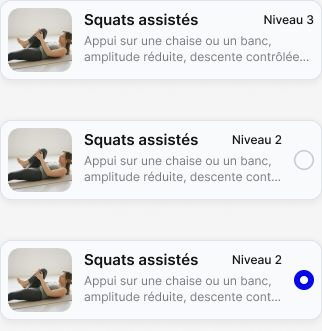

# Architecture technique

## Composition — actualisation du 28/10/2026

Implémenter le plan de composition avec parents explicites et ordre, sans injecter de cycle technique. Ne pas renommer automatiquement les enums persistés. Les en-têtes collantes utilisent la hauteur rendue et au plus deux niveaux ; le rail, le survol et les cibles demandent une recette réelle. La forme visuelle du survol et le stepper ouvert ne sont pas qualifiés. Voir [Composition du 28/10](../KODJO-Composition-conteneurs-2026-10-28.md).

## Catalogue des mouvements — famille et message temporaire, 28/10/2026

Réutiliser les cartes Mouvement, la pastille de niveau et `DSF / Overlays / Message temporaire`, selon CE-MVT-03 et les [captures du 28/10](../DSF-FAMILLES-CATALOGUE-MOUVEMENTS-2026-10-28.md). Un seul filet vertical à gauche représente l'appartenance ; sa longueur suit les membres, sa naissance et sa disparition la création et la dissolution. Carte saisie soulevée, emplacement pointillé, reflux des cartes et rangs provisoires ; aucun anneau, teinte d'acceptation ou invite textuelle.

Référence Figma : filet 2 px ; message `10484:24052`, 370 × 48 à (16, 738), au-dessus de la navigation, avec Annuler, durée 3 secondes. Adapter au texte et aux safe areas, sans chevauchement. La temporisation et le recalcul dynamique sont des règles, non démontrables par une image statique. Aucun nouveau token ni dépendance n'est imposé. La prévisualisation ne persiste rien avant le relâchement ; la restitution Annuler doit couvrir l'opération entière.

> **C08 — actualisation du 28/10/2026.** La [composition des familles depuis le catalogue](../DSF-FAMILLES-CATALOGUE-MOUVEMENTS-2026-10-28.md), règles A à E et CE-MVT-03, est désormais définie : rattacher, détacher et dissoudre une famille par geste. Les mentions antérieures « C08 différé » restent historiques pour ces opérations ; elles ne sont plus une restriction active. La suppression définitive d'un mouvement reste distincte et n'est pas clôturée par ce lot.

## Composants — Ajouter un niveau dans le glissé (27/10/2026)

| Composant | Figma | Référence visuelle | Usage |
| --- | --- | --- | --- |
| DSF / Actions glissées / Mouvement | `10586:45516` | 204 × 80 ; Inter Semi Bold 11 | Partager, Ajouter un niveau, Archiver |
| DSF / Actions glissées / Mouvement — Choix du sens | `10586:45517` | 204 × 56 ; Inter Semi Bold 11 | Plus facile ↓ / Plus difficile ↑, raccords compris, sous les actions |
| Carte — Mouvement — Résultat | `10199:22268` | Bouton « Ajouter un niveau » 66 × 32 à x264 ; zone tactile 78 × 36 à x258/y31 ; description 179 pt | **Une seule action visible sur la carte de création de Mouvement** ; « Utiliser ce mouvement » absent (CE-MVT-RESULT-01) |

Texte des actions glissées lié à `color/on-primary` (`VariableID:4151:6166`), blanc, déjà référencé. Aucune création de token global requise par le renommage. Réutiliser les propriétés des composants ; ne pas appliquer la typographie de carte aux actions glissées. Relevé : [ajout-niveau-glisse.json](../figma-mouvements-2026-10-27/ajout-niveau-glisse.json).

La hauteur supplémentaire doit participer au layout de la liste pour décaler les cartes suivantes et prolonger le filet de famille. Ne pas monter un overlay qui les recouvre. Les raccords des deux boutons appartiennent au composant Choix du sens ; les flèches doivent être accompagnées des libellés accessibles. Les frames du prototype ne sont pas toutes des instances de ces nouveaux composants : leur existence dans le DSF est la référence de réutilisation, sans prétendre une liaison de toutes les frames.

## Composants Résultat / Composition — PRE-9, 30/10/2026

**Source visuelle active :** Figma `10199:22268` (« Carte — Mouvement — Résultat ») et `10895:19870` (« Carte — Mouvement — Composition »), [spécification fonctionnelle](../KODJO-Resultats-recherche-mouvements-PRE9-2026-10-30.md) et CE-MVT-RESULT-01. Ne pas créer un nouveau composant pour ce correctif.

- **Résultat** : description 179 pt ; « Ajouter un niveau » sur deux lignes, x264, 66 × 32 pt, zone tactile x258/y31 de 78 × 36 pt. Ne pas réintroduire « Utiliser ce mouvement » dans cette variante de carte.
- **Composition** : 338 × 73 pt, description 253 pt sur deux lignes avec « … », **aucun bouton** dans toutes les instances de ce composant.
- **Familles** : filet bleu x3, largeur 2 pt, de centre à centre des cartes visibles extrêmes. **Choix du sens** : cadre 338 × 104 pt, une ligne supplémentaire « Plus facile | Plus difficile » ; aucun second cadre ou symbole d'arbre.
- Utiliser les composants et comportements de recherche/famille existants ; la séparation des deux variantes est une règle d'affichage, sans mutation des données ni nouveau service.

## Design system — fiche Mouvement (lot ciblé du 27/10/2026)

Relevé direct de `10453:23030` ; données brutes : [composants-tokens.json](../figma-mouvements-2026-10-27/composants-tokens.json). Ce relevé couvre la fiche et les composants qu'elle utilise, pas l'ensemble du fichier Figma.

Le bloc média adopte uniquement l'emplacement et les dimensions du nouveau gabarit Figma. Tous les comportements existants sont conservés : ajout/import, consultation/lecture, retrait et réordonnancement. La disparition de l'accordéon inférieur ne supprime aucune de ces commandes et n'introduit aucun nouveau parcours. Aucun écran ni arbitrage média supplémentaire n'est un prérequis de PRE-8.

### Composants à réutiliser / raccorder

| Usage | Référence Figma | Variante / valeur observée | Consigne |
| --- | --- | --- | --- |
| Photo | set `10450:24378` | Rempli `10450:24374`, 402 × 329 | Nouveau gabarit ; média plein écran en largeur derrière contexte ; état vide illustré par Initial |
| Phases du mouvement | set `10450:24397` | Renseigné `10450:24387`, 354 × 90 pour trois phases | Structure et libellés seuls ; ne pas réutiliser tel quel le tableau de durées d'exercice |
| Contexte | `9029:18368` | 402 × 115 | Nom et trois pastilles ; zone corporelle élastique |
| Nom | set `5544:4821`, instance liée à `6981:14888` | 354 × 42 | Ancien nom de variante « Nom d’exercice » conservé dans Figma ; données Mouvement |
| Classification | set `9003:15638` | Catégorie `9003:15626`, Zone `9003:15631`, Niveau `9925:41515` | États vide/renseigné selon les données, pas selon les valeurs de démonstration |
| Niveau | set `9932:44044` | Instance de fiche `9925:41235` (Niveau=1) | Variante pilotée par rang réel ; écart avec texte Niveau 3 consigné |
| Description | set `9003:15591`, renseigné `9003:15580` | Étape `9002:15555` | Liste de hauteur variable ; invite de saisie seulement au focus |
| En-tête | set `5544:4504`, fermer `5544:4503` | 402 × 95 | Réutiliser navigation et safe areas |
| Actions média | set `5613:5357` | Lecture `7872:14696` 56 × 56 ; plein écran `5613:5346` 32 × 32 | Dimensions visuelles distinctes des cibles tactiles |
| Crayon | `icon/modifier` `9925:41240` (référence antérieure) | Écran de reprise `10419:22924` | Réserver au catalogue ; pas de crayon dans une occurrence de séance |

### Tokens et valeurs relevés

Les alias de couleurs relevés restent compatibles avec `src/shared/ui/tokens.ts`. Les valeurs locales sans style Figma ne deviennent pas automatiquement de nouveaux tokens globaux. Réutiliser un token qui a la bonne valeur et le bon rôle ; sinon définir un style de composant limité à ce gabarit, sans modifier globalement la typographie de l'application.

| Rôle | Figma | Correspondance / écart code |
| --- | --- | --- |
| Texte principal | `color/text-primary`, `VariableID:2290:57`, #141414 | `colors.textPrimary` |
| Texte secondaire | `color/text-secondary`, `VariableID:2290:58`, #595E66 | `colors.textSecondary` |
| Action primaire | `color/primary`, `VariableID:2290:51`, #0508E5 | `colors.primary` |
| Texte sur primaire | `color/on-primary`, `VariableID:4151:6166`, blanc | Réutiliser la couleur blanche du rôle sur primaire existant ; ne pas changer le fond global |
| Marges de contenu | 16 à toutes les largeurs (402 → 370), arbitrage PRE-8 A01 du 27/10/2026 ; auparavant 24 (`spacing/24`) | `layout.screenGutter` (`spacing[16]`) ; exceptions : médias pleine largeur, Safe Areas, barre de navigation (24), géométries propres aux modales |
| Espacements communs | `spacing/8`, `spacing/12` disponibles | `spacing[8]`, `spacing[12]` ; disponibilité ne prouve pas une liaison sur chaque instance |
| Titre d'écran | Inter Medium 17, hauteur AUTO | Ne pas appliquer aveuglément `screenTitle` (20 SemiBold) ; style d'en-tête existant à réutiliser |
| Nom du mouvement | Inter Semi Bold 20, hauteur 22 | `screenTitle` a une hauteur 24 : valeur locale 22 à respecter ici |
| Pastilles | Inter Regular 13, hauteur AUTO | Famille de style `exerciseFieldValue` / taille 13 ; vérifier le rendu AUTO plutôt que prétendre une équivalence de hauteur |
| Titres Description / Phases | Inter Regular 11, hauteur AUTO | Taille/rôle proche de `caption`, pas `sectionTitle` (16 SemiBold) |
| Contenu des étapes/phases | Inter Regular 14, hauteur AUTO | Famille `body` ; chiffres Inter Medium 14, famille `label` |
| Terminer | Inter Semi Bold 14, hauteur AUTO | Famille `button` |

Les valeurs AUTO de Figma ne fixent pas une hauteur numérique nouvelle. Préserver la lisibilité et comparer le rendu au composant ; ne pas convertir ces observations en tolérances arbitraires.

### Réutilisation technique et frontière du lot

Éléments livrés à examiner avant tout nouveau composant : `src/domain/activities/Movement.ts`, `movementSave.ts`, `movementSuggestion.ts`, `src/infrastructure/database/repositories/SqliteMovementRepository.ts`, `src/features/activities/MovementSuggestionPanel.tsx`, `MovementResultCard.tsx`, `MovementSaveDialog.tsx`, `MovementLevelMenu.tsx` et `MovementLevelsScreen.tsx`. Ils sont des points de réutilisation, pas une attestation de conformité au nouveau parcours. `WorkPhasesTable.tsx` sert aux paramètres : séparer son rôle de saisie des durées du nouveau bloc de structure.

La recette automatique existante `src/domain/activities/__tests__/movementSearch.r07.test.ts` reste la référence pour les ajustements de recherche. Cette mise à jour documentaire n'a pas modifié ces fichiers de code et n'a pas exécuté une recette produit.

> **Référence ciblée — parcours Mouvement, 27/10/2026.** [Création et modification des mouvements](../DSF-MOUVEMENTS-CREATION-EDITION-2026-10-27.md) remplace, sur ce périmètre seulement, les anciens écrans de création d’exercice : nouveau gabarit, structure des phases sans durées, modification et variante depuis le catalogue des mouvements. Le crayon et la création de variante depuis une séance ne sont plus des parcours cibles. Les règles de recherche R01–R08 et de sauvegarde C03 restent applicables. Les autres lots de la simplification ne sont pas déclarés documentés ou livrés par cette mise à jour.

> **Cible validée D-449 — 26/10/2026.** [Six décisions closes](../KODJO-Seance-Objet-Unique-Decisions-2026-10-26.md). Les dispositions ci-dessous sur l’exercice autonome de catalogue, le lancement `ACTIVITY`, le cycle technique unique et les catalogues séparés par nature décrivent le modèle antérieur et sont remplacées sur ces seuls points. Les autres règles restent applicables. La réalisation et les visuels Figma ne sont pas déclarés livrés.

## Cible d’architecture fonctionnelle — D-449

La simplification retire la dualité de contenus autonomes ActivityDefinition/Session au profit de la Séance. Les exercices restent des composants à paramètres locaux et référence au mouvement partagé. La composition accepte plusieurs cycles successifs sans structure récursive de cycles/circuits/séances. Conserver l’instantané au démarrage et la séparation contenu/planification. Le code livré PRE-7 n’est pas déclaré conforme à cette cible par la seule mise à jour documentaire ; une analyse d’impact précédera l’implémentation. Aucun renommage de classes ni effacement de données n’est autorisé implicitement.

**D-445 — décisions validées le 25/10 :** C01–C07 et C09 sont clos ; C08 seul reste différé sur le périmètre MVP. [Spécification consolidée v7](../KODJO-Niveaux-Recherche-Parcours-Regles-v7.md).


## Sommaire

- [12.0 Objet et périmètre](#120-objet-et-périmètre)
- [12.1 Principes d’architecture](#121-principes-darchitecture)
  - [Internationalisation](#internationalisation)
- [12.2 Architecture logique générale](#122-architecture-logique-générale)
- [12.3 Interface utilisateur](#123-interface-utilisateur)
- [12.4 Services applicatifs](#124-services-applicatifs)
- [12.5 Domaine métier](#125-domaine-métier)
- [12.6 Persistance et stockage local](#126-persistance-et-stockage-local)
  - [Principe](#principe)
  - [Données persistées](#données-persistées)
  - [Repositories](#repositories)
- [12.7 Identité utilisateur](#127-identité-utilisateur)
  - [MVP](#mvp)
  - [Évolution future](#évolution-future)
- [12.8 Gestion de l’état](#128-gestion-de-létat)
  - [État persistant](#état-persistant)
  - [État temporaire](#état-temporaire)
- [12.9 Architecture du moteur d’exécution](#129-architecture-du-moteur-dexécution)
- [12.10 Gestion du temps](#1210-gestion-du-temps)
- [12.11 Audio, voix et vibrations](#1211-audio-voix-et-vibrations)
- [12.12 Fonctionnement en arrière-plan](#1212-fonctionnement-en-arrière-plan)
- [12.13 Notifications locales](#1213-notifications-locales)
- [12.14 Médias](#1214-médias)
- [12.15 Instantanés et historique](#1215-instantanés-et-historique)
- [12.16 Transactions et intégrité](#1216-transactions-et-intégrité)
- [12.17 Gestion technique des erreurs](#1217-gestion-technique-des-erreurs)
- [12.18 Tests automatisés](#1218-tests-automatisés)
- [12.19 Crash reporting et observabilité](#1219-crash-reporting-et-observabilité)
- [12.20 Sécurité et données personnelles](#1220-sécurité-et-données-personnelles)
- [12.21 Synchronisation future](#1221-synchronisation-future)
- [12.22 Intégrations externes futures](#1222-intégrations-externes-futures)
- [12.23 Critères de choix technologiques](#1223-critères-de-choix-technologiques)
- [12.24 Choix technologiques retenus](#1224-choix-technologiques-retenus)
  - [Contraintes techniques propres à T04](#contraintes-techniques-propres-à-t04)
- [12.25 Justification des principaux choix](#1225-justification-des-principaux-choix)
  - [React Native + Expo](#react-native--expo)
  - [TypeScript strict](#typescript-strict)
  - [SQLite](#sqlite)
  - [Accès direct à `expo-sqlite`](#accès-direct-à-expo-sqlite)
  - [Gestion d’état](#gestion-détat)
  - [Moteur d’exécution](#moteur-dexécution)
  - [Gestion du temps](#gestion-du-temps)
  - [Notifications](#notifications)
  - [Médias — MVP PRE-3](#médias--mvp-pre-3)
  - [Tests](#tests)
- [12.26 Mise en page adaptative et bornes sûres](#1226-mise-en-page-adaptative-et-bornes-sûres)
  - [Unités d’implémentation](#unités-dimplémentation)
  - [Paliers de largeur du MVP](#paliers-de-largeur-du-mvp)
  - [Architecture canonique de spécification UI](#architecture-canonique-de-spécification-ui)
  - [Screen Shells](#screen-shells)
  - [Composants et contrôles réutilisables](#composants-et-contrôles-réutilisables)
  - [Règles de réutilisation et de contrôle](#règles-de-réutilisation-et-de-contrôle)
  - [Design tokens canoniques](#design-tokens-canoniques)
  - [Règles de dimensionnement des composants](#règles-de-dimensionnement-des-composants)
  - [Matrice de validation responsive](#matrice-de-validation-responsive)
- [12.27 Risques techniques et validations préalables](#1227-risques-techniques-et-validations-préalables)
  - [RT-001 — Timer, audio et arrière-plan](#rt-001--timer-audio-et-arrière-plan)
  - [RT-002 — Drizzle ORM / Expo](#rt-002--drizzle-orm--expo)
  - [RT-003 — Comportement audio réel](#rt-003--comportement-audio-réel)
- [12.28 Distribution](#1228-distribution)
- [12.29 Évolutivité](#1229-évolutivité)
- [12.30 Organisation du code](#1230-organisation-du-code)
- [12.31 Architecture UI, accessibilité et responsive](#1231-architecture-ui-accessibilité-et-responsive)
- [Interface générale — règles](#interface-générale--règles)
- [Écart d’implémentation constaté lors de la fusion documentaire](#écart-dimplémentation-constaté-lors-de-la-fusion-documentaire)
- [Segmentés — complément](#segmentés--complément)
- [Cohérence des couleurs après rationalisation — H-13](#cohérence-des-couleurs-après-rationalisation--h-13)
- [DSF courant — Cartes, icônes et animations d’appui](#dsf-courant--cartes-icônes-et-animations-dappui)
  - [Saisie des paramètres d’exécution](#saisie-des-paramètres-dexécution)
- [contraintes DSF avant développement](#contraintes-dsf-avant-développement)
  - [Référence DSF V2 détaillée — clôture](#référence-dsf-v2-détaillée--clôture)
  - [Générateur et validation des paramètres v13](#générateur-et-validation-des-paramètres-v13)
- [12.32 Stratégie de développement incrémental](#1232-stratégie-de-développement-incrémental)
- [12.33 Réconciliation après interruption technique](#1233-réconciliation-après-interruption-technique)
- [Adaptation moteur et persistance](#adaptation-moteur-et-persistance)
- [Moteur Cadence — cible technique](#moteur-cadence--cible-technique)
- [12.34 Architecture cible — Exercices, Médias et Parcours](#1234-architecture-cible--exercices-médias-et-parcours)
  - [Sources de données du Catalogue](#sources-de-données-du-catalogue)
  - [Composants et tokens Figma](#composants-et-tokens-figma)
- [Architecture de la bilatéralité](#architecture-de-la-bilatéralité)
- [Architecture MVP T03 — Catalogue des Exercices et moteur multi-origine](#architecture-mvp-t03--catalogue-des-exercices-et-moteur-multi-origine)
  - [Moteur d’Exécution multi-origine](#moteur-dexécution-multi-origine)
  - [Icônes vectorielles de sélection multiple](#icônes-vectorielles-de-sélection-multiple)
- [Architecture cible — média pendant l’Exécution](#architecture-cible--média-pendant-lexécution)
- [12.35 Source polymorphe des Routines — D-206](#1235-source-polymorphe-des-routines--d-206)
- [12.36 Extensibilité de la source Routine — Parcours](#1236-extensibilité-de-la-source-routine--parcours)
- [12.37 Schéma cible des récupérations — D-208](#1237-schéma-cible-des-récupérations--d-208)
- [Pauses et symboles](#pauses-et-symboles)
- [12.38 Impacts techniques de la consolidation D-209 à D-217](#1238-impacts-techniques-de-la-consolidation-d-209-à-d-217)
- [Vérification de l’existant pour Bip de cadence](#vérification-de-lexistant-pour-bip-de-cadence)
- [Contrat technique de phrase](#contrat-technique-de-phrase)
- [Transmission au développement — évolutions v15](#transmission-au-développement--évolutions-v15)
- [Architecture — circuits](#architecture--circuits)
- [Formats — architecture cible du moteur à construire](#formats--architecture-cible-du-moteur-à-construire)
- [Contrats internes et découpage des services](#contrats-internes-et-découpage-des-services)
- [Internationalisation et vérification du générateur](#internationalisation-et-vérification-du-générateur)
  - [Internationalisation — décision et dette explicites](#internationalisation--décision-et-dette-explicites)
  - [Recette de développement](#recette-de-développement)

## 12.0 Objet et périmètre

Ce chapitre définit l’architecture technique du MVP.

L’architecture doit permettre :
- le développement d’une application mobile iOS et Android ;
- un fonctionnement complet hors connexion pour les fonctions du MVP ;
- une exécution fiable des Séances et de leurs timers ;
- un stockage local des données ;
- l’utilisation de notifications locales ;
- la gestion des sons, annonces vocales et vibrations ;
- la conservation de l’historique des Exécutions ;
- l’évolution future vers des comptes utilisateurs, une synchronisation cloud et des intégrations externes ;
- le maintien d’une architecture suffisamment simple pour le MVP.

Le MVP ne nécessite pas :
- de backend applicatif ;
- de compte utilisateur ;
- de connexion Internet pour les fonctions principales ;
- de synchronisation multi-appareils ;
- d’API réseau interne ;
- d’intégration avec les calendriers Apple, Google ou Microsoft.

## 12.1 Principes d’architecture

Les principes suivants sont retenus :

| Principe | Décision |
|---|---|
| Plateformes | iOS et Android |
| Fonctionnement hors ligne | Toutes les fonctions principales du MVP fonctionnent hors connexion |
| Compte utilisateur | Aucun compte obligatoire dans le MVP |
| Identité locale | Chaque installation dispose d’un identifiant Utilisateur interne unique et stable |
| Stockage | Données métier stockées localement sur l’appareil |
| Backend | Aucun backend requis pour le MVP |
| Synchronisation cloud | Hors MVP, mais anticipée dans l’architecture |
| Notifications | Notifications locales |
| Médias | Consultation des médias associés incluse au MVP (D-203) ; acquisition et stockage selon D-066/D-068 ; galerie ordonnée |
| Calendriers externes | Hors MVP |
| Tests | Tests automatisés de la logique métier et des parcours critiques |
| Distribution initiale | Versions de test privées avant publication sur les stores |
| Web | Hors MVP ; son ajout futur ne doit pas être artificiellement bloqué par l’architecture |

L’application suit une approche **local-first** : les données locales constituent la source opérationnelle du MVP.
### Internationalisation

**Le MVP est livré uniquement en français et ne propose aucun sélecteur de langue à l'utilisateur.**

L'architecture est néanmoins préparée pour une évolution multilingue sans refonte :
- les textes affichés dans l'interface ne sont pas codés en dur dans les composants ;
- ils sont externalisés dans un catalogue de ressources identifié par des clés stables ;
- ce catalogue couvre également les pluriels, interpolations, messages d’erreur, notifications et libellés d’accessibilité ;
- les dates, heures et nombres utilisent les formats de la locale sélectionnée ;
- l'ajout d'une langue doit pouvoir être réalisé en ajoutant les traductions correspondantes sans modifier la logique métier ;
- la langue de l'interface et la langue de synthèse vocale sont conçues comme deux paramètres pouvant être gérés lors d'une évolution future ;
- aucun mécanisme de détection, de choix ou de changement de langue n'est exposé à l'utilisateur dans le MVP ;
- aucune préférence utilisateur de langue n'est persistée dans le MVP.

## 12.2 Architecture logique générale

L’application est structurée en couches afin de séparer l’interface, les règles métier et la persistance des données.

```text
Interface utilisateur
        │
        ▼
Services applicatifs
        │
        ▼
Domaine / règles métier
        │
        ▼
Repositories
        │
        ▼
Stockage local
```

Les services techniques du système d’exploitation sont accessibles à travers des adaptateurs dédiés :

```text
Services applicatifs
        │
        ├── Notifications
        ├── Audio / voix
        ├── Vibrations
        ├── Médias (adaptateur local MVP PRE-3)
        └── Horloge / temps
```

Cette séparation doit éviter que les règles métier dépendent directement :
- de l’interface graphique ;
- du système de stockage ;
- d’iOS ou Android ;
- d’un fournisseur cloud futur.

## 12.3 Interface utilisateur

La couche Interface utilisateur assure :
- l’affichage des écrans ;
- la navigation ;
- la collecte des actions utilisateur ;
- l’affichage de l’état courant ;
- l’affichage des erreurs fonctionnelles.

Elle ne porte pas directement les règles métier principales.

Les écrans s’appuient sur les services applicatifs définis dans le chapitre 11.

La navigation et les composants doivent être organisés de façon à partager le maximum de code entre iOS et Android.

## 12.4 Services applicatifs

Les API fonctionnelles du chapitre 11 sont mises en œuvre par les services internes suivants :

| Service | Responsabilité |
|---|---|
| `SessionService` | Création, lecture, modification, duplication, archivage et restauration des Séances |
| `CompositionService` | Gestion des Cycles, Tours, Exercices et de leur ordre |
| `PlanningService` | Gestion des Routines et calcul des occurrences |
| `ExecutionService` | Génération du plan d’exécution, timer, progression et commandes pendant l’Exécution |
| `HistoryService` | Exécutions, Instantanés, occurrences historisées et consultation de l’historique |
| `PreferencesService` | Lecture et modification des Préférences globales |
| `ReferenceDataService` | Gestion des Étiquettes de Séance, des Catégories d’Exercice et du référentiel administrable des Zones corporelles |

La couche de référentiels ne distingue pas, pour le droit de suppression, les valeurs initiales des valeurs créées ensuite par l’utilisateur. La suppression d’une valeur la retire atomiquement du référentiel actif et des nouvelles sélections, sans supprimer ses associations aux objets existants ; les Instantanés historiques ne sont jamais réécrits.

Ces services sont des composants logiques internes à l’application.

Ils ne correspondent pas à des serveurs ou microservices distincts.

## 12.5 Domaine métier

### Architecture cible MFN — D-437 à D-440

Une `ActivityDefinition` référence directement un mouvement et porte ses paramètres propres. Une `SessionActivity` possède son identifiant et référence **directement le mouvement**, sans dépendance de contenu envers l’exercice Catalogue ; elle porte une copie locale complète des paramètres au moment de l’insertion, puis les conserve indépendamment. Elle ne conserve pas une copie modifiable du nom, de la description, des médias, de la catégorie, des zones ni de la structure des phases.

Les corrections du contenu partagé sont visibles à la prochaine lecture des définitions et des séances ; aucun mécanisme de propagation de copies de contenu n’est nécessaire. Modifier les paramètres Catalogue ne modifie pas ceux des séances. Supprimer ou archiver la définition Catalogue ne casse pas les occurrences.

Au démarrage, résoudre le contenu courant avec les paramètres de l’exercice puis construire un instantané autonome. Cet instantané, l’exécution déjà démarrée et les historiques ne changent plus avec le mouvement. Leur `sourceMovementId` conserve l’identité exécutée, sans rang stocké ; la classification actuelle peut être résolue séparément à la lecture.

Les relations actives vers le mouvement doivent rester intègres, depuis les définitions **et les occurrences de séance**. L’absence de contrainte référentielle et la tolérance d’orphelins concernent la filiation des instantanés, pas le contenu vivant. La suppression explicite d’un mouvement encore référencé par un exercice est interdite ; son parcours reste dans C08. La suppression du dernier exercice ne supprime jamais le mouvement : un mouvement peut exister sans exercice et reste recherchable.

La structure des phases appartient au mouvement ; les valeurs restent propres à chaque définition et occurrence. Dans une **correction du même mouvement**, conserver les valeurs des phases conservées par `WorkPhase.id` stable ; ne pas réutiliser un identifiant supprimé. Une nouvelle phase n’hérite d’aucune durée inventée. Les exercices concernés peuvent rester explicitement incomplets après la correction partagée ; les signaler et demander la complétion avant leur prochain lancement. L’exercice directement édité reste soumis à sa validation normale. Ne pas imposer la complétion immédiate de tous les autres exercices.

Dans un **changement de mouvement/niveau**, transférer par rang, jamais par égalité d’identifiants entre mouvements : sans→sans, durée reprise ; sans→phases, durées vides ; phases→sans, cible de série conservée (jamais remplacée par la somme) ; phases→phases, rangs communs repris, surplus source abandonné, surplus cible à compléter. Mode, séries, cibles, pauses, charge, côtés, récupération et position sont conservés sous les contraintes existantes. Annuler restitue intégralement l’occurrence précédente.

La lecture partagée supprime la synchronisation du contenu, pas la vérification de compatibilité des paramètres. Le moteur ne lance pas un exercice incomplet et ne relit aucun mouvement après création de l’instantané.

Le moteur ne relit plus les sources après démarrage. Aucun marquage durable d’utilisation sur insertion n’est nécessaire au dialogue : calculer autres exercices et existence d’une exécution selon MFN-08. Les médias référencés par les instantanés doivent être préservés. Pas de migration (D-440). [D-440 assouplie les 23 et 24/10/2026 : migration 012 versionnée, exécutée une seule fois ; préférences du Profil, Catégories et Zones corporelles conservées avec leurs personnalisations (précision du 24/10) ; Exercices, Séances et leurs associations réinitialisés avec avis, intégrité référentielle préservée à l’utilisateur ; filiation des occurrences existantes non reconstituable, sans conversion.] [Arbitrage de Hermann du 26/10/2026 (Q1, Q2) : C05 appliqué intégralement dans PRE-7 (occurrence sans copie persistante du contenu partagé ni synchronisation, intégrité des références actives, instantanés autonomes et figés) ; migration 013 de réinitialisation ponctuelle, exécutée une seule fois : Profil, Catégories, Zones corporelles et Étiquettes conservés avec leurs personnalisations ; Mouvements, groupes de Niveaux, Exercices, Séances et associations devenues obsolètes réinitialisés ; migration 012 inchangée.]

## 12.6 Persistance et stockage local

### Principe

Les données structurées du MVP sont persistées dans une **base SQLite locale**, via un accès direct à `expo-sqlite` encapsulé derrière les Repositories.

Le spike RT-002 réalisé en T01-S01 a écarté Drizzle ORM en raison d’une compatibilité insuffisamment stable avec la version Expo retenue. Drizzle n’est donc ni une dépendance ni une option active du MVP. Le schéma, les requêtes et les migrations SQLite sont gérés directement par la couche de persistance, sans exposer `expo-sqlite` au domaine.

Le stockage doit notamment permettre :
- les relations entre les entités ;
- l’affichage chronologique du MVP et l’ajout ultérieur de recherche, tri et filtres ;
- les transactions ;
- les migrations du schéma ;
- la conservation durable de l’historique ;
- l’évolution future du modèle.

Les données métier ne doivent pas être stockées uniquement dans l’état de l’interface ou dans de simples préférences applicatives.

### Données persistées

Sont notamment persistés :
- Utilisateur local ;
- Préférences ;
- Séances ;
- Cycles ;
- Tours ;
- Exercices ;
- Routines ;
- Étiquettes de Séance ;
- Catégories d’Exercice ;
- Zones corporelles ;
- Exécutions ;
- Instantanés d’Exécution ;
- Occurrences historisées.

Les Zones corporelles constituent un référentiel utilisateur persistant et administrable, initialisé avec des valeurs par défaut. Leur identité reste stable à travers les renommages ; leur suppression les retire des choix futurs tout en conservant les associations existantes selon les règles du chapitre 10.

### Repositories

L’accès aux données passe par une couche de `Repositories`.

Les services applicatifs ne doivent pas dépendre directement de la technologie de base de données.

Cette abstraction doit permettre ultérieurement :
- de changer de technologie de stockage ;
- d’ajouter une source distante ;
- d’introduire une synchronisation cloud ;
- de prendre en charge les usages multi-appareils, le partage, la communauté et les relations avec des professionnels ;

sans modifier les règles métier ni coupler le domaine à SQLite ou à un fournisseur cloud.

La technologie cloud et la stratégie précise de synchronisation ne sont pas choisies dans le MVP. Elles seront définies lorsqu’une version nécessitera effectivement des données partagées ou multi-appareils.

Après le MVP, les médias ne seront pas stockés comme blobs dans SQLite : la base conservera leurs métadonnées et leurs références locales ou distantes.

### Évolution des paramètres canoniques pour les phases

Étendre le contrat versionné ExecutionParameters, les brouillons, validateurs, projections, copies, sérialiseurs et parseurs. La persistance locale dispose déjà d’un champ execution_parameters pour le Catalogue ; une nouvelle table n’est pas imposée par le concept. Vérifier aussi les chemins de Séance et d’instantané avant de choisir la migration physique.

Les anciennes définitions restent sans phases. La nouvelle écriture et sa lecture compatible doivent être livrées ensemble ; préserver le refus explicite d’une version inconnue, sans repli scalaire destructeur. Les totaux et phrases restent dérivés. Le choix des noms techniques et du numéro de version relève de la réalisation, pas de Figma.

L’impact est transversal mais additif : éditeur, calcul, données et moteur cible doivent évoluer ensemble. Aucun nouveau besoin d’hébergement n’est identifié. Les bornes de durée actuelles du code divergent de RM-234 ; la correction doit suivre la spécification et être rattachée au lot approprié, sans migration silencieuse des anciennes valeurs.

## 12.7 Identité utilisateur

### MVP

Le MVP ne nécessite pas de création de compte ni de connexion.

Lors du premier lancement, l’application génère automatiquement un **identifiant Utilisateur interne unique et stable**, de type UUID ou équivalent.

Cet identifiant :
- est généré localement ;
- est conservé sur l’installation ;
- ne dépend pas de l’adresse e-mail ;
- ne dépend pas de l’appareil comme identité métier ;
- est utilisé comme propriétaire des données de l’utilisateur.

Les principales données métier sont rattachées directement ou indirectement à cet Utilisateur.

Les racines d’agrégat persistantes appartenant à l’utilisateur (notamment Séance, Routine, Exécution et Catégorie) portent une référence de propriété `ownerId` vers cet identifiant Utilisateur. Les objets enfants, tels que Cycle, Tour et Exercice, héritent de cette propriété par leur rattachement à leur agrégat et n’ont pas à dupliquer systématiquement `ownerId`.

### Évolution future

Dans le MVP, **Profil** n'est pas une entité métier autonome : il s'agit de l'espace UI regroupant les informations de l'Utilisateur et ses Préférences globales.

Pour les évolutions futures, l’architecture distingue :
- l’**Utilisateur**, identité interne de l’application ;
- le **Compte**, permettant de retrouver un Utilisateur ;
- le **Fournisseur d’identité**, par exemple Apple ou Google.

Une entité Profil distincte ne sera introduite ultérieurement que si un besoin fonctionnel lié aux comptes, au cloud ou au partage le justifie.

Cette séparation doit permettre ultérieurement d’associer un Utilisateur local existant à un compte authentifié sans recréer ses données métier.

Apple et Google sont les fournisseurs d’identité envisagés en priorité.

Facebook n’est pas retenu comme besoin du MVP.

Sans compte ni sauvegarde distante, la suppression de l’application ou la perte de l’appareil peut entraîner la perte de l’identité locale et des données associées.

## 12.8 Gestion de l’état

Deux catégories d’état sont distinguées.

### État persistant

Il correspond aux données métier devant survivre à la fermeture de l’application.

Il est stocké dans la base locale.

### État temporaire

Il correspond notamment :
- à l’écran courant ;
- aux formulaires non encore validés ;
- à l’état visuel de l’interface ;
- à certains états transitoires d’exécution.

L’état temporaire est géré avec les mécanismes natifs de React : `useState`, `useReducer` et, lorsqu’un partage limité entre composants le justifie, Context.

Aucune bibliothèque globale de gestion d’état telle que Zustand ou Redux n’est introduite au démarrage du MVP. Une telle bibliothèque ne pourra être ajoutée que si un besoin transverse concret apparaît pendant le développement et si les mécanismes natifs de React deviennent insuffisants.

Les données métier persistantes ne doivent pas avoir pour source de vérité l’état de l’interface.

### Contraintes issues des décisions D-427 à D-429
Le moteur d'exécution distingue l'activation d'un parcours enrichi par le contexte du Programme et la validation de ses champs obligatoires. La confirmation d'un résultat de répétitions l'enregistre puis déclenche la transition planifiée ; une fermeture non validée ne change ni résultat ni progression. Aucun choix de bibliothèque, protocole ou schéma physique nouveau n'est déduit de ces règles.

## 12.9 Architecture du moteur d’exécution

Le moteur d’exécution constitue un composant critique du MVP.

Il est sous la responsabilité de `ExecutionService`.

Au démarrage d’une Exécution :

1. la définition de la Séance est chargée ;
2. un Instantané fonctionnel immuable est créé ;
3. un plan d’exécution ordonné est généré ;
4. l’Exécution démarre au Compte à rebours initial.

Le moteur gère ensuite :
- l’étape courante ;
- les tours de chaque circuit et les répétitions propres des cycles visibles (D-451) ;
- les Séries propres à chaque Exercice ;
- *Texte identique à celui de la section [« Structure d'un Exercice »](04%20%E2%80%93%20Mod%C3%A8le%20fonctionnel.md#structure-dun-exercice) ; il n’est pas recopié ici.*
- l’insertion éventuelle d’une phase `SIDE_RECOVERY` entre les deux côtés lorsque `sideRecoverySeconds > 0` ;
- l’insertion d’une phase `POST_ACTIVITY_RECOVERY` après chaque occurrence de Séance lorsque `postActivityRecoverySeconds > 0` ;
- la progression dans le Circuit au cours du Tour courant ;
- la progression interne du Cycle, non exposée dans l’interface MVP ;
- les temps écoulés ;
- les transitions entre étapes ;
- la pause et la reprise ;
- la réinitialisation de l’Exercice, de la Série ou de la Récupération courante ;
- le passage à l’étape suivante ;
- l’arrêt anticipé ;
- la terminaison normale.

Le Plan distingue les phases `INITIAL_COUNTDOWN`, `ACTIVITY`, `SERIES_PAUSE`, `SIDE_RECOVERY`, `POST_ACTIVITY_RECOVERY` et `SESSION_END`. Ces valeurs qualifient une phase d’exécution et non un type d’Exercice. `SIDE_RECOVERY` conserve la référence de l’Exercice bilatéral ; `POST_ACTIVITY_RECOVERY` conserve la référence de l’occurrence. Leurs métriques planifiées/écoulées sont distinctes. Après le dernier Exercice et sa récupération post-exercice éventuelle, `ExecutionService` active `SESSION_END` et continue le calcul du temps écoulé. Il ne persiste la clôture normale qu’à l’achèvement de cette étape ; `0 s` provoque la transition immédiatement. Le routeur ouvre ensuite la fin minimale dans T04, ou la Synthèse dans la tranche qui la livre. Un arrêt antérieur suit le chemin d’interruption et produit le statut `Interrompue`.

La logique du moteur doit être indépendante des composants graphiques afin de pouvoir être testée automatiquement.

### Phases internes aux séries

Les phases s’insèrent sous le passage de travail de la série, sans changer les frontières des pauses, côtés, circuits ou résultats. Un changement de phase ne clôt pas la série et ne redémarre pas le bip périodique. Le moteur temporel demeure la source de vérité ; le guidage vocal ne retarde jamais la transition. Une annonce de phase remplace la précédente encore active.

La reprise technique conserve l’identité de l’occurrence, de la série, du côté et de la phase, ainsi que son temps restant. Réinitialiser et Suivant gardent leur portée métier existante. Pour la progression globale, subdiviser un travail de 9 s en 6 + 3 ne change pas son poids, notamment avec des séries non déterminables ailleurs dans le plan.

Les données de phases sont figées dans l’instantané, pas relues depuis le catalogue. Leur définition reste une liste unique ; le plan développe ses occurrences. Aucun stockage de phrase, aucune boucle supplémentaire ni service distant ne découle de cette évolution.

## 12.10 Gestion du temps

Le moteur d’Exécution ne détermine jamais le temps réellement écoulé par comptage des ticks d’un timer JavaScript.

L’Exécution conserve des horodatages et des références temporelles persistées permettant de recalculer de manière déterministe son état réel à partir de l’horloge système. Le timer utilisé par l’interface sert uniquement au rafraîchissement visuel et n’est jamais la source de vérité temporelle.

L’accès à l’heure est abstrait par une interface technique de type `Clock`, injectable dans le moteur, afin de rendre les calculs temporels testables indépendamment de React et de la plateforme.

Cette approche permet notamment de reconstruire l’état lorsque :
- l’interface est momentanément ralentie ;
- l’application passe en arrière-plan ;
- l’écran est verrouillé ;
- le système suspend temporairement certaines tâches ;
- l’application revient au premier plan après une interruption.

L’état minimal nécessaire à la reconstruction fiable d’une Exécution est persisté. Les comportements exacts autorisés en arrière-plan dépendent toutefois des capacités d’iOS et Android et doivent être validés sur appareils réels.

## 12.11 Audio, voix et vibrations

L’accès aux fonctions audio et haptiques est isolé derrière des services techniques dédiés.

Ils prennent en charge :
- les bips ;
- les annonces vocales ;
- les vibrations ;
- leur déclenchement aux moments définis par les règles fonctionnelles.

Le moteur d’exécution demande le déclenchement d’un événement sans dépendre directement de l’API native utilisée.

Le feedback haptique des roulettes numériques relève de l’interface et non du moteur d’Exécution. Le composant de roulette déclenche un retour haptique léger et bref à chaque changement effectif de valeur, une seule fois par cran. Ce déclenchement est systématique et ne consulte pas la préférence `Vibrations`, réservée aux vibrations fonctionnelles de séance. L’implémentation reste isolée derrière l’adaptateur haptique natif afin de conserver un comportement cohérent sur iOS et Android.

Cette abstraction permet de gérer les différences entre iOS et Android.

Les comportements doivent être testés notamment :
- application au premier plan ;
- écran verrouillé ;
- application en arrière-plan ;
- téléphone en mode silencieux ;
- avec d’autres sources audio actives.

## 12.12 Fonctionnement en arrière-plan

Le MVP vise à maintenir une Exécution cohérente lorsque l’application passe temporairement en arrière-plan ou que l’écran est verrouillé, dans les limites autorisées par iOS et Android.

L’architecture ne suppose pas que le code JavaScript ou le processus applicatif continue nécessairement à s’exécuter en permanence en arrière-plan.

Le passage en arrière-plan ou le verrouillage ne met pas automatiquement l’Exécution en pause. Le Plan d’Exécution continue logiquement selon ses horodatages persistés. Lors du retour au premier plan, l’état de l’Exécution est recalculé à partir :
- de l’étape en cours ;
- des références temporelles persistées ;
- de l’état enregistré.

Le moteur applique une pause de sécurité en l’absence d’interaction :

- *Texte identique à celui de la section [« Arrière-plan et verrouillage »](10%20%E2%80%93%20Processus%20m%C3%A9tier%20et%20r%C3%A8gles%20m%C3%A9tier%20transverses.md#arrière-plan-et-verrouillage) ; il n’est pas recopié ici.*
- *Texte identique à celui de la section [« Arrière-plan et verrouillage »](10%20%E2%80%93%20Processus%20m%C3%A9tier%20et%20r%C3%A8gles%20m%C3%A9tier%20transverses.md#arrière-plan-et-verrouillage) ; il n’est pas recopié ici.*

Cette pause est déterminée à partir des horodatages et ne suppose pas qu’un timer JavaScript reste actif en permanence en arrière-plan.

Les fonctions nécessitant un comportement natif spécifique sont encapsulées derrière des interfaces dédiées. Les différences iOS / Android sont traitées dans ces adaptateurs et ne doivent pas modifier les règles métier du moteur d’Exécution.

Le choix définitif des mécanismes natifs nécessaires aux transitions, sons et annonces vocales lorsque l’application est suspendue ou l’écran verrouillé est arrêté après le spike technique iOS / Android.

## 12.13 Notifications locales

Les rappels liés aux Routines utilisent des notifications locales du système d’exploitation.

Elles sont planifiées à partir des occurrences calculées par `PlanningService`.

Aucun serveur n’est nécessaire pour envoyer ces notifications dans le MVP.

Pour les Routines périodiques, les notifications sont programmées selon une **fenêtre glissante** d’occurrences futures plutôt que jusqu’à la date de fin complète. Cette fenêtre est réapprovisionnée lors de l’ouverture de l’application et lors de toute création, modification, suppression ou autre changement affectant la planification. Sa taille technique est déterminée à l’implémentation selon les contraintes iOS et Android.

Lorsqu’une Routine est :
- créée ;
- modifiée ;
- supprimée ;
- ou supprimée à la suite de l’archivage de sa source ;

les notifications futures correspondantes doivent être recalculées ou supprimées.

L’application ne demande pas l’autorisation de notification au lancement. Elle vérifie l’état de l’autorisation lorsque l’utilisateur active pour la première fois un rappel pendant une planification, explique l’usage, puis déclenche la demande système. Si l’autorisation est refusée, le rappel n’est pas activé et l’interface indique que l’autorisation peut être modifiée dans les réglages du système.

## 12.14 Médias

L’import/ajout de photos ou vidéos locales et leur association aux Exercices sont inclus au MVP dans PRE-3, avant le moteur d’exécution (D-333).

L’architecture doit permettre `0..n` associations média ordonnées par Exercice au MVP dans PRE-3 (D-333). La copie d’un Exercice ou d’une Séance ne duplique pas le fichier physique : plusieurs associations peuvent référencer le même fichier local immuable.

Le stockage local privilégie la **non-duplication des données volumineuses**. Les fichiers médias ne seront pas intégrés physiquement aux Instantanés historiques ; leurs associations ordonnées et références stables le seront.

PRE-3 complète les tables et associations médias existantes par une migration additive si nécessaire ; les fichiers restent hors SQLite. Le schéma physique exact est déterminé dans le plan technique à partir de la baseline réelle.

Les fichiers binaires volumineux ne sont pas stockés directement dans les entités métier.

Les fichiers médias ne sont pas copiés dans les Instantanés d’Exécution ; les associations ordonnées et références stables nécessaires à l’historique y seront conservées.

La suppression ou la modification ultérieure d’un média ne doit pas compromettre la lisibilité fonctionnelle de l’historique.

Une évolution future pourra permettre le stockage ou la synchronisation des médias dans un service distant.

## 12.15 Instantanés et historique

Au démarrage effectif d’une Exécution, `HistoryService` conserve l’Instantané fonctionnel défini au chapitre 09.

Cet Instantané est :
- immuable ;
- indépendant des modifications futures de la Séance ;
- suffisamment complet pour restituer l’historique ;
- volontairement léger ;
- dépourvu de copie physique des fichiers médias, tout en conservant leurs références stables après leur introduction.

Le format physique de stockage doit permettre de relire les anciens Instantanés même après une évolution du modèle de données.

Dans le MVP, l’Instantané est persisté sous forme de **JSON immuable** associé à l’Exécution. Les données nécessaires à la recherche et au tri chronologique du Suivi MVP sont conservées sous une forme permettant un accès efficace. Le JSON constitue la photographie historique complète. Les index dédiés aux filtres avancés — notamment Catégories, Zones corporelles, statut et période — sont reportés avec la fonctionnalité de filtrage avancé.

Les migrations futures doivent donc préserver la compatibilité avec l’historique existant.

## 12.16 Transactions et intégrité

Les opérations modifiant plusieurs objets liés doivent être atomiques lorsque leur cohérence l’exige.

Exemples :
- création d’une Séance et de sa structure initiale ;
- archivage d’une Séance et suppression de ses Routines ;
- suppression logique d’une Étiquette, d’une Catégorie ou d’une Zone corporelle du référentiel actif, avec conservation de ses associations existantes ;
- création d’une Exécution et de son Instantané.

Une opération atomique :
- réussit entièrement ;
- ou ne conserve aucune modification partielle.

Les contraintes d’intégrité du chapitre 09 doivent également être appliquées au niveau de la persistance lorsque cela est techniquement pertinent.

## 12.17 Gestion technique des erreurs

Les conventions fonctionnelles du chapitre 11 sont appliquées par l’architecture technique.

Les couches techniques distinguent au minimum :
- erreurs de validation ;
- objet inexistant ;
- état incompatible ;
- conflit ;
- autorisation ;
- erreur technique.

Les erreurs techniques sont journalisées avec les informations utiles au diagnostic, sans exposer directement ces informations à l’utilisateur.

Les messages affichés à l’utilisateur restent compréhensibles et indépendants des détails techniques.

Les informations sensibles ne doivent pas apparaître dans les journaux techniques.

## 12.18 Tests automatisés

La stratégie de tests comporte plusieurs niveaux.

| Niveau | Objet |
|---|---|
| Tests unitaires | Règles métier, validations et calculs |
| Tests du moteur d’exécution | Plan d’exécution, répétitions, transitions, timer |
| Tests de persistance | Création, modification, suppression, transactions et migrations |
| Tests d’intégration | Interaction entre services applicatifs et stockage |
| Tests de composants | Comportement des composants critiques de l’interface |
| Tests de parcours critiques | Création → planification → exécution → historique |
| Tests sur appareils réels | Audio, arrière-plan, verrouillage, notifications, performances |

Les tests du domaine et du moteur d’exécution doivent être indépendants de l’interface graphique autant que possible.

Les fonctions dépendantes du comportement réel de la plateforme sont validées sur au moins un appareil iOS réel et un appareil Android réel. Une première campagne est réalisée dans le cadre du spike RT-001 avant le développement complet du moteur d’Exécution ; une campagne complète est réalisée avant livraison du MVP.

Les outils retenus sont :
- **Jest + `jest-expo`** pour les tests unitaires du domaine, des règles métier, du moteur d’Exécution et de la persistance ;
- **React Native Testing Library** pour les tests des composants et écrans ;
- **Maestro** pour les parcours end-to-end critiques, introduit lorsque les premiers parcours bout-en-bout sont stabilisés.

Les tests sur appareils réels iOS et Android complètent obligatoirement les tests automatisés pour les fonctions natives sensibles : timer, audio, arrière-plan, écran verrouillé, vibrations et notifications.

Les plans de tests fonctionnels sont documentés séparément.

## 12.19 Crash reporting et observabilité

Le MVP prévoit un mécanisme de remontée des erreurs techniques et crashs lors des versions distribuées aux testeurs.

Sentry est la solution retenue à introduire avant les premiers tests externes.

Les données collectées doivent être limitées aux informations nécessaires au diagnostic.

Le MVP ne nécessite pas d’analytics comportemental détaillé.

L’ajout ultérieur d’analytics devra faire l’objet d’une décision spécifique concernant :
- les données collectées ;
- leur finalité ;
- la protection des données personnelles ;
- les éventuels consentements nécessaires.

## 12.20 Sécurité et données personnelles

Le MVP applique les principes suivants :
- minimisation des données personnelles ;
- stockage uniquement des données nécessaires ;
- absence de mot de passe géré par l’application dans le MVP ;
- séparation entre identité interne et authentification future ;
- absence d’informations sensibles dans les logs ;
- utilisation des mécanismes sécurisés du système pour les secrets techniques lorsqu’ils existent.

Si des comptes utilisateurs, une synchronisation cloud ou des données de santé sont introduits ultérieurement, une revue spécifique de sécurité et de protection des données devra être réalisée avant leur mise en production.

## 12.21 Synchronisation future

La synchronisation cloud ne fait pas partie du MVP.

L’architecture doit néanmoins éviter de la rendre difficile à introduire ultérieurement.

À cette fin :
- les entités disposent d’identifiants stables ;
- les données appartiennent à un Utilisateur interne ;
- l’accès aux données passe par des Repositories ;
- les règles métier ne dépendent pas du stockage local ;
- les dates de création et modification sont conservées lorsque nécessaires ;
- les Instantanés historiques sont immuables.

Une future synchronisation devra définir explicitement :
- la source de vérité ;
- la résolution des conflits ;
- le fonctionnement hors ligne ;
- les suppressions ;
- la synchronisation des médias ;
- la gestion multi-appareils.

Aucun de ces mécanismes n’est implémenté dans le MVP.

## 12.22 Intégrations externes futures

Les intégrations suivantes sont hors MVP :
- Apple Calendar ;
- Google Calendar ;
- Microsoft Outlook ;
- fournisseurs externes de vidéos ou contenus d’exercices ;
- partage avec des kinésithérapeutes ou coachs ;
- services cloud ;
- API publiques ou partenaires.

Elles devront utiliser des adaptateurs dédiés afin de ne pas introduire de dépendance directe entre le domaine métier et un fournisseur externe.

Aucun port ou service d’intelligence artificielle vide (`no-op`) n’est créé dans le MVP. Une interface dédiée à l’IA ne sera introduite que lorsqu’un cas d’usage concret sera retenu, afin d’éviter une abstraction sans besoin fonctionnel actuel.

## 12.23 Critères de choix technologiques

Les technologies du MVP sont évaluées selon les critères suivants :

| Critère | Importance | Justification |
|---|---:|---|
| Compatibilité iOS + Android | Critique | Les deux plateformes sont dans le périmètre du MVP |
| Accès aux fonctions natives | Critique | Audio, notifications, arrière-plan, fichiers et vibrations sont nécessaires |
| Fiabilité du timer | Critique | Le moteur d’exécution est une fonction centrale du produit |
| Fonctionnement hors ligne | Critique | Exigence structurante du MVP |
| Persistance structurée | Critique | Le modèle métier est relationnel et comporte un historique |
| Testabilité | Critique | Le moteur d’exécution et les règles métier doivent être fortement testables |
| Maturité et maintenance | Élevée | Réduire le risque technique et faciliter la maintenance |
| Documentation | Élevée | Le développement sera fortement assisté par IA |
| Simplicité | Élevée | Éviter une architecture disproportionnée pour un MVP |
| Écosystème et bibliothèques | Élevée | Réduire le développement natif spécifique |
| Évolutivité cloud | Moyenne à élevée | Comptes et synchronisation sont envisagés ultérieurement |
| Web futur | Moyenne | Hors MVP, mais ne doit pas être artificiellement bloqué |
| Coût initial | Élevée | Le MVP ne doit pas nécessiter de backend ni d’infrastructure serveur |

## 12.24 Choix technologiques retenus

| Domaine | Choix retenu | Justification principale |
|---|---|---|
| Framework mobile | **React Native + Expo** | Code partagé iOS/Android, accès natif, écosystème mature et forte documentation |
| Architecture React Native | **New Architecture** | Architecture actuelle et pérenne de React Native / Expo |
| Langage | **TypeScript strict** | Sécurise les contrats, les objets métier et facilite le développement assisté par IA |
| Navigation | **Expo Router** | Navigation structurée et typée, compatible iOS/Android et préparant un Web futur |
| Base locale | **SQLite via `expo-sqlite`** | Stockage relationnel, transactions, historique et migrations |
| ORM | **Aucun** | RT-002 a écarté Drizzle ORM ; accès direct à `expo-sqlite` derrière les Repositories |
| État UI temporaire | **React state / reducer / Context** | Suffisant au MVP ; évite une dépendance globale prématurée |
| Moteur d’exécution | **Module TypeScript indépendant de React** | Fiabilité, testabilité et indépendance de l’interface |
| Notifications | **`expo-notifications`** | Notifications locales cross-platform sans backend |
| Audio | **`expo-audio`** | Abstraction audio cross-platform |
| Synthèse vocale | **`expo-speech`** | Text-to-speech cross-platform |
| Vibrations / haptique | **Modules Expo natifs adaptés** | Accès homogène aux capacités iOS/Android |
| Médias / fichiers | **`expo-file-system` + APIs média Expo** | Stockage local des fichiers en dehors de SQLite |
| Tests unitaires / composants | **Jest + `jest-expo` + React Native Testing Library** | Stack adaptée à Expo et aux composants React Native |
| Tests end-to-end | **Maestro** | Automatisation des parcours mobiles critiques après stabilisation |
| Builds / distribution | **Expo EAS** | Builds et distribution privée iOS/Android, adaptés à un environnement de développement Windows |
| Crash reporting | **Sentry** | Diagnostic des crashs et erreurs lors des tests distribués |
| Backend | **Aucun dans le MVP** | Architecture local-first et réduction de la complexité |
| Authentification | **Aucune dans le MVP ; Apple/Google préparés** | Évite la complexité des comptes tout en préservant l’évolution future |

### Contraintes techniques propres à T04

- Le contrôle technique initial du moteur d’Exécution est intégré au début du premier lot T04 ; aucun spike ni prototype séparé ne précède ce lot.
- Les tests audio sur appareils physiques iOS et Android sont réalisés dans le second lot T04.
- L’ajout de `expo-audio`, `expo-speech` et de leur configuration native impose la production d’un nouveau development build iOS et Android ; Expo Go ne constitue pas la preuve finale pour ces comportements natifs.
- T02-S02 et sa migration `004` constituent désormais un **état historique** supersédé sur la récupération par D-208. Le schéma cible n’utilise plus une récupération générique attachée à l’Exercice.
- Pour D-208, la base de développement peut être **réinitialisée** : le schéma cible doit représenter `side_recovery_seconds` sur l’Exercice et un objet `recovery` explicite lié à l’occurrence de Séance ; `post_activity_recovery_seconds` peut être une projection technique dérivée, jamais une seconde source autoritaire de récupération (RM-209). Aucune exigence de migration utilisateur de l’ancien `recovery_seconds` n’est portée par cette conception.
- Les migrations `005`/`006` restent des traces de l’état technique antérieur et des évolutions déjà réalisées ; elles ne doivent pas être interprétées comme le scénario cible de migration D-208. Lors de l’implémentation de D-208, la version de schéma et les éventuels scripts techniques doivent être recalés sur la baseline de base réinitialisée.
- L’archivage, la restauration et la suppression restent hors du périmètre de livraison T04 ; leur modèle existant n’est pas supprimé.

## 12.25 Justification des principaux choix

### React Native + Expo

React Native avec Expo est retenu afin de :
- partager l’essentiel du code entre iOS et Android ;
- disposer d’un écosystème intégré pour les notifications, fichiers, audio et autres capacités natives ;
- réduire le volume de code natif spécifique ;
- disposer d’une documentation abondante et exploitable par les outils de développement assisté par IA ;
- conserver la possibilité d’ajouter du code natif spécifique si une fonction critique l’exige ;
- ne pas bloquer une évolution Web future.

Flutter constitue une alternative viable mais n’apporte pas d’avantage décisif pour les besoins identifiés du MVP et introduirait un autre langage et un autre écosystème.

### TypeScript strict

TypeScript strict est obligatoire pour :
- traduire explicitement le modèle fonctionnel en types techniques ;
- détecter plus tôt les incohérences ;
- sécuriser les interfaces entre couches et services ;
- faciliter la génération et la revue de code par IA.

### SQLite

SQLite est retenu parce que le produit manipule des données structurées, relationnelles et historisées.

Il fournit :
- relations ;
- requêtes ;
- transactions ;
- index ;
- migrations ;
- fonctionnement hors ligne.

Les fichiers JSON ou un stockage de type préférences ne constituent pas un stockage métier principal adapté au modèle.

### Accès direct à `expo-sqlite`

RT-002 a conclu que la combinaison Drizzle ORM / Expo n’était pas suffisamment stable. Le MVP utilise donc directement `expo-sqlite`, sans ORM. La couche Repository demeure la seule frontière d’accès à la persistance : elle protège le domaine d’une dépendance à SQLite et permet une évolution ultérieure de la source de données sans modifier les contrats métier.

Le schéma, les requêtes, les transactions et les migrations sont définis et testés dans la couche de persistance. La décision historique d’évaluer puis d’écarter Drizzle est conservée dans D-043 et RT-002 ; elle ne constitue plus un choix ouvert.

### Gestion d’état

Aucune bibliothèque globale de gestion d’état, notamment Zustand ou Redux, n’est introduite au démarrage du MVP.

La stratégie retenue est :
- SQLite via les Repositories pour l’état métier persistant ;
- services applicatifs pour les opérations métier ;
- `useState`, `useReducer` et Context lorsque nécessaire pour l’état UI temporaire.

Une bibliothèque globale supplémentaire n’est introduite que si un besoin transverse concret apparaît pendant le développement et justifie cette complexité.

### Moteur d’exécution

Le moteur d’exécution est implémenté en TypeScript pur et indépendant de React.

Il reçoit les données nécessaires à l’Exécution et produit un état d’Exécution et des événements.

Il ne dépend pas directement :
- des écrans ;
- de la navigation ;
- de SQLite ;
- des APIs natives.

Ce choix permet de tester intensivement la logique de progression et de timer.

### Gestion du temps

Le moteur utilise des références temporelles absolues et des timestamps plutôt qu’un simple compteur décrémenté à l’écran.

Cette décision permet de recalculer l’état réel après :
- un ralentissement de l’interface ;
- une mise en arrière-plan ;
- un verrouillage d’écran ;
- une suspension temporaire par le système.

### Notifications

Les rappels utilisent des notifications locales afin de :
- fonctionner hors connexion ;
- ne nécessiter aucun backend ;
- rester cohérents avec l’approche local-first.

### Médias — MVP PRE-3

La consultation des médias déjà associés pendant l’Exécution est incluse au MVP (D-203). L’import/ajout et le stockage local sont inclus au MVP dans PRE-3 (D-333) ; les règles de D-066/D-068 sont conservées. Les fichiers restent dans le système de fichiers et SQLite conserve uniquement leur référence et leurs métadonnées nécessaires.

### Tests

Les tests sont considérés comme une composante de l’architecture et non comme une étape ultérieure facultative.

La priorité est donnée :
1. au domaine métier ;
2. au moteur d’exécution ;
3. à la persistance et aux migrations ;
4. aux composants et écrans critiques ;
5. aux parcours end-to-end critiques.

La stack retenue est **Jest + `jest-expo`** pour les tests unitaires, **React Native Testing Library** pour les composants et écrans, et **Maestro** pour les parcours end-to-end après stabilisation des premiers parcours fonctionnels. Les comportements natifs sensibles restent validés sur appareils réels iOS et Android.

## 12.26 Mise en page adaptative et bornes sûres

Le gabarit Figma de référence mesure `402 × 874` pixels de maquette, interprétés comme des points logiques pour l’implémentation. Il ne constitue pas une taille fixe. Les trois modes Figma de référence sont `Compact 360`, `Standard 402` et `Grand téléphone 440`. L’implémentation reste contrôlée à des largeurs intermédiaires, notamment `390` et `430`, sur iOS et Android en portrait.

Les règles techniques suivantes rendent cette adaptation opératoire :

- utiliser les insets de Safe Area fournis par le système, sans coder en dur la hauteur d’une encoche, de la Dynamic Island, de la barre d’état ou de l’indicateur d’accueil ;
- autoriser les fonds à atteindre les bords physiques, tout en maintenant titres, commandes et contenus interactifs dans les bornes sûres haute et basse ;
- intégrer l’inset inférieur à la navigation basse fixe ; le contenu défilant conserve un espace final suffisant pour ne jamais être masqué par cette navigation ;
- gérer l’apparition du clavier afin que le champ actif et l’action principale restent atteignables ;
- utiliser des contraintes adaptatives, contrôler les retours à la ligne et le grossissement du texte, et ne jamais coder les coordonnées du gabarit Figma comme positions absolues ;
- conserver la navigation basse opaque et au premier plan, notamment dans les listes et cartes déployées.

Ces exigences font l’objet de tests visuels et d’interaction sur les largeurs cibles et avec les tailles de texte accessibles.

### Unités d’implémentation

- Les valeurs Figma sont interprétées comme des points logiques React Native, pas comme des pixels physiques.
- Aucun calcul ne dépend de la densité de pixels de l’appareil ; React Native et le système assurent la conversion physique.
- Les dimensions verticales comprenant les barres système sont calculées à partir des insets réels.
- Le gabarit `402 × 874` sert aux comparaisons visuelles, jamais à un redimensionnement global proportionnel de l’interface.

### Paliers de largeur du MVP

| Palier | Largeur logique | Marge horizontale | Comportement |
| --- | ---: | ---: | --- |
| Compact | `360–389` | `16` | Les groupes horizontaux peuvent passer en pile ; les textes conservent leur taille. |
| Standard | `390–419` | `24` | Reproduction directe de la hiérarchie Figma ; `402` est la largeur de comparaison principale. |
| Large téléphone | `420–440` | `24` | Les composants s’étendent jusqu’à la largeur utile sans agrandir les textes ou icônes. |
| Hors cible téléphone | `> 440` | Contenu centré | Largeur principale maximale `440` ; l’interface tablette spécifique est hors MVP. |

La largeur minimale officiellement supportée par le MVP est `360`. Une largeur inférieure peut rester fonctionnelle, mais ne constitue pas un critère de recette avant décision explicite d’élargir la cible.

### Architecture canonique de spécification UI

La construction et la vérification d’un écran suivent obligatoirement la chaîne suivante :

`Screen Shell → composant ou contrôle du Design System → règle spécifique et contrat d’écran`

- Le **Screen Shell** définit la structure générale, les zones fixes et les slots disponibles.
- Le **composant ou contrôle du Design System** définit les propriétés communes réutilisables : géométrie, style, états génériques, cible tactile et comportement d’interaction commun.
- La **règle spécifique et le contrat d’écran** définissent le contenu, les valeurs, les états métier, les conditions d’affichage, la navigation et les résultats observables propres à l’écran.

Une valeur contextuelle, un libellé métier ou une condition fonctionnelle ne devient pas une propriété générique du composant. Inversement, une règle commune portée par un Shell ou un composant n’est pas recopiée dans chaque contrat d’écran. Toute exception locale est explicitement identifiée et reliée à une évidence Figma ou à une décision fonctionnelle validée.

### Screen Shells

Les dimensions ci-dessous décrivent le gabarit Figma de référence. Les insets système réels remplacent les réserves de Safe Area lors de l’implémentation ; ils ne sont jamais déduits d’une coordonnée fixe du gabarit.

#### `DSF / Gabarits / Écran` — `402 × 874`

| Variante Figma | Header | Context | Body | Zone basse |
| --- | ---: | ---: | ---: | ---: |
| `Context=On, Bottom=Navigation` | `0–92` | `92–207` | `207–797` | Navigation `797–874` |
| `Context=Off, Bottom=Navigation` | `0–92` | — | `92–797` | Navigation `797–874` |
| `Context=On, Bottom=Action` | `0–92` | `92–207` | `207–790` | Action `790–874` |
| `Context=Off, Bottom=Action` | `0–92` | — | `92–790` | Action `790–874` |

#### `DSF / Gabarits / Modale plein écran` — `378 × 822`

| Zone | Bornes Figma | Dimension |
| --- | ---: | ---: |
| Header | `0–60` | `60` |
| Content | `60–752` | `692` |
| Bottom Action | `752–822` | `70` |

Le Bottom Action contient un bouton `354 × 48` placé à `x=12`, avec un espace inférieur de référence de `22`. La réaction du prototype et le libellé du bouton restent propres à chaque instance.

#### `DSF / Gabarits / Exécution` — `402 × 874`

| Variante Figma | Header | Content | Footer |
| --- | ---: | ---: | ---: |
| `Mode=Run` | `0–92` | `92–782` | `782–874` |
| `Mode=Summary` | `0–92` | `92–874` | — |

Au relevé historique du 1er septembre 2026, `Prototype MVP` contenait `74` frames de production (133 frames au relevé du 06/10). Le contrôle daté établit que `73` utilisent au moins un Screen Shell ; le Splash `1992:469` est l’unique exception. Les neuf états de planification concernés utilisent également `DSF / Gabarits / Modale plein écran` à l’intérieur de leur écran de contexte.

### Composants et contrôles réutilisables

Les composants ci-dessous constituent le catalogue structurel actuellement vérifié

Pour l’Exécution, les composants textuels du contenu utilisent **Roboto Condensed** ; le titre supérieur de Séance et les dialogues de décision utilisent **Inter**. Les écrans d’Exécution réutilisent une seule instance d’en-tête canonique dans la page Figma `Design system — Fondations`. Leur nom Figma est conservé pour permettre une correspondance déterministe.

Le catalogue courant et les exceptions sont détaillés dans [DSF-CADENCE](../DSF-CADENCE-2026-10-06.md), §7. Les anciens noms Source exact et leurs variantes ne constituent plus le catalogue cible.

Complément du 23/10 : [relevé Figma MFN du 23/10](../DSF-MOUVEMENT-FILIATION-NIVEAUX-2026-10-23.md). Les nouveaux écrans ne sont pas tous des composants ; ne pas inventer de composant partagé sur la seule foi d’une frame.

| Famille | Référence courante | Variantes / portée |
|---|---|---|
| Niveau | `icon/niveau` `9932:44044` | Niveau 1 / 2 / 3, tranches non atteintes à 28 % ; aucune limite métier à trois niveaux |
| Modifier le mouvement | `icon/modifier` `9925:41240` | Crayon plein bleu KODJO dans le rendu du 25/10 ; création sur mouvement repris ; portée en occurrence réservée D-445 (clos) |
| Classification | `Sélecteur classification` `9925:41506`, `9925:41515` | Rôle Niveau, états Vide / Renseigné ; Rôle = Catégorie / Zone / Niveau |
| Contexte exercice | `Zone bleue — Nom et média` `9029:18368`, rangée `9029:18363` | Niveau troisième ; espacement 12, marges latérales 6 ; zones élastiques tronquées |
| Navigation | DSF / Navigation / Barre inférieure `5544:4441` | Catalogue / Calendrier / Suivi / Profil |
| En-tête | DSF / Navigation / En-tête fixe `5544:4504` | Standard / Retour / Fermer ; Titre, Démarcation ; exceptions anciennes identifiées dans DSF §7 |
| En-tête de modale | DSF / Overlays / En-tête de modale `5544:5567` | Classification / Roulette / Sélection |
| Interrupteur | DSF / Controls / Interrupteur `5544:4632` | Actif / Inactif |
| Disclosure | DSF / Controls / Disclosure `5544:4650` | Replié / Déployé / Désactivé |
| Fermer et valider | DSF / Actions / Fermer et valider `5544:4541` | Fermer / Valider |
| Son | DSF / Controls / Son `5544:4770` | Activé / Désactivé |
| Voix | DSF / Controls / Voix `5544:4790` | Activée / Désactivée |
| Indicateur de côté | DSF / Status & Tags / Indicateur de côté `5544:6944` | Changement de côté, sans direction (D-407, RM-243) ; variantes selon le DSF Figma courant (les anciennes variantes Droite → Gauche / Gauche → Droite ne sont plus des références) |
| Confirmation | DSF / Overlays / Confirmation `5544:6095` | Primaire / Destructive / Trois actions / Abandon ; 6 dialogues longs conservés dans la primitive ancienne |
| Bouton primaire | DSF / Actions / Bouton primaire `5544:4522` | Actif / Désactivé ; depuis D-444, composant d’action principal réutilisable commun à tous les écrans : format du bouton « Terminer » de l’écran Exercice, zone fixe protégée en bas d’écran avant laquelle le contenu défilant s’arrête, dégradé vertical blanc pleine largeur, bouton centré verticalement dans la zone ; barres d’action de mode dans la zone de sécurité iOS, sans saut au changement de mode |
| Segmenté | DSF / Controls / Segmenté `5548:9818` | 8 variantes : les 6 existantes conservées, plus Deux options — 1 sélectionné `7388:13779` et Deux options — 2 sélectionné `7388:13786` ; références courantes du Catalogue (DSF Segmentés/Titres du 07/10) |
| Nom | DSF / Forms / Nom `5544:4821` | Exercice / Profil / Séance / Étiquette / Nom exercice champ vide |
| Catégorie sélectionnable | DSF / Status & Tags / Catégorie sélectionnable `5548:10518` | Sélectionnée / Non sélectionnée × standard / Libellé seul |
| Statut d’exécution | DSF / Status & Tags / Statut d’exécution `5544:6902` | Catalogue / Planifiée / Exécutée / Archivée / Partielle / Terminée / Interrompue |
| Cartes | DSF / Cards / Séance `6214:7276`, Exercice `6214:7278` | Contextes et états activés selon contrats Catalogue, choix, Calendrier Semaine, Suivi ; présence ne signifie pas activation MVP |
| Paramètres | Valeur modifiable `6944:26423`, Roulette `5544:5146` | Valeur modifiable :4 variantes ; Roulette :5 depuis le 13/10, dont Minutes secondes avec échec 8452:13297 ; DSF Deux modes |
| Composition / Média / Pickers | Primitives et compositions conservées | Références par contrat ; exceptions historiques ne sont pas de nouvelles règles métier |

Les contraintes de contexte déjà validées restent applicables ; les noms ci-dessous sont des repères de provenance historique, avec correspondance courante dans DSF §7.

| Famille | Référence contextuelle | Règle conservée |
|---|---|---|
| Retour | Référence conservée par contrat ; ancien nom de provenance : `Action / Back` (`2624:3105`) | cible `48 × 48` liée à `size/touch-target-min`, cercle `38 × 38` (`2624:3106`) lié à `component/action/circular-visual-box`, cadre d’icône `24 × 24` (`3089:61`) lié à `component/action/circular-icon` |
| Action basse de modale | Référence conservée par contrat ; ancien nom de provenance : `Modal / Bottom Action` | `378 × 70`, bouton `354 × 48`, libellé d’instance |
| Sélection | Référence conservée par contrat ; ancien nom de provenance : `Forms / Select Field — Source exact` | `Size=Full/Compact/Compact narrow`, hauteur `42` |
| Pickers | Référence conservée par contrat ; ancien nom de provenance : `Picker / Popover — Source exact` (`2537:1174`) | `Type=Duration` (`2537:1110`), `Type=Numeric wheel` (`3210:49`), `Type=Time` (`2884:4415`) ou Date selon contrat ; les variantes numériques ouvertes sont rendues dans un overlay d’écran centré, jamais dans le flux ou le `ScrollView` hôte |
| Nom de séance | Référence conservée par contrat ; ancien nom de provenance : `Session / Name Field — Source exact` (`2537:1480`) | `354 × 42`, fond transparent, sans liseré (D-352 ; liseré blanc `1` historique) |
| Catalogue | Famille Cartes courante (voir ci-dessus) ; Ressenti selon contrat | Contexte=Catalogue ; Séance Replié/Archivé/Déployé, Exercice Replié/Archivé ; variante Exercice Déployé historique hors MVP ; classement en pastilles, valeurs nues ; gouttière Exercice permanente (D-260/D-261) |
| Calendrier | Famille Cartes courante (voir ci-dessus) ; Ressenti selon contrat | Contexte=Calendrier Semaine ; états réellement présents selon inventaire du complément |
| Suivi | Famille Cartes courante (voir ci-dessus) ; Ressenti selon contrat | Contexte=Suivi ; carte 67 px à deux lignes, statut en haut à droite, Ressenti indicateur 20 × 20 en bas à droite ; aucun déploiement (D-262) |
| Composition | Référence conservée par contrat ; ancien nom de provenance : `Composition / Activity Row with Recovery` (`3572:64`) | bloc `354 × 93` lorsque Récupération > 0 ; carte principale puis sous-carte attachée `Récupération X min Y s` ; Nom / Zones corporelles / Synthèse ; déplacement, duplication et suppression portent sur le bloc entier |
| Composition | Référence conservée par contrat ; ancien nom de provenance : `Composition / Tour Section — Source exact` | section Tour, synthèse calculée des exercices et répétition contextuelle |
| Composition | Référence conservée par contrat ; ancien nom de provenance : `Composition / Boundary Activity — Source exact` | `Type=Initial countdown/End session` |
| Exercice | Référence conservée par contrat ; ancien nom de provenance : États de calcul (`3580:4733`, `3580:4845`, `3580:4957`) | respectivement Séries pilote, Durée totale pilote et durée cible ajustée ; le pilote confirmé reçoit un contour lié à `color/selection` |
| Média | Référence conservée par contrat ; ancien nom de provenance : `Action / Add Media — Source exact` (`3382:60`) | actif pour l’import/ajout au MVP dans PRE-3 (D-333) ; icône vectorielle `icon/ajouter` (`3382:61`) en `16 × 16`, jamais un caractère typographique `+` |
| Média | Référence conservée par contrat ; ancien nom de provenance : `Media / Preview` (`3382:59`) | aperçu Photo ou Vidéo |
| Média | Référence conservée par contrat ; ancien nom de provenance : `Media / Gallery — Source exact` (`3382:64`) | liste horizontale ordonnée avec aperçu suivant tronqué |
| Média | Référence conservée par contrat ; ancien nom de provenance : `Media / Section — Source exact` (`3382:71`) | section média visible au MVP ; associations ordonnées importables dans PRE-3 (D-333) |
| Stepper entier simple | Référence conservée par contrat ; ancien nom de provenance : Composant standard/DSF compatible React Native/Expo | Stepper permanent pour Séries dans CE-UI-10 et Tours dans Composition ; bornes métier appliquées ; pas de roulette pour ces entiers. La cible Répétitions utilise une roulette native à une colonne, 1 à 100, avec « Aucune répétition, à l’échec » en tête dans une cellule de séries variables seulement (décision PRE-4 Q8 du 16/10, D-385 ; retirée en séries identiques par D-418) |

Disclosure `5544:4650` : six variantes État(Replié/Déployé/Désactivé) × Cadre(Oui/Non), Oui par défaut [D-447 du 24/10/2026 : le chevron de Durée de l’exercice de la Feuille des paramètres utilise la variante sans cadre ; chevron, position, accessibilité et interaction inchangés ; autres usages inchangés] ; cibles `48 × 48` relues le 08/10. Cadre interne 28×28, habillage retiré avec Cadre Non . Les anciennes variantes 2537:1033/1038 sont archivées. Réutiliser le master courant, sans copie graphique locale ; les destinations relèvent du contrat hôte.

### Règles de réutilisation et de contrôle

1. Réutiliser une instance du composant existant lorsqu’il couvre le besoin ; ne pas recréer localement une copie visuelle.
2. Utiliser les propriétés de variante uniquement pour des états génériques et réutilisables.
3. Conserver les libellés, valeurs, bornes, règles de validation et destinations dans le contrat d’écran lorsqu’ils dépendent du contexte.
4. Ne pas détacher une instance pour contourner une propriété manquante sans identifier d’abord si le besoin relève du composant ou d’une exception locale.
5. Toute modification d’un composant partagé impose un contrôle de ses instances et des contrats qui le référencent.
6. Toute différence locale doit être qualifiée : contenu d’instance, état métier, exception visuelle validée ou non-conformité.
7. Les réactions du prototype restent locales lorsqu’elles dépendent du parcours ; le composant générique ne porte pas une destination métier arbitraire.
8. L’absence de liaison d’une propriété à une variable Figma ne permet pas d’inventer une nouvelle valeur : le token canonique et l’intention du composant restent la référence.

### Design tokens canoniques

Le Figma contient les collections locales `KODJO / Primitives`, `KODJO / Sémantiques` et `KODJO / Responsive`. Au relevé direct du 06/10/2026, elles contiennent respectivement 350,432 et 4 variables ; 51 styles de texte. Les anciens comptes 59/62/4 et 9styles sont historiques. La collection Responsive possède les modes `Compact 360`, `Standard 402` et `Grand téléphone 440`. Ils sont documentés dans la page `Design system — Fondations`. La page `Référence responsive — Cible` présente ces modes pour huit familles structurantes, déclinées en neuf groupes d’écrans puisque le Calendrier est contrôlé séparément en vues Semaine et Mois, soit vingt-sept écrans de travail.

Le journal du 05/10 documente la liaison et la rationalisation du Prototype MVP ; le relevé courant ne revendique pas un audit exhaustif de chaque liaison. Les valeurs sont rapprochées par rôle, avec exceptions explicites, selon DSF-CADENCE-2026-10-06 ; ne pas réutiliser le constat du 04/09 comme état courant. Une valeur brute telle que `13,16`, `16,92`, `18,8` ou `9,4` ne doit pas être créée comme token : elle est ramenée au niveau canonique correspondant.

Les noms avec barre oblique, par exemple `color/primary`, sont les noms physiques des variables Figma. Les noms avec point employés dans le code, par exemple `color.primary`, sont leurs identifiants d’implémentation. La correspondance distingue les rôles ; les alias explicitement conservés (divider/border, iconNeutral/textSecondary, etc.) sont documentés et ne justifient pas une duplication silencieuse.

#### Couleurs

| Token | Valeur | Usage |
| --- | --- | --- |
| `color.primary` | `#0508E5` | Actions principales, navigation active, texte ou contour d’action secondaire |
| `color.selection` | `#5F60EE` | Fond d’un contrôle de sélection actif portant un texte blanc ; contraste texte/fond de `4,78:1` |
| `color.selectionSurface` | `#E5F0FF` | Fond de destination ou d’élément sélectionné |
| `color.background` | `#FFFFFF` | Fond principal |
| `color.surface` | `#F5F7FA` | Cartes, navigation et surfaces secondaires |
| `color.surfaceSubtle` | `#F9FAFC` | Contrôles neutres et fonds légers |
| `color.textPrimary` | `#141414` | Texte principal canonique |
| `color.textSecondary` | `#595E66` | Texte secondaire |
| `color.iconNeutral` | `#595E66` | Icônes inactives |
| `color.cardsBorder` | `#CCD1E0` | Bordure renforcée ; Figma `color/cards/border` |
| `color.cardsArchiveBorder` | `#D9D9D9` | PRE-8 (epic E, E.2) : bordure de la carte de Séance archivée du Catalogue ; Figma `color/cards/archive-border` (`6214:3625`) |
| `color.catalogueSessionTitle` | `#14171C` | PRE-8 (epic E, E.2) : nom de la carte de Séance du Catalogue ; Figma `color/observed/14171c` |
| `color.catalogueSessionMuted` | `#80858C` | PRE-8 (epic E, E.3) : en-têtes de conteneur et récupérations de la composition déployée ; Figma `color/observed/80858c` (`6214:3696`) |
| `color.border` | `#E0E3E8` | Bordure standard |
| `color.divider` | `#E0E3E8` | Séparateurs et démarcation d’en-tête |
| `color.disabled` | `#BEC2CC` | Fond d’action désactivée |
| `color.snackbar` | `#292B33` | Fond des messages temporaires |
| `color.snackbarActionSurface` | `rgba(255, 255, 255, 0.1)` | Capsule de l’action « Annuler » du message d’ajustement : blanc transparent à 90 %, sans contour, rayon en demi-cercle, marges droite/haut/bas égales (recette 2, T-58, 12/10) |
| `color.positive` | `#4F9F83` | Ressenti positif sélectionné |
| `color.warning` | `#FF8D28` | Ressenti intermédiaire et avertissement non destructif |
| `color.danger` | `#D92D20` | Action destructive et état négatif |
| `color.dangerSurface` | `#FFF1F0` | Fond destructif léger |
| `color.wheelActionCancelBackground` | `#F5F7FA` | Cercle d’annulation d’une roulette ; alias de `color.surface` |
| `color.wheelActionConfirmBackground` | `#0508E5` | Cercle de confirmation d’une roulette ; alias de `color.primary` |
| `color.wheelActionCancelIcon` | `#141414` | Croix d’annulation ; alias de `color.textPrimary` |
| `color.wheelActionConfirmIcon` | `#FFFFFF` | Coche de confirmation sur fond primaire |
| `color.sessionNameBorder` | `#FFFFFF` | Liseré du champ `Nom de la séance` sur la surface colorée de Composition ; variable Figma `color/session-name-border`. **Sans consommateur depuis D-352** (liseré retiré) ; conservé déclaré |
| `color.mediaSurface` | `#F5F7FA` | Alias conservé de surface ; anciennes valeurs F6F6FF historiques |
| `color.mediaBorder` | `#CDCEFA` | Bordure des aperçus Média ; variable sémantique Figma `color/media/border`, alias exact de la primitive `color/media/border-CDCEFA` |
| `color.overlayScrim` | `rgba(31, 33, 41, 0.34)` | Voile unique de tous les dialogues, feuilles, roues et modales, y compris CE-UI-10 ; variable sémantique Figma `color/overlay/scrim`, alias exact de la primitive `color/overlay/scrim-1F2129-34`. Appliqué dans le code à tous les voiles existants par le complément d’alignement du 07/10 (ajout A) ; l’ancienne valeur de code `rgba(20, 20, 20, 0.5)` est historique |
| `color.textLabel` | `#46464C` | Libellés, Figma color/text-label |
| `color.textTertiary` | `#7A7A80` | Texte tertiaire |
| `color.onPrimary` | `#FFFFFF` | Texte et icône sur primaire |
| `color.primarySoft` | `#8283F2` | Décor, pas fond de sélection portant du texte blanc normal |
| `color.calendarMarker` | `#1F9E7A` | Point de séance Calendrier |
| `color.breakpoint` | `#ED7314` | Action de point d’arrêt |
| `color.compositionDraggedCardShadow` | `#14171F` | Teinte d’ombre de la carte déplacée ; distincte de `overlayScrim`, jamais utilisée comme voile. L’alpha relève de l’effet d’ombre |
| `color.stepperSurface` | `#F2F2FF` | Fond lavande du stepper ouvert (`DSF / Controls / Stepper / Profil` `5544:4732`) ; variable Figma observée `color/observed/f2f2ff`, sans token sémantique |
| `color.segmentedSurface` | `rgba(255, 255, 255, 0.5)` | Cadre du contrôle segmenté standard : `color/background` (`2290:54`) avec opacité de remplissage 0,5, jamais une opacité de conteneur (`DSF / Controls / Segmenté` `7388:13779`) |
| `color.segmentedInactiveSurface` | `#EAEAFF` | Fond des options inactives du contrôle segmenté standard, rayon 10 ; peinture locale du maître `7388:13779`, sans variable Figma |
| `color.parametersSegmentedBorder` | `#DBDEE3` | Contour 1 du cadre segmenté de la feuille Paramètres (Mode, Côté, Ordre) ; figés `6407-9805` et `6665-26185` ; D-341, présentation remplacée par les DSF validés (D-377) |
| `color.parametersSegmentedOption` | `#FCFCFE` | Options inactives du segmenté de la feuille Paramètres, contour blanc 1 ; figé `6407-9805` ; D-341, présentation remplacée par les DSF validés (D-377) |
| `color.selectionSubtitle` | `#E0E3FF` | Sous-titre de l’option sélectionnée (Ordre des côtés) ; figé `6665-26185` ; D-341, présentation remplacée par les DSF validés (D-377) |
| `color.mediaPlaySurface` | `rgba(255, 255, 255, 0.22)` | Voile du bouton de lecture vidéo du gabarit photo de la fiche Mouvement (Figma `7872:14696`, Ø 72), posé sur le verre natif iOS 26 (`expo-glass-effect`, `GlassView` « clear », clair) ; sans Liquid Glass, voile seul (PRE-8, 27/10/2026, arbitrage B de Hermann) |
| `color.mediaPlayBorder` | `rgba(255, 255, 255, 0.35)` | Contour 1 du même bouton |
| `color.movementEditableSurface` | `rgba(255, 255, 255, 0.9)` | Surface de la couche éditable de la fiche Mouvement (Description, Phases) quand elle remonte devant le média, clavier ouvert (PRE-8, 27/10/2026, CE-MVT-01 §10). Mise en œuvre : `ActivityEditorForm`, couche éditable à marge haute animée (Reanimated ; durée donnée par l'évènement clavier, à défaut 250 ms ; iOS `keyboardWillShow`/`WillHide`, Android `DidShow`/`DidHide`), au-dessus du gabarit média fixe et sous la zone de contexte ; recadrage du champ actif une fois la remontée terminée. |
| `color.exerciseEditorContextBand` | `#EAEAFF` | Zone de contexte de Créer/Modifier un exercice, opaque jusqu’à 80 % puis fondu vers le fond (« Zone bleue » figée `3542:4656`) ; distincte de `exerciseContextBandBackground` (Composition) ; extension X-3 du 12/10 |
| `color.variableSeriesGroupSurface` | `#F3F3F6` | Fond du groupe Séries variables déployé, contour `color.selection` 1,5 (figé `6665:24616`) ; extension X-3 du 12/10 |

##### Alias d’usage du code — alignement DSF du 07/10/2026

Les tokens d’usage ci-dessous existent dans `src/shared/ui/tokens.ts` pour exprimer un rôle local ; chacun est un alias d’un token canonique ci-dessus ou une valeur observée explicitement conservée. Ils sont contrôlés par `src/shared/ui/__tests__/tokensSpecification.test.ts`.

| Token de code | Valeur | Alias de / provenance |
| --- | --- | --- |
| `color.wheelActionValidateBackground` | `#0508E5` | Nom de code de `color.wheelActionConfirmBackground` |
| `color.wheelActionValidateIcon` | `#FFFFFF` | Nom de code de `color.wheelActionConfirmIcon` |
| `color.tourSurface` | `#CDCEFA` | `color.mediaBorder` |
| `color.exerciseParameterCardBackground` | `#F5F7FA` | `color.mediaSurface` (ancienne valeur `#F6F6FF`) |
| `color.exerciseParameterControlBorder` | `#E0E3E8` | `color.divider` (ancienne valeur `#DBDBE5`) |
| `color.exerciseParameterValueText` | `#141414` | `color.textPrimary` (ancienne valeur `#14171C`) |
| `color.exerciseParameterLabelText` | `#141414` | `color.textPrimary` (ancienne valeur `#1F1F26`) |
| `color.exerciseContextBandBackground` | `#F5F7FA` | `color.surface` (ancienne valeur `#F7F7FF`) |
| `color.dialogTitleText` | `#141414` | `color.textPrimary` (ancienne valeur `#121212`) |
| `color.dialogMessageText` | `#46464C` | `color.textLabel` (ancienne valeur `#474D57`) |
| `color.dialogNeutralActionBackground` | `#F5F7FA` | `color.surface` (ancienne valeur `#F3F4F6`) |
| `color.dialogNeutralActionText` | `#292E38` | Valeur propre conservée (décision D3 du brief d’alignement) |
| `color.dialogDestructiveActionBackground` | `#D92D20` | `color.danger` (ancienne valeur `#E62B1E`) ; Figma lie le bouton destructif de `DSF / Overlays / Confirmation` à `color/danger` |
| `color.dialogDestructiveActionBorder` | `#D92D20` | `color.danger` (ancienne valeur `#DB2E2E`) |
| `color.disclosureBackground` | `#FBFCFF` | Valeur observée conservée : `DSF / Controls / Disclosure` `5544:4650` la porte toujours (`color/observed/fbfcff`) |
| `color.disclosureBorderCollapsed` | `#D6D9E3` | Valeur observée conservée (`color/observed/d6d9e3` sur `5544:4650`) ; non ramenée à `color.divider` |
| `color.disclosureBorderExpanded` | `#8283F2` | `color.primarySoft` |
| `color.disclosureChevronCollapsed` | `#8282F2` | Valeur observée conservée (`color/observed/8282f2` sur `5544:4650`) |
| `color.compositionDraggedCardBorder` | `#D1D1D6` | Valeur propre conservée (D-129) ; la variante Figma `4916:6844` ne porte pas de contour au premier niveau — à reconfirmer |
| `color.movementCardDescription` | `#7A7A80` | PRE-8, recette A/B (B03/B04) : description des cartes du Catalogue des Mouvements et texte indicatif du champ Rechercher (Figma `Carte — Mouvement`, `10579:21580`) |
| `color.movementCardShadow` | `#1A1A26` | Teinte de l’ombre 8 % 0/2/10 des cartes de Mouvement et de la navigation à cinq destinations (B04, E01) |
| `color.movementLevelAction` | `#8C8C94` | Fond des actions « Ajouter un niveau », « Plus facile » et « Plus difficile » (B11, `10579:21620`, `10579:21707`) |
| `color.movementArchiveAction` | `#F08C33` | Fond de l’action glissée « Archiver » d’un Mouvement (`10579:21617`) |
| `color.movementFamilyRail` | `rgba(5, 8, 229, 0.35)` | Filet de famille d’une pile déployée (`10579:21615`) |
| `color.movementPileLeafBorder` | `#E0E3ED` | Bordure des feuilles d’épaisseur d’une pile condensée (`Pile — feuille 1/2`) |
| `color.searchFieldSurface` | `#F3F4F9` | Fond du champ Rechercher de la zone de contexte (D04 ; Figma : dégradé `#F3F4F9` → transparent, rendu en aplat) |

Les couleurs de statut sont toujours accompagnées d’un libellé, d’une icône ou des deux. Les rares variantes historiques de noir ou de gris présentes dans les frames sont normalisées vers les tokens ci-dessus lors du développement, sauf différence visuelle explicitement documentée.

L’ancienne valeur `#8283F2` ne doit plus servir de fond à un texte blanc de taille normale. Elle peut rester présente sur un élément décoratif ou sans texte dans l’attente de l’audit complet des couleurs, mais ne constitue plus le token de sélection active.

#### Typographie

Les textes d’interface utilisent Inter ; chronomètres et compteurs concernés utilisent volontairement Roboto Condensed. Ces deux familles doivent être chargées ; Roboto Condensed utilise Medium, SemiBold et Bold. Les rendus Auto Inter sont explicités par la règle D2 ; les interlignes explicites sont conservés. Les métriques Auto Roboto se mesurent par rôle, sans leur appliquer le facteur Inter.

Le relevé du 06/10 comporte 51 styles. La correspondance code/Figma se fait par rôle et contexte, jamais par égalité de corps. Les styles historiques subsistent ; DSF / Card title17 est obsolète, et le chrono secondaire 5017:6051 utilise le style neutre Inter Semi Bold 17.

| Token | Graisse | Taille | Hauteur de ligne | Usage |
| --- | --- | ---: | ---: | --- |
| Temps principal d’Exécution — rôle à mapper | Roboto Condensed Bold | `100` | Rendu Auto Figma à mesurer par rôle, ne pas réutiliser 64 | Témoin DSF / Timer ; ancien type.timerPrimary Inter 58/64 non conforme |
| Grand chronomètre — rôle contextuel | Roboto Condensed Bold | `158` | Auto Figma, à mesurer par rôle | 6 occurrences selon brief, ne pas généraliser à tous les chronomètres |
| Compteurs | Roboto Condensed Bold / SemiBold | `30` | Interligne propre au contexte Figma | Compteurs de tours / répétitions |
| Indication média | Roboto Condensed Medium | `24` | Interligne propre au contexte Figma | Indication média |
| Chronomètre / libellé secondaire | Roboto Condensed SemiBold | `16` | `22` explicite | Exception conservée |
| Information secondaire | Roboto Condensed Medium | `16` / `17` | Auto Figma | Rôles contextuels, ne pas appliquer le facteur Inter |
| Information compacte | Roboto Condensed SemiBold | `10` | Espacement contextualisé validé par le journal §3 |
| `14` | Espacement contextualisé validé par le journal §3 |
| `20` | Espacement contextualisé validé par le journal §3 |
| `12` | Auto Figma | Rôle compact |
| `type.activityTitle` | Semi Bold | `28` | `34` | Nom de l’Exercice en cours d’Exécution |
| `type.metricPrimary` | Semi Bold | `22` | `27` | Durée, résultat ou métrique dominante (Inter Auto selon D2 ; ancien `28` historique) |
| `type.screenTitle` | Semi Bold | `20` | `24` | Nom saisi en tête de fiche (Mouvement, Exercice, Séance) ; ancien titre d’écran |
| `type.screenHeaderTitle` | Medium | `17` | `21` | Titre d’écran (PRE-8, recette A/B du 27/10, r9-a02 : tous les titres d’écran en Medium 17) |
| `type.modalTitle` | Semi Bold | `18` | `22` | Titre de modale, bottom sheet ou date principale |
| `type.sectionTitle` | Semi Bold | `16` | `19` Auto ;20 si style explicite | Titre de section ou de formulaire |
| `type.cardTitle` | Semi Bold | `16` | `19` Auto ;20 si style explicite | Titres hors famille Cartes du 30 septembre |
| `type.listCardTitle` | Semi Bold | `15` | `18` | Titre des nouvelles cartes (rôle distinct de `type.cardTitle`) : Catalogue, choix, Calendrier Semaine et Suivi ; exception documentée à D-083 |
| `type.cardDuration` | Semi Bold | `12` | `15` | Durée des cartes, sans cadre, `color.textPrimary`, calée à droite à 16 du bord (D11) |
| `type.segmentedCompactLabel` | Regular | `13` | `16` | Options du segmenté « Changement de côté » de la feuille Paramètres, sur deux lignes, centrées (D-341, 12/10 ; présentation remplacée par les DSF validés, D-377) |
| `type.editableValue` | Semi Bold | `13` | `16` | `DSF / Forms / Valeur modifiable` `Texte=13` et valeur du stepper ; état `Grisé` = texte `color.disabled`, jamais une opacité de conteneur |
| `type.compactCardTitle` | Semi Bold | `15` | `18` | Titre d’une carte compacte imbriquée, notamment dans une Composition |
| `type.body` | Regular | `14` | `17` Auto ;20 si style explicite | Texte courant |
| `type.label` | Medium | `14` | `17` Auto ;18 si style explicite | Libellé de champ ou valeur importante |
| `type.button` | Semi Bold | `14` | `17` Auto ;18 si style explicite | Bouton principal et secondaire |
| `type.supporting` | Regular | `12` | `15` explicite selon rôle ;16 historique | Aide, métadonnée et information secondaire |
| `type.caption` | Regular | `11` | `13` (Inter Auto traduit selon D2) | Légende compacte ; usages Calendrier relus, ancien code14/doc16 à aligner |
| `type.navLabel` | Regular | `11` | `13` (usages Navigation / Bottom Inter11 Auto) | Rôle vérifié sur libellés Calendrier/Suivi/Profil ; ancien style11/16 historique |
| `type.parameterColumnLabel` | Semi Bold | `15` | `18` | Libellé de colonne de l’ancienne rangée de paramètres (Auto) |
| `type.exerciseFieldValue` | Regular | `13` | `16` | Valeur saisie d’un champ de texte (Auto ; ancienne estimation `18`) |
| `type.dialogMessage` | Regular | `14` | `21` | Message des dialogues de décision — interligne **explicite** `21` sur `DSF / Overlays / Confirmation`, variante `Abandon` (`5544:6095`) et l’ancienne primitive `2590:2961` : exception D2, la valeur `17` proposée par l’annexe B du brief n’est pas appliquée |
| `type.dialogNeutralActionLabel` | Semi Bold | `16` | `19` | Libellé de l’action neutre d’un dialogue (Auto) |
| `type.dialogDestructiveActionLabel` | Medium | `16` | `19` | Libellé de l’action destructive d’un dialogue (Auto) |
| `type.contextLine` | Regular | `14` | `17` | Ligne de contexte du bandeau (interligne explicite `17`) |
| `type.segmentedLabel` | Semi Bold | `16` | `20` | Libellés des contrôles segmentés, sélectionnés ou non — style `KODJO / Section title` à interligne explicite 20 ; exceptions conservées : Changement de côté (13) et Ordre des côtés (14/11) |
| `type.movementCardDescription` | Regular | `12` | `16` | PRE-8, recette A/B (B03) : deux premières étapes de la description d’une carte de Mouvement, une ligne chacune |
| `type.movementCardLevel` | Medium | `12` | `15` | Rang « Niveau N » d’une carte de Mouvement |
| `type.swipeActionLabel` | Semi Bold | `11` | `13` | Libellés des actions glissées et du choix Plus facile / Plus difficile (`KODJO / Texte / Inter Semi Bold 11`) |
| `type.searchField` | Regular | `15` | `18` | Saisie et texte indicatif du champ Rechercher (D04) |
| `type.filterCommandTitle` | Medium | `11` | `13` | « Filtres » dans la commande Filtrer étendue (D05, `10465:23259`) |
| `type.filterCommandSummary` | Regular | `10` | `12` | Résumé des critères de la commande Filtrer étendue (`10465:23260`) |
| `type.resetActionLabel` | Medium | `12` | `15` | Libellé « Réinitialiser » des filtres (D06, `10460:23179`) |

La taille minimale d’un texte fonctionnel est `11`. Une information secondaire utilise normalement `type.supporting` en `12`. Les tailles `8`, `10` et `10,5` ne sont pas utilisées pour du texte fonctionnel ; les points du Calendrier mensuel sont des indicateurs graphiques et non des caractères typographiques. Les titres et noms fonctionnels utilisent `type.cardTitle` en `16`, sauf les nouvelles cartes en `15` et le niveau compact explicitement prévu par `type.compactCardTitle`. La taille `15` est désormais le titre fonctionnel des nouvelles cartes du 30 septembre, exception explicite à D-083 ; les autres titres conservent leur niveau propre.

Tous les textes conservent `allowFontScaling=true`. Les tests doivent couvrir au minimum `100 %`, `135 %` et une taille d’accessibilité proche de `200 %`. Les composants grandissent ou passent sur plusieurs lignes ; la réduction automatique de la taille de police est interdite pour masquer un défaut de mise en page. Après toute modification d’un token typographique, la largeur et la hauteur de son conteneur sont recalculées et contrôlées afin d’éviter retour à la ligne involontaire, troncature, débordement ou chevauchement. Les glyphes employés comme pictogrammes (`+`, `×`, `‹`, `›`, coche ou points d’occurrence) sont gérés comme des icônes et ne créent pas de niveau typographique.

#### Icônes et pictogrammes

La taille canonique désigne la boîte visuelle de l’icône. Le tracé interne conserve son ratio et peut occuper une surface plus petite pour assurer un équilibre optique. Cette boîte reste indépendante du minimum tactile commun de `44 × 44` ; les dimensions spécifiques supérieures sont conservées.

| Token | Taille visuelle | Usage |
| --- | ---: | --- |
| `icon.control` | `14 × 14` | Chevrons et indicateurs de sélecteurs compacts |
| `icon.compact` | `16 × 16` | Icônes fonctionnelles incorporées à un contrôle compact. L’ancien exemple `icon/ajouter` (`2884:4315`) dans `Action / Add Activity — Source exact` (`2537:1484`) est historique, supprimé lors du nettoyage Figma ; il ne prouve plus ce format. Ne s’applique jamais aux icônes structurelles de carte |
| `icon.section` | `18 × 18` | Icônes de contenu, repli de section et restauration interne |
| `icon.standard` | `24 × 24` | Retour, fermeture, ajout, navigation précédent/suivant et commandes de section |
| `icon.action` | `28 × 28` | Démarrer, restaurer et actions circulaires |
| `icon.navigation` | `32 × 32` | Boîte optique commune des cinq destinations de navigation basse |
| `icon.status` | `32 × 32` | Statuts illustrés nécessitant une présence visuelle renforcée |

Les pictogrammes de navigation sont centrés dans leur boîte `32 × 32` sans mise à l’échelle forcée de leurs tracés : leurs dimensions internes peuvent donc différer. Les triangles de lecture, chevrons ou autres chemins vectoriels internes ne créent pas de tokens supplémentaires.

`icon.compact` décrit exclusivement la boîte visuelle d’une petite icône fonctionnelle intégrée à un contrôle. L’ancien exemple `icon/ajouter` (`2884:4315`, 16 × 16) dans `Action / Add Activity — Source exact` (`2537:1484`, 174 × 32) est historique et n’est plus une source Figma courante. La référence courante du signe d’ajout est `icon/ajouter` (`6959:15706`, 24 × 24), export `assets/icons/action-add.svg` selon DSF-CADENCE §6 ; elle ne démontre pas à elle seule un usage `icon.compact` de 16 × 16. Ce token ne définit ni la taille de la cible tactile ni celle d’un slot structurel.

La poignée de déplacement constitue une exception structurelle explicite : `DSF / Primitives / Icône de structure — déplaçable` (`3066:4676`) utilise un dessin `20 × 20`, centré dans un slot `28 × 28`, avec une opacité de `50 %` et la couleur `color.iconNeutral`. L’ancien dessin local `icon/réorganiser` en `16 × 16` est obsolète et interdit comme source ou comme implémentation de cette poignée. Il ne doit jamais être déduit de `icon.compact`.

Les caractères typographiques `+`, `×`, `‹`, `›` et les coches ne sont pas utilisés comme icônes dans l’application. Ils sont remplacés par des tracés vectoriels nommés, centrés dans la boîte visuelle appropriée et colorés avec les tokens d’icône ou d’action.

#### Espacements et rayons

| Famille | Tokens autorisés | Usage principal |
| --- | --- | --- |
| Espacements | `2`, `4`, `6`, `8`, `10`, `12`, `14`, `16`, `20`, `24`, `32` | Écart interne et externe ; `24` est la marge standard, `16` la marge compacte |
| Rayons fixes | `6`, `8`, `10`, `12`, `14`, `16`, `17`, `20`, `24` | Petits indicateurs, contrôles, champs, cartes, modales et boutons |
| Rayons dérivés | Demi-hauteur ou demi-largeur du composant | Cercles et capsules ; notamment `28`, `29` et `33` dans les composants actuellement validés |
| Bordure | `1`, `2` | `1` par défaut ; `2` pour un état actif ou fortement accentué |

Le choix d’un token existant est obligatoire. Une nouvelle valeur ne peut être ajoutée que si aucun token ne permet de reproduire une différence réellement visible et intentionnelle du Figma.

##### Modales basses — géométrie canonique du contenu

Les modales basses réutilisent les tokens du DSF Figma et ne déduisent pas leurs marges à partir de la hauteur d’un contenu particulier :

| Token DSF | Valeur | Règle |
| --- | ---: | --- |
| `size/modal-header-height` | `60` | Hauteur canonique de l’en-tête de la modale basse |
| `size/modal-width` | `378` | Largeur utile interne à la largeur de référence `402`, soit `12` points de marge latérale de chaque côté |
| `spacing/modal-content-top-inset` | `16` | Espace vertical obligatoire entre le bas de l’en-tête et le premier élément fonctionnel visible du contenu |
| `spacing/modal-bottom-inset` | `22` | Espace vertical obligatoire entre le dernier élément fonctionnel visible du contenu et le bas de la modale |

La hauteur totale d’une modale basse suit son contenu, dans la limite de hauteur définie pour cette famille. Les cibles tactiles restent indépendantes de la boîte visuelle : un contrôle peut disposer d’une cible `48 × 48` alors que son élément visible est plus petit. En conséquence, les espacements visuels entre groupes se mesurent entre les boîtes visuelles des éléments, et non entre les limites transparentes de leurs cibles tactiles. Une cible tactile plus grande ne doit donc jamais créer artificiellement un espacement visuel supérieur au token demandé.

##### Échelle et usages des espacements

| Token | Usage canonique |
| ---: | --- |
| `2` | Séparation minimale ou ajustement optique exceptionnel à l’intérieur d’un composant ; ne structure pas deux sections distinctes |
| `4` | Micro-espacement entre pictogramme et élément associé, ou padding interne très contraint |
| `6` | Espacement compact explicitement validé, notamment marge interne droite des groupes d’actions de carte |
| `8` | Écart compact entre contrôles ou cartes d’une même liste ; écart titre/contrôle lorsque les deux appartiennent au même bloc |
| `12` | Padding interne standard d’un petit contrôle ou écart intermédiaire à l’intérieur d’une carte |
| `16` | Écart standard entre éléments fonctionnels associés, entre message et action, et respiration avant une zone fixe |
| `24` | Marge horizontale standard, séparation entre groupes fonctionnels et espacement information/progression de l’Exécution |
| `32` | Séparation majeure entre sections ou entre une barre d’actions et le début d’une liste |

Les espacements `10`, `14`, `20` et rayons `14`, `17` sont des tokens courants (journal §3) ; ne pas les arrondir vers une ancienne échelle.

Les valeurs `18`, `26`, `29` et `30` observées historiquement dans certaines frames ne sont pas des tokens. Elles ont été rationalisées vers l’échelle ci-dessus lorsqu’elles représentaient un véritable espacement. Une distance mesurée entre deux boîtes Figma peut néanmoins résulter de la hauteur de ligne, de la hauteur d’un contrôle, d’une grille horaire ou d’un sélecteur système : elle n’est alors pas convertie en token et ne doit pas être arrondie mécaniquement.

##### Espacements validés par composant

| Famille ou composant | Espacement validé |
| --- | ---: |
| Profil — cartes de réglage successives | `16` |
| Calendrier Semaine — en-tête journalier et cartes successives | `8` |
| Calendrier Semaine — fin de la zone défilante avant la séparation de navigation | `16` |
| Suivi — groupes de dates successifs | `16` |
| Suivi — groupe `Filtrer / Trier` vers la liste | `32` |
| Catalogue — action `Créer une séance` vers le début de la liste | `32` |
| Dialogue de décision — dernière ligne de message vers la première action | `16` |
| Exécution — libellé du temps écoulé vers la progression par Tours | `24` |
| Synthèse — statut vers date et heure | `16` |
| Synthèse — résumé vers section Ressenti | `32` |
| Synthèse — titre Ressenti vers les choix | `8` |
| Synthèse — choix du Ressenti vers la section Commentaire | `24` |

Les espacements sont appliqués par `gap`, `padding`, `margin` ou par la structure du composant, jamais par reproduction d’une coordonnée absolue du gabarit Figma. Une liste défilante conserve un padding final permettant à son dernier élément d’être entièrement consultable sans toucher une séparation, une navigation ou une action fixe.

##### Échelle et usages des rayons

| Token | Usage canonique |
| ---: | --- |
| `6` | Petit indicateur ou contrôle très compact |
| `8` | Petit champ ou contrôle compact |
| `10` | Options de contrôles segmentés et options de rappel |
| `12` | Carte et champ standard |
| `14` | Complément de rationalisation du journal §3, conserver par contexte |
| `17` | Contrôle Tri, rayon de demi-hauteur 34 |
| `16` | Bouton secondaire compact, calendrier contextuel et message temporaire |
| `20` | Modale compacte, notamment `Choisir une séance` et les modales de planification validées |
| `24` | Bouton principal de hauteur minimale `48` |

Les valeurs historiques `9`, `9,4` et `18,8` utilisées comme rayons fixes ont été rationalisées respectivement vers `10`, `16` ou `20` selon le composant. Le token sémantique `radius/20` est lié à la primitive `dimension/20`. Les valeurs de demi-hauteur ou demi-diamètre propres aux destinations actives et à la navigation principale ne complètent pas l’échelle fixe. Les cercles, capsules, indicateurs graphiques de demi-hauteur et rayons supérieurs propres aux bottom sheets restent calculés depuis la géométrie du composant et ne sont jamais arrondis mécaniquement vers un token fixe.

#### Dimensions structurantes

| Élément | Règle |
| --- | --- |
| `size/header-fixed-height` | `95`, référence Figma incluant la barre d’état ; utiliser l’inset système réel, pas une hauteur fixe de 95 |
| `size/main-navigation-region-height` | `77`, région de navigation de référence |
| `size/modal-bottom-action-height` | `70`, région d’action basse de modale |
| `size/content-max-width` | `440`, largeur maximale de contenu |
| `size/modal-width` / `size/modal-height` | `378` / `822`, gabarit de référence |
| Bouton principal | Hauteur minimale `48`, rayon `24`, largeur utile complète |
| Bouton secondaire compact | Hauteur visuelle `32`, rayon `16`, dans une cible tactile de `48 × 48` minimum |
| Cible tactile commune | Minimum `44 × 44` points logiques sur iOS et Android ; dimensions spécifiques de `48 × 48` conservées (D-087) |
| Minimum natif iOS | `44 × 44` points ; le MVP retient la cible commune de `44 × 44` (D-087) |
| Minimum natif Android | `48 × 48 dp` |
| En-tête | Hauteur de contenu `48` + inset supérieur dynamique |
| Région d’en-tête du gabarit historique | `92` (référence ancienne ; token courant 95) ; zone utile `48` et réserve système de référence, remplacée par l’inset supérieur réel |
| Action finale d’écran | Région de référence `84` (`790–874`) ; bouton de `48` dans un conteneur intégrant marges et inset inférieur réel |
| Action finale de modale plein écran | Région de référence `70` (`752–822`) ; bouton `354 × 48` et espace inférieur de référence `22` |
| Région de navigation du gabarit | `77` (`797–874`) ; contient la pilule de navigation de `62` (D-225) et la réserve d’inset inférieur |
| Navigation principale | Pilule DSF `354 × 62` au gabarit 402 pt (D-225), positionnée avec l’inset inférieur réel |
| Destination active | Hauteur visuelle `56`, rayon `28` |
| Carte standard | Nouvelles cartes Catalogue/choix/Semaine/Suivi : largeur 354 sur référence 402, rayon 8 ; les cartes structurelles hors famille conservent leur variante propre |
| Roulette compacte à deux colonnes — `Type=Duration` | Contenu de roulette rendu dans la modale basse canonique ; barre d’actions `Annuler / Confirmer`, contenu natif et dimensions internes selon Figma/DSF actifs. Aucun overlay centré ad hoc. |
| Roulette numérique compacte à une colonne | Variante numérique du contenu de la même modale basse canonique ; mêmes règles de brouillon et de confirmation |
| Action de roulette | Cible tactile `48 × 48` ; cercle visuel `38 × 38` ; icône `24 × 24` ; Annuler à gauche et Confirmer à droite dans la barre supérieure ; cadre de mise en page `48 × 53` autorisé pour les marges, sans modification de la cible tactile |
| Sélection de roulette à deux colonnes | Deux cadres gris séparés de `56 × 34`, rayon `17`, couvrant uniquement les chiffres ; unités hors cadres |
| Dialogue de décision | Largeur `354`, rayon `18`, centré ; actions `147 × 48` avec écart horizontal `12`; variante trois choix avec `Annuler` `306 × 48` sur une seconde ligne, écart vertical `12` |
| Champ Nom de la séance | `354 × 42`, fond transparent, sans liseré (D-352) ; zone de contexte avec courbe sous Retour et fondu inférieur (D-352) |
| Bandeau contextuel Exercice | `402 × 115`, accolé à la ligne basse de l’en-tête ; contexte Inter Regular `14/17` ; padding supérieur `spacing/12`, espacement contexte/champ `spacing/24`, padding inférieur `spacing/16` explicitement porté par le shell |
| Champ Nom de l’Exercice | Largeur utile `354`, hauteur visuelle `46`, fond transparent, sans liseré (D-348) ; valeur en token canonique `KODJO / Screen title` (`20/24`, Semi Bold), identique au champ `Nom de la séance` |
| Synthèse de l’Exercice | Largeur utile `354`, texte `KODJO / Body` (`14/20`), cadre extensible ; espacement vertical `spacing/24` avant l’action finale |
| Tag de Catégorie | Composant DSF `DSF / Status & Tags / Catégorie sélectionnable` (`5548:10518`) (`3302:4166`) ; `State=Unselected/Selected` ; cible tactile de hauteur `48`, pilule visuelle de hauteur `30` centrée dans la cible, rayon `15`, libellé Inter Regular `12/15`; rangées espacées sur un pas minimal de `48` afin que les cibles ne se chevauchent pas ; largeur adaptée au libellé dans la largeur utile |
| Conteneur Circuit | Largeur `374` ; hauteur `54` fermé ou `175` déployé ; en-tête intérieur `354 × 34` avec marges externes de `10` |
| Stepper du nombre de Tours | Contrôle inline ; valeur de `1..99` sans ouverture de modale ; alignement et dimensions suivent le Figma actif ; aucun chevron de repli |
| Icône Tour | composant DSF `DSF / Primitives / Icône de tour` (`3066:4685`) ; dessin `18 × 18` ; trait `1,35` ; `color.textPrimary` (`#141414`) ; actif `assets/icons/icon-tour.svg` ; clé `icon.tour` |

Dans `Composition / Circuit Section`, le groupe `Nombre de tours` + synthèse mesure `33` points de haut et est centré verticalement face au sélecteur. La synthèse utilise `type.caption` (`11/13`), `color.textSecondary` et un espacement vertical de `4` points sous le titre. Son calcul consomme la Durée synthétique des Exercices de ce seul Circuit (D-382) et exclut toujours le `Compte à rebours initial` et la `Fin de séance`, éléments structurels hors Circuit. Ces valeurs réemploient les tokens existants ; aucun nouveau token n’est créé. Les variantes `State=Collapsed` et `State=Expanded` partagent strictement cet en-tête.

##### Source canonique de l’icône Tour

Le composant DSF `DSF / Primitives / Icône de tour` (`3066:4685`) est l’unique source Figma autorisée. Son dessin provient de l’icône validée dans la frame `Nouvelle séance — Nom renseigné` (`2028:12003`), ancien nœud graphique local `2028:12040`, désormais remplacé dans l’écran par une instance du composant DSF. La référence exportable unique est `assets/icons/icon-tour.svg`, déclarée sous la clé `icon.tour` dans `assets/icons/manifest.json` et destinée à `KodjoIcon name="icon-tour"`. L’ancienne géométrie `20 × 20`, les copies `icon/contenu-principal` et toute autre entrée de manifeste concurrente ne sont plus canoniques.

Le tableau suivant conserve le **relevé historique des instances**, antérieur au nettoyage du 05/10 : les IDs locaux supprimés ne constituent plus des cibles courantes. Le composant canonique `3066:4685` ci-dessus reste la source ; `4913:7432` est le stepper de Tours, pas une instance de l’icône. Aucun remplacement d’ID local n’est inventé.

| Écran historique concerné | Frame du relevé historique | Instance / élément du relevé historique |
| --- | --- | --- |
| Nouvelle séance — État initial | `2028:11137` | `I3067:4835;3067:247` |
| Modal — Abandonner la création de la séance | `2028:11298` | `3272:4126` |
| Modal — Paramétrer le compte à rebours initial | `2028:11375` | `3272:4131` |
| Modal — Paramétrer la fin de séance | `2028:11457` | `3272:4136` |
| Composition — Nombre de tours — stepper intégré permanent | `2028:11700` | `4913:7432` |
| Composition d’une séance — sans Cycle | `2028:11700` | `3272:4146` |
| Composition d’une séance — actions glissées | `2028:11808` | `3272:4151` |
| Composition d’une séance — sélecteur couleur ouvert | `2028:11921` | `3272:4156` |
| Nouvelle séance — Nom renseigné | `2028:12003` | `3272:4161` |
| Composition d'une séance — Appui long — carte soulevée | `3518:4576` | État transitoire du bloc `Composition / Activity Row with Recovery` (`3572:64`) |

L’état de déplacement par appui long ne crée pas un second composant. Il applique temporairement au bloc Exercice + Récupération les dimensions `362 × 97`, le bleu du bandeau supérieur, un fond interne transparent, un contour `1` point `#D1D1D6`, un rayon `12` et une ombre `#14171F` à `22 %` avec décalage `0 / 0`, flou `10` et étalement `2`. Au repos, le bloc reprend `354 × 93`; sans Récupération, la carte conserve `354 × 69`. La persistance de l’ordre intervient uniquement après une dépose valide via `API-COM-06`.

Les tokens Figma associés sont `component/wheel/compact-height`, `component/wheel/numeric-compact-width`, `component/wheel/selection-column-width`, `component/wheel/action-bar-height`, `component/wheel/content-height`, `component/wheel/action-hit-target`, `component/wheel/action-visual-box`, `component/wheel/action-icon`, `component/action/circular-visual-box`, `component/action/circular-icon`, `color/wheel-action/cancel-background`, `color/wheel-action/confirm-background`, `color/wheel-action/cancel-icon` et `color/wheel-action/confirm-icon`. Les primitives `dimension/38` (`VariableID:3641:68`), `dimension/53` (`VariableID:3644:68`), `dimension/144` (`VariableID:3644:69`) et `dimension/203` (`VariableID:3644:70`) valent respectivement `38`, `53`, `144` et `203`. `component/action/circular-visual-box` (`VariableID:3641:69`) aliasse `dimension/38`, puis `component/wheel/action-visual-box` (`VariableID:3078:61`) aliasse ce token sémantique. `component/wheel/action-bar-height` (`VariableID:3072:4056`) aliasse `dimension/53`; `component/wheel/numeric-compact-width` (`VariableID:3218:4021`) aliasse `dimension/144`; `component/wheel/compact-height` (`VariableID:3072:4060`) aliasse `dimension/203`. `component/wheel/action-hit-target` (`VariableID:3072:4057`) et `size/touch-target-min` (`VariableID:2612:10`) restent aliasés à `dimension/48` (`VariableID:2290:37`). `component/action/circular-icon` (`VariableID:3648:68`) et `component/wheel/action-icon` (`VariableID:3072:4058`) aliasent `dimension/24` (`VariableID:2290:30`). Ces tokens décrivent `DSF / Primitives / Action — retour` (`2624:3105`) et le component set unique `Picker / Popover — Source exact` (`2537:1174`), notamment les variantes `Type=Duration` et `Type=Numeric wheel`, dans la section `Forms` du Design System Foundation ; aucune seconde famille de composant Wheel ne doit être créée.

### Règles de dimensionnement des composants

- Les largeurs utilisent le flux Flexbox, `width: '100%'`, des contraintes `minWidth` / `maxWidth` et les marges du palier ; aucune largeur de `354`, `302` ou position `x/y` du Figma n’est recopiée directement.
- Les hauteurs contenant du texte sont des minima et non des valeurs fixes.
- Les groupes horizontaux utilisent `flexWrap` ou basculent en colonne lorsque la largeur minimale de leurs enfants n’est plus disponible.
- Les icônes conservent leur taille visuelle et leur ratio ; seule leur cible tactile s’étend.
- La taille visuelle et la cible tactile sont deux propriétés distinctes. Une icône, un radio, un interrupteur, un contrôle segmenté ou une action compacte de `32` à `42` points n’est pas agrandi visuellement lorsque sa dimension est intentionnelle. Un conteneur interactif transparent ou un `hitSlop` porte sa cible effective à `44 × 44` au minimum, sans réduire les dimensions spécifiques de `48 × 48`.
- Deux cibles tactiles voisines ne se chevauchent pas. Elles sont réparties en zones contiguës ou séparées afin qu’un même point de contact ne puisse déclencher deux actions différentes.
- Les boutons d’action principaux, dont `Enregistrer` dans la Synthèse, possèdent une hauteur visible minimale de `48` points. Les anciennes zones explicitement tactiles de `42 × 42` sont normalisées à `48 × 48` dans le Figma.
- Les images de marque utilisent `contain` et conservent leur ratio d’origine.
- Les listes utilisent un composant virtualisé lorsqu’elles peuvent croître ; leur `contentContainerStyle` réserve l’espace de la navigation ou de l’action finale.
- La zone visible d’une liste s’arrête avant la navigation fixe ; son conteneur réserve la hauteur de la navigation, l’inset inférieur et `16` points de respiration. Le contenu peut continuer à défiler dans cette zone, mais il n’est jamais rendu par-dessus la navigation.
- Les formulaires utilisent un mécanisme de Keyboard Avoiding adapté à la plateforme et permettent de faire défiler le champ actif au-dessus du clavier.
- Les modales basses limitent leur hauteur à `85 %` de la hauteur sûre et rendent leur contenu interne défilant au-delà.
- Un contrôle segmenté est un conteneur horizontal dont chaque option utilise `flex: 1`. Le fond sélectionné appartient au segment et non à l’écran ; texte et fond sont centrés dans la même zone.
- La navigation basse du MVP est un composant unique à cinq destinations `Catalogues / Calendrier / Suivi / Communauté / Profil`, sans contrôle Recherche (D-221/D-225). [PRE-8, recette A/B E01 du 27/10/2026 : `Communauté` visible et désactivée, sans écran, tant que son écran n'est pas développé.]
- **Animations de mise en page (recette A/B B05, 27/10/2026).** Les changements d'état utilisateur qui insèrent, retirent, déploient ou replient du contenu passent par les primitives communes de `SheetMotion.tsx` (Reanimated, fil UI) : révélation par le bas à l'entrée, repli à la sortie, transition de place des voisins ; aucune opacité animée ; « Réduire les animations » neutralise tout, sans retarder une opération métier. Le Catalogue des Mouvements (piles, choix d'ajout de Niveau, archivage, filtres) les réutilise ; aucune animation spécifique par écran.
- Les actions situées à droite d’une carte sont regroupées dans un conteneur `row` aligné en fin de carte. Le groupe possède une marge droite interne de `6` et un espacement fixe entre actions ; aucune action n’utilise une coordonnée calculée depuis la largeur de l’écran.
- Les cadres de synthèse utilisent `width: '100%'`, un padding horizontal canonique et une hauteur minimale. Le texte est multi-ligne et détermine la hauteur finale ; `numberOfLines` et une hauteur fixe ne doivent pas masquer ou faire dépasser le contenu.
- Dans le formulaire Exercice, le récapitulatif est un frère du groupe de paramètres et non son enfant. Le layout principal utilise un espace flexible entre les paramètres et ce récapitulatif pour maintenir ce dernier au-dessus de l’action finale. Le code ne doit pas reproduire les coordonnées absolues du gabarit.
- Le Rappel est activé par un interrupteur ; l’option `Aucun` est supprimée (D-330). Le sélecteur de rappel présente ensuite cinq options de largeur égale, dont `Autre` (D-229, révision du 08/10).
- La barre de jours du Calendrier utilise `width: '100%'` et sept cellules de même poids (`flex: 1`). Les espacements sont inclus dans la largeur disponible : aucune cellule ne conserve la largeur ou la position du gabarit `402`.
- Le groupe `Série / Tour` de l’Exécution comporte deux zones flexibles symétriques et un séparateur central fixe. Il ne repose sur aucune coordonnée absolue et reste sur une ligne à partir de `360` points avec le texte à `100 %` ou `135 %` ; à une taille d’accessibilité supérieure, son conteneur peut grandir verticalement sans rendre les valeurs ambiguës.
- La progression par Tours est contenue dans un parent de largeur utile avec débordement masqué. Pour `n` Tours, la largeur de chaque segment est calculée à partir de la largeur disponible après déduction des `n - 1` espacements ; aucune largeur de segment provenant du Figma n’est codée en dur.

### Matrice de validation responsive

Chaque écran principal, état vide, carte déployée, sélecteur et modale critique est contrôlé au minimum dans la matrice suivante :

| Profil de test | Dimensions logiques indicatives | Plateformes | Texte |
| --- | --- | --- | --- |
| Petit téléphone | `360 × 640` ou hauteur équivalente | Android, puis iOS compact disponible | `100 %` et `135 %` |
| Téléphone iOS compact | `375 × 667` ou équivalent | iOS | `100 %` et `135 %` |
| Référence Figma | `402 × 874` | iOS et Android | `100 %` |
| Grand téléphone | `430–440 × 900+` | iOS et Android | `100 %` et `135 %` |
| Accessibilité | Une largeur compacte et une largeur standard | iOS et Android | Taille proche de `200 %` |

Pour chaque profil, les critères sont : aucun chevauchement, aucune action essentielle masquée, aucun texte principal tronqué sans règle, aucune cible tactile insuffisante, aucun contenu sous les barres système, clavier ou navigation, et conservation de l’ordre fonctionnel.

Les captures comparatives automatisées utilisent `402 × 874` pour la non-régression visuelle. Les autres profils contrôlent l’adaptation et ne doivent pas être comparés par redimensionnement proportionnel à la capture Figma.

## 12.27 Risques techniques et validations préalables

Trois sujets doivent faire l’objet de validations techniques précoces.

### RT-001 — Timer, audio et arrière-plan

Un spike technique obligatoire doit être réalisé avant le développement complet du moteur d’Exécution, sur au moins un appareil iOS réel et un appareil Android réel.

Il doit vérifier :
- fonctionnement au premier plan ;
- maintien de la cohérence temporelle en arrière-plan ;
- verrouillage et déverrouillage de l’écran ;
- suspension et reprise de l’application, y compris après une interruption prolongée ;
- reconstruction exacte de l’état au retour au premier plan ;
- transitions automatiques entre Exercices ;
- déclenchement des sons ;
- synthèse vocale ;
- vibrations ;
- notifications locales lorsque pertinentes ;
- interactions avec le mode silencieux, les écouteurs / Bluetooth et les autres sources audio.

Les simulateurs restent utiles pendant le développement mais ne constituent pas, à eux seuls, une validation suffisante de ces comportements.

Les résultats du spike sont documentés avant validation du moteur d’Exécution. Toute limitation de plateforme identifiée donne lieu soit à une adaptation technique, soit, si le comportement cible n’est pas réalisable, à une règle fonctionnelle explicite. Les résultats peuvent conduire à adapter l’implémentation technique sans remettre en cause le modèle fonctionnel de l’Exécution.

Ce point constitue le principal risque technique identifié du MVP et une condition de sortie du socle technique.

### RT-002 — Drizzle ORM / Expo

**Statut : réalisé et clôturé en T01-S01.**

Le spike a évalué la compatibilité entre la version stable d’Expo retenue, `expo-sqlite` et Drizzle ORM. La combinaison Drizzle ORM / Expo a été jugée insuffisamment stable. Le repli prévu a été appliqué : SQLite et les Repositories sont conservés, avec accès direct à `expo-sqlite` et sans Drizzle ORM. Cette conclusion est normative et enregistrée par D-043.

### RT-003 — Comportement audio réel

Le comportement de la synthèse vocale et de l’audio doit être validé sur appareils physiques dans les configurations réellement utilisées :
- mode silencieux ;
- écran verrouillé ;
- arrière-plan ;
- écouteurs / Bluetooth ;
- autre application audio active.

## 12.28 Distribution

Le développement est d’abord distribué sous forme de versions privées de test.

La stratégie prévue est :
1. développement local ;
2. tests automatisés ;
3. builds de développement ;
4. tests sur appareils réels iOS et Android ;
5. distribution privée à des testeurs ;
6. correction et stabilisation ;
7. préparation des versions destinées aux stores.

La publication publique sur l’App Store et Google Play intervient uniquement après validation fonctionnelle et technique du MVP.

## 12.29 Évolutivité

L’architecture du MVP doit permettre sans refonte majeure :
- l’ajout de comptes Apple ou Google ;
- la sauvegarde et synchronisation cloud ;
- le multi-appareils ;
- la monétisation et les abonnements ;
- les intégrations calendrier ;
- le partage de Séances ;
- les fonctions kiné/coach ;
- les médias distants ;
- l’ajout éventuel d’un backend ;
- une évolution future vers d’autres plateformes.

Cette capacité d’évolution ne doit toutefois pas conduire à implémenter dans le MVP des composants qui ne sont pas nécessaires à son fonctionnement.

## 12.30 Organisation du code

Le code est organisé principalement par domaine fonctionnel. Le dossier `app/` d’Expo Router porte les routes et les points d’entrée des écrans, sans contenir la logique métier principale.

Arborescence cible :

```text
app/
  routes et écrans Expo Router

src/
  features/
    sessions/
    composition/
    planning/
    execution/
    history/
    preferences/
    reference-data/

  domain/
    types et règles métier transverses

  infrastructure/
    database/
    notifications/
    audio/
    speech/
    haptics/
    files/

  shared/
    ui/
    utils/
    errors/
    i18n/

e2e/
```

Principes :
- une fonction métier doit pouvoir être retrouvée principalement dans son domaine ;
- les éléments réellement communs sont placés dans `shared/` ;
- les accès aux capacités techniques et natives sont placés dans `infrastructure/` ;
- les tests unitaires restent proches du code testé et les tests end-to-end sont séparés dans `e2e/` ;
- aucun dossier global `store/` n’est créé au démarrage, Zustand ou Redux n’étant pas retenus pour le MVP ;
- les noms techniques du code sont en anglais et restent explicitement rattachables aux concepts du glossaire français.

## 12.31 Architecture UI, accessibilité et responsive

Le MVP utilise un seul système UI de référence, issu des écrans Figma validés et décliné par les Screen Shells documentés au §12.26. Les Shells sont des variantes structurelles de ce système commun, et non des Design Systems concurrents.

L’architecture UI sépare :
- la logique fonctionnelle ;
- les composants de présentation ;
- le design system.

Les propriétés visuelles communes sont centralisées sous forme de design tokens, notamment :
- couleurs ;
- typographies ;
- espacements ;
- rayons ;
- tailles d’icônes ;
- autres dimensions visuelles partagées.

Cette séparation doit permettre une évolution ultérieure du design, y compris une refonte par un designer ou l’introduction de variantes de présentation, sans modifier le domaine métier ni le moteur d’Exécution.

Le MVP applique dès le socle les principes essentiels d’accessibilité :
- textes lisibles ;
- contrastes suffisants ;
- zones tactiles adaptées ;
- libellés accessibles pour les contrôles importants ;
- support raisonnable de l’agrandissement système du texte sans casser les écrans critiques.

L’interface est responsive pour les principales tailles d’écran iOS et Android. Le MVP est conçu, utilisé et testé en orientation portrait. Les composants ne doivent toutefois pas dépendre de dimensions d’écran codées en dur afin de permettre l’ajout ultérieur d’interfaces paysage sans refonte du code métier ou de l’architecture UI.

Une interface spécifique tablette et le mode sombre sont hors MVP. Une revue d’accessibilité est réalisée avant livraison, sans reporter à cette étape l’application des règles de base.

## Interface générale — règles

La référence générale est le [DSF du 08/10](../DSF-INTERFACE-GENERALE-2026-10-08.md). Elle remplace les anciens écarts de contexte/sections, positions de CTA et habillages de blocs incompatibles. Elle ne remplace pas les espacements internes des composants. Fond blanc de modale et voile 34 % sont distincts. Le registre des tokens de code ne vaut pas preuve que la nouvelle grille a été implémentée : cette mission est documentaire.

La planification applique [sa spécification](08%20%E2%80%93%20Conception%20fonctionnelle%20d%C3%A9taill%C3%A9e.md#planification) et les contrats CE-UI-04/05/11. L’ordre et les coordonnées observés ne fournissent aucune formule de récurrence.

*Texte identique à celui de la section [« Précision de modèle — source, v15 »](09%20%E2%80%93%20Mod%C3%A8le%20de%20donn%C3%A9es%20fonctionnel.md#précision-de-modèle--source-v15) ; il n’est pas recopié ici.*

## Écart d’implémentation constaté lors de la fusion documentaire

La cible normative de `color.overlayScrim` est `rgba(31, 33, 41, 0.34)`, conformément au brief de voile appliqué et au relevé Figma de cette mission. La mention « cible à arbitrer » de la PR #326 est dépassée. Le code de `src/shared/ui/tokens.ts` au commit `a0a07602` conserve `rgba(20, 20, 20, 0.5)` : son alignement reste à réaliser dans une intervention de développement. Le test `tokensSpecification.test.ts`, qui compare le code au présent registre, signalera cet écart tant que le code ne sera pas aligné. Cette fusion documentaire ne modifie pas le code et ne clôture pas cet écart d’implémentation.

## Segmentés — complément

[Contrat DSF courant](../DSF-SEGMENTES-TITRES-2026-10-07.md) : deux choix Exercices/Séances pour les catalogues et sélecteurs de type ; rendu standard 354×42, options 171×34, padding/gap4, radius 14/10, fond blanc 50%, inactive#EAEAFF, libellés 16/20. Calendrier et modes conservent leurs trois choix. Exceptions de texte 13 et 14/11 pour côtés ; géométries de feuille conservées et écarts mesurés explicités dans le DSF. Lors d’une liaison de peinture au token, restaurer l’alpha0,5 du **remplissage** ; ne pas appliquer 0,5 au nœud entier, ce qui atténuerait textes et options.

La suppression du troisième segment est une évolution fonctionnelle [FUNC-SEG-02](../BACKLOG-SEGMENTS-CATALOGUE-2026-10-07.md), distincte de l’alignement visuel. Elle ne supprime aucune entité ni table Circuit/Parcours et ne modifie pas l’Exécution.

## Cohérence des couleurs après rationalisation — H-13

| Élément | Valeur de référence | État observé / provenance |
|---|---|---|
| Pilule de navigation | `color/navigation/pill #F9FAFC` | L’ancienne prescription `#FCFCFE` des chapitres 06/07 est historique ; la valeur du token est la référence courante. |
| Surface de carte archivée | `color/surface #F5F7FA` | Le composant Cartes / Exercice Archivé est lié à ce token (relevé Claude du 06/10). `#F6F6F6` figure dans l’ancienne documentation ; cela ne prouve pas à lui seul la valeur historique du token supprimé `color/cards/archive-surface`. |
| Fond circulaire Retour | `#FCFCFE` observé dans Figma | Selon Claude, 85 calques de Prototype MVP restent liés à des primitives `color/observed/…`, sans token sémantique. Ne pas leur attribuer `color/navigation/pill` par analogie. Le rendu existant est conservé. |

Les faibles écarts de couleurs relèvent des fusions déjà acceptées dans le journal §5.3. Les chapitres 06/07/13 renvoient ici pour éviter deux prescriptions concurrentes ; aucun token de code ni asset n’est modifié. Les anciennes valeurs sont des preuves datées, pas des cibles simultanées.

## DSF courant — Cartes, icônes et animations d’appui

Décisions finales du propriétaire : les 17 points du 30/09 sont clos. Révision des cartes du 03/10/2026 (D-260 à D-264) : un seul format de carte d’Exercice, avec une gouttière permanente de 64 px dans le Catalogue et les listes de sélection d’exercices ; photo si média associé, icône de nature sinon. La vignette utilise le premier média dans l’ordre de la galerie ; si ce média est une vidéo, elle utilise son image de couverture (D-264). Les Séances portent un visuel dans le seul Catalogue depuis le 27/10/2026 (CE-T03-01) ; autres contextes inchangés. Aucune photo dans les listes mixtes, le Calendrier ou le Suivi. Aucun déploiement d’Exercice ni de carte du Suivi ; le déploiement des Séances reste accessible dans le Catalogue et le Calendrier Semaine. Le Suivi présente deux lignes : nature/titre/statut, puis durée/catégorie/ressenti ; sans heure, zones corporelles ni étiquettes. Le Ressenti y est un indicateur sans action, distinct de sa saisie obligatoire en Synthèse. Les variantes déployées d’Exercice et du Suivi sont historiques, hors MVP. Pauses/récupérations et prochaine planification restent absentes des cartes concernées. Les données, instantanés, calculs et fonctions de planification sont conservés.

Synthèses : « N séries de X », « N séries de N rép. », « N séries à l’échec » ; bilatéralité par miroir dans les variantes concernées. Heure Semaine « 08:00 » ; aucune heure dans la carte du Suivi. Séance sans étiquette : catégories de ses exercices ; listes de catégories/zones séparées par un point médian et tronquées avec « … ». Choix sans badge durée ; récurrence du Calendrier Semaine dans la carte déployée seulement.

RG-10 : le Profil porte une préférence silhouette facultative, homme/femme ; absence = homme affiché. Elle ne pilote que l’icône de zone corporelle, sans filtre, recherche ou effet métier. RG-11 à RG-13 : vignette 64 centrée et recadrée sans déformation (couverture pour une vidéo), place réservée pendant chargement/erreur, texte alternatif égal au nom de l’exercice.

D-239 : Calendrier Jour est une exception compacte (séance 298 × 46, exercice 298 × 48, x=80, hauteur d’instance adaptée à l’événement), avec barre colorée 4, nature 26, titre 13 gras, heure/durée 11, lecture 26 et aucun Déployer. Les deux sets comportent 10 variantes chacun. Suivi — Vue d’ensemble est hors MVP. Les boutons Calendrier Aujourd’hui/Planifier restent à 32, sans cible 44 ajoutée : situation acceptée, à revoir et développer après T04. Les nouvelles icônes sont nommées icon/<nom>, les anciennes ne sont pas renommées ; target est réservé au Programme, pulse aux rapports/Suivi.

Implémentation attendue : conserver la préférence dans le mécanisme persistant du Profil existant ; résoudre le défaut homme dans la présentation ; réutiliser les médias déjà associés, sans import supplémentaire. Les composants canoniques DSF conservent leurs identifiants ; les variantes déployées d’Exercice et du Suivi sont historiques hors MVP (D-261/D-262).

Référence normative ciblée : [DSF — Cartes, icônes et appuis](../DSF-CARTES-ICONES-APPUIS-2026-09-30.md). Ces règles finales prévalent sur les anciennes formulations d’affichage du présent chapitre dans ce périmètre uniquement.

*Texte identique à celui de la section [« Références transverses des cartes et appuis »](06%20%E2%80%93%20Ecrans%20et%20navigation%20de%20la%20V1.md#références-transverses-des-cartes-et-appuis) ; il n’est pas recopié ici.*

> **Clôture des contrats — 01/10/2026.** Les règles consolidées du [chapitre 13, §6](13%20%E2%80%93%20Contrats%20d%E2%80%99%C3%A9cran.md#clôture-des-réserves-fonctionnelles-des-contrats) s’appliquent : progression sur le plan complet ; transitions et pauses selon D-248 et [Ordres d’exécution et pauses](10%20%E2%80%93%20Processus%20m%C3%A9tier%20et%20r%C3%A8gles%20m%C3%A9tier%20transverses.md#ordres-dexécution-et-pauses) (ancien repli D-242 retiré) ; fréquence 1..12 semaines ; rappel personnalisé au plus 24 h. En Un côté après l’autre, le reset porte sur le bloc du côté courant ; la même règle s’applique à l’ordre alterné en conservant les résultats de l’autre côté (chapitre 13 R-03). Les étapes et calculs ci-dessous se lisent avec ces précisions ; aucune nouvelle disposition d’écran.

### Saisie des paramètres d’exécution

Contenu identique à la section [« Saisie des paramètres d’exécution »](10%20%E2%80%93%20Processus%20m%C3%A9tier%20et%20r%C3%A8gles%20m%C3%A9tier%20transverses.md#saisie-des-paramètres-dexécution) : il n’est pas recopié ici.

## Contraintes DSF avant développement

L’implémentation de la navigation et des composants visuels respecte D-224 à D-230 : fonds, dégradés de contexte, navigation 354×62 au gabarit 402 pt et intégration écran, halos/actions circulaires, steppers/badges, clipping des listes et gabarits de modales/roulettes. Ces valeurs sont centralisées dans les tokens/composants du Design System plutôt que dupliquées écran par écran. Aucun composant ni route de Recherche globale/Catalogue n’est requis pour le MVP (D-221).

### Référence DSF V2 détaillée — clôture

- **Navigation basse** : set `6513:20151`, cinq destinations. Au gabarit 402 pt, pilule `354 × 62`, marges latérales 24 ; icônes `24 × 24` dans boîtes `32 × 32`. Cadre actif `66 × 50` (`78 × 50` pour Communauté). Actif `#0508E5`, inactif `#595E66` ; fond `color/navigation/pill #F9FAFC`. Répartition responsive et inset bas natif. Les captures et mesures courantes sont dans DSF-NAVIGATION-CINQ-DESTINATIONS-2026-10-27.md ; les anciennes coordonnées à quatre onglets ne sont plus applicables.
- *Texte identique à celui de la section [« Référence DSF V2 détaillée — clôture »](06%20%E2%80%93%20Ecrans%20et%20navigation%20de%20la%20V1.md#référence-dsf-v2-détaillée--clôture) ; il n’est pas recopié ici.*
- **Halo et action circulaire** : halo Annuler/Retour blanc opaque `59,28 px`, placé devant la zone de contexte et hors du conteneur clippé ; bouton circulaire clair `32 × 32`, `#FCFCFE`, stroke blanc 1 px, ombre `rgba(26,26,38,0.08)` blur 10 offset `0,2`.
- *Texte identique à celui de la section [« Référence DSF V2 détaillée — clôture »](06%20%E2%80%93%20Ecrans%20et%20navigation%20de%20la%20V1.md#référence-dsf-v2-détaillée--clôture) ; il n’est pas recopié ici.*
- *Texte identique à celui de la section [« Référence DSF V2 détaillée — clôture »](06%20%E2%80%93%20Ecrans%20et%20navigation%20de%20la%20V1.md#référence-dsf-v2-détaillée--clôture) ; il n’est pas recopié ici.*
- *Texte identique à celui de la section [« Référence DSF V2 détaillée — clôture »](06%20%E2%80%93%20Ecrans%20et%20navigation%20de%20la%20V1.md#référence-dsf-v2-détaillée--clôture) ; il n’est pas recopié ici.*
- *Texte identique à celui de la section [« Référence DSF V2 détaillée — clôture »](06%20%E2%80%93%20Ecrans%20et%20navigation%20de%20la%20V1.md#référence-dsf-v2-détaillée--clôture) ; il n’est pas recopié ici.*
- *Texte identique à celui de la section [« Référence DSF V2 détaillée — clôture »](06%20%E2%80%93%20Ecrans%20et%20navigation%20de%20la%20V1.md#référence-dsf-v2-détaillée--clôture) ; il n’est pas recopié ici.*
- **Cartes d’Exercice** : D-260/D-261 remplacent l’ancien état média déployé ; gouttière permanente au Catalogue et dans les choix d’exercices, photo ou icône de nature ; aucun Déployer. Aucune photo sur Séance, dans les listes mixtes, le Calendrier ou le Suivi. Les variantes média d’Exécution conservent leur fonctionnement propre.

### Générateur et validation des paramètres v13

Fonctions pures communes de calcul, résumé et construction des phases : chapitre 08, paramètres d’exercice, D-247 à D-255. Fournir explicitement le contexte intrinsèque/occurrence. Ne pas extraire de données métier du texte du résumé ni des valeurs Figma. Le tableau ordonné est la source des paramètres variables. Le total est dérivé, jamais éditable en variable.

Bornes : N1..99, répétitions 1..100, durée 1..3535 s (minimum porté de 5 à 1 s par D-430), somme des phases 1..3535 s (D-430), pauses 0..300 s. Steppers : tap 1 ; maintien avec paliers 1/5/10 et arrondi directionnel selon DSF Bip ; Bip/Compte à rebours/Fin sans accélération. Les valeurs stockées ne sont pas arrondies à l’ouverture. PC reprend le défaut Profil (10 s). Aucune estimation forfaitaire de répétition ; [Résultats temporels et agrégation du circuit](10%20%E2%80%93%20Processus%20m%C3%A9tier%20et%20r%C3%A8gles%20m%C3%A9tier%20transverses.md#résultats-temporels-et-agrégation-du-circuit) gouverne le total. La Cadence est présentée par choix rapides ; Autre réutilise le mécanisme numérique existant (RM-245). La charge est saisie au clavier numérique décimal (RM-239, D-405), sans extension aux autres paramètres numériques.

Prévoir la représentation versionnée uniforme/variable, Ordre des côtés et charge (activation, valeur commune, valeurs par Série, valeurs conservées sous Sans ; RM-236) dans les définitions, copies et instantanés. Les données anciennes sont lues uniforme/Un côté après l’autre et sans charge, jamais 0 kg ; la nouvelle politique des pauses s’applique aux nouvelles exécutions de ces données. Les résultats historiques restent immuables. La migration physique doit être planifiée avec l’implémentation ; aucune réinitialisation de base n’est autorisée par cette mise à jour documentaire. PRE-1 reste fermé. Les anciens jeux v10 sont des preuves historiques ; la recette cible est chapitre 08, paramètres d’exercice et la matrice du 02/10.

## 12.32 Stratégie de développement incrémental

Le MVP est développé et validé progressivement. Les premières versions de développement ne reproduisent volontairement pas l’intégralité des écrans et fonctions Figma ; elles servent à valider les briques fonctionnelles et techniques avant d’ajouter la complexité suivante.

Ordre de développement retenu :

1. **Socle technique** : React Native / Expo, TypeScript, SQLite, architecture, tests, design tokens et préparation i18n.
2. **Spike technique critique** : timer, arrière-plan, écran verrouillé, audio, voix et vibrations sur iOS et Android.
3. **Séance simple** : création et modification d’une Séance avec quelques exercices directs sans conteneur obligatoire (D-451).
4. **Premier moteur d’Exécution bout-en-bout** : démarrage, timer, pause, Exercice suivant, arrêt et fin.
5. **Structure complète du MVP** : circuits et leurs tours, cycles visibles, exercices directs, récupération (D-451), Compte à rebours initial et Fin de Séance.
6. **Exécution complète** : règles, sons, annonces, confirmations, interruptions et Instantané.
7. **Historique / Suivi**.
8. **Planification / Agenda / notifications locales**.
9. **Catégories, Zones corporelles et Préférences (écran Profil)** : CRUD des Catégories ; référentiel persistant des Zones corporelles administrable par l’utilisateur (lister, créer, renommer, supprimer) et sélection multiple sur les Exercices ; Profil et Préférences.
10. **Robustesse, accessibilité, responsive, tests end-to-end et stabilisation**.

Chaque étape doit être fonctionnelle et testée avant de servir de base à la suivante. Les validations sur appareils réels sont réalisées dès qu’un comportement dépend d’iOS ou Android. Figma reste la référence UI cible ; l’ordre de développement ne modifie pas le périmètre fonctionnel du MVP.

## 12.33 Réconciliation après interruption technique

Si l’application est interrompue alors qu’une Exécution est `En cours`, celle-ci n’est pas clôturée automatiquement. Au retour au premier plan ou au prochain démarrage, l’état sauvegardé est détecté et l’utilisateur doit choisir entre **Reprendre la séance** et **Arrêter la séance**. Tant que ce choix n’est pas effectué, le démarrage d’une nouvelle Exécution est bloqué. `Arrêter la séance` clôt l’Exécution au statut `Interrompue` et ouvre la fin minimale dans T04 ; la Synthèse appartient à la tranche qui la livre.

## Adaptation moteur et persistance

Classifier chaque phase par mode ET nature de cible ; DURATION seul ne garantit plus une fin automatique. Les formules de poids sont conservées, les prédicats changent : cible échec inconnue et fin Suivant, même avec bip. Reprendre les intervalles logiques pour la proposition de répétitions, indépendamment de l’audibilité ; ne pas diviser le temps global cumulé par l’intervalle après des pauses/reset. Persister séparément cumul et dernière tentative, identité par occurrence/côté, et qualification du relevé. Confirmer/corriger ne commande pas l’avancement.

Migration versionnée et atomique de l’ancien mode, copies/snapshots compris ; une erreur structurelle annule toute la migration, tandis que les Exercices aux paramètres illisibles, valeurs négatives ou non entières comprises, sont écartés et dénombrés ; ce nombre est restitué par le message récapitulatif de fin de migration, affiché seulement si au moins un Exercice a été écarté et non réaffiché aux mises à jour suivantes (décisions PRE-4 Q19 et Q28 du 16/10, D-385 ; D-394 ; chapitre 09, Migration et compatibilité) ; compatibilité/reprise à qualifier sur le schéma réel. Le §4.5 reçu impose une roulette grisée mais manipulable : son mouvement sélectionne une cible numérique. Ne pas traduire cet état par disabled bloquant les gestes. Qualification des interactions, du rendu 45% du bloc et de l’accessibilité sur chaque plateforme à réaliser. Aucun coût nul ni capacité déjà livrée n’est revendiqué.

## Moteur Cadence — cible technique

Séparer `durationDeterminable` de `autoComplete` dans l’adaptateur du plan : Répétitions cadencées fournissent Ri×Ci mais attendent Suivant. La phase Série porte cadence/cible ; pas une phase par répétition. Les Séries sans cadence et À l’échec gardent leur poids à validation ; les cadencées entrent dans le groupe temporel R-01 (chapitre 13).

Scheduler fondé sur ancres monotones, nombre d’intervalles acquis, début du courant, nominal atteint ; état persistable et transitions idempotentes. Le compteur de tentative est distinct de l’accumulateur actif réel : fraction abandonnée par Pause et temps avant reset restent dans le résultat par Série/côté. Reprise avec intervalle complet ; arrière-plan avec recalcul et sans rejeu des sons manqués. Le seuil 30 min est ancré sur la fin nominale recalculée. Aucun100% global avant finalisation.

Ordre de développement : représentation variable effective, initialisation sur base vierge pour la transition MFN (D-440, sans migration de cadence), snapshot versionné, calcul/incertitude, ordonnanceur/progression/audio, restitution/phrase, tests sur appareils. Les modules audio en arrière-plan, interruptions système, verrouillage et reprise doivent être qualifiés iOS/Android ; aucune réussite de test n’est revendiquée ici. Les sons concrets et leur adaptation aux préférences existantes restent du travail d’implémentation, pas un nouveau réglage Profil.

## 12.34 Architecture cible — Exercices, Médias et Parcours

SQLite porte les définitions d’Exercices, les copies de Séance, les associations ordonnées et les métadonnées média ; la cible de Routine multi-contenus est décrite ci-dessous, sans entité Parcours. Les photos et vidéos résident dans le stockage interne de l’application sous URI stable ; aucun binaire n’est enregistré en base. Un service de références compte les usages actifs et historiques avant tout nettoyage physique.

Le domaine sépare `ActivityDefinitionRepository`, `SessionActivityRepository`, `MediaAssetRepository`. `CompositionService` orchestre la copie complète d’une définition dans une Séance. L’ancien service d’Exécution de Parcours n’est plus une cible à introduire (D-328).

Le schéma d’`ActivityDefinition` utilise `executionMode ∈ {DURATION, REPETITIONS}` avec cible typée chiffrée/À l’échec par Série ; TO_FAILURE est un format historique à migrer. Il persiste le nombre de Séries canonique, la Pause après chaque série, `sideRecoverySeconds`, `sideMode` et la charge : activation, valeur commune ou valeurs par Série, numériques en kg, décimales acceptées préservées, noms techniques laissés à l’implémentation (RM-235, RM-236, RM-239). `SessionActivity` expose `postActivityRecoverySeconds` comme projection de calcul de son éventuel objet `recovery`, et non comme une seconde récupération persistée (RM-209). La Durée totale et le pilote Séries/Durée totale restent dérivés. Les Résultats distinguent les métriques des phases `SIDE_RECOVERY` et `POST_ACTIVITY_RECOVERY`. Les migrations conservent les Exercices MVP comme `SessionActivity`; elles ne créent pas silencieusement de références de catalogue. Les médias de la cible post-T05 utilisent capture ou photothèque, copie locale, miniature vidéo et lecture manuelle. La synchronisation distante reste séparée.

### Sources de données du Catalogue

| Segment | MVP | V2 |
|---|---|---|
| Exercices | `ActivityDefinitionRepository`, à partir de T03 (D-166, D-183, RM-109) | `ActivityDefinitionRepository` |
| Séances | `SessionRepository` | `SessionRepository` |

Le filtrage et le tri sont des paramètres de requête indépendants du segment. L’ordre par défaut est `updatedAt DESC`; l’exécution d’une Séance ne modifie jamais `updatedAt`.

### Composants et tokens Figma

Les composants d’éditeur et de Composition restent la base visuelle, mais le composant historique `Composition / Activity Row with Recovery` (`3572:64`) est **supersédé sur la sémantique récupération par D-208** : la récupération post-activité est ajoutée explicitement ; D-238 retire les informations de pause/récupération du corps des cartes ; le trait reste hors placement, indépendamment du contenu (D-303). L’éditeur utilise une récupération entre côtés conditionnelle. Les états d’écran de calcul sont `3580:4733` (Séries pilote), `3580:4845` (Durée totale pilote) et `3580:4957` (durée ajustée).

Les alias Figma sont bijectifs et explicites :

| Primitive Figma | Token sémantique Figma | Rôle |
| --- | --- | --- |
| `color/media/surface-F6F6FF` | `color/media/surface` | Surface Média |
| `color/media/border-CDCEFA` | `color/media/border` | Bordure Média |
| `color/overlay/scrim-1F2129-34` | `color/overlay/scrim` | Voile unique de tous les dialogues, feuilles, roues et modales, y compris CE-UI-10 |
| `color/blue/selection-5F60EE` | `color/selection` | Contour du contrôle pilote après confirmation ; alias exact `VariableID:2290:52` → `VariableID:2290:3` |

Toutes les modales utilisent le voile `overlayScrim` (`color/overlay/scrim`, #1F2129 à 34 %). Hors CE-UI-10, les roulettes ouvertes recouvrent le shell ; dans CE-UI-10, la roulette reste inline dans la feuille, avec le même voile `overlayScrim` ; aucune interaction ni aucun défilement de l’arrière-plan n’est possible tant que la roulette est ouverte.

## Architecture de la bilatéralité

Le domaine expose le changement de côté Sans / Avec (`sideMode`, RM-242) et le côté d’exécution sans côté / côté 1 / côté 2 (`executionSide`, RM-243). Les valeurs historiques `UNILATERAL`, `RIGHT_LEFT`, `LEFT_RIGHT` et `NONE`, `RIGHT`, `LEFT` restent lisibles ; `RIGHT_LEFT` et `LEFT_RIGHT` valent Avec, sans réinterprétation de l’Ordre des côtés (RM-244). La représentation technique de Avec et de côté 1 / côté 2 est laissée à l’implémentation. Les repositories persistants conservent `side_mode` sur l’Exercice de catalogue et l’occurrence de Séance. Le champ historique équivalent du Tour est conservé pour compatibilité/non-régression, reste `UNILATERAL` et n’est pas exposé à la mutation utilisateur dans la version actuelle. Les nœuds d’instantané conservent le changement de côté effectif de l’Exercice ; les résultats conservent le côté.

Le générateur de Plan est l’unique composant autorisé à développer les passages. Dans la version actuelle, il ne développe aucune bilatéralité portée par le Tour : le Tour est traité fonctionnellement `UNILATERAL`. La capacité technique historique est conservée sans être exposée ni modifiée par l’utilisateur. Il applique la priorité du Tour, empêche tout double multiplicateur et produit des identifiants stables incluant répétition de Tour, Exercice, Série et côté. La commande d’activation recherche d’abord les enfants propres avec changement de côté (Avec, valeurs historiques `RIGHT_LEFT` ou `LEFT_RIGHT` comprises). Sans enfant concerné, elle met directement le Tour à jour. Avec enfant concerné et confirmation, une transaction met à jour le parent et remet uniquement ces enfants à `UNILATERAL`; une annulation n’écrit rien. La migration affecte `UNILATERAL` et `NONE` aux données historiques sans créer de duplicata.

Les services de calcul utilisent des fonctions pures couvrant les deux valeurs de `L`, l’arrondi `.5` vers le haut, les bornes et le recalcul. Les tests combinent deux modes × réglages de côté (Sans, Avec et valeurs historiques lues Avec) × Exercice/Tour × Séries × Pauses/Récupérations × interruptions. Les tests d’intégration vérifient les deux Ordres des côtés avec changement de côté, la lecture Avec des valeurs historiques `RIGHT_LEFT` et `LEFT_RIGHT` (RM-244), l’idempotence des résultats, la reprise, la progression monotone, les annonces uniques et la préservation du côté 1 lors d’une réinitialisation du côté 2.

Le DSF normalise `Controls / Sides — Source exact` (`3704:5021`) à `74 × 42 pt` pour toutes ses variantes ; il est déjà placé ligne 2, colonne 1 sous `Séries`. `Controls / Tour Sides — Source exact` (`3705:5021`) reste `42 × 34 pt`, avec `8 pt` après le cadre numérique `66 × 34 pt` dans `2028:11743`. `DSF / Status & Tags / Indicateur de côté` (`5544:6944`) remplace l’ancienne référence `3706:5020`, historiquement `42 × 20 pt` dans les informations secondaires de carte. Les descriptions DSF portent les libellés accessibles, les conditions de désactivation et de confirmation. Cette rectification ne crée aucun token, champ, enum ou calcul.

Le Shell d’Exécution affiche un texte secondaire centré de 16 points sous le nom de l’Exercice pour le côté courant, désigné « Côté 1 » ou « Côté 2 » (RM-243). Les écrans unilatéraux le masquent. Cette présentation réutilise les couleurs et la typographie existantes ; aucun nouveau token n’est requis. Lorsque la charge est active, la charge de la Série courante est affichée (RM-241) ; son emplacement et son traitement relèvent de Figma, qui ne les illustre pas encore.

## Architecture MVP T03 — Catalogue des Exercices et moteur multi-origine

T03 livre le Catalogue des Exercices et le sous-ensemble du moteur nécessaire à l’Exécution directe d’un Exercice. T04 étend ensuite ce moteur partagé à l’Exécution structurée des Séances, sans dupliquer la machine à états. Le Catalogue des Exercices réutilise le Shell du Catalogue et sépare les responsabilités existantes : lecture et cycle de vie des `ActivityDefinition`, copie ordonnée par `CompositionService`, lancement par `ExecutionService` et retour d’état de navigation par la couche de présentation. Aucun service réseau ni stockage parallèle n’est introduit.

Pour la couche de présentation du Catalogue et de l’éditeur autonome, `src/features/activities/` est le périmètre feature dédié : écrans, composants et adaptateurs UI propres aux Exercices persistants y résident. Le domaine reste dans `src/domain/activities/` et l’accès SQLite dans `src/infrastructure/database/`; aucune règle métier ni persistance n’est dupliquée dans la feature. Les composants réellement partagés avec la Composition ou les autres écrans restent dans les espaces partagés existants. Cette séparation justifie l’introduction de `src/features/activities/` sans créer un second domaine.

### Moteur d’Exécution multi-origine

Le moteur d’Exécution reçoit un `ExecutionSource` discriminé : `SessionSnapshotSource` ou `ActivitySnapshotSource`. Un adaptateur construit un plan commun ; la machine à états, les minuteries, les résultats, la persistance et la reprise restent partagés.

L’adaptateur `ACTIVITY` ajoute `DIRECT_PREPARE(5 s)`, développe l’Exercice, puis clôt sans `SESSION_END`. La persistance stocke l’origine et l’instantané autonome. Les agrégateurs sélectionnent uniquement les métriques compatibles et n’incrémentent pas le compteur de Séances.

La navigation conserve un état de retour sérialisable du Catalogue. Les tests couvrent au minimum : les deux modes, Séries multiples, Pause nulle/non nulle, Récupération, sans et avec changement de côté (valeurs historiques comprises), interruption/reprise, suppression de la source, Synthèse obligatoire, Suivi et non-comptage d’une Séance.

### Icônes vectorielles de sélection multiple

Les pictogrammes de `CE-COMP-SEL-01` proviennent des composants locaux DSF du fichier Figma `G6RY5Ebhgwb4AHIOYDwwvg` :

| Usage | Composant Figma | ID / clé | Tokens liés |
|---|---|---|---|
| Recherche dans le panneau | `DSF / Primitives / Icône de recherche` | `3847:5508` / `8468835f0e5ce8676ea419e838c19dccddac0d71` | trait `color/icon-neutral` — `VariableID:2290:59` |
| Exercice sélectionné — choix Composition | `DSF / Cards / Exercice`, variante `Contexte=Choix composition, État=Sélectionné` | carte `6214:4425` ; case `6214:4423` ; coche `6214:4424` | case `#0508E5` liée à `color/blue/primary-0508E5` (`VariableID:2290:2`), rayon 6 ; coche blanche (`VariableID:2290:5`) |

L’ancien composant autonome `Icon / Selection Check` (`3847:5512`) est absent. La référence actuelle est vérifiée dans la frame `3789:5349`, instances sélectionnées `6221:3519` et `6221:3586`, issues de la carte `6214:4425`. La case mesure 20 ×20, rayon 6, sans stroke ; la coche source est un glyphe Inter 14 Semi Bold dans un calque 20 ×20. Son export SVG vectorisé exact est [selection-check.svg](../../assets/icons/selection-check.svg), `viewBox 0 0 10 8` : dimensions du tracé exporté, pas du slot. Aucun glyphe de police n’est requis côté code. Le calque de coche se place 1px au-dessus de la case ; le tracé visible a un décalage d’environ5,236px horizontal et 5,598px vertical dans la case selon ses bounds Figma. Ne pas agrandir le tracé 10 ×8 à 20 ×20. Le fond et son rayon appartiennent au contrôle hôte, pas à cet asset. L’ancien fond `color/selection #5F60EE` et le cadre 24 ×24 sont historiques pour cet usage. [Provenance](../../assets/icons/figma-current-exports.json). L’implémentation réutilise l’asset exporté ou son équivalent code connecté au composant, sans caractère Unicode, emoji, glyphe de police, icône système ni redessin approximatif. La cible tactile appartient au contrôle hôte et reste au minimum `48 × 48 pt`.

## Architecture cible — média pendant l’Exécution

La conception D-203 impose des propriétés techniques observables sans imposer de bibliothèque :
- le lecteur média est découplé du moteur d’Exécution ; afficher ou lire un média ne suspend pas le moteur ;
- la galerie consomme un ordre déterministe des médias ;
- la face et l’index courant vivent dans un état de séance transitoire, non dans les données métier persistées ;
- l’animation de retournement reste purement UI ;
- le lecteur vidéo gère pause/reprise explicite et absence d’autoplay ;
- le mixage audio permet un **ducking** temporaire de la vidéo pendant les annonces vocales KODJO ;
- le plein écran autorise la rotation de l’appareil et conserve un overlay d’Exécution alimenté par l’état courant du moteur ;
- une transition de fin d’Exercice ferme tout média de l’Exercice terminé avant d’afficher l’étape suivante ;
- une erreur de chargement média reste confinée au média concerné.

Cette cible fait partie du périmètre MVP (D-203, confirmation du 28/09/2026).

## 12.35 Source polymorphe des Routines — D-206

*Texte identique à celui de la section [« Entité Routine »](09%20%E2%80%93%20Mod%C3%A8le%20de%20donn%C3%A9es%20fonctionnel.md#entité-routine) ; il n’est pas recopié ici.*

| Donnée fonctionnelle | Porteur | Règle |
|---|---|---|
| Identité, propriétaire, dates de création/modification | Routine | Identité stable ; aucun objet Parcours ajouté |
| Liste de contenus | Routine | Ordonnée, mixte SESSION/ACTIVITY ; une ou plusieurs entrées à la validation |
| Type et référence de contenu, rang | Entrée de la liste | Référence source ; pas de copie SessionActivity lors du choix |
| x, n, positions retenues | Entrée de la liste | Filtre sans unité ; n positions affichées ; valeur initiale à chaque fois |
| Programme | Routine | Facultatif ; fenêtre borne les dates ; source Programme V1.2 à retrouver |
| Début, heure | Routine | Une seule heure par créneau |
| Répétition activée | Routine | Non : unique ; Oui : paramètres de récurrence |
| Unité, multiplicateur | Routine | Jour/Semaine/Mois ; bornes Jour/Mois à préciser |
| Jours sélectionnés | Récurrence hebdomadaire | Au moins un jour pour Semaine ; usage sous Jour/Mois ouvert |
| Type de borne | Routine | jusqu’au/date ou pendant/nombre d’unités ; conversion ouverte |
| Rappel activé, délai | Routine |0..1 ; permission système requise pour activation |

*Texte identique à celui de la section [« Entité Routine »](09%20%E2%80%93%20Mod%C3%A8le%20de%20donn%C3%A9es%20fonctionnel.md#entité-routine) ; il n’est pas recopié ici.*

*Texte identique à celui de la section [« Entité Routine »](09%20%E2%80%93%20Mod%C3%A8le%20de%20donn%C3%A9es%20fonctionnel.md#entité-routine) ; il n’est pas recopié ici.*

Un seul service génère les occurrences du créneau puis applique les filtres par entrée. Les sources restent discriminées SESSION/ACTIVITY. Aucun CircuitRepository ou CircuitExecutionService ne doit être ajouté pour un objet Parcours ; les éventuels noms techniques historiques ne sont pas supprimés sans analyse d’implémentation.

## 12.36 Extensibilité de la source Routine — Parcours

**Ancienne cible autonome retirée le 08/10/2026.** Parcours est désormais le libellé d’un créneau à plusieurs contenus, sans identité, persistance, étapes ou exécution globale propres. Programme est un conteneur distinct ; Circuit reste interne à la Séance. Voir la [spécification de planification du 08/10](08%20%E2%80%93%20Conception%20fonctionnelle%20d%C3%A9taill%C3%A9e.md#planification), y compris ses points ouverts ; aucune règle manquante ne se déduit des valeurs Figma.

## 12.37 Schéma cible des récupérations — D-208

Le champ historique générique `recovery_seconds` ne constitue plus le schéma cible. La persistance cible sépare :
- `ActivityDefinition.side_recovery_seconds` — récupération intrinsèque entre côtés, pertinente uniquement en bilatéral ;
- objet `recovery` explicitement attaché à `SessionActivity` — unique source persistée de la récupération contextuelle, dont l’absence reste distincte d’une récupération présente à 0 s ; une projection `post_activity_recovery_seconds` peut être matérialisée pour le calcul ou la compatibilité, avec 0 en l’absence d’objet, mais ne devient pas une seconde source autoritaire (RM-209).

La base étant réinitialisable pour cette évolution, aucune migration utilisateur n’est exigée dans la documentation cible ; l’implémentation doit néanmoins produire directement le schéma cible.

Le moteur ne déduit jamais une récupération post-exercice à partir de l’adjacence. Il lit la valeur portée par l’occurrence. Une Exécution directe d’`ActivityDefinition` ignore toute récupération post-exercice et ne peut produire que `SIDE_RECOVERY` lorsqu’elle est bilatérale.

## Pauses et symboles

Conserver les shells. Composition : sous-brouillon isolé pour placement multiple et roulette ; commit parent avant sauvegarde finale. Modèle de pauses explicites et projection R unique pour calcul/snapshot. Moteur : phases de récupération et d’attente existantes, cadence sonore et ancres temporelles inchangées. Rendu de durée discriminé (exact/estimated/lowerBound/omitted), sans formater omitted en 0. Pas de migration numérotée ni de version de dépendance prescrite sans lecture du code. DSF et assets : voir ../DSF-PAUSES-ICONES-2026-10-07.md.

## 12.38 Impacts techniques de la consolidation D-209 à D-217

Le schéma cible doit pouvoir représenter : (1) le Circuit interne et son nombre de Tours sans confondre ce concept avec le libellé parcours de planification ; (2) Catégorie obligatoire et associations Zones corporelles `1..n` sur `ActivityDefinition`; (3) retrait logique d’une valeur de référentiel tout en conservant les références existantes et, pour Étiquette/Catégorie, sa couleur . Aucun booléen de Séance pour les phases propres aux Exercices : le générateur SESSION les exclut inconditionnellement ; seuls le Compte à rebours initial et la Fin de séance sont générés à leurs frontières.

Les défauts Profil sont lus à la création uniquement : aucune synchronisation réactive ni indicateur d’héritage n’est requis. Le générateur de Plan développe les Points d’arrêt internes au Circuit à chaque Tour et ordonne, après un Exercice, `POST_ACTIVITY_RECOVERY` avant le Point d’arrêt. Lorsque le Circuit est exécuté N ≥ 2 fois et ouvre ou clôt la Séance, il omet seulement l’arrêt de début ou de fin de Tour qui suivrait le Compte à rebours initial ou précéderait la Fin de séance (D-442, RM-219) ; un passage partiel de Circuit à séries alternées qui ferait se suivre deux arrêts n’en exécute qu’un (RM-251). Les identifiants techniques historiques peuvent rester inchangés jusqu’à une refactorisation explicitement planifiée.

**D-219 — composants de saisie.** Les durées conservent les pickers/roulettes en modale basse. Les entiers simples `Nombre de Séries` et `Nombre de Tours` utilisent un stepper inline ; la cible `Nombre de répétitions` utilise une roulette native à une colonne, 1 à 100, avec « Aucune répétition, à l’échec » en tête dans une cellule de séries variables seulement (décision PRE-4 Q8 du 16/10, D-385 ; retirée en séries identiques par D-418). L’implémentation réutilise en priorité un composant standard/DSF compatible React Native/Expo ; un contrôle ad hoc équivalent ne doit pas être recréé sans contrainte technique documentée. La charge fait exception : saisie directe au clavier numérique décimal (D-405, RM-239).

## Vérification de l’existant pour Bip de cadence

À la tête 4365c0c de la PR323 (base main 6d03f5be), l’arbre contient migrations 001 à 008 ; ActivityDefinition.ts expose encore repetitionCount,seriesCount,pauseSeconds scalaires, sans champ de bip. Ceci confirme le prérequis de refonte SeriesParameters/pauses ; cela ne réserve pas un numéro de migration. [Exécution d'une séance — Bip de cadence, progression et sécurité](10%20%E2%80%93%20Processus%20m%C3%A9tier%20et%20r%C3%A8gles%20m%C3%A9tier%20transverses.md#exécution-dune-séance--bip-de-cadence-progression-et-sécurité) exige un ordonnanceur périodique récupérable et une qualification sur appareil (arrière-plan, verrouillage, suspension, interruptions audio), sans annoncer le comportement natif déjà livré. Aucun code n’est modifié par ce lot.

## Contrat technique de phrase

Contenu identique à la section [« Migration T03 — Catalogue des Exercices — Contrat technique de phrase »](11%20%E2%80%93%20API%20fonctionnelles.md#migration-t03--catalogue-des-exercices--contrat-technique-de-phrase) : il n’est pas recopié ici.

## Transmission au développement — évolutions v15

Contrôle du main 72d1bf47add0a80b4241f9706e3d2f8913a484ff : migrations 001..008 présentes ; 009 est le prochain numéro observé, à revalider avant création. Aucune reprise fonctionnelle des anciennes séances demandée dans le lot de conception ; contrôler les données réellement présentes avant livraison applicative. La collection SeriesParameters conserve Pi ; Pause de Composition est distincte. Voir [consolidation et dépendancesF-0 àF-8](10%20%E2%80%93%20Processus%20m%C3%A9tier%20et%20r%C3%A8gles%20m%C3%A9tier%20transverses.md#calculs-durees).

Le jeu de 276phrasesv15 teste le générateur avec un total injecté ; la feuille Calcul des durées ne teste pas le moteur. Rendu RN en Text imbriqués, aucune phrase persistée ; recette de césure et cas 224caractères. Qualification audio/appareils séparée.

## Architecture — circuits

Séparer paramètres persistés, brouillon avec réserves temporaires, développement du plan, agrégation typée et formatage visuel. Pour les plans finis à compte borné, le plan est développé une fois selon la nature ; calcul et progression consomment les occurrences effectives sans multiplication supplémentaire. AMRAP/Death by ajoutent une génération progressive depuis l’instantané ; ils ne nécessitent pas de précréer un nombre arbitraire de passages. Le retour arrière/réinitialisation conserve sa portée existante et les résultats acquis ; le raccordement doit utiliser les identifiants d’occurrence, sans rejouer implicitement un exercice intermédiaire déjà terminé.

Prévoir transactions de conversion et adaptation, compatibilité tours par défaut, invariants aux frontières API/persistance et instantanés immuables. La formalisation technique des reprises sera vérifiée avant qualification ; aucune livraison du moteur ni migration n’est revendiquée ici. Les nouveaux états visuels réutilisent les shells existants ; mesures DSF et captures différées par demande utilisateur.

<a id="formats-architecture"></a>
## Formats — architecture cible du moteur à construire

**Raccordement documentaire PRE-9 du 30/10/2026 :** [matrice et décisions consolidées](../KODJO-PRE9-Arbitrages-Composition-Formats-Consolides-2026-10-30.md). L'Exercice demeure le seul porteur de Format et de ses réglages. Le registre de Format contient les valeurs initiales décidées (30/30 = 6 séries, EMOM W60/N6, AMRAP 12:00 réglable, For time 21·15·9, Death by 1/1/1, constantes Tabata), non des valeurs de maquette inventées. L'adaptation à N du Circuit alterné est contrôlée avant mutation ; le Circuit groupé exécute ses membres selon leurs prescriptions (For time : Volume par tour indexé par passage), le Cycle répète sa séquence, sans double multiplication. L'architecture fait correspondre **chaque valeur de l'échelle For time au passage du Circuit**, avec choix « Par exercice / En alternance », sans renseigner le nombre de Séries de l'Exercice. Chaque passage AMRAP conserve sa durée configurée. Fenêtres, acquisition et clôture spécialisés attendent PRE-10/11 ; aucune migration SQL n'est livrée par cette clarification.

**Clarification PRE-9 du 29/10/2026 — répartition des responsabilités.** Le **Format et ses réglages appartiennent à chaque Exercice** de la Séance ; un Circuit n'a ni `format_key` ni `format_settings` en propre. Le Circuit stocke uniquement sa nature (groupées/alternées), son compte et son ordonnancement. La migration 017 proposée dans le plan PRE-9 doit donc porter les attributs de Format sur les activités de Séance, **pas sur `tours`** ; le numéro et le contenu effectifs des migrations restent à vérifier sur le schéma physique au moment du développement. Lors d'une simple dépose, l'Exercice conserve son Format ; l'adoption par un second Exercice résulte d'un choix explicite. La validation doit séparer contraintes propres au Format, organisation et compte du Circuit, sans transfert implicite.

**Contrat de présentation (source Figma)** : lorsqu'un Circuit est replié, sa deuxième ligne existante liste les Exercices et peut afficher leur Format respectif ; lorsqu'il est déplié, les cartes des Exercices sont visibles. La propriété métier du Format n'est pas déduite de cette présentation ; aucun nouvel état persistant du Circuit n'est créé. Figma, page `510:101`, nœuds `10717:20056` et `10725:20142` ; contrat de Composition au chapitre 13.

Séparer prescription versionnée, paramètres contextuels, développement des occurrences, horloge, acquisition de résultat et formatage UI. Réutiliser les circuits de tours/séries ; porter l’unité d’indexation afin qu’un volume par tour ne soit pas interprété comme des séries successives.

Les plans à compte fini peuvent être déroulés ; AMRAP/Death by doivent générer leurs passages progressivement jusqu’à leur borne. Les fenêtres EMOM/Death by ont une échéance indépendante de la fin du travail : un appui ne provoque pas la transition. Le signal audio n’est pas l’horloge métier et ne prouve pas une répétition physique. Conserver des identités de fenêtre pour éviter une double acquisition lors d’une reprise ou d’un doublon d’événement.

L’instantané porte la prescription et les paramètres effectifs. Le résultat Death by conserve séparément rang, tours acquis, répétitions partielles déclarées, motif et achèvement incomplet. Les données nécessaires au Suivi prolongent les structures générales ; aucun moteur de classement ni service distant n’est ajouté.

Avant développement : inventaire du schéma et des consommateurs réels, raccordement des règles de Pause/Reprendre/reset/points d’arrêt et de bilatéralité aux fenêtres, vérification de la déclinaison Death by multi-exercice et de la progression d’un plan à nombre inconnu. Ne pas généraliser aux formats ouverts les poids figés d’un plan fini. Ces limites sont listées dans la revue transverse ; les fonctions métier manquantes ne sont pas réputées livrées.

## Contrats internes et découpage des services

Les API fonctionnelles définies dans ce chapitre constituent les contrats internes de l’application. Elles ne préjugent pas d’une exposition sous forme d’API réseau.

Dans le MVP :
- les opérations sont mises en œuvre par des services applicatifs internes ;
- les échanges entre composants utilisent des objets typés dérivés du modèle de données fonctionnel ;
- aucun protocole réseau ni format d’API externe n’est imposé pour les échanges internes ;
- les protocoles réseau, formats d’échange et contrats d’intégration seront définis lorsqu’une fonction nécessitera effectivement un backend ou un service externe.

Le découpage logique initial des services est le suivant :

| Service | Responsabilité |
|---|---|
| `SessionService` | Gestion des Séances et de leur cycle de vie |
| `CompositionService` | Gestion des Cycles, Tours et Exercices |
| `PlanningService` | Gestion des Routines et calcul des occurrences |
| `ExecutionService` | Plan d’exécution, progression et commandes d’exécution |
| `HistoryService` | Exécutions, Instantanés et historique |
| `PreferencesService` | Préférences globales |
| `ReferenceDataService` | Catégories et Zones corporelles |

Ce découpage représente des responsabilités logiques au sein de l’application et n’implique pas la création de services réseau ou de serveurs distincts.

<a id="generateur-phrase"></a>
## Internationalisation et vérification du générateur

### Internationalisation — décision et dette explicites

Le générateur livré pour le MVP est **francophone uniquement**. Les segments de rendu ne sont pas des fragments à traduire isolément : ordre des groupes, accords de nombre et de genre, ponctuation et placement des unités dépendent de la langue. Une future version multilingue nécessite des gabarits par locale avec règles de pluriel/genre (par exemple un système de messages à règles), puis génération de segments depuis ces gabarits. Prévoir une réécriture de la grammaire française concaténée et des tests par langue ; ne pas chiffrer cette évolution comme une simple traduction de libellés. Aucun moteur i18n supplémentaire imposé au MVP monolingue.

### Recette de développement

276 cas historiques conservés sans altération, complétés par les cibles mixtes du 13/10 ; injecter le total métier de test à la place du montant d’exemple avant comparaison. Vérifier texte/ponctuation exacts et absence de clause ajoutée aux cas variables. Vérifier singulier, côtés désignés côté 1 / côté 2 (RM-243), mention de charge active ou absente (RM-240), deux/trois/plus de trois cibles, min=max, bip 0/positif dans deux modes, pause 0/positive, N1 avec/sans pause et PC0/positive. Les cas complémentaires ne remplacent pas le corpus.

Contrôler les segments et le gras, notamment deux valeurs identiques à des positions différentes ; concaténation égale au texte attendu. Relire un objet ancien après modification de grammaire : nouvelle phrase, aucune migration de chaîne. Vérifier absence de champ persistant phrase/segments et génération au rendu, annulation/validation, accès clavier/lecteur d’écran et absence de troncature à 360/402/440 avec texte agrandi. Il s’agit de recette prescrite, pas d’une implémentation ou de tests applicatifs exécutés dans ce lot documentaire.


## Composants et valeurs observés — niveaux / recherche (25/10/2026)

Le [relevé courant](../DSF-NIVEAUX-RECHERCHE-2026-10-25.md#composants-et-tokens-vérifiés) et son [export de propriétés](../figma-niveaux-2026-10-25/releve-composants.json) actualisent l’inventaire, sans création de tokens fictifs.

| Composant | Identifiant | Contrat |
|---|---|---|
| Carte — Mouvement | 10124:21979 | Sélection Absente / Vide / Cochée, 322 × 80 ; instances 354 × 80 |
| Carte — Mouvement — Résultat | 10199:22268 | Variante résultats de création Mouvement ; description 179 pt ; « Ajouter un niveau » 66 × 32, zone tactile 78 × 36 ; **aucun bouton Utiliser** |
| icon/modifier | 9925:41240 | Crayon plein 24, état actif blanc/bleu ; portée dans CE-T03-04, réserve D-445 (clos) |
| icon/niveau | 9932:44044 | Variantes 1/2/3 ; état vide via Sélecteur classification, rangs supérieurs à compléter |
| Sélecteur classification | 9003:15638 | Rôles Catégorie / Zone / Niveau ; vide 9925:41506, renseigné 9925:41515 |
| Zone bleue — Nom et média | 9029:18368 | 3 sélecteurs ; gap 12, marges 6, zones flexibles tronquées |

Fond des cartes : liaison VariableID:2290:56 ; contour : color/cards/border, VariableID:6364:10579. Radio actif : color/primary, VariableID:2290:51 → VariableID:2290:2 (#0508E5). Textes des nouvelles cartes : Nom 15, Description 12, Niveau 12, actions 13, sans textStyleId lié observé. Ne pas déclarer ces valeurs comme de nouveaux tokens canoniques sans liaison constatée. Les variables component/card/height et component/cards/media-size existent ; leur valeur et leur emploi doivent être alignés au gabarit, sans appliquer 80 à la carte Résultat ni aux cartes dépliées.

Carte repliée simple 80 ; média 64 ; marges 8 ; colonne x84 ; icône de ligne 14 sans cercle. Bilatéralité en ligne 2 immédiatement après zones. Réserve de durée commune calculée à la largeur de la valeur la plus longue, glyphes fixes ; même principe horloge/heure en calendrier semaine. Préserver le comportement responsive et les cibles tactiles ≥44 (48 lorsque spécifié), même pour le bouton Résultat dessiné haut de 26.

Dialogue centré : largeur 354 sur écran 402, titre 18, message 14, boutons 147 dans les états à deux actions. Réemployer le gabarit de décision existant ; les trois frames de sauvegarde ne prouvent pas l’existence d’un nouveau composant. L’absence de Confirmer dans l’état non sélectionné est un écart à corriger, pas un modèle d’interaction à reproduire.





### Phases — clarification PHC-20261026

Les phases forment un motif cyclique de guidage : un passage complet correspond à une répétition guidée. Chaque phase conserve une durée en secondes. La somme des phases est la durée du motif, jamais la durée cible de la série. Les modes Durée et Répétitions, avec cible chiffrée ou À l’échec, sont compatibles ; seules les séries variables restent incompatibles avec les phases. [remplacé par D-446 du 26/10/2026 : les phases sont aussi compatibles avec les séries variables ; une seule séquence de phases et de durées, commune à toutes les séries] La condition d’arrêt appartient à la série. En Durée chiffrée, la cible indépendante termine la série à échéance, même au milieu d’une phase. À l’échec, le guidage boucle jusqu’à Suivant. En Répétitions chiffrées, R motifs donnent une durée nominale R × somme des phases ; Suivant conserve la validation manuelle existante. Chaque nouvelle série recommence à la première phase. Les cycles guidés ne prouvent pas les répétitions effectivement réalisées.

Modifier, ajouter ou supprimer une phase ne réécrit pas la cible de série. Toutes les durées de phase sont éditables, y compris sous un format à durée imposée : aucune dernière phase calculée, aucune adaptation proportionnelle pour faire tenir le motif dans la série. Une durée manquante reste à renseigner ; ne pas inventer une durée depuis l’objectif de série. Les bornes existantes des phases restent des bornes du motif, indépendantes de celles de la cible. Le retrait 2 → 1 conserve le passage à Sans mais ne remplace plus la cible par la durée restante. Sans phases conserve également la cible existante.

Référence normative : [PHC-20261026](../KODJO-Phases-Guidage-Cyclique-2026-10-26.md). La règle Répétitions sans bip = non calculable concerne désormais les exercices sans phases : avec phases, R × durée du motif donne une estimation nominale, jamais une mesure. Arrêt mixte et guidage après objectif avant Suivant restent les deux points distincts décrits dans cette référence. [clos par D-446 du 26/10/2026 : l’arrêt mixte se représente par les séries variables, avec phases ; en Répétitions chiffrées, le motif continue de boucler, sans signal, entre la cible et Suivant] Les anciennes captures sont des preuves datées ; alignement Figma et code non revendiqué.


### Contrôle transversal de navigation — 27 octobre 2026

La référence courante est le composant `6513:20151`, utilisé sur les 62 écrans recensés de Prototype MVP. Le [relevé exhaustif](../DSF-NAVIGATION-CINQ-DESTINATIONS-2026-10-27.md) associe chaque écran à sa capture courante et au contrat commun CE-UI-05, et fournit les dix exports SVG disponibles dans `KodjoIcon`. La présence de Communauté dans la barre ne vaut pas spécification de ses fonctionnalités ; une destination non livrée reste explicitement désactivée. Les anciennes preuves datées à quatre destinations ne constituent plus la cible.


## Composants du Catalogue des séances — 27/10/2026

[Relevé contrôlé : composants, tokens, captures et écarts](../DSF-CATALOGUE-SEANCES-2026-10-27.md). Set `DSF / Cards / Séance` `6214:7276`, variantes Catalogue Replié `6214:3572`, Archivé `6214:3625`, Déployé `6214:3696`. Largeur 370 à référence 402, marges 16, écart 12 ; hauteur de référence repliée/archivée 80, déployée dynamique. Visuel 64 à 8 du bord, texte x84 dans le maître replié, cible lecture 48. En déployé, contenu sur toute la largeur ; indentation 16 par niveau ; action glissée 80 constante. Segmenté `7954:14628` du set `5548:9818`, trois options, 370 × 42. Navigation `6513:20151` conservée.

Ces mesures remplacent les anciennes contraintes de ces seules variantes Catalogue. Ne pas modifier Calendrier, Suivi, Choix par effet de composant partagé. Les valeurs et bindings exacts sont conservés dans `docs/figma-catalogue-seances-2026-10-27/`. La marge globale Figma signalée dans la source ne constitue pas une refonte globale de code autorisée par la tranche Catalogue.

La carte doit consommer une projection de la composition D-449 pour compter les exercices, parcourir les médias, dédupliquer les catégories et afficher la structure sans déplier les répétitions. Aucun stockage de catégorie/photo/niveau dérivé sur la Séance n'est imposé. Réutiliser le calcul commun de durée, les dépôts de séances/mouvements/médias et les services de cycle de vie. Le raccordement des vignettes spécifiques aux formats reste à terminer dans Figma ; ne pas livrer le motif Libre comme asset EMOM définitif.
