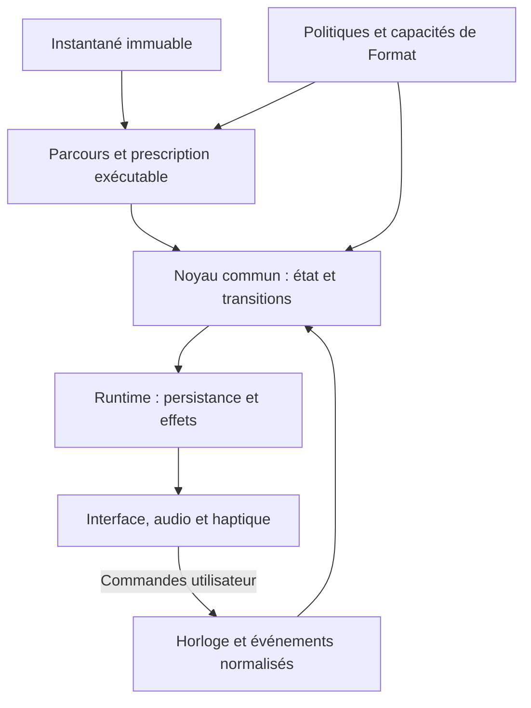

# KODJO — Conception d’ensemble du moteur d’exécution

> **Version documentaire actualisée au 5 novembre 2026.** Base : branche `docs/conception-moteur-execution-20261102`, commit `8855c793b3aa50c7249acb327d501267a9fd551e`, fichier conservé dans son organisation. Les décisions du complément final du 5 novembre remplacent les prescriptions antérieures contraires dans leur portée. Cette intégration ne déclare aucun développement du moteur.


**Version :** 2 consolidée — 2 novembre 2026. Fusion de la proposition ChatGPT (version 1, base de ce document) et de la proposition Claude « Architecture du moteur d'exécution » (modèle de pilotes, scénarios chiffrés), avec les corrections croisées et les décisions de Hermann D1–D6 et Q1–Q6.  
**Statut :** conception de référence proposée pour intégration. Les décisions métier de Hermann (§2 bis) sont acquises ; les contrats, types, algorithmes et découpages restent des propositions techniques jusqu'à leur intégration normative.  
**Baseline documentaire exclusive :** `MyUncried/Application-Routine`, commit `88f3ffc7da8ece6d9317f80604e7240d535f5681`. Aucune version antérieure ne remplace cette base.  
**Mission :** concevoir l’ensemble maintenant, livrer progressivement, éviter une reconstruction du socle lors de l’ajout des Formats spécialisés. Ce document ne certifie pas l’état du code dans la branche PRE-9 de Claude et ne déclenche ni PRE-10 ni PRE-11.

## 1. Sources, autorité et état de connaissance

Sources lues et utilisées :

| Repère | Source à la baseline | Portée |
|---|---|---|
| S1 | [Formats d’entraînement du 02/11](https://github.com/MyUncried/Application-Routine/blob/88f3ffc7da8ece6d9317f80604e7240d535f5681/docs/KODJO-Formats-entrainement-2026-11-02.md) | Porteurs, paramètres, organisations, AMRAP, EMOM, For time, Death by, préconfigurations et arbitrages A1–A7. |
| S2 | [Architecture technique, chapitre 12](https://github.com/MyUncried/Application-Routine/blob/88f3ffc7da8ece6d9317f80604e7240d535f5681/docs/Specifications-fonctionnelles/12%20%E2%80%93%20Architecture%20technique.md) | §12.9–12.12 : moteur, temps, adaptateurs et arrière-plan ; §12.33 : réconciliation ; moteur Cadence ; architecture des circuits et Formats. |
| S3 | [Règles métier, chapitre 10](https://github.com/MyUncried/Application-Routine/blob/88f3ffc7da8ece6d9317f80604e7240d535f5681/docs/Specifications-fonctionnelles/10%20%E2%80%93%20Processus%20m%C3%A9tier%20et%20r%C3%A8gles%20m%C3%A9tier%20transverses.md) | FMT-01–42 ; phases, côtés, cadence, relevés, RM-066–077, récupérations et règles de durée. |
| S4 | [Architecture PRE-9](https://github.com/MyUncried/Application-Routine/blob/88f3ffc7da8ece6d9317f80604e7240d535f5681/_bmad-output/pre9/planning-artifacts/architecture-pre9.md) | Plan fini/progressif, instantané et descripteurs ; orientation PRE-10. |
| S5 | [Epics PRE-9](https://github.com/MyUncried/Application-Routine/blob/88f3ffc7da8ece6d9317f80604e7240d535f5681/_bmad-output/pre9/planning-artifacts/epics.md) | D.1 à D.5 ; responsabilités et dépendances, sans preuve de livraison des artefacts. |
| S6 | Proposition Claude « Architecture du moteur d'exécution » du 02/11 et analyses comparatives croisées | Modèle de pilotes, quatre rôles temporels, Clôture, scénarios chiffrés, décisions D1–D6 et Q1–Q6 de Hermann (§2 bis). |

Le cadrage du 28/10 sur la branche `docs/pre9-strategie-moteur-20261028` a confirmé l’intention de concevoir le socle pour les Formats avant PRE-10. Il sert de contexte historique, pas de baseline métier : ses anciens modèles, constantes et décomptes ne sont pas réintroduits.

Convention de lecture : **ACQUIS** = règle déjà définie dans les sources ; **PROPOSITION** = choix technique de ce document ; **À PRÉCISER** = sémantique ou faisabilité non démontrée dans les sources contrôlées. Une précision locale ne bloque pas les comportements indépendants.

## 2. D.3, D.5 et conception globale : trois responsabilités complémentaires

| Livrable | Ce que prévoit le plan | Rapport avec cette conception |
|---|---|---|
| D.1 | Développement déterministe des plans finis et représentation des segments progressifs | Fournit le parcours et les identités que le moteur doit consommer. |
| D.2 | Type et constructeur d’instantané versionné de toute la Séance | Fournit la prescription figée du moteur. |
| D.3 | Table sourcée et type minimal de capacités par Format/organisation, sans exécution | Décrit les besoins et règles des politiques. Ne constitue pas, à lui seul, le moteur commun. |
| D.4 | Validité de configuration distincte de disponibilité du moteur | Empêche de confondre configuration correcte et exécution spécialisée déjà livrée. |
| D.5 | Instruction documentaire des capacités temporelles, transitions, interruptions et résultats ; conséquences PRE-10/11 | Complète les règles réellement manquantes et prépare leur raccordement. N’est pas une livraison de code du moteur. |
| Présente conception | Organisation commune de toutes ces capacités | Définit comment elles coopèrent et comment livrer PRE-10 puis PRE-11 sans reconstruire les fondations. |

D.3 et D.5 sont **prévus à produire par Claude Code dans PRE-9**. Leur achèvement effectif n’est pas attesté ici. Claude doit rapprocher ce document des artefacts réellement déjà produits, les réutiliser et les compléter, sans créer trois référentiels concurrents. Les numéros A1–A7 du vieux cadrage moteur et ceux de la contre-revue Formats désignent des listes différentes : citer le document et le cas, jamais le numéro seul.

## 2 bis. Décisions métier de Hermann du 2 novembre 2026

Ces décisions complètent la baseline. Elles sont **ACQUISES** pour la présente conception et doivent être propagées dans les sources normatives (§21). Les identifiants D1–D6 et Q1–Q6 ne désignent pas les lots PRE-9 D.1–D.5.

| Réf. | Sujet | Décision |
|---|---|---|
| D1 | Échéance AMRAP pendant une série | Le bloc s'arrête net à l'échéance. Tours complets calculés ; répétitions du tour entamé saisies à la Clôture du bloc. |
| D2 | Fenêtre Death by manquée | Le défi s'arrête à la fin de la fenêtre manquée ; résultat partiel réellement réalisé de cette fenêtre saisi à la Clôture, en répétitions ou durée selon le membre. |
| D3 | Clôture et enchaînement | La saisie du résultat fait partie de la clôture de l'élément formaté. Une fois le résultat validé, la Séance continue automatiquement, sauf Point d'arrêt placé par l'utilisateur ou Pause. Le Point d'arrêt est placé manuellement : l'utilisateur construit sa Séance. |
| D4 | Point d'arrêt et Formats | Autorisé entre deux éléments ; refusé à l'intérieur d'un élément à fenêtre ou à échéance (AMRAP, EMOM, Death by, For time borné). La Pause manuelle reste toujours possible. Clôt la réserve R-01. |
| D5 | Fenêtre EMOM non terminée | Enregistrée « non terminée » avec les répétitions faites ; la fenêtre suivante démarre à l'heure, sans repos inventé. |
| D6 | For time sans temps limite | Aucune borne supplémentaire ; les sécurités RM-068/069 suffisent. |
| Q1 | Saisie d'une fenêtre EMOM non terminée | Au début de la fenêtre suivante, bandeau **non bloquant** « Fenêtre k non terminée — répétitions faites : [valeur préremplie] · Passer », qui disparaît seul ; le chronomètre ne s'arrête jamais. Ce qui n'est pas saisi est redemandé à la Clôture de l'EMOM. |
| Q2 | Réinitialiser dans un Format à fenêtre ou échéance | Désactivé à l'intérieur d'un AMRAP ou d'un Death by. |
| Q3 | Suivant pendant une récupération d'AMRAP | Autorisé ; l'échéance du bloc continue de courir. |
| Q4 | Confirmation exactement à l'échéance | Le travail confirmé à l'instant de l'échéance ou avant est acquis (For time borné, fenêtre Death by, fenêtre EMOM). |
| Q5 | Exercice bilatéral dans une fenêtre commune | Il consomme une seule fenêtre pour ses deux côtés ; non fini à l'échéance, la fenêtre est « non terminée » (Q1). |
| Q6 | Changement d'heure ou redémarrage sans continuité temporelle | Dialogue existant « Reprendre la séance / Arrêter la séance » ; la Séance est remise à l'étape en cours, en pause, sans rien déduire du temps écoulé. |

## 3. Principes du moteur entier

**ACQUIS — S1 à S4.**

- Une Séance est la seule source de lancement (D-449) ; aucune réintroduction d'Exercice autonome lançable, de parcours `ACTIVITY` / `DIRECT_PREPARE` ou de minuteur « Mouvement libre » (B10 différé). Les anciens historiques restent lisibles.
- La prescription est figée à partir des données courantes au lancement. Le moteur ne relit pas le Catalogue pendant l’Exécution.
- Le cœur est indépendant de React, de SQLite, des API audio/haptiques et des bibliothèques natives.
- Les plans finis et progressifs coexistent. Une limite de saisie n’est pas une limite du nombre d’occurrences réalisées.
- Temps, progression, résultat, affichage et son restent distincts. Une durée estimée ne devient pas une condition de fin.
- Le Cycle répète sa séquence ; les organisations groupées/alternées restent celles de la prescription. Aucun multiplicateur ajouté par le moteur.
- Les politiques propres aux Formats ne sont pas codées dans les écrans.

**PROPOSITION — structure minimale.** Un seul noyau de transitions, un seul orchestrateur de parcours et un seul gestionnaire logique des échéances. Les politiques spécialisées déclarent les décisions nécessaires ; elles ne possèdent ni timer indépendant, ni moteur de persistance, ni boucle React propre.

Aucun framework de workflow, bus distribué, moteur de plugins chargé dynamiquement, journal intégral de tous les ticks ou système d’event sourcing n’est nécessaire au MVP. Des fonctions et types TypeScript explicites suffisent ; les noms ci-dessous illustrent les responsabilités et n’imposent pas autant de classes ou fichiers.

## 4. Architecture et frontières



| Responsabilité | Produit / consomme | Ne fait pas |
|---|---|---|
| Construction d’instantané | Copie versionnée de toute la structure et des paramètres effectifs | Ne garde pas une dépendance vivante au Catalogue. |
| Compilation / parcours | Prescription exécutable et résolution des prochaines étapes | Ne déclenche pas le son, n’écrit pas en base. |
| Politiques de Format | Références temporelles, acquisition, avancement, borne et fin propres au contexte | Ne pilotent pas directement les composants graphiques. |
| Noyau | État + événement + lecture temporelle → nouvel état + effets demandés | Ne lit pas Date.now directement, ne navigue pas, ne joue pas le son. |
| Runtime applicatif | Sérialisation des commandes, lecture de Clock, sauvegarde, programmation d’échéance | Ne réinterprète pas la prescription métier. |
| Adaptateurs | Horloge, stockage, sons, voix, haptique et cycle de vie natif | Ne décident pas du prochain Exercice. |
| Projection UI | État courant, libellés, contrôles autorisés et métriques dérivées | Ne maintient pas un second compte à rebours métier. |

`ExecutionService` reste la façade applicative prévue par S2. Le domaine pur peut être testé sans démarrer React Native ; le service orchestre les adaptateurs existants.

## 5. Quatre objets distincts

### 5.1 Prescription figée

L’instantané conserve :

- identité et version de schéma de la Séance, version des règles et de la représentation exécutable ;
- ordre des Exercices, Circuits et Cycles, comptes et organisations ;
- identité de Format sur le bon porteur, paramètres et bornes effectifs ;
- données de Mouvement nécessaires à l’exécution, phases, médias référencés et paramètres propres ;
- séries, cibles typées, charges, côtés, pauses, récupération, Rôles explicites Buy-in/Tour/Buy-out et incréments ;
- paramètres structurels de Compte à rebours initial et Fin de séance.

Les valeurs futures d’un Profil ne modifient pas cette prescription. Les préférences d’audibilité restent des préférences de restitution selon les règles existantes, sans changer le temps ou le travail acquis.

### 5.2 Prescription exécutable

**PROPOSITION.** Une représentation composée de séquences, répétitions finies, étapes et portées de Format. Elle garde l’identité des conteneurs. D.1 peut continuer à matérialiser les plans finis ; un adaptateur de lecture commun doit aussi accepter ses segments progressifs. Il n’est pas demandé de réécrire D.1 pour remplacer systématiquement ses tableaux.

### 5.3 État d’Exécution

Il contient le curseur de parcours, les portées actives, les références temporelles, les tentatives, les acquisitions et les éventuelles interactions en attente. Il évolue ; il ne modifie jamais l’instantané.

### 5.4 Résultats et projection

Les résultats représentent ce qui est chronométré, acquis ou déclaré ; l’UI en est une projection. Les résultats ne sont pas reconstruits depuis le texte affiché ni depuis le nombre de sons joués.

## 6. Parcours hiérarchique et plans ouverts

### 6.1 Le curseur

**PROPOSITION.** Le curseur conserve une pile de contextes : Séance, répétition de Cycle, passage de Circuit ou bloc AMRAP, occurrence d’Exercice, série et côté. Les phases du mouvement forment un sous-parcours de guidage du travail courant.

Une étape a une identité stable fondée sur la source et le chemin d’occurrence. Exemple conceptuel : Exercice X / Cycle passage 2 / Circuit passage 3 / série 1 / côté 2. Un identifiant d’exécution distinct évite toute collision entre deux lancements de la même Séance.

Les identités d’occurrence ne changent pas avec un rafraîchissement, un repli d’interface, une reconstruction après interruption ou une reprise. Un reset crée une nouvelle tentative du même périmètre, sans faire disparaître le temps des tentatives précédentes.

### 6.2 Unité de travail et conteneur

| Niveau | Rôle |
|---|---|
| Cycle | Répète une séquence complète, sans hériter d’une horloge de Format par défaut. |
| Circuit standard groupé | Rejoue chaque membre complet dans l’ordre à chaque passage. |
| Circuit standard alterné | Entrelace les séries compatibles ; aucun Format collectif caché. |
| Circuit porteur | Coordonne l’AMRAP, le For time, l’EMOM commun ou le Death by selon S1. |
| Série / côté | Porte la cible et les mesures effectives de travail. |
| Phase du mouvement | Guide une partie du travail ; ne clôt pas à elle seule la série. |

### 6.3 Génération progressive

AMRAP et Death by produisent les prochaines occurrences à partir du curseur, des paramètres et du rang courant. Pas de nombre fictif de tours et pas de préallocation jusqu’à 99 ou 1 000.

L’état conservé est proportionné aux portées actives et aux résultats réellement produits. Une nouvelle occurrence n’est créée qu’une fois que la politique autorise son entrée. Les tours AMRAP réalisés ne sont pas déduits du temps écoulé.

La formule de progression peut calculer un objectif supérieur à la borne de saisie : départ 90, incrément 5 → 90, 95, 100, 105… Aucun clamp et aucun échec automatique à 100. Le rang calculé et l’acquisition du rang sont deux données distinctes.

### 6.4 Pilotes d'éléments

**PROPOSITION — ossature reprise de la proposition Claude.** Chaque contexte de la pile est piloté par un **pilote** propre au type d'élément et, le cas échéant, à son Format. Tous partagent la même interface :

```
interface Pilote<EtatLocal> {
  ouvrir(nœud, contexte, lecture): Transition<EtatLocal>
  surEnfantClos(état, enfant, contribution, lecture): Transition<EtatLocal>
  surRéférenceTemporelle(état, référence, lecture): Transition<EtatLocal>
  surCommande(état, commande, lecture): Transition<EtatLocal>
  projeter(état): Projection
}
Transition = { état, ouvrirEnfant?, ouvrirRéférences[], fermerRéférences[], effets[], clôture?: Contribution }
```

| Pilote | Porteur | Rôle |
|---|---|---|
| Séance, Cycle | Séance, Cycle | Enchaînement ordonné ; le Cycle répète sa séquence (D-17). |
| Exercice standard | Exercice libre, Tabata, départs rapides, membre | Séries, côtés, phases, pauses, récupérations ; réutilise `buildExecutionLedger` (`executionCalculations.ts:153`), dont la substitution de la dernière Pause par la récupération. |
| Circuit standard | Circuit sans Format | Passages × membres en groupées ou alternées ; réutilise `expandComposition` (`circuit.ts:192`). |
| Point d'arrêt | Point d'arrêt | Attente sans référence temporelle de Format (D4). |
| AMRAP, EMOM, For time, Death by | Exercice ou Circuit porteur | Politiques du §12. |
| Clôture | Inséré par une politique | Saisie bloquante du résultat spécialisé (§12.5). |

Les pilotes **ne mesurent pas le temps, ne persistent rien et ne dédupliquent rien** : ces responsabilités restent au noyau (§8 à §10, §15). Un pilote décide seulement de l'ouverture, de l'avancement et de la clôture de son élément.

**Unité consommée par un Circuit alterné.** Un Circuit en nature alternées consomme, à chaque tour, **une unité de chaque membre** — une série, ou une fenêtre pour un membre EMOM ou Death by — puis passe au membre suivant. L'état local de chaque membre (rang, série, cible courante) est conservé entre deux passages. Parcours EMOM alterné : A fenêtre 1 → B fenêtre 1 → A fenêtre 2 → B fenêtre 2… ; il ne déroule jamais toutes les fenêtres de A avant B. Même règle pour le Death by alterné coordonné.

### 6.5 API de parcours proposée

Les fonctions de responsabilité minimale sont : résoudre l’étape courante ; entrer/sortir une portée ; appliquer l’avancement autorisé ; déterminer les prochaines échéances ; produire les contributions de résultats. La résolution est déterministe à prescription, état et événements identiques. Aucun plugin généraliste d’itérateur n’est requis.

## 7. Cibles, fin automatique et estimation

**ACQUIS — S3.** Mode d’exécution, nature de cible et politique du Format doivent être examinés ensemble.

| Prescription de travail standard | Fin normale | Valeur temporelle |
|---|---|---|
| Durée chiffrée | Échéance automatique | Durée cible connue. |
| Durée à l’échec | Suivant | Temps actif mesuré, pas de durée cible infinie ou nulle. |
| Répétitions chiffrées | Suivant | Éventuelle estimation ; elle ne clôt pas l’effort. |
| Répétitions à l’échec | Suivant | Relevé facultatif selon les règles ; le bip ne détecte aucun mouvement. |
| EMOM / Death by | Politique de fenêtre du Format | L’appui peut acquérir le travail sans avancer l’échéance. |
| AMRAP / For time | Travail local et borne du porteur | La fin du travail local n’est pas nécessairement celle du Format. |

**PROPOSITION.** Chaque étape porte une condition de fin typée et une contribution de durée distincte : `durationContribution = exact | estimated | lowerBound | omitted`. Elle peut aussi porter une échéance métier. La présence d’une estimation n’implique jamais `autoComplete`.

Le compilateur utilise les mêmes prescriptions et règles de récupération que les calculs de durée. Il ne reparcourt pas le texte de carte pour retrouver la cible. Les résultats chronométrés restent séparés de ces contributions prévisionnelles.

## 8. Modèle temporel commun

### 8.1 Plusieurs portées, une autorité temporelle

**PROPOSITION.** Un registre de références temporelles détenu par le noyau représente les horloges logiques actives. Ce n’est pas un timer système par horloge.

| Référence | Exemple | Effet d’une fin de travail locale |
|---|---|---|
| Temps de Séance | Temps global de l’Exécution | Continue selon les règles de temps réel. |
| Borne de bloc | AMRAP 12 min | Continue pendant les membres et leur récupération de boucle. |
| Borne maximum | For time limité à 15 min | Ne redémarre pas à chaque Exercice. |
| Fenêtre | EMOM 60 s | Continue après travail terminé à 35 s ; 25 s de repos résiduel. |
| Travail local | Maintien de 40 s dans un AMRAP | Peut être borné avant sa propre échéance par la fin du bloc. |
| Cadence / motif | Bip ou phases cycliques | Guide sans devenir l’horloge de fin du Format. |

**Quatre rôles temporels** (repris de la proposition Claude) ; ce ne sont pas quatre chronomètres ni quatre mécanismes natifs :

| Rôle | Question | Exemple | Effet de la fin |
|---|---|---|---|
| Étape | Combien dure cette action locale ? | Maintien de 40 s, pause, récupération | Termine l'étape. |
| Fenêtre | Dans quel intervalle faut-il accomplir le travail ? | EMOM 60 s, fenêtre Death by | Termine la fenêtre même si le travail a fini plus tôt ; la politique décide de la suite. |
| Échéance | Jusqu'à quand cet ensemble peut-il continuer ? | Bloc AMRAP 12 min, limite For time 15 min | Termine l'ensemble, y compris au milieu d'un exercice ou d'une récupération. |
| Chronomètre | Combien de temps cet ensemble a-t-il pris ? | Temps réalisé d'un For time | Mesure, sans fin à lui seul. |

La progression Death by est un compteur de rang, pas une référence temporelle supplémentaire.

Une entrée temporelle minimale associe propriétaire, type, durée/budget éventuel, ancre, temps accumulé actif, état actif/suspendu et génération. Les formes concrètes peuvent réutiliser les données existantes, sans table SQL par type d’horloge.

Le temps logique d’une échéance automatique reste l’échéance calculée, pas l’heure tardive du callback JavaScript. Sinon un retard de 500 ms serait ajouté à chaque série.

### 8.2 Clock et continuité

**ACQUIS.** L’accès à l’heure est injectable ; le temps n’est pas un compteur décrémenté à l’écran. Les références doivent permettre une reprise après suspension.

**PROPOSITION.** L’adaptateur Clock expose une lecture monotone pendant une continuité d’exécution, une référence civile persistable et les informations de continuité disponibles sur la plateforme. Les valeurs monotones d’un processus ne sont jamais comparées directement à celles d’un nouveau processus sans garantie de leur domaine.

Un changement manuel d’heure, un redémarrage du téléphone ou l’absence d’une référence continue doivent pouvoir être identifiés comme incertitude de reconstruction. Le comportement utilisateur correspondant n’est pas inventé ici ; il est isolé parmi les précisions du §19. L’adaptateur natif réalisable sous la version Expo du projet doit être confirmé par lecture de l’existant et spike ciblé, pas présumé disponible.

### 8.3 Ordonnanceur

Le runtime programme le prochain réveil utile : échéance de travail, fenêtre, borne englobante, signal ou sécurité existante. L’interface peut rafraîchir son affichage plus souvent. Un callback demande une réconciliation à l’heure courante ; il ne décrémente pas une durée ni n’impose la transition.

Les réveils portent l’identifiant d’exécution, l’identité/génération de la portée et l’échéance attendue. Un callback ancien après Pause/reset/changement d’étape est sans effet.

## 9. États et événements

### 9.1 État du noyau

**PROPOSITION.** Quatre états globaux suffisent : prêt, en cours, en pause, terminé. Une interaction en attente est une donnée orthogonale, pas une copie du moteur dans une modale.

| État / donnée | Signification |
|---|---|
| Prêt | Instantané validé, Exécution pas encore démarrée. |
| En cours | Parcours actif, échéances et commandes évaluées selon leur portée. |
| En pause | Suspension volontaire ou Point d’arrêt conformément à la règle ; temps de Format conservé. |
| Terminé | Clôture de l’Exécution, normale ou interrompue ; résultats consolidés. |
| Interaction en attente | Choix ou résultat à déclarer ; identifiant, portée et actions disponibles explicites. Son effet sur les horloges dépend de la règle, pas de la seule présence d'un écran : la Clôture d'un élément formaté est bloquante (§12.5) ; le bandeau EMOM ne l'est pas (Q1). |
| Réconciliation technique | Mode de l’orchestrateur après interruption ; ne réécrit pas automatiquement le statut métier en pause ou terminé. |

La clôture d’un bloc, d’un Exercice ou d’un Circuit n’est pas la clôture de toute la Séance. La Fin de séance doit être exécutée selon les règles avant clôture normale. Les états métier Terminée/Partielle/Interrompue et l’achèvement spécifique Death by ne sont pas remplacés par ces quatre états techniques.

### 9.2 Familles d’événements

| Famille | Exemples conceptuels | Source |
|---|---|---|
| Commande utilisateur | démarrer, Pause, Reprendre, Suivant, reset dans le périmètre autorisé, arrêter | Interface. |
| Acquisition spécialisée | travail de fenêtre terminé, tour de boucle déclaré, résultat partiel confirmé | Interface validée par la politique concernée. |
| Événement temporel | échéance attendue, réconciliation à une nouvelle lecture de Clock | Ordonnanceur / cycle de vie natif. |
| Décision d’interaction | confirmer/corriger une valeur, annuler, reprendre après interruption | Dialogue existant, lié à son identifiant. |
| Événement technique | retour au premier plan, reprise du processus, interruption audio, erreur de persistance | Adaptateur ; ce n’est pas automatiquement un événement métier Pause. |

Chaque commande vise l’Exécution et, lorsque pertinent, une occurrence/tentative attendue. Une confirmation arrivée pour une occurrence déjà terminée ne s’applique pas à l’Exercice suivant.

### 9.3 Contrat du noyau

Signature illustrative : `transition(state, event, clockReading) -> { nextState, resultChanges, effectRequests }`.

La prescription ou son accès immuable fait partie de l’environnement explicite de la fonction. Elle n’est ni une variable globale React ni une donnée SQLite relue pendant la transition.

Une transition peut contenir plusieurs micro-avancements déterministes : fin de travail, pause de durée nulle, entrée du prochain membre. Elle s’arrête lorsqu’une entrée utilisateur réelle est nécessaire ou lorsque l’état courant correspond à l’heure évaluée. Une garde technique contre une boucle sans progrès doit signaler une erreur de parcours ; elle ne devient pas une borne de tours métier.

## 10. Événements simultanés et idempotence

**PROPOSITION technique.** Une file sérialisée par Exécution ordonne les traitements. Une lecture temporelle est attachée à la réception de la commande ; on ne lui substitue pas l’heure plus tardive de sa sauvegarde. Les événements natifs peuvent également porter leur échéance effective.

Avant une décision, le noyau évalue les échéances logiquement déjà atteintes et les effets causaux sur la portée visée. Pour un même instant logique, il rassemble les candidats et applique une règle explicite ; l’ordre d’arrivée des callbacks ne suffit pas à décider du résultat.

**ACQUIS.** Si une fin de phase coïncide avec un bip, la transition et son signal priment, sans double signal. Une fenêtre ne peut être acquise deux fois ; un événement de reprise répété ne recommence pas le travail.

**ACQUIS — Q4.** Un travail confirmé à l'instant de l'échéance ou avant est acquis (For time borné, fenêtre Death by, fenêtre EMOM). Le noyau rassemble les candidats d'un même instant logique et applique cette règle ; l'ordre d'arrivée des callbacks ne décide jamais.

**Fermeture des descendants.** Lorsqu'une référence englobante expire et que la politique décide la fin de sa portée (par exemple bloc AMRAP), le noyau ferme les portées descendantes avec le motif « échéance du parent », y compris une récupération en cours (B02), puis rend la main à la politique propriétaire. Cette fermeture est distincte de la qualification d'événements simultanés traitée ci-dessus ; « le parent gagne toujours » n'est pas une règle générale.

La déduplication utilise les identités de transition/résultat et les générations, pas un délai arbitraire de debounce. Elle ne supprime pas une deuxième action utilisateur légitime sur une nouvelle occurrence.

## 11. Matrice de capacités — base de D.3

| Modèle / organisation | Porteur | Parcours et temps | Fin / suite | Résultat principal |
|---|---|---|---|---|
| Standard, dont Tabata/30-30/départs rapides | Exercice ; Circuit standard éventuel | Séries, cibles, côtés, pauses et récupérations effectifs | Automatique en Durée chiffrée ; autres fins selon cible et actions existantes | Temps et relevés génériques qualifiés. |
| EMOM autonome / À la suite | Chaque Exercice | N fenêtres propres de W ; À la suite, tests successifs et récupération configurée | Échéance conduit à la fenêtre suivante ; fin des fenêtres puis élément suivant | Capacités de résultat de fenêtre à documenter sans mesure inventée. |
| EMOM alterné | Exercices dans Circuit standard | Une fenêtre de A puis une de B ; comptes compatibles | N passages par membre selon prescription ; pas de double multiplication | Fenêtres et résultats locaux. |
| EMOM dans chaque intervalle | Circuit groupé porteur | A puis B dans la même fenêtre commune | Fin de travail avant échéance → repos résiduel ; prochaine fenêtre à échéance | Travail des membres et fenêtre commune distincts. |
| AMRAP autonome | Exercice | Boucle sous sa durée, Répétitions | Échéance de bloc, puis suite de la Séance | Tours complets et partiel selon règles de déclaration. |
| AMRAP en Circuit | Circuit groupé porteur | B blocs distincts ; boucle sous durée de chaque bloc ; plusieurs buy-in exécutés une fois au début du premier | Échéance termine le bloc même pendant la récupération ; repos inter-blocs si un bloc reste | Résultat distinct par bloc, objectifs/incréments réinitialisés. |
| For time autonome | Exercice | Séries/échelle finies et temps mesuré ; borne optionnelle | Travail accompli ou borne atteinte ; suite de la Séance | Temps, achèvement et motif distincts. |
| For time multi-membres | Circuit alterné porteur | Série i au tour i, buy-in/out uniques, borne commune optionnelle | Boucle puis buy-out selon prescription ; borne du Circuit non recopiée comme minuteur local | Travail et achèvement du porteur, temps mesuré. |
| Death by autonome / À la suite | Chaque Exercice | Fenêtres, départ et incrément propres ; rang ouvert | Échec termine cet Exercice ; récupération puis suivant | Rang, acquis, partiel déclaré, motif et achèvement. |
| Death by autonome dans standard groupé | Exercice | Exécution complète à chaque passage | Échec local ; membre suivant ; nouveau passage repart au départ initial | Résultat par exécution, sans écraser le passage précédent. |
| Death by dans chaque intervalle | Circuit groupé porteur | Fenêtre commune ; objectifs croissants des membres | Premier échec termine le Circuit, puis suite de Séance | Acquis et partiels par contexte, rang et fin collective. |
| Death by alterné coordonné | Circuit alterné porteur | A puis B dans leurs intervalles locaux ; progression par mouvement | Premier échec termine le Circuit, puis suite de Séance | Rang/acquisition/partiel par contexte et fin collective. |

Précisions acquises : un Death by autonome est refusé en Circuit standard alterné ; cette combinaison n'est pas une autre politique moteur. Le Death by alterné coordonné porte le Format d'origine Death by au Circuit (nature alternées, tours « jusqu'à l'échec », en-tête sans durée). Un AMRAP à un mouvement avec un repos de boucle supérieur à 0 est porté par un Circuit d'un membre (A3), ce qui donne la récupération à chaque boucle (T14). Tabata À la suite à 8 séries 20/10 et récupération intermédiaire 60 s donne **530 s**, par substitution de la dernière pause ; aucune trace d’origine Tabata nécessaire au moteur.

La table décrit les besoins de toutes les organisations. Elle ne certifie pas que la saisie, l’acquisition et la restitution de chaque résultat spécialisé sont déjà entièrement spécifiées ou implémentées ; les limites sont au §19.

## 12. Politiques spécialisées sans moteurs parallèles

**PROPOSITION.** Une politique TypeScript déclarative ou à fonctions pures fournit les décisions réellement variables :

1. initialisation de la portée et de ses références temporelles ;
2. objectif au rang courant et résolution du travail local ;
3. interprétation de l’acquisition utilisateur ;
4. traitement de l’échéance de fenêtre ou de borne ;
5. avancement, fin de portée et données de résultat.

Le noyau conserve l’identité, l’ordre, la mesure du temps, les transitions atomiques, la déduplication et la persistance. Le descripteur D.3 expose les capacités et règles ; il ne stocke pas une liste de callbacks sérialisés. Distinguer la donnée versionnée de règle et l’implémentation de la politique.

Les politiques de cette section sont des **pilotes** au sens du §6.4.

### 12.1 AMRAP

La portée de bloc possède sa borne. La boucle produit les membres Passage = À chaque tour dans l’ordre. Le buy-in est attaché au Circuit et consommé une fois, dans le premier bloc ; il n’est pas compilé en élément avant le Circuit.

Un état de boucle conserve rang, membre et acquisitions utiles, sans inventer le nombre de tours à partir du temps. À l'échéance du bloc (D1), la portée se termine net, même pendant une récupération ; la Clôture du bloc présente les tours complets calculés et demande les répétitions du tour entamé. Après validation : repos entre deux AMRAP s'il reste un bloc, puis bloc suivant avec objectifs et incréments réinitialisés ; sinon fin de l'AMRAP et enchaînement (D3). « Suivant » est permis pendant une récupération de boucle, l'échéance continuant (Q3) ; Réinitialiser est désactivé (Q2). La récupération de l’Exercice s’exécute dans le temps du bloc et reste attachée à son propriétaire après réordonnancement antérieur au lancement. Aucun transfert automatique vers le dernier membre n’est effectué au lancement.

### Prescriptions et fins — complément du 5 novembre

- **EMOM :** chaque fenêtre lit la cible et la charge de la série de rang correspondant, pas une cible commune fixe ni une formule d’incrément de charge. Respecter le portage et le parcours groupé/alterné existants ; validation de toutes les fenêtres côté configuration, somme des durées connues dans une fenêtre commune, bilatéralité comprise. Un objectif en Répétitions n’acquiert aucune durée déduite.
- **Superset :** préconfiguration standard alternée, trois tours initialement ; A1/B1 puis A2/B2. Le compte du Circuit n’introduit aucune multiplication supplémentaire de la collection des séries. La récupération après le tour lit le dernier Exercice actuel ; les autres récupérations conservent leur porteur, sans transfert silencieux.
- **AMRAP :** incrément signé ; objectif actif calculé borné à 1 dans son unité, sans terminer la boucle. Le plancher ne réactive pas une cible nulle intentionnelle et ne s’applique pas à Buy-in ou À l’échec. Blocs, acquisitions et clôtures gardent leurs règles.
- **Death by :** Mode Répétitions ou Durée, départ et incrément positif dans l’unité. Avant chaque rang, calculer le travail connu : cible de durée, deux côtés et pause applicable ; somme des membres en intervalle commun, intervalle propre sinon. Un rang dont ce travail atteint ou dépasse sa fenêtre n’est pas lancé. Arrêter après le rang précédent, motif « limite de l’intervalle atteinte », sans échec/tentative/partiel fictifs. Si c’est le premier rang, avertissement non bloquant à la sauvegarde, zéro rang lancé à l’exécution. Sinon conserver la fin sur fenêtre réellement non tenue et sa déclaration de partiel. Une progression future qui atteindra cette limite ne déclenche pas d’avertissement initial.
- **Ordre temporel :** le contrôle d’admissibilité précède l’ouverture du nouveau rang Death by. La règle Q4 d’acquisition à l’échéance pour une fenêtre effectivement ouverte n’est pas remplacée. Aucun allongement de fenêtre. Défi 10 s, +10 s, intervalle 60 s : rangs 1–5 réalisables et acquis seulement si tenus ; arrêt avant le rang 6.
- **Données :** objectifs, unités, charges, Rôles et récupérations effectifs dans l’instantané ; aucun historique de réponses du questionnaire concurrent. Les restaurations temporaires du brouillon de création ne constituent pas un état à rejouer dans le moteur. Historique et instantanés existants inchangés.

Ces règles complètent la table des politiques ; pour le Death by en Durée, l’arrêt préventif est distinct de D2 (fenêtre réellement manquée). L’ouverture de la Clôture et la suite de la Séance réutilisent le mécanisme existant, sans nouvelle horloge ni flux parallèle.

### 12.2 EMOM

La fin locale du travail signale son achèvement ; l'échéance de fenêtre reste inchangée. Fenêtre expirée avant la fin du travail : « non terminée » (D5), la fenêtre suivante démarre à l'heure ; bandeau de saisie non bloquant au début de la fenêtre suivante, rattrapage à la Clôture de l'EMOM (Q1). Un exercice bilatéral consomme une seule fenêtre pour ses deux côtés (Q5). La Clôture de l'EMOM n'est présentée que s'il reste des fenêtres non terminées sans saisie. Le repos résiduel n’est pas une récupération ajoutée au calcul. Une fenêtre expirée non achevée ne se prolonge pas et n’invente pas de repos positif.

### 12.3 For time

Le parcours fini et le chronomètre du porteur restent indépendants ; la borne maximum, lorsqu’elle existe, est une troisième notion. Le rappel grisé de borne dans la modale d’un membre n’ajoute aucune horloge locale au lancement.

Fin normale : dernier travail confirmé ; temps réalisé lu sur le chronomètre ; Clôture de validation. Borne atteinte : fermeture des descendants ; Clôture avec tours et répétitions faits (position calculée, partiel du membre en cours à saisir). Travail confirmé pile à la borne : acquis (Q4). Sans borne : sécurités existantes seulement (D6).

Un For time autonome répété dans un Circuit standard groupé rejoue toute son échelle depuis le début. Un For time multi-mouvements porté par Circuit avance d’un rang de série à chaque tour. Ces opérations ne sont pas confondues.

### 12.4 Death by

La progression prescrit l’objectif ; l’acquisition confirme le travail, jamais le passage du temps seul. L’absence d’appui ne crée pas un rang acquis. Le régime ouvert ne dépend pas d’une réserve de 99 séries.

Échec : fenêtre expirée avant confirmation, ou échec déclaré ; le défi s'arrête (D2) et la Clôture présente le dernier rang réussi, le mouvement en échec en Circuit, et demande le partiel de la fenêtre réellement tentée, en répétitions ou durée selon le membre. Confirmation pile à la fin de la fenêtre : acquise (Q4). Réinitialiser désactivé (Q2).

En alternance coordonnée, l'intervalle reste propre à chaque membre et ne devient pas une durée de tour globale : avec A à 60 s et B à 90 s, un passage complet dispose de 150 s d’intervalles. La portée collective du Circuit décide de sa fin ; les horloges locales se succèdent. Le raccordement précis rang/fenêtre/partiels doit être confirmé par D.5, sans remettre en cause cette structure décidée.

### 12.5 Clôture des éléments formatés

**ACQUIS — D3.** La Clôture est une interaction en attente **bloquante**, rattachée à l'élément terminé (identité d'occurrence) :
- aucune référence temporelle de l'élément suivant n'est ouverte pendant la saisie ;
- elle présente les valeurs calculées (tours complets, temps réalisé, rang atteint, fenêtres) et les champs à déclarer ;
- sa validation clôt l'élément ; l'élément suivant s'ouvre **automatiquement** à l'instant de la validation, sauf Point d'arrêt suivant ou Pause en cours.

Elle concerne AMRAP (chaque bloc), Death by (fin du défi), For time (fin ou borne) et EMOM (s'il reste des fenêtres non terminées sans saisie). Elle reste **distincte** de la confirmation ou correction des relevés des Exercices standards, qui ne commande pas l'avancement (ch12) ; la Clôture n'est pas étendue implicitement à d'autres cas.

## 13. Pause, reset, côtés et guidage

| Événement | Règle à préserver |
|---|---|
| Pause volontaire | Suspendre toutes les références temporelles actives ; conserver temps restant et progression. |
| Point d'arrêt | Uniquement entre deux éléments (D4) ; aucune référence de Format n'est active pendant l'attente. Refusé à l'intérieur d'un élément à fenêtre ou à échéance (validation D.4). |
| Reprendre | Reprendre les budgets suspendus sans remise à zéro du Format. |
| Reprendre le bip | Premier nouveau bip après un intervalle complet ; pas de rattrapage ni reset du minuteur Durée. |
| Reset | Portée existante seulement : série en unilatéral, côté courant en bilatéral, récupération courante si récupération. Ne pas appliquer implicitement un reset de Circuit ou de Séance. **Désactivé à l'intérieur d'un AMRAP ou d'un Death by (Q2).** |
| Suivant pendant une récupération de Format | Autorisé en AMRAP ; l'échéance englobante continue (Q3). |
| Reset et mesures | Temps actif cumulé conserve les tentatives antérieures ; relevé de performance sur la dernière tentative terminée. Exemple 20 s, reset, 35 s = 55 s actifs cumulés et 35 s de relevé. |
| Arrière-plan / verrouillage | Pas une Pause volontaire ; évolution logique selon les références temporelles et les capacités natives. |
| Consultation média | Pas de Pause implicite. |
| Motif de phases | Guidage cyclique ; nouvelle série à la première phase ; ne clôt pas la série à chaque fin de motif. |
| Cadence AMRAP/For time | Facultative, sans incidence sur durée/estimation, transitions ou répétitions réellement réalisées. |

Le changement de côté est résolu selon l’ordre prescrit, en conservant identité et résultats par côté. La politique de fenêtre ne doit pas additionner un intervalle complet pour chacun des côtés si le Format ne le prescrit pas. Une règle d’articulation côté/fenêtre non définie est à préciser pour ce cas ; ne pas la remplacer par une nouvelle restriction générale d’éligibilité.

Les phases et le bip ne créent pas une occurrence persistée par signal ou par répétition guidée. Le moteur conserve les compteurs/ancres suffisants pour retrouver l’état et produire les relevés estimés autorisés. En AMRAP/For time, ne pas réintroduire une estimation de durée depuis les phases ou le bip au motif que les paramètres standards savent la calculer ailleurs.

## 14. Arrière-plan, suspension et redémarrage

### 14.1 Retour après suspension

**ACQUIS.** Ne pas dépendre de la continuité d’un timer JavaScript. Au retour, calculer les échéances réellement atteintes depuis les ancres persistées ; ne pas rejouer les sons manqués.

**PROPOSITION.** Réconcilier de façon chronologique les transitions automatiques déterminables. Exemple : plusieurs étapes Durée peuvent être franchies logiquement pendant une suspension si leur fin ne requiert aucune acquisition utilisateur. Les résultats portent la qualité de preuve applicable ; une durée mesurée ou déduite d’horodatages n’atteste pas que le mouvement a été réalisé.

**Travail local bloqué, échéances englobantes actives.** Une étape qui attend une confirmation (Répétitions, « Terminé ») bloque l'avancement du travail local, pas les références englobantes. Au rattrapage, le noyau continue d'évaluer les échéances et fenêtres des portées supérieures : si l'échéance d'un bloc AMRAP est atteinte pendant la suspension, le bloc se termine à son instant logique, le membre en attente est fermé sans être validé, puis la Clôture du bloc est présentée. Ce mécanisme est commun à toutes les portées ; aucune branche propre à l'AMRAP.

Pour les étapes manuelles et Formats à acquisition, ne pas inventer les appuis manquants. Le noyau peut calculer le rang temporel ou une borne expirée sans transformer ce calcul en tours accomplis. Les règles spécialisées décident de la suite.

### 14.2 Interruption du processus

**ACQUIS — S2 §12.33.** Une Exécution interrompue techniquement n’est pas clôturée automatiquement. À la détection, proposer Reprendre la séance / Arrêter la séance ; pas de nouveau lancement concurrent tant que le choix existant n’est pas traité.

Le runtime reconstruit un **état candidat** sans reprendre silencieusement l'exécution : il charge l'instantané, la version de règle, le checkpoint et les résultats, évalue leur compatibilité, puis présente le choix existant. Si la continuité temporelle n'est pas démontrée (changement d'heure, redémarrage), la Séance est remise à l'étape en cours, **en pause**, sans rien déduire du temps écoulé (Q6). [Précisé le 09/11/2026 — recette iPhone PRE-10, décision de Hermann (« Oui » à : « après une fermeture de l'application, reprendre à l'étape interrompue, en pause, sans compter l'absence (comme la règle Q6) ») : après une interruption du processus, la remise à l'étape en cours, en pause, sans compter l'absence, s'applique **même avec une continuité temporelle démontrée** ; la reprise au temps logique ne vaut plus que pour l'arrière-plan sans fermeture (§14.1, RM-067).] La décision de reprise est rattachée à cette Exécution précise. Son traitement ne redémarre pas le Compte à rebours initial.

### 14.3 Limites natives

Une application suspendue ne peut pas supposer que JavaScript joue les signaux à l’heure. Le spike doit démontrer, sur l’Expo et les appareils cibles, comment les échéances et signaux nécessaires sont pris en charge. La conception n’impose ici aucune bibliothèque ni service de fond non vérifié.

Le système doit distinguer : continuité temporelle du métier ; capacité à produire un son en arrière-plan ; livraison d’un signal ; capacité à afficher l’état. Une réussite du premier point ne prouve pas les trois autres. Les interruptions audio ne modifient pas les résultats ni les chronomètres sauf règle explicite.

Les sécurités déjà décidées (30 min après nominal dans leur portée, 2 h sans interaction dans les cas définis) sont conservées. Aucun nouveau seuil, arrêt définitif automatique ou pause automatique générale n’est introduit.

## 15. Persistance et résultats

### 15.1 État minimal durable proposé

| Ensemble | Contenu |
|---|---|
| Exécution | Identifiant, origine Séance, instantané/version, état, révision de checkpoint. |
| Curseur | Pile des conteneurs et indices actifs, occurrence/série/côté/phase, identifiant de tentative. |
| Temps | Ancres, budgets/temps accumulés et état des portées actives ; référence de continuité de Clock disponible. |
| Acquisitions | Tours/blocs/fenêtres confirmés utiles, progression et buy-in consommé une fois. |
| Interaction | Choix ou résultat attendu, occurrence propriétaire et état validé/non validé. |
| Résultats | Résultats terminés, tentatives et métriques utiles ; motif, achèvement et qualification des valeurs. |

Le checkpoint ne contient pas une copie illimitée des échéances passées. Les résultats peuvent être écrits progressivement ; conserver tout leur historique en mémoire n’est pas requis pour calculer le prochain événement.

### 15.2 Frontière transactionnelle

**PROPOSITION.** Lors d’une transition métier, sauvegarder atomiquement le nouvel état durable et les changements de résultats correspondants. En cas d’erreur, ne pas publier à l’UI un avancement irréversible non sauvegardé ; conserver la commande et son identité pour une reprise technique contrôlée. Le traitement d’erreur et la restitution réutilisent les mécanismes du projet, sans nouvel écran inventé.

Les contraintes d’unicité ou mises à jour idempotentes empêchent la duplication d’un résultat : Exécution + occurrence + tentative + type de résultat. Les révisions évitent qu’une sauvegarde asynchrone ancienne écrase une nouvelle. Le runtime traite une transition à la fois, sans nécessiter de protocole distribué.

Une sauvegarde n’est pas effectuée à chaque frame d’animation ni chaque tick d’affichage. Les ancres permettent la reconstruction entre transitions. Les besoins éventuels de checkpoint intermédiaire doivent être justifiés par une donnée qui ne serait pas reconstructible.

### 15.3 Qualification des résultats

Conserver séparément :

- prescription et objectif calculé ;
- temps actif cumulé et performance de la dernière tentative ;
- valeur chronométrée, estimée, déclarée ou non renseignée ;
- rang temporel et nombre de fenêtres/tours acquis ;
- motif de fin, résultat et niveau d’achèvement ;
- résultat de membre, bloc, Circuit et Séance.

Contenu spécialisé par Format (repris de la proposition Claude) :

| Format | Résultat réalisé |
|---|---|
| AMRAP | Par bloc : tours de boucle complets et répétitions du tour entamé |
| For time | Temps réalisé ; à la borne : tours et répétitions faits, motif « borne » |
| EMOM | Fenêtres terminées / non terminées avec répétitions faites (ou non renseignées) |
| Death by | Dernier rang acquis ; partiel en répétitions/durée d’une fenêtre réellement tentée, membre en échec le cas échéant ; arrêt avant un rang incompatible identifié par « limite de l’intervalle atteinte », sans tentative fictive |
| Standard | Séries, relevés et récupérations partielles selon les règles existantes |

Une absence n'est pas zéro. Le son désactivé ne supprime pas une estimation logique déjà prévue ; la confirmation utilisateur ne devient pas une mesure automatique. Les partiels AMRAP/Death by suivent leurs contrats spécifiques, sans rendre toute saisie de relevé obligatoire sur les exercices standards.

### 15.4 Mise à jour de l’application pendant une Exécution

Conserver la version des données et des règles nécessaires à la lecture de l’état actif. Un checkpoint n’est pas relu sous une nouvelle politique incompatible sans migration ou chemin de compatibilité explicite. Réutiliser les mécanismes de version existants ; pas de bibliothèque de migration du moteur imposée ici.

## 16. Effets, interface et observabilité

### 16.1 Effets demandés

Le noyau peut demander une transition d’affichage, un signal, une interaction ou la programmation d’un réveil ; il ne réalise pas lui-même ces effets. Les adaptateurs utilisent l’identité de la transition et la génération active pour écarter les demandes devenues obsolètes après Pause, reset ou fin de portée.

Les résultats et le checkpoint ont une atomicité de base ; le son physique ne partage pas cette transaction. Une garantie « exactement une fois » après crash n’est donc pas revendiquée pour l’audio. La règle utile reste : pas de rattrapage de signaux périmés, pas de doublon logique, signal de transition prioritaire sur un bip coïncident. Aucun mécanisme d’outbox durable n’est ajouté par défaut au MVP.

### 16.2 Projection de l’interface

Une fonction de projection expose la phase courante, les noms, objectifs et charges effectifs, côté et rangs, temps écoulés/restants, état et commandes autorisées. La commande disponible est dérivée de l’état métier, pas d’un compteur React local.

La barre de progression peut être indéterminée ou partielle selon les règles existantes. Ne pas appliquer les poids fixes d’un plan fini aux boucles ouvertes ; ne pas afficher 100 % de Séance avant sa clôture. Aucune nouvelle maquette de suivi ou progression spécialisée n’est prescrite par cette conception.

### 16.3 Diagnostic proportionné

Pour comprendre un incident : version, identifiant de transition, événement, occurrence et tentative, références temporelles, état avant/après et motif de fin. Un journal de développement borné suffit ; pas de télémétrie distante ni d’enregistrement de tous les ticks imposé.

## 17. Scénarios de validation de l’architecture entière

Les scénarios suivants sont des **tests à réaliser**, pas des résultats obtenus par ce document. Les tests du noyau utilisent une horloge simulée ; les capacités natives nécessitent une vérification réelle.

| Cas | Résultat ou propriété à démontrer | Tranche |
|---|---|---|
| T01 — Séance, Cycle et Circuits groupé/alterné | Bon ordre, bons indices et une seule multiplication des passages | PRE-9/D.1 puis PRE-10 |
| T02 — Durée, Répétitions et À l’échec | Estimation indépendante de fin automatique ; Suivant dans les cas manuels | PRE-10 |
| T03 — Pause 20 s pendant une Durée | Temps restant conservé, horloges concernées suspendues, reprise sans reset | PRE-10 |
| T04 — Pause au milieu du bip | Fraction non acquise, temps actif conservé ; reprise après intervalle complet sans reset du minuteur | PRE-10 |
| T05 — Reset après 20 s puis 35 s | 55 s actifs cumulés ; 35 s pour la dernière tentative ; autre côté préservé | PRE-10 |
| T06 — Callback ancien après reset | Aucun avancement ni signal sur la nouvelle tentative | PRE-10 |
| T07 — Fin et bip au même instant | Une transition et son signal, aucun bip additionnel | PRE-10 |
| T08 — Mise en arrière-plan sur étapes automatiques | Reconstitution aux échéances logiques, aucun retard ajouté à chaque étape, aucun son rattrapé | PRE-10 + appareil |
| T09 — Interruption du processus | Checkpoint et résultats cohérents, choix de reprise existant, aucune double acquisition | PRE-10 + appareil |
| T10 — Deux confirmations de même fenêtre | Une acquisition ; pas d’acquisition implicite d’une fenêtre suivante | Simulation du contrat PRE-10, politique PRE-11 |
| T11 — EMOM : travail terminé à 35 s dans 60 s | 25 s résiduelles ; aucune transition à 35 s ni seconde récupération ajoutée | PRE-11 |
| T12 — AMRAP 12 min, maintien local 40 s commencé à 11:50 | La borne du bloc peut terminer la portée à 12:00 ; traitement du partiel selon règle, sans attendre 12:30 | Contrat PRE-10, politique PRE-11 |
| T13 — Trois blocs AMRAP et buy-in | Buy-in une seule fois dans le premier, temps consommé dans sa borne ; objectifs et résultats propres à chaque bloc | PRE-11 |
| T14 — AMRAP un membre, repos de boucle 30 s | Récupération à chaque boucle, consommant le bloc ; pas seulement à la fin de tout l’AMRAP | PRE-11 |
| T15 — For time, borne commune et borne absente | Borne ne redémarre pas au changement de membre ; temps mesuré distinct de durée cible | PRE-11 |
| T16 — Death by en standard groupé | Fin locale, poursuite du Circuit et redémarrage au départ au passage suivant | PRE-11 |
| T17 — Death by alterné 60 s / 90 s | Intervalles locaux successifs, rangs par mouvement, premier échec collectif, puis suite de Séance | PRE-11 |
| T18 — Progression à 105 pour saisie bornée à 100 | Objectif calculé conservé sans clamp ni arrêt caché | PRE-9/D.3 puis PRE-11 |
| T19 — Guidage ou Sons désactivés en AMRAP/For time | Aucun changement de borne, calcul temporel, acquisition ou répétitions réalisées | PRE-11 |
| T20 — Erreur de sauvegarde à une transition | Pas d’état durable avancé sans résultat ni de résultat dupliqué à la réémission | PRE-10 |
| T21 — Point d'arrêt, sécurité et récupération | Pause/attente/récupération distinctes ; Point d'arrêt seulement entre éléments, refusé dans un Format (D4) ; répétition et déduplication des Points selon les règles existantes | PRE-10/11 |
| T25 — Rattrapage sous échéance englobante | Retour au premier plan après l'échéance d'un bloc AMRAP pendant un membre en attente de Suivant : membre fermé non validé, Clôture du bloc présentée | PRE-10 (politique de test) |
| T26 — EMOM alterné | A f1 → B f1 → A f2 → B f2 ; état de chaque membre conservé | PRE-10 (politique de test) puis PRE-11 |
| T27 — Clôture et enchaînement | Validation de la Clôture → élément suivant ouvert automatiquement ; Point d'arrêt ou Pause l'empêchent | PRE-10 |
| T28 — Bandeau EMOM | Saisie non bloquante d'une fenêtre manquée, rattrapage à la Clôture | PRE-11 |
| T22 — Modification ultérieure d’un Mouvement ou du Profil | Exécution active et historique inchangés | PRE-9/D.2 puis PRE-10 |
| T23 — Délais simultanés de deux portées | Traitement causal déterministe, même résultat quel que soit l’ordre des callbacks ; cas métier égalité explicitement testé | PRE-10/11 |
| T24 — Clôture après Fin de séance | Clôture normale seulement après SESSION_END, pas au dernier Exercice ; fin locale spécialisée ne clôt pas la Séance | PRE-10/11 |

**Recommandation consolidée.** PRE-10 éprouve les contrats du noyau avec des **politiques de test qui reproduisent la sémantique réelle** de l'AMRAP et de l'EMOM : échéance qui ferme une récupération, fenêtre non terminée puis suivante à l'heure, Clôture bloquante puis enchaînement automatique, rattrapage sous échéance englobante, Circuit alterné consommant une fenêtre par membre. Validation par R2 à R6, T25 à T27. Cela démontre la capacité du socle sans livrer l'interface, les sons ni toutes les règles des Formats dans PRE-10 ; la livraison fonctionnelle de l'AMRAP et de l'EMOM se décide séparément.

### 17.1 Cas de recette chiffrés

Compte à rebours de 10 s inclus ; horloge simulée ; aucune interface.

| Cas | Déroulé | Attendu |
|---|---|---|
| R1 Tabata À la suite | A 8×20/10, récupération 1 min, B 8×20/10 | 530 s + compte à rebours ; aucune commande utilisateur |
| R2 EMOM dans chaque intervalle | 6 × 1 min, A et B à 10 rép. ; f4 : B fini à 0:52 ; f5 : B non fini à 1:00 | f4 terminée, 8 s de repos affichées ; f5 non terminée, f6 à l'heure, bandeau de saisie (Q1) ; résultat 5/6 |
| R3 AMRAP en Circuit | Buy-in 50 ; A 10 (+2) puis B Max ; 3 blocs de 12 min ; repos 2 min | 0:10 échéance bloc 1 (12:10) ; buy-in puis boucle ; 12:10 fin au tour 6 pendant A → Clôture : 5 tours + 7 rép. saisies ; validation 12:40 → repos jusqu'à 14:40 → bloc 2 sans buy-in, A revient à 10 ; trois résultats de bloc |
| R4 Échéance pendant récupération | R3, repos de boucle 30 s, échéance pendant la récupération de B | Récupération fermée à 12:10, motif « échéance du parent » ; Clôture : tours complets, 0 au tour entamé |
| R5 Pause pendant le bloc 2 | R3, Pause de 3 min à 20:00 | Échéance du bloc 2 reculée de 3 min ; temps restant d'étape conservé ; bip repris sur intervalle complet |
| R6 Interruption du processus | R3, application fermée à 20:00, relancée à 20:40 | État candidat reconstruit ; dialogue Reprendre / Arrêter ; à la reprise, échéance du bloc courue pendant l'absence (T25) |
| R7 For time borné | Buy-in 50, 3 tours 21-15-9 A/B, buy-out 50, limite 15 min atteinte au tour 3 pendant B | Fermeture des descendants ; Clôture : tours 1–2 complets, tour 3 A fait, B à saisir, buy-out non commencé ; motif borne |
| R8 Death by alterné | A et B, 1 min, départ 1, +1 ; f8 (B rang 4) expire | Clôture : A 4, B 3, B en échec, répétitions de la minute manquée ; Circuit entier clos ; élément suivant ouvert à la validation |
| R9 Death by À la suite | A jusqu'à l'échec au rang 9, Clôture, récupération 1 min, B | Deux résultats distincts ; B repart au rang 1 |
| R10 Au-delà de la borne de saisie | Death by départ 90, +5 | 90, 95, 100, 105… sans plafond ni troncature des compteurs |
| R11 Point d'arrêt | Point avant l'AMRAP de R3 | Attente sans référence active ; échéance du bloc 1 ouverte à « Continuer » ; Point à l'intérieur rejeté à la validation |

## 18. Mise en œuvre progressive sur une conception commune

| Étape | Livrable concret | Frontière à conserver |
|---|---|---|
| PRE-9 en cours | Formats configurables ; D.1/D.2 et réalignement du bon porteur ; D.3 matrice/types ; D.4 validité ; D.5 limites et besoins | Pas de noyau d’exécution ajouté dans les écrans de configuration. |
| Conception PRE-10 | Rapprochement de l’existant, contrats de ce document amendés, état/événements/temps/persistance, choix natifs vérifiés | Précisions structurantes résolues avant de coder les mécanismes dépendants, pas audit infini ni validation de chaque combinaison. |
| PRE-10.1 | Noyau pur, parcours commun, Clock de test et états ; scénarios représentatifs futurs simulés | Pas de moteur dédié à Libre impossible à étendre aux portées temporelles. |
| PRE-10.2 | Runtime, checkpoint/résultats, cycle de vie natif et premiers signaux | Pas d’écriture SQLite ou de choix de prochaine étape dans React. |
| PRE-10.3 | Exécution Libre complète, dont préconfigurations standards compatibles, côtés/phases/récupérations/Points ; qualification ciblée appareil | Les modèles standards ne justifient aucun moteur Tabata ou 30/30 supplémentaire. Le périmètre exact suit le plan PRE-10 validé. |
| PRE-11 | Politiques et interfaces spécialisées EMOM/AMRAP/For time/Death by, résultats et cas d’échéance ; qualification | Mêmes transitions, identités, temps, résultats et adaptateurs ; refonte seulement si impossibilité réellement démontrée. |

Les sous-étapes PRE-10.1–3 sont un découpage technique proposé, pas de nouvelles stories validées. Leur granularité peut changer selon l’existant. La conception doit identifier les fonctionnalités déjà réutilisables avant création ; elle ne prescrit aucune réécriture systématique ni nouvelle dépendance.

## 19. Précisions — état après les décisions du 2 novembre

**Statut :** P1, P2, P3 et P4 sont tranchés par D1, D2, D3, Q4 et Q5 ; P5 par Q6. Seul P6 reste une vérification technique (spike), sans décision métier. Le tableau ci-dessous est conservé pour traçabilité.

Les points suivants ne sont pas tous de nouveaux arbitrages : rechercher d’abord la règle exacte dans les sources et dans les compléments de la branche de développement. Ne solliciter Hermann que si elle manque réellement.

| Réf. | Point et cas concret | Ce qui est déjà décidé | Ce qu’il faut compléter / recommandation |
|---|---|---|---|
| P1 | Borne AMRAP pendant travail ou récupération ; résultat en cours | Le bloc se termine à son échéance ; récupération de boucle dans le temps ; résultats par bloc | Décrire les données exactes du partiel et l’enchaînement de sa saisie avec le repos et le bloc suivant. Représenter une interaction rattachée au bloc terminé ; ne pas décider implicitement que toute modale suspend toutes les horloges. |
| P2 | Confirmation exactement à une échéance For time/Death by | Borne et fin spécialisées, absence d’acquisition implicite, fin collective Death by | Chercher la règle d’égalité puis qualifier le résultat explicitement. Recommandation technique : candidats au même instant évalués ensemble, pas ordre des callbacks. |
| P3 | Fenêtre Death by sans appui, rang alterné et partiels | Pas de rang acquis sans confirmation ; intervalles locaux alternés ; premier échec collectif ; fin locale autonome groupée | Préciser le constat d’échec et l’articulation rangs/fenêtres/partiels. Ne pas transformer automatiquement toute absence d’appui en preuve d’échec si la règle ne le dit pas. |
| P4 | Côtés et travail dans une fenêtre commune | Paramètres de côté et phases compatibles ; ordre et récupérations existants | Vérifier la consommation de la même fenêtre et la portée de l’acquisition/partiel quand l’échéance tombe entre côtés. Aucun intervalle supplémentaire ni interdiction générale inventés. |
| P5 | Changement d’heure ou redémarrage sans continuité temporelle démontrée | Clock injectable et reconstruction ; pas de clôture automatique sur interruption technique | Confirmer les moyens natifs et la politique en cas d’incertitude. Ne pas convertir une différence d’heure civile ambiguë en effort réalisé ni remettre les chronomètres à zéro silencieusement. |
| P6 | Audio/annonces sous verrouillage ou suspension | Adaptateurs, références persistées et absence de rattrapage de signaux périmés | Spike ciblé Expo/iOS/Android ; identifier les garanties obtenues et les limites. Une simulation Jest ne prouve pas l’audio en arrière-plan. |

Les lignes du plan PRE-9 mentionnant encore « suite de Séance après AMRAP/Death by à définir » doivent être rapprochées de S1 : la poursuite et la portée de fin sont déjà décidées dans plusieurs cas. Il faut compléter les détails manquants, pas rouvrir cette décision générale.

Un choix de classement de fichiers, nom de type ou bibliothèque n’est pas un arbitrage métier à soumettre systématiquement. Le détail propre à PRE-11 peut attendre si le contrat le représente sans refonte. À l’inverse, l’identité, le modèle temporel et la frontière de sauvegarde du socle doivent être conçus avant leur implémentation.

## 20. Validité de configuration liée au moteur (D.4)

Contrôlés à la composition ; le moteur suppose une configuration valide :
- Point d'arrêt refusé à l'intérieur d'un élément à fenêtre ou à échéance (D4) ;
- AMRAP ou For time dont la boucle ne contient que le buy-in ou le buy-out : invalide ;
- Death by autonome dans un Circuit standard alterné : refusé (A5) ;
- Exercice avec paramètres « à compléter » : non lançable (ch12 l.353).

## 21. Mises à jour documentaires à réaliser après validation

- **ch12 §12.9** : arbre d'éléments parcouru par des pilotes, plans finis et progressifs ; phases `RESULT_ENTRY` (Clôture), `BLOCK_REST` (repos entre deux AMRAP), `STOP_POINT`.
- **ch12 §12.10** : quatre rôles temporels, fermeture des descendants, rattrapage sous échéance englobante, règle d'égalité Q4.
- **ch12 « Moteur multi-origine »** : marquer historique (D-449).
- **ch09** : Exécution, état durable (checkpoint), interaction en attente, résultats d'élément.
- **ch10** : D1–D6 et Q1–Q6 ; clôture de R-01.
- **`architecture-pre9.md` §8** et plan PRE-10/11 : remplacer l'orientation PRE-10 par le §18.
- **Figma** : écrans de Clôture AMRAP, EMOM, For time, Death by ; bandeau EMOM (Q1) ; écran d'Exécution d'un AMRAP avec son échéance.

Cette conception n'autorise ni le lancement de PRE-10/PRE-11, ni l'interruption des développements Formats PRE-9 en cours.

## Référence complémentaire du 5 novembre

[Source finale validée](../../sources/formats-2026-11-05/KODJO-Complement-Parcours-creation-2026-11-05.md). Scénarios supplémentaires prescrits : EMOM séries 20/25/30 s, charges par série ; fenêtre commune 30+30/60 bloquée en configuration ; Death by premier rang incompatible (avertissement, aucun rang lancé) et 10+10/60 (cinq rangs si tenus) ; AMRAP 5/3/1/1 ; Superset trois membres, récupération propre au dernier. Ces scénarios ne sont pas déclarés exécutés sur l’application.
